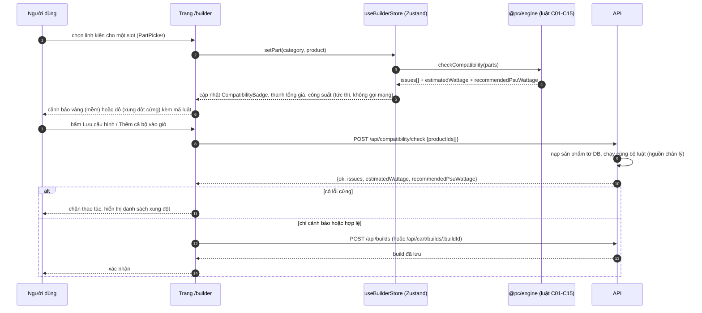

# CH1 — Chương 1 - Giới thiệu

Sinh tự động bởi `pnpm graph` — tư liệu thô để viết báo cáo, không sửa tay (sửa ở node tương ứng).

## Dàn ý chương

**Nội dung cần viết:**
1. **Đặt vấn đề** - rào cản kỹ thuật khi tự lắp PC (socket, chuẩn RAM, công suất nguồn, nghẽn cổ chai), website thương mại điện tử truyền thống chỉ bán lẻ từng linh kiện (phiếu giao nhiệm vụ, mục 3.5).
2. **Mục tiêu và phạm vi** - 5 hạng mục: AI PC Advisor, Optimization Engine, Interactive Customizer, thương mại điện tử D2C, Admin Portal; ngoài phạm vi: marketplace nhiều người bán, vận chuyển thật, app mobile, fine-tune model.
3. **Định hướng giải pháp** - chuyển bài toán thành CSP + MCKP; LLM chỉ điều phối; chế độ dự phòng.
4. **Đóng góp chính** - xem các tính năng gắn nhãn CH1 dưới đây.
5. **Bố cục báo cáo.**

**Nguồn trong graph:** các tính năng nổi bật (CH1), `docs/superpowers/specs/2026-11-07-pc-builder-design.md` §1.

**Liên hệ phiếu giao nhiệm vụ:** Nội dung 1, tuần 1-3.

Tổng cộng **4** node thuộc chương này.

## Tính năng

### F-AI-ADVISOR — AI PC Advisor: chatbot Gemini điều phối Engine qua function calling

Trạng thái: **done**
Liên kết — realizes: FR-07, UC-03, NFR-02, NFR-05 · dependsOn: M-CHAT, M-CHAT-LLM, F-ENGINE-CORE, F-FALLBACK-NLU, F-RECOMMEND, E-CHAT-SESSION, E-CHAT-MESSAGE · decidedBy: ADR-003, ADR-004, ADR-005, ADR-018, ADR-019 · shownIn: SCR-ADVISOR, SCR-HOME, SCR-ADMIN-CHATLOGS

**Mục đích:** tính năng nổi bật của hệ thống - người dùng nói nhu cầu bằng tiếng Việt, nhận cấu hình thật trong kho thay vì tự học thuật ngữ phần cứng.

**Trạng thái:** đã xong cả API (module chat, 5 tool, luồng SSE, lưu hội thoại, đánh giá golden set) và giao diện web (`/advisor`, widget chat nổi; chi tiết ở SCR-ADVISOR). Đã chạy thử đầu-cuối ở chế độ dự phòng: "chơi game 25 triệu" → chip công cụ → 3 BuildCard → "Mở trong Customizer" nạp đủ 8 linh kiện không lỗi.

**Mô tả:** API `POST /chat/sessions/:id/messages` trả luồng SSE. Orchestrator gửi 20 dòng lịch sử gần nhất và system prompt kèm 5 tool cho Gemini (`recommend_builds`, `search_products`, `get_product_details`, `check_compatibility`, `modify_build`). Khi model gọi tool, API chạy Engine/DB thật và trả về cho model bản tóm tắt gọn (id, nhãn, tổng giá, tên và giá linh kiện, phân bổ, cảnh báo - không kèm toàn bộ thông số); thẻ cấu hình được gửi riêng tới web qua sự kiện `builds` từ dữ liệu tool nên giá luôn đúng. `modify_build` giữ nguyên mọi linh kiện trừ danh mục cần đổi, giải lại bằng Engine; nếu giữ nguyên làm bài toán vô nghiệm thì thử lại và cho đổi thêm các linh kiện phụ thuộc (ví dụ đổi card thì được đổi nguồn, vỏ case) rồi báo rõ cho khách. Giới hạn 4 vòng tool mỗi lượt, timeout 20 giây, rate limit 10 tin/phút, cache kết quả gợi ý theo băm tham số 10 phút. Toàn bộ hội thoại và tool call được lưu để xem lại và phân tích.

**Quyết định chính:** ADR-003 chọn Gemini free tier với function calling; ADR-004 LLM chỉ điều phối, Engine quyết định; ADR-005 chế độ dự phòng khi Gemini không dùng được. Khai báo tool chỉ dùng tập con JSON Schema mà Gemini chấp nhận (bộ lọc thông số của `search_products` là danh sách cặp `{key, value}` thay vì object tự do), có unit test kiểm tra.

**Kiểm tra giá phía server:** sau mỗi lượt ở chế độ AI, `price-check.ts` trích các số tiền VND trong câu trả lời và so với các số tool đã trả về; số không khớp được lưu vào `chat_messages.price_check` và log cảnh báo, văn bản giữ nguyên (giám sát, không chặn; xem NFR-05). Eval có thêm chỉ số "price-mention mismatch rate", chỉ có giá trị ở chế độ AI.

**Điểm nhấn cho báo cáo (CH5):** kiến trúc chống ảo giác (guardrails: giá trên thẻ cấu hình được bảo đảm từ DB/Engine, văn bản tự do được ràng buộc bằng prompt và giám sát bằng bộ kiểm tra giá), so sánh với chatbot thuần LLM, kết quả golden-set 30 kịch bản (`apps/api/eval/results.md`). Lần chạy ở chế độ dự phòng (2026-11-07), chấm **nghiêm ngặt** theo kỳ vọng của trợ lý AI: gọi đúng tool **26/30**, tham số đúng 23/25, sở thích 9/10, đạt mọi tiêu chí 26/30; 4 kịch bản trượt là 2 câu chỉnh cấu hình (luật dự phòng gọi lại `recommend_builds` thay vì `modify_build`) và 2 câu hỏi sản phẩm (dự phòng hỏi lại thay vì `search_products`). Nếu chấm theo khả năng thiết kế của chế độ luật (`fallbackExpect`) thì đạt 30/30. Ở cả hai cách chấm, 69/69 cấu hình trả về đều hợp lệ khi kiểm tra lại bằng bộ luật C01–C15 và ngân sách; độ trễ p50 10 ms / p95 22 ms.

**Sự kiện SSE và dự phòng:** luồng gồm `session` (id phiên), `token` (từng đoạn văn bản), `tool` (`start`/`end` kèm nhãn tiếng Việt, web hiện thành chip), `builds` và `products` (thẻ dữ liệu thật lấy từ kết quả tool, không từ lời model), `error` và `done` (kèm `messageId` và `mode`). Gemini hết quota (429), quá thời gian (20 giây), thiếu khóa hoặc trả rỗng thì orchestrator chuyển sang NLU luật (ADR-005, ADR-018) ngay trong cùng lượt: chữ đã phát vẫn giữ, phần dự phòng nối thêm sau một dòng trống, kết thúc `done{mode:'FALLBACK'}`; không phát `error`. Khách đóng kết nối thì hủy cả lượt (không chuyển dự phòng). Chỉ chủ phiên được gửi tin (STAFF/ADMIN chỉ đọc, nhật ký ở SCR-ADMIN-CHATLOGS); 10 tin/phút và 10 phiên mới/phút.

**Kiểm thử:** phía API có hơn 240 test cho module chat (đơn vị, tích hợp có DB và Redis thật), toàn bộ API 529 test và web 166 test (số liệu của Lead khi tích hợp, gồm cả store chat và trình đọc SSE). Cách chấm golden set và hai mức điểm nằm ở ADR-019.

**Hạn chế cần nêu trong báo cáo:** bộ golden set do chính người phát triển viết khi đã biết phạm vi của NLU dự phòng và không mang tính đối kháng, nên điểm chế độ dự phòng là cận trên chứ không phải độ chính xác trên câu hỏi thật; chỉ 30 kịch bản, một lần chạy, trên catalog dev. Hãy dẫn con số nghiêm ngặt (26/30). Kết quả chế độ Gemini thật cần khóa API: chạy `eval/smoke-gemini.ts` rồi `eval:ai`.

**Code:** `apps/api/src/modules/chat/**`, `apps/web/src/features/advisor/**`, `apps/web/src/stores/chat.ts`, `apps/web/src/components/ChatWidget.tsx`

**Test:** `apps/api/src/modules/chat/**/*.test.ts`, `apps/api/src/modules/chat/**/*.int.test.ts`, `apps/api/eval/**`, `apps/web/src/features/advisor/**/*.test.ts`, `apps/web/src/stores/chat.test.ts`

**Sơ đồ:** `docs/diagrams/seq-ai-advisor.mmd`

```mermaid
sequenceDiagram
  autonumber
  participant U as Người dùng
  participant W as Web (ChatWidget, /advisor)
  participant A as API /chat (controller + orchestrator)
  participant G as Gemini
  participant T as ToolRegistry (5 tool)
  participant E as Engine / services
  participant DB as Postgres / Redis
  U->>W: "chơi game 2K, 25 triệu, thích AMD"
  W->>A: POST /api/chat/sessions/:id/messages (SSE)
  A->>DB: body 422 > phiên 404/403 (chỉ chủ phiên được gửi) > rate-limit 10 tin/phút (429 + Retry-After)
  A->>DB: nạp 20 dòng lịch sử gần nhất, lưu tin nhắn user, đọc ý định trước (chat:intent)
  A-->>W: event: session {sessionId, mode}
  alt Có GEMINI_API_KEY và Gemini phản hồi
    loop tối đa 4 vòng tool
      A->>G: lịch sử + system prompt + khai báo tool
      G-->>A: functionCall (recommend_builds, search_products, get_product_details, check_compatibility, modify_build)
      A-->>W: event: tool {name, status: start, label}
      A->>T: run(tool, args)
      T->>E: solve / tìm kiếm catalog / check tương thích (Engine quyết định linh kiện và giá)
      E->>DB: ứng viên còn hàng (cache cache:candidates:v{n}), kết quả gợi ý (cache:reco:v{n}:{sha1})
      E-->>T: dữ liệu thật
      T-->>A: forModel (tóm tắt gọn) + events + buildIds
      A-->>W: event: builds hoặc products (thẻ render từ dữ liệu tool)
      A-->>W: event: tool {name, status: end, label}
      A->>G: functionResponse (không kèm toàn bộ specs)
    end
    G-->>A: stream lời giải thích tiếng Việt
    A-->>W: event: token ...
  else Không có khóa, 429, lỗi 5xx, hết 20 giây hoặc trả rỗng
    Note over A,W: chữ đã stream giữ nguyên, phần dự phòng nối sau một dòng trống, không phát event error
    A->>A: parseIntent: ngân sách, mục đích, độ phân giải, hãng, màu (NLU luật)
    alt Thiếu ngân sách hoặc mục đích
      A-->>W: event: token (một câu hỏi lại theo mẫu)
    else Ngân sách dưới mức tối thiểu hoặc vô nghiệm
      A-->>W: event: token (lý do và ngân sách tối thiểu khả thi, theo mẫu)
    else Đủ thông tin
      A-->>W: event: tool {recommend_builds, start}
      A->>T: recommend_builds(budget, purpose, preferences)
      T->>E: solve(request, candidates, weights)
      E-->>T: tối đa 3 cấu hình (Hiệu năng / Cân bằng / Tiết kiệm) + stats
      T-->>A: builds
      A-->>W: event: builds
      A-->>W: event: tool {recommend_builds, end}
      A-->>W: event: token (giải thích sinh từ dữ liệu tool theo mẫu, theo từng nhóm 4 từ)
    end
  end
  opt Khách đóng kết nối giữa chừng
    W--xA: close
    A->>A: AbortController hủy lượt, không chuyển sang dự phòng
  end
  A->>DB: một transaction: mỗi tool call một dòng chat_messages (tool_args, tool_result), dòng assistant (content, build_ids, mode, latency_ms), cập nhật chat_sessions.mode
  A-->>W: event: done {messageId, mode: AI hoặc FALLBACK}
  Note over A,W: lỗi không thuộc LLM: event error rồi done
```

### F-CUSTOMIZER — Interactive PC Customizer: lắp ráp tự do với kiểm tra tương thích tức thì

Trạng thái: **done**
Liên kết — realizes: FR-09, UC-05 · dependsOn: F-COMPAT-CHECK, M-WEB-STATE, M-ENGINE, F-CATALOG · decidedBy: ADR-001 · shownIn: SCR-BUILDER

**Mục đích:** cho người đã biết mình muốn gì tự lắp từng linh kiện nhưng vẫn được bảo vệ khỏi chọn sai.

**Mô tả:** trang `/builder` có 8 slot linh kiện; chọn linh kiện qua `PartPicker` (drawer có lọc). Mỗi lần đổi, trang chạy bộ luật của `@pc/engine` (`checkCompatibility`) ngay trên trình duyệt để cập nhật huy hiệu tương thích, tổng giá và công suất mà không gọi mạng; ngay trong PartPicker, từng sản phẩm được xem trước tương thích và món xung đột bị làm mờ kèm mã luật. Khi lưu hoặc thêm vào giỏ, server kiểm tra lại trong `POST /builds` (lỗi cứng → 422 INCOMPATIBLE kèm danh sách luật). Luật cân bằng CPU–GPU (C13) cần toàn bộ danh mục để xếp bậc nên chỉ server tính. Nút "Mở trong Customizer" nhận cấu hình từ chatbot hoặc form qua `/builder?build=<id>`.

**Quyết định chính:** chạy cùng một bộ luật ở client và server (ADR-001) - phản hồi tức thì nhưng server vẫn là nguồn chân lý.

**Code:** `apps/web/src/features/builder/**`, `apps/web/src/stores/builder.ts`, `apps/web/src/app/*/builder/**`

**Test:** `apps/web/src/features/builder/**/*.test.ts`, `apps/web/src/stores/builder.test.ts`

**Sơ đồ:** `docs/diagrams/seq-customizer-check.mmd`

### F-ENGINE-CORE — Optimization Engine: bộ giải CSP + MCKP thuần TypeScript

Trạng thái: **done**
Liên kết — realizes: FR-08, FR-09, NFR-01, NFR-08 · dependsOn: M-ENGINE, ALG-CSP, ALG-AC3, ALG-FC, ALG-BNB, ALG-MCKP, ALG-SCORING, ALG-TOPK, F-COMPAT-CHECK · decidedBy: ADR-001, ADR-004, ADR-012, ADR-013, ADR-014, ADR-020

**Mục đích:** là lõi học thuật của đề tài: biến bài toán "chọn linh kiện tương thích và tối ưu hiệu năng trong ngân sách" thành bài toán CSP kết hợp MCKP và giải bằng tìm kiếm có cắt tỉa, kèm chứng minh thực nghiệm rằng kết quả là tối ưu.

**Mô tả:** Engine là package thuần (không I/O, không phụ thuộc DB) nhận danh sách ứng viên còn hàng và yêu cầu (ngân sách, mục đích, sở thích, linh kiện cố định, linh kiện loại trừ, `topK`, chiến lược) rồi trả về tối đa 3 cấu hình có nhãn Hiệu năng / Cân bằng / Tiết kiệm (ADR-020), kèm điểm theo danh mục, tỉ lệ phân bổ ngân sách, công suất ước tính, cảnh báo và thống kê (số nút duyệt, số giá trị bị loại bởi dominance, AC-3, forward checking, cận; cờ `capped`; thời gian). Khi vô nghiệm trả lý do (`BUDGET_TOO_LOW` kèm ngân sách tối thiểu, `FIXED_PART_CONFLICT`, `NO_COMPATIBLE_COMBINATION`, `SEARCH_LIMIT`). Cùng bộ luật C01-C15 chạy ở server (nguồn chân lý), trong Engine và ở client (Customizer).

**Cấu trúc (phẳng, một file mỗi mối quan tâm):** `rules.ts` (15 hàm luật thuần và hàm công suất), `compatibility.ts` (`checkCompatibility`), `scoring.ts` và `profiles.ts` (ALG-SCORING), `domains.ts` (mô hình bài toán, dominance), `ac3.ts`, `search.ts` (quay lui, forward checking, B&B), `topk.ts` (hợp đồng nhãn), `bruteforce.ts`, `solver.ts` (`solve`, `solveWithOptions` cho bench), `index.ts` (API công khai). Sơ đồ ở `class-engine.mmd`.

**Quyết định chính:** ADR-001 tách thành package riêng để test độc lập và dùng chung web/api; ADR-004 Engine quyết định linh kiện, LLM chỉ điều phối. Các quyết định rút ra trong quá trình phát triển: chấm theo mức đủ dùng (ADR-012), hệ số CUDA (ADR-013), luật mềm C15 (ADR-014), hợp đồng nhãn và thứ tự biến theo mục tiêu (ADR-020).

**Số liệu cho báo cáo (nguồn: báo cáo task 3 §3 và §5, `bench/results.md`; Apple M3, Node 22, hạt giống 7):**
- **175 test, phủ nhánh 98,85%** (691/699), phủ câu lệnh 99,51%, hàm 99,44%, dòng 99,63%. NFR-08 yêu cầu tối thiểu 90%.
- **Hiệu năng `full`:** p95 **11,5 ms** ở catalog 250 sản phẩm (221 còn hàng) và **40,3 ms** ở 500 sản phẩm (NFR-01: 300 ms). Mean nút duyệt 8.937 và 16.775.
- **So sánh 4 chiến lược** (kịch bản văn phòng 20 triệu, game 25 triệu, đồ họa 40 triệu, AI 60 triệu; 25 lần chạy cho `full`, 3 lần cho mỗi chiến lược vét cạn; trần 2.000.000 nút): ở 250 và 500 sản phẩm brute force, backtracking và forward checking đều chạm trần và không lần nào tìm được cấu hình có điểm bằng `full` (0/12). Cột "tối ưu" của bench lấy chính `full` làm mốc, nên dòng `full` không tự chứng minh được tính tối ưu; bằng chứng là phép kiểm tra tương đương bên dưới. Ở 50 sản phẩm cả bốn đều giải được (p95: brute force 57,1 ms, BT 5,9 ms, FC 9,9 ms, full 1,2 ms).
- **Kiểm tra tương đương (bằng chứng tối ưu):** `pnpm --filter @pc/engine bench:equivalence` so `full` với forward checking vét cạn (không giới hạn nút) trên catalog ngẫu nhiên đủ nhỏ để vét cạn chạy hết. Chạy lại ngày 2026-11-08: 1.080 ca (48 sản phẩm, 30 hạt giống) + 432 ca (72 sản phẩm, 12 hạt giống) = **1.512 ca, 0 sai khác**, 0 vi phạm hợp đồng nhãn (lần chạy ở task 3: 1.502 ca, 0 sai khác).
- **Seed thật** (240 sản phẩm, 213 còn hàng): mọi cấu hình đều tương thích, mỗi lần giải 2-14 ms.
- **Trung thực về AC-3:** AC-3 loại **gần như 0** giá trị trên dữ liệu tổng hợp (2 ở 50 sản phẩm, 0 ở 100 trở lên); mức tăng tốc đến từ cận LP của MCKP cùng thứ tự biến theo mục tiêu, không phải AC-3 (ADR-020). Ablation MRV: p95 1.896 ms so với 11,8 ms ở 250 sản phẩm.
- Không gian tìm kiếm của vét cạn: 1,69e8 (100 sản phẩm), 3,16e11 (250), 8,09e13 (500) tổ hợp.

**Hạn chế đã biết (cần nêu trong báo cáo):** dữ liệu benchmark và thông số của seed là giá trị tham chiếu gần đúng; `tdpW` của CPU là TDP cơ sở nên luật C08 cỡ nguồn theo công suất cơ sở + 30% dự phòng, hơi lạc quan với CPU có công suất đỉnh (PL2) cao như Intel thế hệ 12-14 (thêm trường công suất đỉnh là hướng phát triển, xem R-C08); `commercialBoost` nhân thay vì cộng như công thức spec; điểm văn phòng không nhạy giá; cache điểm theo định danh mảng catalog nên không được sửa catalog tại chỗ.

**Code:** `packages/engine/src/**`

**Test:** `packages/engine/src/**/*.test.ts`, `packages/engine/bench/**`

**Sơ đồ:** `docs/diagrams/class-engine.mmd`

```mermaid
%% Mirrors packages/engine/src (flat files). Data types come from types.ts; the module classes group the exported functions of each file.
classDiagram
  class EngineProduct {
    +string id
    +CategoryKey category
    +string name
    +string brand
    +number price
    +number stock
    +AnySpecs specs
    +Benchmark benchmark?
    +number commercialBoost?
  }
  class SolveRequest {
    +number budget
    +Purpose purpose
    +Preferences preferences?
    +Record fixed?
    +string[] exclude?
    +number topK?
    +SolveStrategy strategy?
    +number nodeLimit?
  }
  class Build {
    +BuildLabel label
    +PartMap parts
    +number totalPrice
    +number score
    +Record scoreBreakdown
    +Record allocation
    +number estimatedWattage
    +number recommendedPsuWattage
    +CompatibilityIssue[] warnings
  }
  class SolveResult {
    +Build[] builds
    +SolveStats stats
    +InfeasibleReason infeasibleReason?
    +number minFeasibleBudget?
  }
  class SolveStats {
    +SolveStrategy strategy
    +number nodesExplored
    +number prunedByDominance?
    +number prunedByAc3
    +number prunedByForwardChecking
    +number prunedByBound
    +boolean capped?
    +number timeMs
  }
  class PurposeProfile {
    +Purpose purpose
    +Record weights
    +Record allocation
  }
  class CompatibilityIssue {
    +RuleCode code
    +severity error or warning
    +string message
    +CategoryKey[] categories
  }
  class CompatibilityReport {
    +CompatibilityIssue[] issues
    +number estimatedWattage
    +number recommendedPsuWattage
  }
  class CompatibilityContext {
    +Purpose purpose?
    +number budget?
    +EngineProduct[] catalog?
  }
  class SolveStrategy {
    <<enumeration>>
    bruteforce
    backtracking
    forwardChecking
    full
  }
  class InfeasibleReason {
    <<enumeration>>
    BUDGET_TOO_LOW
    NO_COMPATIBLE_COMBINATION
    FIXED_PART_CONFLICT
    SEARCH_LIMIT
  }

  class rules_ts["rules.ts"] {
    <<module>>
    +RULES one pure function per rule C01 to C15
    +PAIR_RULES hard binary rules per category pair
    +pairCompatible(codes, parts) boolean
    +estimateWattage(tdp, tgp) number
    +minPsuWattage(estimated) number
    +recommendedPsuWattage(estimated) number
    +lacksPsuHeadroom(wattage, estimated) boolean
    +isEntryChipset(chipset) boolean
    +isHighClassCpu(cpu, catalog) boolean
  }
  class compatibility_ts["compatibility.ts"] {
    <<module>>
    +checkCompatibility(parts, ctx) CompatibilityReport
  }
  class scoring_ts["scoring.ts"] {
    <<module>>
    +scoreProduct(product, purpose, catalog) number
    +createScorer(catalog, purpose) Scorer
    +ecosystemFactor(product, purpose, prefs) number
    +cpuGpuTier(product, catalog) Tier
    +CUDA_ECOSYSTEM_FACTOR Record
  }
  class profiles_ts["profiles.ts"] {
    <<module>>
    +DEFAULT_PROFILES Record
    +profileForRequest(profile, prefs) PurposeProfile
  }
  class domains_ts["domains.ts"] {
    <<module>>
    +buildProblem(req, catalog, profile) Problem
    +initialDomains(problem) number[][]
    +compatible(problem, a, i, b, j) boolean
    +psuSufficient(problem, cpu, gpu, psu) boolean
    +softPenalty(problem, idx) number
    +exactScore(problem, idx) number
    +exactPrice(problem, idx) number
    +pruneDominated(problem, domains) number
  }
  class ac3_ts["ac3.ts"] {
    <<module>>
    +ac3(problem, domains) Ac3Result
  }
  class search_ts["search.ts"] {
    <<module>>
    +search(problem, initial, cfg) SearchResult
    +search uses forward checking and a MCKP LP bound
  }
  class bruteforce_ts["bruteforce.ts"] {
    <<module>>
    +bruteForce(problem, domains, onLeaf, nodeLimit) BruteForceResult
  }
  class topk_ts["topk.ts"] {
    <<module>>
    +labelRoles(candidates) LabelledCandidate[]
    +selectDiverse(candidates) LabelledCandidate[]
    +CandidatePool per cpu-gpu Pareto fronts
    +BUDGET_SCORE_RATIO 0.85
  }
  class solver_ts["solver.ts"] {
    <<module>>
    +solve(req, catalog, profile) SolveResult
    +solveWithOptions(req, catalog, profile, options) SolveResult
    +DEFAULT_NODE_LIMIT 2000000
  }

  solver_ts ..> SolveRequest : nhận
  solver_ts ..> EngineProduct : miền giá trị
  solver_ts ..> PurposeProfile : trọng số MCKP
  solver_ts --> SolveResult : trả về
  solver_ts --> domains_ts : dựng bài toán CSP, dominance
  solver_ts --> ac3_ts : tiền xử lý (full)
  solver_ts --> search_ts : quay lui, FC, B&B
  solver_ts --> bruteforce_ts : chiến lược vét cạn
  solver_ts --> topk_ts : gán nhãn top-3
  domains_ts --> rules_ts : ma trận tương thích từ hàm luật
  domains_ts --> scoring_ts : giá trị MCKP, hệ số CUDA
  domains_ts --> profiles_ts : trọng số theo mục đích
  ac3_ts --> domains_ts
  search_ts --> domains_ts
  compatibility_ts --> rules_ts : chạy C01..C15
  compatibility_ts --> CompatibilityReport
  rules_ts --> CompatibilityIssue
  CompatibilityReport "1" o-- "*" CompatibilityIssue
  CompatibilityContext ..> compatibility_ts : tùy chọn
  SolveResult "1" o-- "*" Build
  SolveResult "1" *-- "1" SolveStats
  SolveResult ..> InfeasibleReason
  SolveRequest ..> SolveStrategy
  Build "1" o-- "*" EngineProduct : parts
  Build "1" o-- "*" CompatibilityIssue : warnings
```

### F-RECOMMEND — Gợi ý cấu hình theo form (ngân sách, mục đích, tùy chọn)

Trạng thái: **done**
Liên kết — realizes: FR-08, UC-04, NFR-01 · dependsOn: M-RECOMMENDATION, F-ENGINE-CORE, E-PURPOSE-WEIGHT, E-BUILD · decidedBy: ADR-004, ADR-013, ADR-015, ADR-020 · shownIn: SCR-HOME, SCR-ADVISOR, SCR-ADVISOR-FORM

**Mục đích:** cho người dùng không muốn chat vẫn nhận 2-3 cấu hình tối ưu chỉ với một form ngắn.

**Mô tả:** `POST /recommendations` nhận `{budget, purpose, preferences}`, nạp ứng viên còn hàng (cache Redis 5 phút theo phiên bản catalog `cache:candidates:v{n}`), nạp ma trận trọng số từ bảng `purpose_weights` (thiếu thì dùng mặc định của Engine), gọi Engine và lưu các cấu hình thành `builds` (nguồn FORM; chatbot gọi cùng service với nguồn CHAT). Kết quả cache 10 phút theo băm của request đã chuẩn hóa tại `cache:reco:v{n}:{sha1}`, header `X-Cache` cho biết trúng hay trượt; lần gọi lặp lại trả đúng các build đã lưu. Khi admin đổi giá, tồn kho hay trọng số, phiên bản catalog tăng nên mọi cache cũ tự vô hiệu. Nếu không khả thi, trả HTTP 200 với lý do (ngân sách quá thấp, không có tổ hợp tương thích, linh kiện cố định xung đột) kèm ngân sách tối thiểu khả thi.

**Khóa cache và giới hạn tần suất:** khóa kết quả gồm yêu cầu đã chuẩn hóa, nguồn tạo build (FORM hoặc CHAT) và chủ sở hữu, để một lần trúng cache không đưa build của người này sang người khác (ADR-015). Kết quả `SEARCH_LIMIT` không được cache. Endpoint giới hạn 20 lần/phút theo người dùng, theo cookie khách hoặc theo IP (Redis `MULTI INCR/EXPIRE`, trả `429 RATE_LIMITED` kèm `Retry-After`).

**Điểm nhấn cho báo cáo:** các cấu hình trả về mang nhãn Hiệu năng / Cân bằng / Tiết kiệm theo hợp đồng nhãn của Engine (ADR-020); với mục đích AI hoặc đồ họa, GPU NVIDIA được ưu tiên bằng hệ số CUDA trừ khi người dùng chọn hãng khác (ADR-013).

**Trạng thái:** API xong và có test tích hợp. Giao diện: biểu mẫu gợi ý (ngân sách, mục đích, tùy chọn) trên trang `/advisor` (`apps/web/src/features/advisor`) gọi `POST /recommendations` và hiển thị 2-3 thẻ cấu hình, mở được trong Customizer. Biểu mẫu này được bổ sung ở đợt sửa cuối (2026-11-08); trước đó chatbot gọi cùng service qua tool `recommend_builds` nhưng chưa có giao diện nào gọi trực tiếp endpoint.

**Code:** `apps/api/src/modules/recommendation/**`, `apps/web/src/features/advisor/**`

**Test:** `apps/api/src/modules/recommendation/**/*.test.ts`
