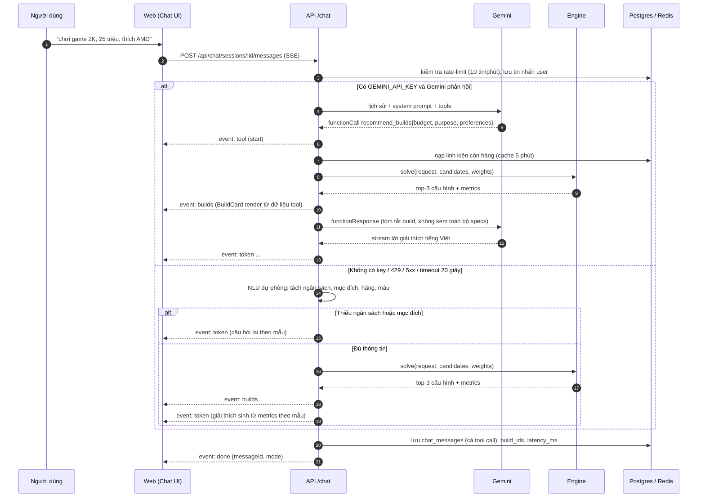
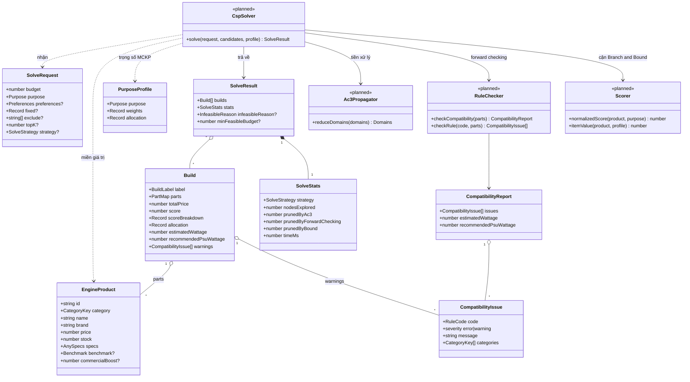

# CH1 — Chương 1 - Giới thiệu

Sinh tự động bởi `pnpm graph` — tư liệu thô để viết báo cáo, không sửa tay (sửa ở node tương ứng).

## Dàn ý chương

**Nội dung cần viết:**
1. **Đặt vấn đề** - rào cản kỹ thuật khi tự lắp PC (socket, chuẩn RAM, công suất nguồn, nghẽn cổ chai), website thương mại điện tử truyền thống chỉ bán lẻ từng linh kiện (phiếu giao nhiệm vụ, mục 3.5).
2. **Mục tiêu và phạm vi** - 5 hạng mục: AI PC Advisor, Optimization Engine, Interactive Customizer, thương mại điện tử D2C, Admin Portal; ngoài phạm vi: marketplace nhiều người bán, vận chuyển thật, app mobile, fine-tune model.
3. **Định hướng giải pháp** - chuyển bài toán thành CSP + MCKP; LLM chỉ điều phối; chế độ dự phòng.
4. **Đóng góp chính** - xem các tính năng gắn nhãn CH1 dưới đây.
5. **Bố cục báo cáo.**

**Nguồn trong graph:** các tính năng nổi bật (CH1), `docs/superpowers/specs/2026-11-07-pc-builder-design.md` §1.

**Liên hệ phiếu giao nhiệm vụ:** Nội dung 1, tuần 1-3.

Tổng cộng **4** node thuộc chương này.

## Tính năng

### F-AI-ADVISOR — AI PC Advisor: chatbot Gemini điều phối Engine qua function calling

Trạng thái: **planned**
Liên kết — realizes: FR-07, UC-03, NFR-02, NFR-05 · dependsOn: M-CHAT, M-CHAT-LLM, F-ENGINE-CORE, F-FALLBACK-NLU, F-RECOMMEND, E-CHAT-SESSION, E-CHAT-MESSAGE · decidedBy: ADR-003, ADR-004, ADR-005 · shownIn: SCR-ADVISOR, SCR-HOME, SCR-ADMIN-CHATLOGS

**Mục đích:** tính năng nổi bật của hệ thống - người dùng nói nhu cầu bằng tiếng Việt, nhận cấu hình thật trong kho thay vì tự học thuật ngữ phần cứng.

**Mô tả:** API `POST /chat/sessions/:id/messages` trả luồng SSE. Orchestrator gửi lịch sử và system prompt kèm 5 tool cho Gemini (`recommend_builds`, `search_products`, `get_product_details`, `check_compatibility`, `modify_build`). Khi model gọi tool, API chạy Engine/DB thật và trả kết quả tóm tắt về cho model; thẻ cấu hình được gửi riêng tới web từ dữ liệu tool nên giá luôn đúng. Giới hạn 4 vòng tool mỗi lượt, timeout 20 giây, rate limit 10 tin/phút, cache kết quả tool theo băm tham số 10 phút. Toàn bộ hội thoại và tool call được lưu để xem lại và phân tích.

**Quyết định chính:** ADR-003 chọn Gemini free tier với function calling; ADR-004 LLM chỉ điều phối, Engine quyết định; ADR-005 chế độ dự phòng khi Gemini không dùng được.

**Điểm nhấn cho báo cáo (CH5):** kiến trúc chống ảo giác (guardrails), so sánh với chatbot thuần LLM, kết quả golden-set 30 kịch bản.

**Code:** `apps/api/src/modules/chat/**`, `apps/web/src/features/advisor/**`

**Test:** `apps/api/src/modules/chat/**/*.test.ts`, `apps/api/src/modules/chat/**/*.int.test.ts`

**Sơ đồ:** `docs/diagrams/seq-ai-advisor.mmd`

### F-CUSTOMIZER — Interactive PC Customizer: lắp ráp tự do với kiểm tra tương thích tức thì

Trạng thái: **planned**
Liên kết — realizes: FR-09, UC-05 · dependsOn: F-COMPAT-CHECK, M-WEB-STATE, M-ENGINE, F-CATALOG · decidedBy: ADR-001 · shownIn: SCR-BUILDER

**Mục đích:** cho người đã biết mình muốn gì tự lắp từng linh kiện nhưng vẫn được bảo vệ khỏi chọn sai.

**Mô tả:** trang `/builder` có 8 slot linh kiện; chọn linh kiện qua `PartPicker` (drawer có lọc). Mỗi lần đổi, `useBuilderStore` chạy bộ luật của `@pc/engine` ngay trên trình duyệt để cập nhật huy hiệu tương thích, tổng giá và công suất mà không gọi mạng. Khi lưu hoặc thêm vào giỏ, server kiểm tra lại bằng `POST /compatibility/check`. Có nút "Mở trong Customizer" nhận cấu hình từ chatbot hoặc form.

**Quyết định chính:** chạy cùng một bộ luật ở client và server (ADR-001) - phản hồi tức thì nhưng server vẫn là nguồn chân lý.

**Code:** `apps/web/src/features/builder/**`

**Test:** `apps/web/src/features/builder/**/*.test.ts`, `e2e/customizer.spec.ts`

**Sơ đồ:** `docs/diagrams/seq-customizer-check.mmd`

### F-ENGINE-CORE — Optimization Engine: bộ giải CSP + MCKP thuần TypeScript

Trạng thái: **planned**
Liên kết — realizes: FR-08, FR-09, NFR-01, NFR-08 · dependsOn: M-ENGINE, ALG-CSP, ALG-AC3, ALG-FC, ALG-BNB, ALG-MCKP, ALG-SCORING, ALG-TOPK, F-COMPAT-CHECK · decidedBy: ADR-001, ADR-004

**Mục đích:** là lõi học thuật của đề tài - biến bài toán "chọn linh kiện tương thích và tối ưu hiệu năng trong ngân sách" thành bài toán CSP kết hợp MCKP và giải bằng thuật toán tìm kiếm có cắt tỉa.

**Mô tả:** Engine là package thuần (không I/O) nhận danh sách ứng viên còn hàng + yêu cầu (ngân sách, mục đích, tùy chọn, linh kiện cố định) và trả về tối đa 3 cấu hình kèm điểm, phân bổ ngân sách, công suất ước tính, cảnh báo và số liệu thống kê (số nút duyệt, số nhánh bị cắt bởi AC-3/FC/bound, thời gian). Cùng bộ luật tương thích C01-C14 được dùng ở server (nguồn chân lý) và ở client (kiểm tra tức thì trong Customizer).

**Quyết định chính:** ADR-001 tách thành package riêng để test độc lập và dùng chung FE/BE; ADR-004 Engine là bên quyết định linh kiện, LLM chỉ điều phối.

**Đánh giá:** harness `bench` chạy 4 biến thể (brute force giới hạn, backtracking, +FC, +AC-3 và B&B) trên catalog 50/100/250/500 sản phẩm - bảng số liệu cho chương 4.

**Code:** `packages/engine/src/**`

**Test:** `packages/engine/src/**/*.test.ts`, `packages/engine/bench/**`

**Sơ đồ:** `docs/diagrams/class-engine.mmd`

### F-RECOMMEND — Gợi ý cấu hình theo form (ngân sách, mục đích, tùy chọn)

Trạng thái: **planned**
Liên kết — realizes: FR-08, UC-04, NFR-01 · dependsOn: M-RECOMMENDATION, F-ENGINE-CORE, E-PURPOSE-WEIGHT, E-BUILD · decidedBy: ADR-004 · shownIn: SCR-HOME, SCR-ADVISOR

**Mục đích:** cho người dùng không muốn chat vẫn nhận 2-3 cấu hình tối ưu chỉ với một form ngắn.

**Mô tả:** `POST /recommendations` nhận `{budget, purpose, preferences}`, nạp ứng viên còn hàng (cache Redis 5 phút theo danh mục), nạp ma trận trọng số từ bảng `purpose_weights`, gọi Engine và lưu các cấu hình thành `builds` (nguồn FORM). Kết quả cache theo băm của request trong 10 phút. Nếu không khả thi, trả lý do (ngân sách quá thấp, không có tổ hợp tương thích) kèm ngân sách tối thiểu khả thi.

**Code:** `apps/api/src/modules/recommendation/**`, `apps/web/src/features/recommend/**`

**Test:** `apps/api/src/modules/recommendation/**/*.int.test.ts`
