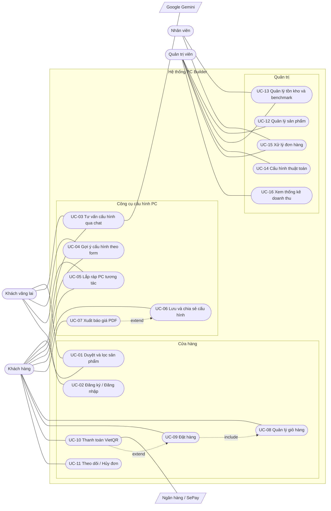

# CH2 — Chương 2 - Khảo sát và phân tích yêu cầu

Sinh tự động bởi `pnpm graph` — tư liệu thô để viết báo cáo, không sửa tay (sửa ở node tương ứng).

## Dàn ý chương

**Nội dung cần viết:**
1. **Khảo sát bài toán** - tương thích linh kiện và các hệ thống cấu hình PC tiêu biểu (cần tự bổ sung: các website cấu hình PC hiện có).
2. **Yêu cầu chức năng** - các node FR-xx; trích nguyên văn nguồn từ phiếu giao nhiệm vụ.
3. **Yêu cầu phi chức năng** - các node NFR-xx.
4. **Biểu đồ use case** - sơ đồ bên dưới và các node UC-xx (mô tả tác nhân, luồng chính, ngoại lệ).
5. **Bảng truy vết yêu cầu** - `docs/graph/out/traceability.md`.

**Liên hệ phiếu giao nhiệm vụ:** Nội dung 1 (tuần 1-3): khảo sát, phân tích yêu cầu chức năng/phi chức năng, biểu đồ use case.

**Sơ đồ:** `docs/diagrams/usecase-overview.mmd`

Tổng cộng **45** node thuộc chương này.

## Yêu cầu

### FR-01 — Duyệt danh mục linh kiện và lọc theo thông số kỹ thuật động

Trạng thái: **done**

**Nguồn:** phiếu giao nhiệm vụ mục 3.4 (duyệt danh mục linh kiện, xem thông số chi tiết) và mục 3.1 (JSONB + GIN).

Người dùng duyệt linh kiện theo 8 danh mục (CPU, Mainboard, RAM, GPU, ổ cứng, nguồn, case, tản nhiệt), tìm kiếm theo tên, lọc theo hãng, khoảng giá, còn hàng và theo **thông số kỹ thuật riêng của từng danh mục** (ví dụ socket = AM5, loại RAM = DDR5). Bộ lọc được sinh động từ `specSchema` của danh mục thay vì viết cứng, vì mỗi loại linh kiện có tập thuộc tính khác nhau.

Tiêu chí chấp nhận: lọc theo thông số trả kết quả đúng và dùng được chỉ mục GIN; có sắp xếp và phân trang.

### FR-02 — Xem chi tiết sản phẩm với bảng thông số và điểm benchmark

Trạng thái: **done**

**Nguồn:** phiếu giao nhiệm vụ mục 3.4 (xem thông số chi tiết).

Trang chi tiết hiển thị ảnh, giá (giá gốc / giá khuyến mại), tồn kho, bảng thông số kỹ thuật đầy đủ và điểm benchmark (CPU đơn nhân / đa nhân, điểm GPU) khi có. Trang được render phía server (SSR) để thân thiện SEO. Từ trang này người dùng thêm sản phẩm vào giỏ hoặc vào cấu hình đang lắp.

### FR-03 — Đăng ký, đăng nhập và phân quyền theo vai trò

Trạng thái: **done**

**Nguồn:** phiếu giao nhiệm vụ mục 3.2 (JWT, Role-based Access Control) và nội dung 2 (module Xác thực, Phân quyền).

Hệ thống có ba vai trò: khách hàng (CUSTOMER), nhân viên (STAFF) và quản trị (ADMIN). Người dùng đăng ký bằng email, đăng nhập nhận access token ngắn hạn và refresh token trong cookie httpOnly, có thể đăng xuất thật (thu hồi refresh token). Các API quản trị chỉ cho phép vai trò phù hợp. Khách chưa đăng nhập vẫn dùng được chatbot, customizer và giỏ hàng tạm.

### FR-04 — Giỏ hàng cho khách vãng lai và khách đã đăng nhập

Trạng thái: **done**

**Nguồn:** phiếu giao nhiệm vụ mục 3.4 (giỏ hàng) và mục 3.2 (Redis quản lý giỏ hàng tạm).

Giỏ hàng cho phép thêm, sửa số lượng, xóa sản phẩm và **thêm cả một cấu hình PC** (nhiều linh kiện cùng gắn một `buildId`). Khách vãng lai dùng giỏ lưu ở Redis theo `guestId` (7 ngày); khi đăng nhập giỏ tạm được gộp vào giỏ trong cơ sở dữ liệu.

### FR-05 — Đặt hàng linh kiện lẻ và đơn lắp ráp nguyên bộ

Trạng thái: **done**

**Nguồn:** phiếu giao nhiệm vụ mục 3.4 (đặt hàng; xử lý trọn vẹn vòng đời đơn hàng, linh kiện lẻ và đơn lắp ráp nguyên bộ) và nội dung 4.

Có hai loại đơn: RETAIL (linh kiện lẻ) và BUILD (nguyên bộ, cộng phí lắp ráp cấu hình qua biến môi trường). Giá luôn được tính lại ở server. Đơn đi theo máy trạng thái PENDING_PAYMENT → PAID → PROCESSING → SHIPPING → COMPLETED, có thể hủy trước khi giao. Khách xem được lịch sử đơn và tự hủy đơn chưa thanh toán.

### FR-06 — Thanh toán VietQR động và tự động xác nhận

Trạng thái: **done**

**Nguồn:** phiếu giao nhiệm vụ mục 3.2 (Cổng thanh toán VietQR động, tự động kiểm tra và xác nhận trạng thái thanh toán đơn hàng).

Mỗi đơn sinh một mã VietQR có đúng số tiền và nội dung chuyển khoản là mã đơn. Khi tiền về, webhook theo chuẩn SePay xác nhận đơn tự động (idempotent theo mã giao dịch). Trang thanh toán đếm ngược thời gian giữ hàng và tự cập nhật. Có nút giả lập thanh toán cho môi trường demo.

### FR-07 — AI PC Advisor: chatbot tiếng Việt tư vấn cấu hình bằng ngôn ngữ tự nhiên

Trạng thái: **done**

**Nguồn:** phiếu giao nhiệm vụ mục 3.4 (Smart PC Builder: người dùng nhập mong muốn, ngân sách, mục đích → đề xuất 2-3 cấu hình tối ưu), mở rộng theo spec §1 bằng hội thoại.

Người dùng chat tự nhiên ("chơi Valorant, edit video nhẹ, tầm 25 triệu, thích màu trắng"). Chatbot hiểu nhu cầu, hỏi lại khi thiếu thông tin, gọi Optimization Engine để chọn linh kiện **thật trong kho**, trả về 2-3 cấu hình kèm giải thích, cho sửa tiếp bằng hội thoại ("đổi sang card AMD", "bớt 3 triệu") rồi thêm cả bộ vào giỏ hoặc xuất PDF. LLM không bao giờ tự bịa linh kiện hay giá.

### FR-08 — Gợi ý 2-3 cấu hình tối ưu theo ngân sách và mục đích (Smart PC Builder)

Trạng thái: **done**

**Nguồn:** phiếu giao nhiệm vụ mục 3.1 (CSP, MCKP), 3.4 (Công cụ "Gợi ý cấu hình PC thông minh") và nội dung 4 (thuật toán Backtracking & Forward Checking).

Từ ngân sách tối đa và mục đích (Chơi game / Đồ họa / AI / Văn phòng) cùng tùy chọn (hãng, màu, Wi-Fi...), hệ thống tự phân bổ ngân sách, duyệt kho và đề xuất 2-3 cấu hình khác nhau (Tối ưu hiệu năng, Cân bằng, Tiết kiệm), đảm bảo tương thích phần cứng 100% và không vượt ngân sách. Có form nhập liệu độc lập với chatbot.

### FR-09 — Lắp ráp PC tương tác với kiểm tra tương thích thời gian thực

Trạng thái: **done**

**Nguồn:** phiếu giao nhiệm vụ mục 3.4 (Interactive PC Customizer) và nội dung 3-4 (bộ quy tắc Socket CPU-Mainboard, chuẩn RAM, công suất PSU, kích thước Case).

Người dùng tự chọn từng linh kiện vào 8 slot; hệ thống kiểm tra tức thì socket CPU, chuẩn RAM, công suất nguồn, kích thước case, chiều dài card đồ họa, tản nhiệt... và cảnh báo xung đột kèm mã luật. Kiểm tra chạy ngay trên client (cùng bộ luật với server) để phản hồi tức thì; server vẫn là nguồn chân lý khi lưu hoặc mua.

### FR-10 — Lưu và chia sẻ cấu hình PC

Trạng thái: **done**

Cấu hình (từ chatbot, form hoặc customizer) được lưu thành bản ghi `builds` kèm điểm hiệu năng, phân bổ ngân sách, công suất ước tính và cảnh báo. Mỗi cấu hình có đường dẫn chia sẻ `/builds/[id]` xem được không cần đăng nhập, có thể nhân bản để chỉnh sửa tiếp hoặc mua cả bộ.

### FR-11 — Xuất báo giá cấu hình dạng PDF

Trạng thái: **done**

**Nguồn:** phiếu giao nhiệm vụ mục 3.2 (tích hợp thư viện xuất báo giá cấu hình dạng file PDF chuyên nghiệp).

Từ một cấu hình hoặc giỏ hàng, người dùng tải file PDF báo giá gồm danh sách linh kiện, đơn giá, tổng tiền, công suất ước tính và thông tin cửa hàng. PDF dùng font hỗ trợ đầy đủ dấu tiếng Việt.

### FR-12 — Quản trị sản phẩm với form schema động (JSONB)

Trạng thái: **done**

**Nguồn:** phiếu giao nhiệm vụ mục 3.4 (Admin: Quản lý danh mục linh kiện với Form Schema động - PostgreSQL JSONB).

Admin thêm/sửa/ẩn sản phẩm; form nhập thông số được sinh từ `specSchema` của danh mục và dữ liệu được kiểm tra theo schema đó trước khi lưu vào cột JSONB `specs`. Admin cũng chỉnh được chính `specSchema` của danh mục. Sửa sản phẩm làm mất hiệu lực cache ứng viên của Engine.

### FR-13 — Quản trị tồn kho và bảng điểm benchmark

Trạng thái: **done**

**Nguồn:** phiếu giao nhiệm vụ mục 3.4 (theo dõi biến động tồn kho thời gian thực và bảng điểm benchmark phần cứng).

Admin/nhân viên nhập kho, điều chỉnh tồn và xem lịch sử biến động (`inventory_movements` với lý do IMPORT/ORDER/CANCEL/ADJUST). Điểm benchmark CPU/GPU được nhập và sửa trong trang riêng; đây là đầu vào của hàm chấm điểm Engine.

### FR-14 — Quản trị ma trận trọng số thuật toán và hệ số ưu tiên thương mại

Trạng thái: **done**

**Nguồn:** phiếu giao nhiệm vụ mục 3.4 (Quản lý Thuật toán Cấu hình: ma trận trọng số phân bổ ngân sách theo từng tác vụ và hệ số ưu tiên thương mại) và nội dung 6 (hiệu chỉnh trọng số theo phản hồi).

Admin chỉnh ma trận trọng số `w_purpose[category]` và khoảng phân bổ ngân sách gợi ý (min-max %) cho 4 mục đích, cùng hệ số `commercialBoost` của từng sản phẩm. Thay đổi có hiệu lực ngay ở lần gợi ý sau (xóa cache gợi ý).

### FR-15 — Quản trị đơn hàng và vòng đời đơn

Trạng thái: **done**

**Nguồn:** phiếu giao nhiệm vụ mục 3.4 (xử lý trọn vẹn vòng đời đơn hàng).

Admin/nhân viên xem danh sách đơn, lọc theo trạng thái, xem chi tiết và chuyển trạng thái theo máy trạng thái hợp lệ (PAID → PROCESSING → SHIPPING → COMPLETED). Chuyển trạng thái sai thứ tự bị từ chối; đơn đã thanh toán bị hủy cần hoàn tiền thủ công.

### FR-16 — Thống kê doanh thu và đối soát thanh toán

Trạng thái: **done**

**Nguồn:** phiếu giao nhiệm vụ mục 3.4 (đối soát thanh toán VietQR tự động và thống kê doanh thu).

Admin xem doanh thu và số đơn theo ngày/tuần/tháng trong khoảng thời gian chọn, và đối chiếu các giao dịch thanh toán (`payments`) với đơn hàng.

### FR-17 — Chế độ dự phòng của chatbot khi không dùng được Gemini

Trạng thái: **done**

**Nguồn:** spec §1 (thành công = hết quota hoặc mất mạng vẫn chạy được) và anti-goal "demo phụ thuộc hoàn toàn Gemini".

Khi không có API key, Gemini trả lỗi 429/5xx hoặc quá thời gian chờ, chatbot chuyển sang chế độ dự phòng: tách ngân sách, mục đích, hãng, màu từ câu tiếng Việt bằng luật, hỏi lại theo mẫu khi thiếu thông tin, gọi cùng Engine và giải thích bằng mẫu sinh từ số liệu. Giao diện hiện nhãn "Chế độ dự phòng".

### FR-18 — Chống bán vượt tồn kho khi đặt hàng đồng thời

Trạng thái: **done**

**Nguồn:** phiếu giao nhiệm vụ mục 3.1 (cơ chế xử lý giao dịch đồng thời) và 3.2 (Redis khóa tồn kho chống bán vượt).

Khi nhiều khách cùng đặt món cuối cùng, chỉ một người thành công. Hàng được giữ (`reserved`) 15 phút trong lúc chờ thanh toán; quá hạn hoặc hủy thì nhả hàng tự động. Không bao giờ để `stock - reserved` âm.

### NFR-01 — Hiệu năng của Optimization Engine: dưới 300 ms (p95) trên catalog khoảng 250 sản phẩm

Trạng thái: **done**

**Nguồn:** phiếu giao nhiệm vụ nội dung 5 (đánh giá thời gian phản hồi và hiệu năng của thuật toán gợi ý) và mục 3.1 (tối ưu hiệu năng truy vấn cho công cụ tương tác thời gian thực).

Engine giải xong trong dưới 300 ms ở phân vị 95 với catalog khoảng 250 sản phẩm. Có benchmark so sánh 4 biến thể (brute force giới hạn, backtracking, +forward checking, +AC-3 và Branch & Bound) trên catalog 50/100/250/500 sản phẩm để làm số liệu cho báo cáo.

### NFR-02 — Độ trễ hội thoại: một câu hỏi cho ra 3 cấu hình trong tối đa 8 giây

Trạng thái: **done**

**Nguồn:** spec §1 (tiêu chí thành công của buổi demo bảo vệ).

Từ lúc gửi tin nhắn đến lúc có 3 cấu hình hiển thị không quá 8 giây (kể cả gọi Gemini). Build card được hiển thị ngay khi Engine trả kết quả, trước khi lời giải thích kịp stream xong; có giới hạn 4 vòng gọi tool mỗi lượt và timeout Gemini 20 giây rồi chuyển dự phòng.

### NFR-03 — Bảo mật ứng dụng web và xác thực

Trạng thái: **done**

Mật khẩu băm bcrypt; JWT access 15 phút và refresh token lưu Redis để thu hồi; cookie httpOnly, SameSite=Lax, Secure ở production; helmet và CORS theo whitelist; giới hạn tần suất đăng nhập (5 lần/phút/IP) và chat (10 tin/phút); mọi đầu vào kiểm tra bằng Zod; truy vấn tham số hóa; không ghi log khóa hay mật khẩu; giá luôn tính lại ở server.

### NFR-04 — Tính sẵn sàng: hệ thống không phụ thuộc cứng vào dịch vụ AI bên ngoài

Trạng thái: **done**

Chatbot phải hoạt động khi dịch vụ Gemini không khả dụng (hết quota, mất mạng, không cấu hình khóa). Mọi chức năng cốt lõi (gợi ý cấu hình, customizer, mua hàng) hoạt động độc lập với Gemini.

### NFR-05 — Tính đúng đắn dữ liệu: AI không được bịa linh kiện hoặc giá

Trạng thái: **done**

**Nguồn:** spec §1 (anti-goal).

Yêu cầu được đáp ứng theo hai mức, và báo cáo cần phân biệt rõ:

1. **Được bảo đảm (bằng cấu trúc):** thẻ cấu hình (BuildCard) cùng giá từng linh kiện và tổng giá được dựng từ dữ liệu tool, tức là từ Engine và cơ sở dữ liệu, không từ văn bản LLM; nên giá hiển thị trên thẻ luôn khớp giá trong DB. Mọi cấu hình trả về đều tương thích 100% và nằm trong ngân sách (Engine kiểm tra, golden set kiểm lại 69/69).
2. **Được ràng buộc và giám sát (không bảo đảm):** văn bản tự do của LLM bị ràng buộc bằng system prompt (chỉ được nêu sản phẩm và giá lấy nguyên văn từ kết quả tool) và được **giám sát** bằng bộ kiểm tra giá phía server (`price-check.ts`): sau mỗi lượt ở chế độ AI, server trích các số tiền VND trong câu trả lời (`25.000.000₫`, `25 triệu`, `25tr`…) và so với tập số mà tool đã trả về (giá, tổng giá, ngân sách, `minFeasibleBudget`, số tiền suy ra từ tỷ lệ phân bổ, phần ngân sách còn dư, chênh lệch giữa các cấu hình; sai số ±1% hoặc làm tròn tới triệu). Số không khớp được ghi vào `chat_messages.price_check` và log cảnh báo; **văn bản không bị sửa hay chặn**, nên đây là giám sát chứ không phải bảo đảm.

**Hiện trạng đánh giá:** chế độ AI (Gemini) **chưa được đánh giá trực tiếp** vì chưa có khóa API; chỉ số "price-mention mismatch rate" trong `pnpm --filter @pc/api eval:ai` sẽ đo khi chạy với khóa. Hiệu chỉnh bộ trích số trên 33 câu trả lời của chế độ dự phòng (sinh từ dữ liệu tool, ngày 2026-11-08): 98 số tiền được trích, 2 bị gắn cờ, cả hai là số ví dụ "25 triệu" trong câu hỏi lại ngân sách (không phải giá), 0 trường hợp đọc sai số.

**Code:** `apps/api/src/modules/chat/price-check.ts`, `apps/api/src/modules/chat/prompts.ts`

**Test:** `apps/api/src/modules/chat/price-check.test.ts`

### NFR-06 — Giao diện tiếng Việt, đáp ứng đa kích thước màn hình và đạt WCAG AA

Trạng thái: **done**

Toàn bộ nội dung hiển thị bằng tiếng Việt; layout responsive từ 360 px đến 1440 px; độ tương phản đạt WCAG AA, focus rõ, tôn trọng `prefers-reduced-motion`; có skeleton loading và trạng thái rỗng/lỗi có hướng dẫn.

### NFR-07 — Đóng gói và triển khai bằng Docker trên máy chủ đám mây

Trạng thái: **done**

**Nguồn:** phiếu giao nhiệm vụ mục 3.2 (Đóng gói bằng Docker và Docker Compose, triển khai trên nền tảng máy chủ đám mây) và nội dung 6.

Hạ tầng dev (PostgreSQL, Redis) chạy bằng Docker Compose; bản production gồm web, api, postgres, redis và Caddy (HTTPS tự động) triển khai trên một VPS Ubuntu, có hướng dẫn triển khai.

### NFR-08 — Khả năng kiểm thử: Engine đạt tối thiểu 90% branch coverage

Trạng thái: **done**

**Nguồn:** phiếu giao nhiệm vụ mục 3.3 (viết Unit Test cho các quy tắc ràng buộc phần cứng, Integration Test cho luồng đặt hàng và thanh toán) và nội dung 5.

Engine là hàm thuần nên unit test từng luật C01-C15 (đúng/sai/biên), AC-3, forward checking, Branch & Bound; mục tiêu tối thiểu 90% branch coverage cho `packages/engine`. Có integration test cho các luồng đặt hàng - thanh toán trên Postgres/Redis thật và E2E cho 3 luồng cốt lõi.

### NFR-09 — Khả năng truy vết từ yêu cầu đến code và test (Spec-Code Graph)

Trạng thái: **done**

**Nguồn:** spec §1 và §8; mục tiêu "giảng viên hỏi chỗ này code ở đâu thì trả lời được".

Mọi yêu cầu truy vết được tới use case, tính năng, file code, test và chương báo cáo; công cụ `pnpm graph:check` báo lỗi khi liên kết hỏng hoặc node đã `done` mà không còn file tương ứng.

### NFR-10 — Nhất quán tiền tệ: số nguyên VND và định dạng vi-VN

Trạng thái: **done**

Mọi số tiền lưu và tính bằng số nguyên đồng (cột `bigint`, không dùng số thực); hiển thị bằng `Intl.NumberFormat('vi-VN')` kèm ký hiệu ₫ qua hàm `formatVnd` dùng chung cho cả web lẫn api.

### NFR-11 — Khả năng sử dụng: đánh giá bằng khảo sát người dùng thật (UAT, điểm SUS)

Trạng thái: **planned**

**Nguồn:** phiếu giao nhiệm vụ nội dung 6 (cung cấp công cụ cho người dùng và kỹ thuật viên lắp ráp thử nghiệm; thu thập phản hồi qua biểu mẫu khảo sát).

Thu thập phản hồi của người dùng và kỹ thuật viên lắp ráp bằng biểu mẫu khảo sát (thang SUS và mức hài lòng); dùng phản hồi để hiệu chỉnh trọng số thuật toán trước khi hoàn thiện báo cáo.

## Use case

### UC-01 — Duyệt và lọc sản phẩm

Trạng thái: **done**
Liên kết — realizes: FR-01, FR-02

**Tác nhân:** khách vãng lai, khách hàng.

**Luồng chính:** chọn danh mục → áp bộ lọc động (hãng, giá, thông số) → sắp xếp, phân trang → mở trang chi tiết xem bảng thông số và benchmark.

**Luồng thay thế:** không có kết quả → hiển thị trạng thái rỗng kèm gợi ý nới lọc.

### UC-02 — Đăng ký và đăng nhập

Trạng thái: **done**
Liên kết — realizes: FR-03

**Tác nhân:** khách vãng lai.

**Luồng chính:** đăng ký email + mật khẩu → đăng nhập → nhận access token và refresh token cookie → giỏ tạm được gộp vào giỏ tài khoản.

**Ngoại lệ:** sai mật khẩu, email trùng, vượt giới hạn 5 lần đăng nhập/phút.

### UC-03 — Tư vấn cấu hình qua chat với AI Advisor

Trạng thái: **done**
Liên kết — realizes: FR-07, FR-17

**Tác nhân:** khách vãng lai, khách hàng; hệ thống phụ: Gemini.

**Luồng chính:** mô tả nhu cầu bằng tiếng Việt → chatbot hỏi lại nếu thiếu ngân sách hoặc mục đích → nhận 2-3 cấu hình → yêu cầu chỉnh ("đổi sang card AMD", "bớt 3 triệu") → thêm cả bộ vào giỏ hoặc mở trong Customizer.

**Luồng thay thế:** Gemini lỗi hoặc không có khóa → chế độ dự phòng, vẫn trả cấu hình.

### UC-04 — Gợi ý cấu hình theo form

Trạng thái: **done**
Liên kết — realizes: FR-08

**Tác nhân:** khách vãng lai, khách hàng.

**Luồng chính:** trên trang `/advisor`, mở biểu mẫu gợi ý → nhập ngân sách, chọn mục đích và tùy chọn → nhận 2-3 cấu hình (`POST /recommendations`) kèm phân bổ ngân sách và điểm hiệu năng → lưu hoặc mở trong Customizer.

**Ngoại lệ:** ngân sách quá thấp → thông báo ngân sách tối thiểu khả thi.

### UC-05 — Lắp ráp PC tương tác

Trạng thái: **done**
Liên kết — realizes: FR-09

**Tác nhân:** khách vãng lai, khách hàng.

**Luồng chính:** chọn từng linh kiện cho 8 slot → thanh tương thích cập nhật tức thì → xem tổng giá và công suất → lưu hoặc thêm vào giỏ.

**Ngoại lệ:** có xung đột cứng → chặn lưu và hiển thị danh sách lỗi kèm mã luật.

### UC-06 — Lưu và chia sẻ cấu hình

Trạng thái: **done**
Liên kết — realizes: FR-10

**Tác nhân:** khách hàng, khách vãng lai.

**Luồng chính:** lưu cấu hình → nhận đường dẫn `/builds/[id]` → gửi người khác xem → nhân bản để chỉnh sửa.

### UC-07 — Xuất báo giá PDF

Trạng thái: **done**
Liên kết — realizes: FR-11

**Tác nhân:** khách hàng.

**Luồng chính:** từ trang cấu hình hoặc giỏ bấm "Xuất báo giá" → tải file PDF tiếng Việt có danh sách linh kiện, đơn giá, tổng tiền.

### UC-08 — Quản lý giỏ hàng

Trạng thái: **done**
Liên kết — realizes: FR-04

**Tác nhân:** khách vãng lai, khách hàng.

**Luồng chính:** thêm sản phẩm hoặc cả cấu hình → sửa số lượng, xóa → xem tạm tính.

**Ngoại lệ:** số lượng vượt tồn kho khả dụng bị từ chối.

### UC-09 — Đặt hàng

Trạng thái: **done**
Liên kết — realizes: FR-05, FR-18

**Tác nhân:** khách hàng.

**Luồng chính:** nhập thông tin giao hàng → hệ thống tính lại giá, giữ hàng 15 phút, tạo đơn PENDING_PAYMENT → chuyển sang thanh toán.

**Ngoại lệ:** có sản phẩm hết hàng → từ chối toàn bộ đơn (rollback), báo mặt hàng nào hết.

### UC-10 — Thanh toán đơn hàng bằng VietQR

Trạng thái: **done**
Liên kết — realizes: FR-06

**Tác nhân:** khách hàng; hệ thống phụ: ngân hàng/SePay.

**Luồng chính:** xem mã VietQR và đếm ngược → chuyển khoản → webhook xác nhận → trang tự chuyển sang "đã thanh toán".

**Luồng thay thế:** quá 15 phút chưa thanh toán → đơn tự hủy, nhả hàng. Môi trường demo dùng nút giả lập thanh toán.

### UC-11 — Theo dõi và hủy đơn hàng

Trạng thái: **done**
Liên kết — realizes: FR-05

**Tác nhân:** khách hàng.

**Luồng chính:** xem danh sách và chi tiết đơn, dòng thời gian trạng thái → hủy đơn khi còn PENDING_PAYMENT.

### UC-12 — Quản lý sản phẩm (admin)

Trạng thái: **done**
Liên kết — realizes: FR-12

**Tác nhân:** quản trị viên.

**Luồng chính:** chọn danh mục → form nhập thông số sinh động từ `specSchema` → lưu, ẩn/hiện sản phẩm; chỉnh `specSchema` của danh mục.

**Ngoại lệ:** thông số không đúng schema bị từ chối kèm thông báo theo từng trường.

### UC-13 — Quản lý tồn kho và benchmark

Trạng thái: **done**
Liên kết — realizes: FR-13

**Tác nhân:** quản trị viên, nhân viên.

**Luồng chính:** nhập kho hoặc điều chỉnh tồn có ghi lý do → xem lịch sử biến động → nhập/sửa điểm benchmark.

### UC-14 — Cấu hình thuật toán gợi ý

Trạng thái: **done**
Liên kết — realizes: FR-14

**Tác nhân:** quản trị viên.

**Luồng chính:** mở ma trận trọng số theo mục đích → sửa trọng số và khoảng phân bổ → lưu → chạy thử gợi ý để thấy kết quả thay đổi; đặt `commercialBoost` cho sản phẩm cần đẩy bán.

### UC-15 — Xử lý đơn hàng

Trạng thái: **done**
Liên kết — realizes: FR-15

**Tác nhân:** quản trị viên, nhân viên.

**Luồng chính:** lọc đơn theo trạng thái → xem chi tiết → chuyển PAID → PROCESSING (lắp ráp với đơn BUILD) → SHIPPING → COMPLETED.

**Ngoại lệ:** chuyển trạng thái không hợp lệ bị từ chối.

### UC-16 — Xem thống kê doanh thu

Trạng thái: **done**
Liên kết — realizes: FR-16

**Tác nhân:** quản trị viên.

**Luồng chính:** chọn khoảng thời gian và nhóm theo ngày/tuần/tháng → xem biểu đồ doanh thu, số đơn → đối soát giao dịch thanh toán.
