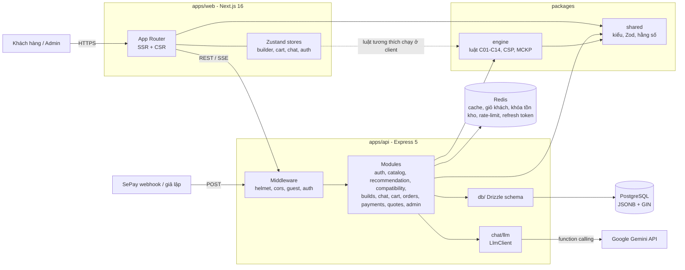

# CH3 — Chương 3 - Công nghệ sử dụng

Sinh tự động bởi `pnpm graph` — tư liệu thô để viết báo cáo, không sửa tay (sửa ở node tương ứng).

## Dàn ý chương

**Nội dung cần viết:** với mỗi công nghệ nêu: là gì, vì sao chọn, dùng ở đâu trong hệ thống.
- **Frontend:** Next.js 16 (App Router, SSR), TypeScript, Tailwind v4, Zustand, TanStack Query.
- **Backend:** Node.js + Express 5, Zod, Drizzle ORM, JWT.
- **Cơ sở dữ liệu và bộ nhớ đệm:** PostgreSQL 16 (JSONB, chỉ mục GIN), Redis 7.
- **AI:** Google Gemini (function calling, streaming).
- **Thanh toán, PDF:** VietQR/SePay, pdfkit.
- **Triển khai:** Docker, Docker Compose, Caddy.

**Nguồn trong graph:** các node ADR (decision) gắn nhãn CH3 - mỗi ADR đã có bối cảnh, quyết định, lý do và phương án đã cân nhắc.

**Liên hệ phiếu giao nhiệm vụ:** Nội dung 2 (tuần 3-5): nghiên cứu công nghệ, thiết kế biểu đồ tuần tự, khởi tạo dự án và Docker, mô-đun Xác thực JWT.

Tổng cộng **6** node thuộc chương này.

## Quyết định thiết kế

### ADR-001 — Monorepo pnpm với package engine thuần TypeScript

Trạng thái: **done**

**Bối cảnh:** hệ thống gồm web, api và một bộ giải thuật toán mà cả web (kiểm tra tương thích tức thì) lẫn api (nguồn chân lý) đều cần.

**Quyết định:** pnpm workspace gồm `apps/web`, `apps/api`, `packages/shared`, `packages/engine`, `tools/graph`. `packages/engine` là TypeScript thuần, không I/O.

**Lý do:** engine test độc lập, nhanh; dùng chung được ở frontend và backend nên một bộ luật duy nhất; kiểu và Zod schema ở `@pc/shared` giúp ba bên không lệch hợp đồng dữ liệu.

**Hệ quả:** cần quy ước ranh giới package rõ (engine không import api/web); dùng chung kiểu giữa hai bên đổi đồng bộ.

**Code:** `pnpm-workspace.yaml`, `packages/engine/package.json`, `packages/shared/package.json`

**Sơ đồ:** `docs/diagrams/component-architecture.mmd`

### ADR-002 — Express 5 + Zod + Drizzle ORM cho backend

Trạng thái: **done**

**Bối cảnh:** phiếu giao nhiệm vụ yêu cầu Node.js (TypeScript), RESTful API và PostgreSQL JSONB + GIN.

**Quyết định:** Express 5 cho HTTP, Zod kiểm tra mọi đầu vào ở route, Drizzle ORM cho truy cập dữ liệu.

**Lý do:** nhẹ, cấu trúc module rõ ràng; Drizzle cho phép viết SQL JSONB/GIN tường minh (phép chứa `specs @> ...` và khai báo chỉ mục GIN ngay trong schema), thuận lợi để trình bày trong báo cáo; kiểu suy ra từ schema nên TypeScript chặt chẽ.

**Phương án đã cân nhắc:** NestJS (nặng, nhiều trừu tượng không cần thiết); Prisma (hạn chế hỗ trợ chỉ mục GIN/JSONB và truy vấn tùy biến).

**Code:** `apps/api/package.json`, `apps/api/src/app.ts`, `apps/api/drizzle.config.ts`

### ADR-003 — Google Gemini qua @google/genai, model gemini-flash-latest cấu hình bằng biến môi trường

Trạng thái: **done**

**Quyết định:** dùng Gemini qua SDK `@google/genai` 2.x, model mặc định `gemini-flash-latest`, đổi được qua `GEMINI_MODEL`; timeout `GEMINI_TIMEOUT_MS`.

**Lý do:** có gói miễn phí (API key free tier) phù hợp đồ án, hỗ trợ function calling để điều phối Engine và streaming để hiển thị chữ chạy dần.

**Hệ quả:** quota miễn phí có giới hạn nên bắt buộc có chế độ dự phòng (ADR-005); truy cập qua giao diện `LlmClient` để test bằng LLM giả và đổi nhà cung cấp mà không đụng nghiệp vụ.

**Code:** `apps/api/src/modules/chat/llm/factory.ts`, `apps/api/src/config/env.ts`

### ADR-006 — JWT access token 15 phút và refresh token 7 ngày (cookie httpOnly, lưu Redis để thu hồi)

Trạng thái: **done**

**Quyết định:** access token JWT sống 15 phút (`ACCESS_TOKEN_TTL_SECONDS`); refresh token sống 7 ngày trong cookie `httpOnly; SameSite=Lax; Secure` (production) và đăng ký ở Redis theo khóa `rt:{userId}:{jti}`.

**Lý do:** đáp ứng RBAC theo phiếu giao nhiệm vụ và cho phép đăng xuất thật: xóa khóa Redis là thu hồi refresh token. Access token ngắn hạn giới hạn thiệt hại nếu bị lộ.

**Hệ quả:** client phải tự làm mới token khi gặp 401; `optionalAuth` coi token hết hạn như ẩn danh.

**Code:** `apps/api/src/middleware/auth.ts`, `apps/api/src/lib/redis.ts`

### ADR-008 — VietQR động qua img.vietqr.io và webhook chuẩn SePay kèm giả lập

Trạng thái: **done**

**Quyết định:** ảnh QR dựng bằng URL `img.vietqr.io` (số tiền và nội dung là mã đơn); xác nhận thanh toán qua webhook theo định dạng SePay (`Authorization: Apikey ...`, đối chiếu nội dung và số tiền, idempotent theo `provider_txn_id`); có nút giả lập cho dev/admin.

**Lý do:** miễn phí, không cần hợp đồng cổng thanh toán, vẫn thể hiện đúng yêu cầu "VietQR động, tự xác nhận" của phiếu giao nhiệm vụ và demo được.

**Hệ quả:** cấu hình ngân hàng qua `VIETQR_BANK_BIN`, `VIETQR_ACCOUNT_NO`, `VIETQR_ACCOUNT_NAME`, `SEPAY_API_KEY`; non-goal: không bắt buộc tích hợp ngân hàng thật.

**Code:** `apps/api/src/config/env.ts`, `packages/shared/src/dto.ts`

### ADR-009 — PDF báo giá dựng phía server bằng pdfkit và font DejaVu

Trạng thái: **done**

**Quyết định:** dựng PDF báo giá ở server bằng `pdfkit`, nhúng font DejaVu (gói `dejavu-fonts-ttf`).

**Lý do:** ổn định, không cần trình duyệt headless nặng nề; DejaVu hỗ trợ đầy đủ dấu tiếng Việt nên không vỡ chữ.

**Hệ quả:** bố cục PDF viết bằng mã (không dùng HTML/CSS) nên thay đổi giao diện báo giá tốn công hơn.

**Code:** `apps/api/package.json`
