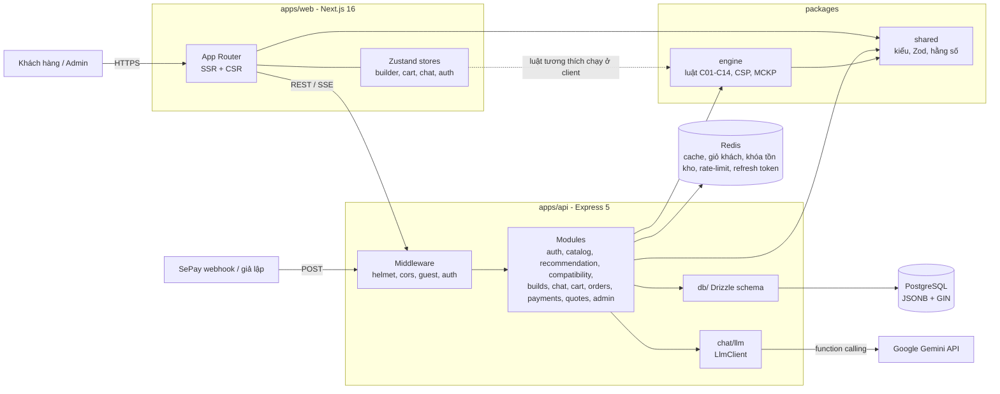
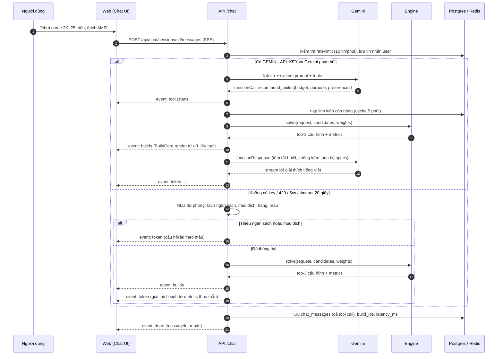
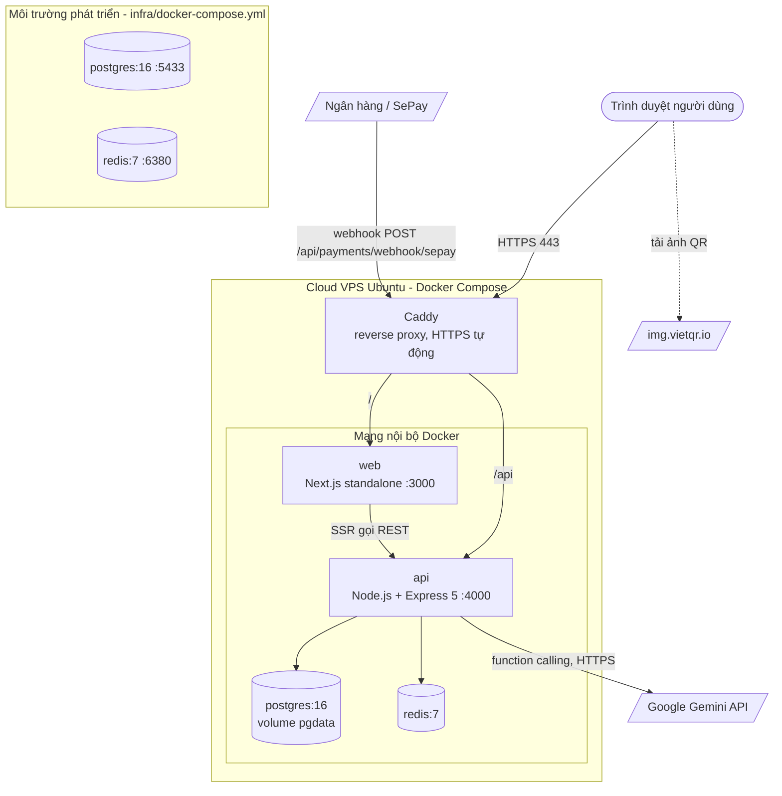
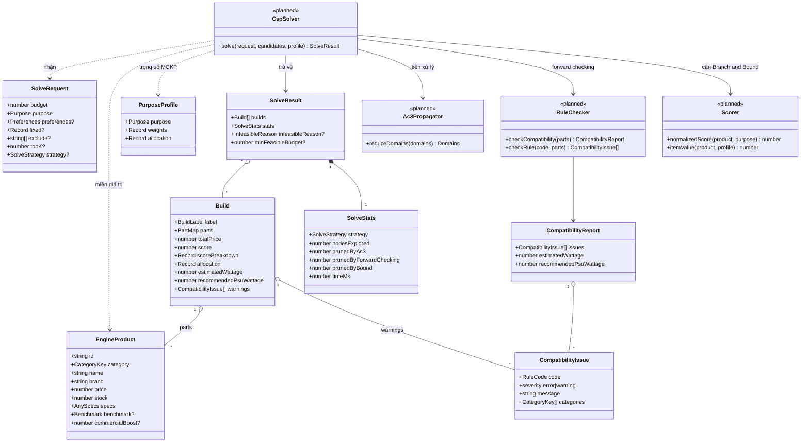
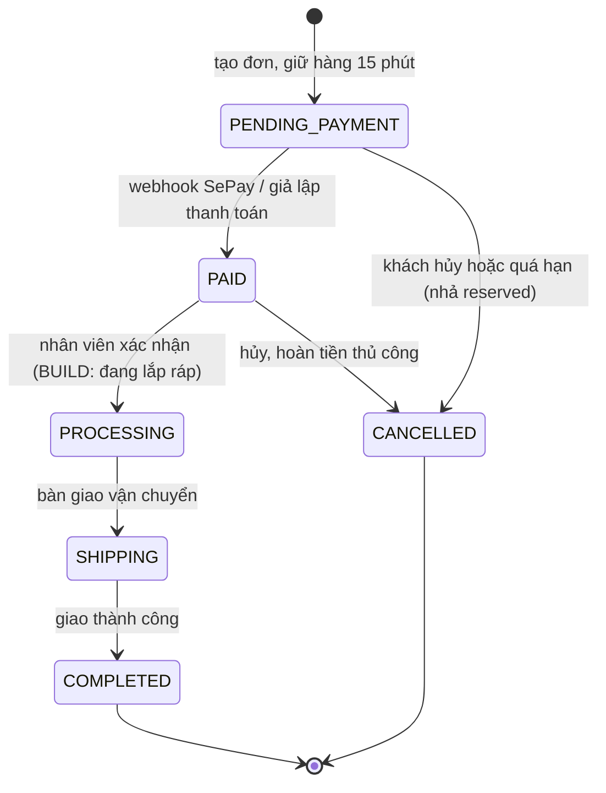
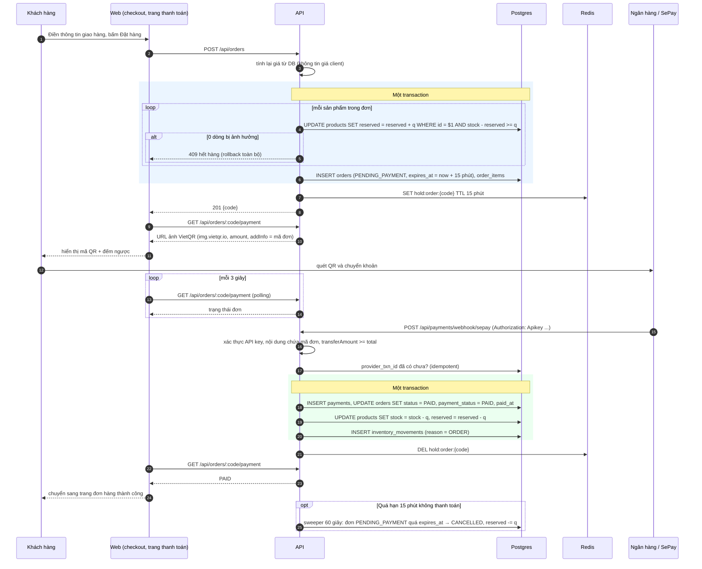
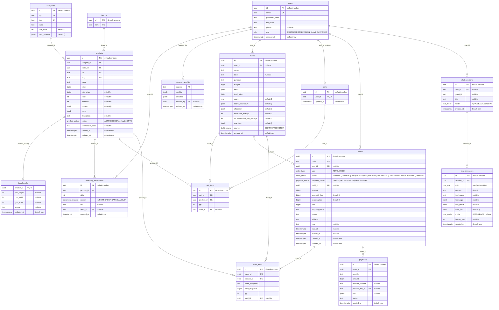

# CH4 — Chương 4 - Thiết kế, triển khai và đánh giá

Sinh tự động bởi `pnpm graph` — tư liệu thô để viết báo cáo, không sửa tay (sửa ở node tương ứng).

## Dàn ý chương

**Nội dung cần viết:**
1. **Thiết kế kiến trúc** - sơ đồ thành phần, monorepo, tầng module (xem sơ đồ kiến trúc bên dưới và ADR-001).
2. **Thiết kế cơ sở dữ liệu** - ERD (node M-DB) và mô tả từng bảng (các node E-xx).
3. **Thiết kế API** - các node API-xx, lỗi chuẩn.
4. **Thiết kế thuật toán** - mô hình CSP, bộ luật C01-C14, MCKP, chấm điểm (các node ALG-xx, R-Cxx; biểu đồ lớp Engine).
5. **Thiết kế luồng nghiệp vụ** - biểu đồ tuần tự AI Advisor, đặt hàng - VietQR, kiểm tra tương thích; máy trạng thái đơn.
6. **Thiết kế giao diện** - các node SCR-xx và hệ thống thiết kế.
7. **Triển khai** - từng tính năng (F-xx): mô tả, file code (`code:`), cách cài đặt.
8. **Kiểm thử và đánh giá** - các node T-xx; số liệu benchmark Engine, hiệu năng API, golden set AI, kết quả UAT.
9. **Triển khai thực tế** - Docker, VPS.

**Liên hệ phiếu giao nhiệm vụ:** Nội dung 1 (thiết kế kiến trúc, Class, ERD), Nội dung 3 (mô hình hóa CSP/MCKP, bộ quy tắc), Nội dung 4 (xây dựng, tuần 8-14), Nội dung 5 (thử nghiệm, tuần 15-16), Nội dung 6 (triển khai, tuần 16-17).

**Sơ đồ:** `docs/diagrams/component-architecture.mmd`

Tổng cộng **148** node thuộc chương này.

## Tính năng

### F-ADMIN-INVENTORY — Quản trị tồn kho và bảng benchmark

Trạng thái: **planned**
Liên kết — realizes: FR-13, UC-13 · dependsOn: M-ADMIN, E-INVENTORY-MOVEMENT, E-BENCHMARK, F-AUTH · shownIn: SCR-ADMIN-INVENTORY

**Mục đích:** theo dõi hàng trong kho theo thời gian thực và cung cấp dữ liệu hiệu năng cho Engine.

**Mô tả:** `POST /admin/inventory/:productId/adjust` thay đổi tồn kho và luôn ghi một dòng `inventory_movements` (người thực hiện, lý do, tham chiếu); trang tồn kho hiện số tồn, số đang giữ (`reserved`) và lịch sử. Bảng benchmark chỉnh điểm CPU đơn/đa nhân và điểm GPU, có trường nguồn dữ liệu.

**Code:** `apps/api/src/modules/admin/inventory/**`, `apps/web/src/features/admin/inventory/**`

**Test:** `apps/api/src/modules/admin/**/*.int.test.ts`

### F-ADMIN-ORDERS — Quản trị đơn hàng

Trạng thái: **planned**
Liên kết — realizes: FR-15, UC-15 · dependsOn: M-ADMIN, F-ORDER, F-AUTH · shownIn: SCR-ADMIN-ORDERS

**Mục đích:** xử lý đơn từ khi nhận tiền đến khi giao.

**Mô tả:** danh sách đơn có lọc theo trạng thái và loại; chuyển trạng thái qua `PATCH /admin/orders/:code/status`, dùng lại máy trạng thái của F-ORDER nên không thể nhảy bước. Đơn BUILD ở bước PROCESSING được hiểu là đang lắp ráp.

**Code:** `apps/api/src/modules/admin/orders/**`, `apps/web/src/features/admin/orders/**`

**Test:** `apps/api/src/modules/admin/**/*.int.test.ts`

### F-ADMIN-PRODUCTS — Quản trị sản phẩm với form schema động

Trạng thái: **planned**
Liên kết — realizes: FR-12, UC-12 · dependsOn: M-ADMIN, E-PRODUCT, E-CATEGORY, E-BRAND, F-AUTH · decidedBy: ADR-002 · shownIn: SCR-ADMIN-PRODUCTS

**Mục đích:** để chủ cửa hàng tự thêm và sửa linh kiện mà không cần lập trình.

**Mô tả:** form nhập thông số (`DynamicSpecForm`) sinh từ `specSchema` của danh mục; server kiểm tra `specs` theo cùng schema (specSchema validator) trước khi lưu. Admin chỉnh được `specSchema` qua `PUT /admin/categories/:id/schema`. Sửa sản phẩm xóa cache `cache:candidates:{category}`.

**Code:** `apps/api/src/modules/admin/products/**`, `apps/web/src/features/admin/products/**`

**Test:** `apps/api/src/modules/admin/**/*.int.test.ts`

### F-ADMIN-STATS — Thống kê doanh thu và đối soát thanh toán

Trạng thái: **planned**
Liên kết — realizes: FR-16, UC-16 · dependsOn: M-ADMIN, E-ORDER, E-PAYMENT, F-AUTH · shownIn: SCR-ADMIN-DASH

**Mục đích:** cho chủ cửa hàng thấy tình hình kinh doanh.

**Mô tả:** `GET /admin/stats/revenue?from&to&groupBy` gộp doanh thu và số đơn đã thanh toán theo ngày/tuần/tháng bằng SQL `date_trunc`; bảng đối soát liệt kê giao dịch `payments` cạnh đơn tương ứng.

**Code:** `apps/api/src/modules/admin/stats/**`, `apps/web/src/features/admin/dashboard/**`

**Test:** `apps/api/src/modules/admin/**/*.int.test.ts`

### F-ADMIN-WEIGHTS — Quản trị ma trận trọng số và hệ số ưu tiên thương mại

Trạng thái: **planned**
Liên kết — realizes: FR-14, UC-14 · dependsOn: M-ADMIN, E-PURPOSE-WEIGHT, ALG-MCKP, ALG-SCORING, F-AUTH · shownIn: SCR-ADMIN-WEIGHTS

**Mục đích:** cho phép hiệu chỉnh hành vi thuật toán theo phản hồi thực tế (nội dung 6 của phiếu) mà không phải sửa code.

**Mô tả:** `WeightMatrixEditor` hiển thị ma trận 4 mục đích x 8 danh mục gồm trọng số `w` và khoảng phân bổ ngân sách (min-max %), lưu vào bảng `purpose_weights` (`updated_by` ghi người sửa). `commercialBoost` của sản phẩm cộng thêm vào giá trị MCKP để đẩy hàng tồn hoặc hàng khuyến mại. Lưu xong xóa cache gợi ý để lần sau dùng trọng số mới.

**Code:** `apps/api/src/modules/admin/weights/**`, `apps/web/src/features/admin/weights/**`

**Test:** `apps/api/src/modules/admin/**/*.int.test.ts`, `e2e/admin-weights.spec.ts`

### F-AI-ADVISOR — AI PC Advisor: chatbot Gemini điều phối Engine qua function calling

Trạng thái: **planned**
Liên kết — realizes: FR-07, UC-03, NFR-02, NFR-05 · dependsOn: M-CHAT, M-CHAT-LLM, F-ENGINE-CORE, F-FALLBACK-NLU, F-RECOMMEND, E-CHAT-SESSION, E-CHAT-MESSAGE · decidedBy: ADR-003, ADR-004, ADR-005 · shownIn: SCR-ADVISOR, SCR-HOME, SCR-ADMIN-CHATLOGS

**Mục đích:** tính năng nổi bật của hệ thống - người dùng nói nhu cầu bằng tiếng Việt, nhận cấu hình thật trong kho thay vì tự học thuật ngữ phần cứng.

**Mô tả:** API `POST /chat/sessions/:id/messages` trả luồng SSE. Orchestrator gửi lịch sử và system prompt kèm 5 tool cho Gemini (`recommend_builds`, `search_products`, `get_product_details`, `check_compatibility`, `modify_build`). Khi model gọi tool, API chạy Engine/DB thật và trả kết quả tóm tắt về cho model; thẻ cấu hình được gửi riêng tới web từ dữ liệu tool nên giá luôn đúng. Giới hạn 4 vòng tool mỗi lượt, timeout 20 giây, rate limit 10 tin/phút, cache kết quả tool theo băm tham số 10 phút. Toàn bộ hội thoại và tool call được lưu để xem lại và phân tích.

**Quyết định chính:** ADR-003 chọn Gemini free tier với function calling; ADR-004 LLM chỉ điều phối, Engine quyết định; ADR-005 chế độ dự phòng khi Gemini không dùng được.

**Điểm nhấn cho báo cáo (CH5):** kiến trúc chống ảo giác (guardrails), so sánh với chatbot thuần LLM, kết quả golden-set 30 kịch bản.

**Code:** `apps/api/src/modules/chat/**`, `apps/web/src/features/advisor/**`

**Test:** `apps/api/src/modules/chat/**/*.test.ts`, `apps/api/src/modules/chat/**/*.int.test.ts`

**Sơ đồ:** `docs/diagrams/seq-ai-advisor.mmd`

### F-AUTH — Xác thực JWT và phân quyền RBAC

Trạng thái: **planned**
Liên kết — realizes: FR-03, UC-02, NFR-03 · dependsOn: M-AUTH, M-API-CORE, E-USER · decidedBy: ADR-006 · shownIn: SCR-AUTH, SCR-ACCOUNT

**Mục đích:** nhận diện người dùng và chặn truy cập trái quyền vào API quản trị.

**Mô tả:** đăng ký/đăng nhập bằng email và mật khẩu (bcrypt). Access token JWT sống 15 phút, gửi qua header `Authorization: Bearer` hoặc cookie; refresh token sống 7 ngày, lưu trong cookie httpOnly và đăng ký ở Redis theo khóa `rt:{userId}:{jti}` để thu hồi được khi đăng xuất. Middleware `optionalAuth` gắn `req.user` nếu có token hợp lệ, `requireAuth` và `requireRole` bảo vệ route. Giới hạn đăng nhập 5 lần/phút/IP.

**Quyết định chính:** ADR-006 - access token ngắn + refresh token thu hồi được thay vì một JWT dài hạn, để đăng xuất có hiệu lực thật.

**Code:** `apps/api/src/modules/auth/**`, `apps/web/src/features/account/**`

**Test:** `apps/api/src/modules/auth/**/*.int.test.ts`

### F-BUILD-SHARE — Lưu, chia sẻ và nhân bản cấu hình

Trạng thái: **planned**
Liên kết — realizes: FR-10, UC-06 · dependsOn: M-BUILDS, E-BUILD, F-COMPAT-CHECK · shownIn: SCR-BUILD-SHARE

**Mục đích:** biến một cấu hình thành thứ có thể lưu, gửi cho bạn bè hoặc kỹ thuật viên và mua lại sau.

**Mô tả:** bảng `builds` lưu danh sách linh kiện (kèm tên và giá tại thời điểm lưu), điểm, phân bổ, công suất ước tính và cảnh báo; `user_id` có thể trống cho khách vãng lai. Trang `/builds/[id]` render SSR, xem được qua liên kết.

**Code:** `apps/api/src/modules/builds/**`, `apps/web/src/features/builds/**`

**Test:** `apps/api/src/modules/builds/**/*.int.test.ts`

### F-CART — Giỏ hàng (khách vãng lai ở Redis, người dùng ở DB, gộp khi đăng nhập)

Trạng thái: **planned**
Liên kết — realizes: FR-04, UC-08 · dependsOn: M-CART, E-CART, E-CART-ITEM, F-BUILD-SHARE · shownIn: SCR-CART

**Mục đích:** gom linh kiện lẻ và cả cấu hình trước khi đặt.

**Mô tả:** khách vãng lai có giỏ ở Redis (`cart:guest:{guestId}`, 7 ngày); người dùng đăng nhập có giỏ trong `carts`/`cart_items`. Khi đăng nhập, giỏ tạm được gộp vào giỏ tài khoản. Thêm cả cấu hình qua `POST /cart/builds/:buildId` gắn `build_id` cho từng dòng để về sau tạo đơn nguyên bộ. Khóa duy nhất `(cart_id, product_id, build_id)` chặn dòng trùng.

**Code:** `apps/api/src/modules/cart/**`, `apps/web/src/features/cart/**`

**Test:** `apps/api/src/modules/cart/**/*.int.test.ts`

### F-CATALOG — Danh mục sản phẩm, lọc theo thông số JSONB và trang chi tiết

Trạng thái: **planned**
Liên kết — realizes: FR-01, FR-02, UC-01 · dependsOn: M-CATALOG, E-PRODUCT, E-CATEGORY, E-BENCHMARK · decidedBy: ADR-002 · shownIn: SCR-CATEGORY, SCR-PRODUCT

**Mục đích:** cho khách duyệt và lọc hàng trăm linh kiện có thuộc tính kỹ thuật khác nhau mà không cần một bảng cột riêng cho từng loại.

**Mô tả:** mỗi danh mục khai báo `specSchema` (danh sách trường: khóa, nhãn, kiểu, có lọc được hay không). Thông số của sản phẩm nằm trong cột JSONB `products.specs`. API trả facet (các giá trị và số lượng) sinh từ schema để web dựng bộ lọc động. Lọc theo thông số dùng phép chứa JSONB, ví dụ `specs @> '{"socket":"AM5","memoryType":["DDR5"]}'`, được tăng tốc bằng chỉ mục GIN `jsonb_path_ops`; lọc theo giá dùng chỉ mục `(category_id, price)`; tìm theo tên dùng GIN trên `to_tsvector`.

**Quyết định chính:** dùng JSONB + GIN thay vì mô hình EAV để truy vấn nhanh và thêm danh mục/thuộc tính mà không đổi schema; dữ liệu JSONB vẫn được kiểm tra bằng Zod theo schema từng danh mục. Trang chi tiết render SSR để tối ưu SEO.

**Điểm nhấn cho báo cáo (CH5):** truy vấn JSONB containment + GIN, so sánh có/không có chỉ mục (số liệu EXPLAIN ANALYZE).

**Code:** `apps/api/src/modules/catalog/**`, `apps/web/src/features/catalog/**`

**Test:** `apps/api/src/modules/catalog/**/*.int.test.ts`

### F-COMPAT-CHECK — Kiểm tra tương thích linh kiện theo bộ luật C01-C14

Trạng thái: **planned**
Liên kết — realizes: FR-09, UC-05 · dependsOn: M-COMPATIBILITY, M-ENGINE, ALG-CSP · decidedBy: ADR-001

**Mục đích:** trả lời "bộ linh kiện này có lắp được và chạy ổn không?" bằng danh sách lỗi (cứng) và cảnh báo (mềm).

**Mô tả:** mỗi luật là một hàm thuần có mã (C01-C14), mức độ (error/warning) và thông điệp tiếng Việt, ví dụ socket CPU không khớp mainboard, RAM sai chuẩn, GPU dài hơn case cho phép, nguồn thiếu công suất. Kết quả kèm công suất ước tính và công suất nguồn khuyến nghị. API `POST /compatibility/check` bọc cùng bộ luật cho client không có Engine.

**Quyết định chính:** luật là dữ liệu của miền (có mã) nên có thể xuất hiện trong thông báo và test; luật nhị phân được dùng lại làm ràng buộc cho CSP.

**Code:** `packages/engine/src/rules/**`, `apps/api/src/modules/compatibility/**`

**Test:** `packages/engine/src/rules/**/*.test.ts`, `apps/api/src/modules/compatibility/**/*.int.test.ts`

### F-CUSTOMIZER — Interactive PC Customizer: lắp ráp tự do với kiểm tra tương thích tức thì

Trạng thái: **planned**
Liên kết — realizes: FR-09, UC-05 · dependsOn: F-COMPAT-CHECK, M-WEB-STATE, M-ENGINE, F-CATALOG · decidedBy: ADR-001 · shownIn: SCR-BUILDER

**Mục đích:** cho người đã biết mình muốn gì tự lắp từng linh kiện nhưng vẫn được bảo vệ khỏi chọn sai.

**Mô tả:** trang `/builder` có 8 slot linh kiện; chọn linh kiện qua `PartPicker` (drawer có lọc). Mỗi lần đổi, `useBuilderStore` chạy bộ luật của `@pc/engine` ngay trên trình duyệt để cập nhật huy hiệu tương thích, tổng giá và công suất mà không gọi mạng. Khi lưu hoặc thêm vào giỏ, server kiểm tra lại bằng `POST /compatibility/check`. Có nút "Mở trong Customizer" nhận cấu hình từ chatbot hoặc form.

**Quyết định chính:** chạy cùng một bộ luật ở client và server (ADR-001) - phản hồi tức thì nhưng server vẫn là nguồn chân lý.

**Code:** `apps/web/src/features/builder/**`

**Test:** `apps/web/src/features/builder/**/*.test.ts`, `e2e/customizer.spec.ts`

**Sơ đồ:** `docs/diagrams/seq-customizer-check.mmd`

### F-DEPLOY — Đóng gói Docker và triển khai lên VPS

Trạng thái: **planned**
Liên kết — realizes: NFR-07 · dependsOn: M-INFRA

**Mục đích:** đưa hệ thống lên máy chủ thật để người dùng và kỹ thuật viên dùng thử (nội dung 6 của phiếu).

**Mô tả:** Dockerfile nhiều giai đoạn cho api và web (Next.js standalone); `docker-compose.prod.yml` chạy web, api, postgres, redis và Caddy với HTTPS tự động; hướng dẫn triển khai trên Ubuntu VPS trong `docs/deploy.md`. Bản dev chỉ chạy postgres và redis bằng `infra/docker-compose.yml`.

**Code:** `infra/docker-compose.prod.yml`, `apps/api/Dockerfile`, `apps/web/Dockerfile`, `docs/deploy.md`

**Sơ đồ:** `docs/diagrams/deployment.mmd`

### F-ENGINE-CORE — Optimization Engine: bộ giải CSP + MCKP thuần TypeScript

Trạng thái: **planned**
Liên kết — realizes: FR-08, FR-09, NFR-01, NFR-08 · dependsOn: M-ENGINE, ALG-CSP, ALG-AC3, ALG-FC, ALG-BNB, ALG-MCKP, ALG-SCORING, ALG-TOPK, F-COMPAT-CHECK · decidedBy: ADR-001, ADR-004

**Mục đích:** là lõi học thuật của đề tài - biến bài toán "chọn linh kiện tương thích và tối ưu hiệu năng trong ngân sách" thành bài toán CSP kết hợp MCKP và giải bằng thuật toán tìm kiếm có cắt tỉa.

**Mô tả:** Engine là package thuần (không I/O) nhận danh sách ứng viên còn hàng + yêu cầu (ngân sách, mục đích, tùy chọn, linh kiện cố định) và trả về tối đa 3 cấu hình kèm điểm, phân bổ ngân sách, công suất ước tính, cảnh báo và số liệu thống kê (số nút duyệt, số nhánh bị cắt bởi AC-3/FC/bound, thời gian). Cùng bộ luật tương thích C01-C14 được dùng ở server (nguồn chân lý) và ở client (kiểm tra tức thì trong Customizer).

**Quyết định chính:** ADR-001 tách thành package riêng để test độc lập và dùng chung FE/BE; ADR-004 Engine là bên quyết định linh kiện, LLM chỉ điều phối.

**Đánh giá:** harness `bench` chạy 4 biến thể (brute force giới hạn, backtracking, +FC, +AC-3 và B&B) trên catalog 50/100/250/500 sản phẩm - bảng số liệu cho chương 4.

**Code:** `packages/engine/src/**`

**Test:** `packages/engine/src/**/*.test.ts`, `packages/engine/bench/**`

**Sơ đồ:** `docs/diagrams/class-engine.mmd`

### F-FALLBACK-NLU — Chế độ dự phòng: NLU tiếng Việt theo luật và giải thích theo mẫu

Trạng thái: **planned**
Liên kết — realizes: FR-17, NFR-04 · dependsOn: M-CHAT, ALG-NLU-FALLBACK, F-ENGINE-CORE · decidedBy: ADR-005

**Mục đích:** bảo đảm buổi demo và người dùng thật không bao giờ gặp "trang trắng" khi Gemini hết quota hoặc mất mạng.

**Mô tả:** khi không có `GEMINI_API_KEY`, Gemini trả 429/5xx hoặc quá thời gian chờ, orchestrator chuyển sang parser rule-based tách ngân sách (`25tr`, `25 triệu`, `25.000.000`, `25m`), mục đích (từ khóa game, valorant, đồ họa, premiere, AI, văn phòng...), độ phân giải, hãng, màu, Wi-Fi. Thiếu ngân sách hoặc mục đích thì hỏi lại theo mẫu. Sau đó gọi đúng Engine như chế độ AI và sinh lời giải thích từ số liệu (phân bổ %, bậc CPU/GPU, dư công suất nguồn). Giao diện hiển thị nhãn "Chế độ dự phòng".

**Code:** `apps/api/src/modules/chat/nlu/**`

**Test:** `apps/api/src/modules/chat/nlu/**/*.test.ts`

### F-INVENTORY-LOCK — Chống bán vượt: cập nhật có điều kiện trong transaction và giữ hàng 15 phút

Trạng thái: **planned**
Liên kết — realizes: FR-18, UC-09 · dependsOn: M-ORDERS, E-PRODUCT, E-INVENTORY-MOVEMENT · decidedBy: ADR-007

**Mục đích:** hai khách cùng đặt chiếc cuối cùng thì chỉ một người đặt được, không âm kho.

**Mô tả:** khi tạo đơn, trong một transaction chạy `UPDATE products SET reserved = reserved + q WHERE id = $1 AND stock - reserved >= q` cho từng dòng; nếu một dòng không cập nhật được dòng nào thì rollback toàn bộ và báo hết hàng. Sau khi thanh toán: `stock -= q, reserved -= q` và ghi `inventory_movements`. Hủy hoặc quá hạn: `reserved -= q`. Khóa Redis `hold:order:{code}` TTL 15 phút và sweeper 60 giây quét đơn PENDING_PAYMENT quá `expires_at`.

**Quyết định chính:** ADR-007 - điều kiện nằm trong câu UPDATE nên atomic ở tầng cơ sở dữ liệu, không cần khóa phân tán; Redis chỉ làm đồng hồ giữ hàng.

**Điểm nhấn cho báo cáo (CH5):** thí nghiệm đặt hàng đồng thời (N yêu cầu song song cho M sản phẩm trong kho) chứng minh không bán vượt.

**Code:** `apps/api/src/modules/orders/**`

**Test:** `apps/api/src/modules/orders/**/*.int.test.ts`

### F-ORDER — Đặt hàng lẻ / nguyên bộ và vòng đời đơn

Trạng thái: **planned**
Liên kết — realizes: FR-05, UC-09, UC-11 · dependsOn: M-ORDERS, E-ORDER, E-ORDER-ITEM, F-INVENTORY-LOCK, F-CART · shownIn: SCR-CHECKOUT, SCR-ACCOUNT

**Mục đích:** biến giỏ hàng thành đơn có thể thanh toán, theo dõi và xử lý.

**Mô tả:** `POST /orders` tính lại giá từ DB, tạo đơn RETAIL hoặc BUILD (cộng `ASSEMBLY_FEE` với đơn nguyên bộ), lưu ảnh chụp tên và giá từng dòng (`name_snapshot`, `price_snapshot`) để lịch sử không đổi khi giá đổi. Vòng đời được định nghĩa trong máy trạng thái `orders.state.ts` (xem sơ đồ): chỉ cho phép các chuyển trạng thái hợp lệ; hủy khi PAID cần hoàn tiền thủ công.

**Code:** `apps/api/src/modules/orders/**`, `apps/web/src/features/checkout/**`

**Test:** `apps/api/src/modules/orders/**/*.test.ts`, `apps/api/src/modules/orders/**/*.int.test.ts`

**Sơ đồ:** `docs/diagrams/state-order.mmd`

### F-PAYMENT-VIETQR — Thanh toán VietQR động, webhook SePay và giả lập

Trạng thái: **planned**
Liên kết — realizes: FR-06, UC-10 · dependsOn: M-PAYMENTS, E-PAYMENT, F-ORDER, F-INVENTORY-LOCK · decidedBy: ADR-008 · shownIn: SCR-PAY

**Mục đích:** nhận tiền chuyển khoản và tự chuyển đơn sang đã thanh toán mà không cần nhân viên đối soát tay.

**Mô tả:** URL ảnh QR dựng theo `https://img.vietqr.io/image/{BANK_BIN}-{ACCOUNT_NO}-compact2.png?amount={total}&addInfo={orderCode}`. Webhook `POST /payments/webhook/sepay` kiểm tra header `Authorization: Apikey ...`, nội dung chuyển khoản chứa mã đơn, số tiền `transferAmount >= total`, và idempotent theo `provider_txn_id` (cột unique) nên gửi lặp không cộng hai lần. Trang thanh toán poll mỗi 3 giây. `POST /payments/:orderCode/simulate` chỉ cho dev/admin để demo.

**Quyết định chính:** ADR-008 - dùng dịch vụ miễn phí và chuẩn webhook SePay để demo được mà không cần hợp đồng ngân hàng thật.

**Code:** `apps/api/src/modules/payments/**`, `apps/web/src/features/payment/**`

**Test:** `apps/api/src/modules/payments/**/*.test.ts`, `apps/api/src/modules/payments/**/*.int.test.ts`

**Sơ đồ:** `docs/diagrams/seq-checkout-vietqr.mmd`

### F-QUOTE-PDF — Xuất báo giá PDF tiếng Việt

Trạng thái: **planned**
Liên kết — realizes: FR-11, UC-07 · dependsOn: M-QUOTES, E-BUILD · decidedBy: ADR-009

**Mục đích:** cho khách mang báo giá đi so sánh hoặc xin duyệt chi.

**Mô tả:** `GET /quotes/builds/:id.pdf` và `GET /quotes/cart.pdf` dựng PDF phía server bằng pdfkit với font DejaVu (ADR-009) để hiển thị đúng dấu tiếng Việt; nội dung gồm bảng linh kiện, đơn giá `vi-VN`, tổng tiền, công suất ước tính, ngày lập báo giá. Giá luôn lấy từ cơ sở dữ liệu tại thời điểm xuất.

**Code:** `apps/api/src/modules/quotes/**`

**Test:** `apps/api/src/modules/quotes/**/*.test.ts`

### F-RECOMMEND — Gợi ý cấu hình theo form (ngân sách, mục đích, tùy chọn)

Trạng thái: **planned**
Liên kết — realizes: FR-08, UC-04, NFR-01 · dependsOn: M-RECOMMENDATION, F-ENGINE-CORE, E-PURPOSE-WEIGHT, E-BUILD · decidedBy: ADR-004 · shownIn: SCR-HOME, SCR-ADVISOR

**Mục đích:** cho người dùng không muốn chat vẫn nhận 2-3 cấu hình tối ưu chỉ với một form ngắn.

**Mô tả:** `POST /recommendations` nhận `{budget, purpose, preferences}`, nạp ứng viên còn hàng (cache Redis 5 phút theo danh mục), nạp ma trận trọng số từ bảng `purpose_weights`, gọi Engine và lưu các cấu hình thành `builds` (nguồn FORM). Kết quả cache theo băm của request trong 10 phút. Nếu không khả thi, trả lý do (ngân sách quá thấp, không có tổ hợp tương thích) kèm ngân sách tối thiểu khả thi.

**Code:** `apps/api/src/modules/recommendation/**`, `apps/web/src/features/recommend/**`

**Test:** `apps/api/src/modules/recommendation/**/*.int.test.ts`

### F-SPEC-GRAPH — Spec-Code Graph: truy vết yêu cầu - code - test - báo cáo

Trạng thái: **done**
Liên kết — realizes: NFR-09 · dependsOn: M-GRAPH-CLI · decidedBy: ADR-010, ADR-011

**Mục đích:** một nguồn truy vết duy nhất để viết báo cáo mà không bị lệch với code.

**Mô tả:** mỗi yếu tố của hệ thống là một file Markdown (node) có frontmatter mô tả liên kết; CLI `pnpm graph` sinh `graph.json`, `graph.mmd`, `traceability.md`, `coverage.md`, `chapters/CH1..CH6.md` và `index.html` (viewer Cytoscape). `pnpm graph:check` (nằm trong `pnpm verify`) bắt lỗi trùng id, liên kết hỏng, node `done` mà không còn file code/test.

**Quyết định chính:** ADR-010 dùng Markdown + frontmatter để diff/review được; ADR-011 không ghi mã spec vào comment code - ánh xạ nằm ở node.

**Code:** `tools/graph/src/**`, `docs/graph/README.md`, `docs/graph/nodes/**`

**Test:** `tools/graph/src/*.test.ts`

### F-UAT-SURVEY — Khảo sát người dùng (UAT) và hiệu chỉnh trọng số theo phản hồi

Trạng thái: **planned**
Liên kết — realizes: NFR-11 · dependsOn: F-DEPLOY, F-ADMIN-WEIGHTS

**Mục đích:** thu thập bằng chứng về mức độ dùng được và hài lòng từ người dùng thật (nội dung 6 của phiếu).

**Mô tả:** mời người dùng phổ thông và kỹ thuật viên lắp ráp thử hệ thống đã triển khai, điền biểu mẫu Google Form (thang SUS và mức hài lòng, câu hỏi mở về độ hợp lý của cấu hình gợi ý). Phản hồi được dùng để chỉnh ma trận trọng số (F-ADMIN-WEIGHTS) rồi đo lại. Kết quả đưa vào chương 4 (đánh giá) và chương 6 (kết luận).

### F-UI-DESIGN-SYSTEM — Hệ thống thiết kế "Tech Workshop" và các thành phần giao diện

Trạng thái: **planned**
Liên kết — realizes: NFR-06 · dependsOn: M-WEB

**Mục đích:** giao diện nhất quán, dễ đọc thông số kỹ thuật, tiếng Việt chuẩn.

**Mô tả:** token Tailwind v4 `@theme` (màu ngữ nghĩa bg/surface/fg/muted/accent/ok/warn/danger, bo góc 8/12/16, khoảng cách 4-pt, 2 cấp bóng, sáng/tối). Nền tối than chì cho khu Advisor/Builder, nền sáng cho storefront. Accent Electric Cyan `#22D3EE`, Signal Lime `#A3E635`, cảnh báo Amber `#F59E0B`, xung đột Red `#EF4444`. Font Be Vietnam Pro (UI) và JetBrains Mono (thông số, giá). Thành phần: ProductCard, SpecTable, PriceTag, CompatibilityBadge, BuildSlot, PartPicker, BuildSummaryBar, BuildCard, ChatMessage, AllocationBar, PerfMeter, VietQRPanel, OrderTimeline, DynamicSpecForm, WeightMatrixEditor. Chuẩn chất lượng: 360-1440 px, WCAG AA, focus ring rõ, `prefers-reduced-motion`.

**Code:** `apps/web/src/components/ui/**`, `apps/web/src/app/globals.css`

**Test:** `apps/web/src/components/ui/**/*.test.tsx`

## Module

### M-ADMIN — Module admin: sản phẩm, tồn kho, benchmark, trọng số, đơn hàng, thống kê

Trạng thái: **planned**
Liên kết — dependsOn: M-AUTH, M-CATALOG, M-ORDERS, E-PURPOSE-WEIGHT, E-INVENTORY-MOVEMENT · decidedBy: ADR-002

Toàn bộ route dưới `/admin`, yêu cầu vai trò ADMIN hoặc STAFF; kiểm tra `specs` theo `specSchema` trước khi lưu; xóa cache khi dữ liệu Engine thay đổi.

**Code:** `apps/api/src/modules/admin/**`

**Test:** `apps/api/src/modules/admin/**/*.test.ts`

### M-API-CORE — Khung ứng dụng API: Express app, middleware, lỗi chuẩn, cấu hình

Trạng thái: **done**
Liên kết — realizes: NFR-03 · dependsOn: M-DB, M-SHARED · decidedBy: ADR-002, ADR-006

**Mục đích:** bộ khung để các module nghiệp vụ cắm vào theo cùng một cách.

**Mô tả:**
- `createApp(deps)` dựng Express 5 với helmet, CORS theo whitelist (`WEB_ORIGIN`), log `pino-http` (ẩn header Authorization và Cookie), JSON giới hạn 1 MB, cookie-parser, middleware `guestId` và `optionalAuth`, gắn router tại `/api`, cuối cùng là `notFoundHandler` và `errorHandler`.
- `AppDeps` (db, redis, env, llm tùy chọn, now) được truyền vào mọi module để test thay bằng đối tượng thật hoặc giả - `llm` trống nghĩa là chatbot chạy dự phòng.
- `errors.ts`: `AppError(status, code, message)` và định dạng lỗi chuẩn `{error:{code,message,details}}`; lỗi Zod trả 422 `VALIDATION_ERROR` kèm đường dẫn trường.
- `auth.ts`: ký/kiểm access token (15 phút), `optionalAuth`, `requireAuth`, `requireRole`.
- `env.ts`: đọc và kiểm tra biến môi trường bằng Zod; production từ chối secret mặc định.
- `routes.ts`: mỗi module sở hữu đầy đủ sub-path của mình nên router được gắn ở gốc `/api`; `GET /health` kiểm tra db, redis và chế độ AI.

**Code:** `apps/api/src/app.ts`, `apps/api/src/routes.ts`, `apps/api/src/deps.ts`, `apps/api/src/server.ts`, `apps/api/src/middleware/**`, `apps/api/src/lib/**`, `apps/api/src/config/**`

**Test:** `apps/api/src/app.test.ts`

### M-AUTH — Module auth: đăng ký, đăng nhập, refresh, đăng xuất

Trạng thái: **planned**
Liên kết — dependsOn: M-API-CORE, E-USER · decidedBy: ADR-002

Chứa route, controller, service, repository của xác thực. Băm mật khẩu bằng bcrypt, ký JWT, lưu và thu hồi refresh token trong Redis. Phụ thuộc middleware của M-API-CORE.

**Code:** `apps/api/src/modules/auth/**`

**Test:** `apps/api/src/modules/auth/**/*.test.ts`

### M-BUILDS — Module builds: lưu, lấy và nhân bản cấu hình

Trạng thái: **planned**
Liên kết — dependsOn: M-COMPATIBILITY, E-BUILD · decidedBy: ADR-002

Lưu cấu hình từ chat/form/customizer, lấy theo id (xem công khai), liệt kê cấu hình của tôi, nhân bản.

**Code:** `apps/api/src/modules/builds/**`

**Test:** `apps/api/src/modules/builds/**/*.test.ts`

### M-CART — Module cart: giỏ hàng Redis/DB và gộp giỏ

Trạng thái: **planned**
Liên kết — dependsOn: E-CART, E-CART-ITEM, M-BUILDS · decidedBy: ADR-002

Giỏ khách vãng lai ở Redis (7 ngày), giỏ người dùng ở DB, gộp khi đăng nhập, thêm cả cấu hình, kiểm tra tồn kho khả dụng khi thêm.

**Code:** `apps/api/src/modules/cart/**`

**Test:** `apps/api/src/modules/cart/**/*.test.ts`

### M-CATALOG — Module catalog: danh mục, sản phẩm, facet lọc động

Trạng thái: **planned**
Liên kết — dependsOn: M-API-CORE, E-PRODUCT, E-CATEGORY, E-BRAND, E-BENCHMARK · decidedBy: ADR-002

Truy vấn sản phẩm có lọc/sắp xếp/phân trang, dựng câu lọc JSONB `@>` từ tham số `specs[...]`, tính facet từ `specSchema`, cache ứng viên cho Engine theo danh mục (5 phút, xóa khi admin sửa sản phẩm).

**Code:** `apps/api/src/modules/catalog/**`

**Test:** `apps/api/src/modules/catalog/**/*.test.ts`

### M-CHAT — Module chat: phiên chat, SSE, orchestrator Gemini và chế độ dự phòng

Trạng thái: **planned**
Liên kết — dependsOn: M-CHAT-LLM, M-RECOMMENDATION, M-COMPATIBILITY, M-CATALOG, E-CHAT-SESSION, E-CHAT-MESSAGE · decidedBy: ADR-002

Quản lý `chat_sessions` và `chat_messages`, phát luồng SSE theo các sự kiện của `@pc/shared`, điều phối vòng lặp tool-calling (tối đa 4 vòng), rate limit Redis 10 tin/phút, chuyển sang NLU dự phòng khi cần.

**Code:** `apps/api/src/modules/chat/**`

**Test:** `apps/api/src/modules/chat/**/*.test.ts`

### M-CHAT-LLM — Lớp trừu tượng LlmClient và bộ chọn nhà cung cấp

Trạng thái: **planned**
Liên kết — dependsOn: M-API-CORE · decidedBy: ADR-003, ADR-005

Giao diện `LlmClient` che Gemini (`@google/genai`, model cấu hình qua `GEMINI_MODEL`) sau một interface nhỏ, nên integration test thay bằng LLM giả có kịch bản. `factory.ts` trả `undefined` khi chưa cấu hình khóa API, khiến hệ thống chạy ở chế độ dự phòng.

**Code:** `apps/api/src/modules/chat/llm/**`

**Test:** `apps/api/src/modules/chat/llm/**/*.test.ts`

### M-COMPATIBILITY — Module compatibility: API kiểm tra tương thích

Trạng thái: **planned**
Liên kết — dependsOn: M-ENGINE, M-CATALOG · decidedBy: ADR-002

Nạp sản phẩm theo id, đổi sang `EngineProduct` và gọi bộ luật của Engine; trả `CompatibilityResultDTO`.

**Code:** `apps/api/src/modules/compatibility/**`

**Test:** `apps/api/src/modules/compatibility/**/*.test.ts`

### M-DB — Tầng dữ liệu: Drizzle schema, migration và kết nối PostgreSQL

Trạng thái: **done**
Liên kết — dependsOn: M-SHARED · decidedBy: ADR-002

**Mục đích:** định nghĩa toàn bộ lược đồ cơ sở dữ liệu bằng TypeScript (Drizzle) để kiểu và SQL luôn khớp nhau.

**Mô tả:** 15 bảng và 9 kiểu enum (role, product_status, order_status, order_type, payment_status, movement_reason, build_source, chat_mode, chat_role). Tiền là `bigint` mode number. Cột JSONB có kiểu TypeScript (`specs`, `spec_schema`, `items`, `weights`...). Chỉ mục đáng chú ý: GIN `jsonb_path_ops` trên `products.specs`, GIN `to_tsvector('simple', name)`, `(category_id, price)`, unique `(cart_id, product_id, build_id)`, `(status, expires_at)` cho sweeper đơn hết hạn. Migration `0000_init.sql` sinh bởi drizzle-kit.

Sơ đồ ERD (`erd.mmd`) được sinh từ đúng file `schema.ts` này.

**Code:** `apps/api/src/db/**`, `apps/api/drizzle/**`, `apps/api/drizzle.config.ts`

**Test:** `apps/api/src/app.test.ts`

**Sơ đồ:** `docs/diagrams/erd.mmd`

### M-ENGINE — Package @pc/engine: Optimization Engine thuần TypeScript

Trạng thái: **planned**
Liên kết — dependsOn: M-SHARED, ALG-CSP, ALG-MCKP, ALG-SCORING · decidedBy: ADR-001, ADR-004

**Mục đích:** nơi chứa luật tương thích, bộ giải CSP, MCKP và hàm chấm điểm; không có I/O nên test nhanh và chạy được trên cả trình duyệt lẫn Node.

**Giao diện công khai (kiểu hiện có trong `types.ts`):** `EngineProduct`, `PartMap`, `RuleCode` (C01-C14), `CompatibilityIssue/Report`, `PurposeProfile`, `SolveRequest` (budget, purpose, preferences, fixed, exclude, topK, strategy), `Build`, `SolveStats`, `SolveResult` (kèm `infeasibleReason` và `minFeasibleBudget`).

**Quyết định:** engine chỉ phụ thuộc @pc/shared; mọi dữ liệu vào ra qua tham số.

**Code:** `packages/engine/src/**`

**Test:** `packages/engine/src/**/*.test.ts`

### M-GRAPH-CLI — Công cụ tools/graph: nạp node, kiểm tra, sinh tài liệu

Trạng thái: **done**
Liên kết — decidedBy: ADR-010, ADR-011

Gói `@pc/graph`: `load.ts` (gray-matter + fast-glob + Zod), `validate.ts` (DUPLICATE_ID, BROKEN_LINK, MISSING_CODE, MISSING_TEST, MISSING_DIAGRAM, cảnh báo requirement chưa có tính năng/test), `trace.ts` (truy vết yêu cầu), các bộ sinh `emit-json`, `emit-traceability`, `emit-chapters`, `emit-html` và `cli.ts`.

**Code:** `tools/graph/src/**`

**Test:** `tools/graph/src/*.test.ts`

### M-INFRA — Hạ tầng phát triển: Docker Compose Postgres và Redis

Trạng thái: **done**
Liên kết — decidedBy: ADR-001

`infra/docker-compose.yml` (project `pcbuilder`) chạy `postgres:16-alpine` (cổng 5433, user/pass `pc`, DB `pcbuilder`, volume `pgdata`, healthcheck `pg_isready`) và `redis:7-alpine` (cổng 6380). Script khởi tạo `postgres-init/01-test-db.sql` tạo thêm DB `pcbuilder_test` cho integration test. Test `app.test.ts` chạy với hạ tầng này.

**Code:** `infra/docker-compose.yml`, `infra/postgres-init/**`

**Test:** `apps/api/src/app.test.ts`

### M-ORDERS — Module orders: tạo đơn, máy trạng thái, giữ hàng, sweeper

Trạng thái: **planned**
Liên kết — dependsOn: E-ORDER, E-ORDER-ITEM, E-PRODUCT, E-INVENTORY-MOVEMENT, M-CART · decidedBy: ADR-002

Chứa `orders.state.ts` (máy trạng thái), logic giữ hàng bằng UPDATE có điều kiện, tính phí lắp ráp và phí giao hàng, hủy đơn, và job quét đơn hết hạn mỗi 60 giây.

**Code:** `apps/api/src/modules/orders/**`

**Test:** `apps/api/src/modules/orders/**/*.test.ts`

### M-PAYMENTS — Module payments: VietQR, webhook SePay, giả lập

Trạng thái: **planned**
Liên kết — dependsOn: E-PAYMENT, M-ORDERS · decidedBy: ADR-002

Bộ dựng URL VietQR (hàm thuần), xác thực webhook bằng API key, đối chiếu nội dung và số tiền, xử lý idempotent theo `provider_txn_id`, polling trạng thái, API giả lập thanh toán.

**Code:** `apps/api/src/modules/payments/**`

**Test:** `apps/api/src/modules/payments/**/*.test.ts`

### M-QUOTES — Module quotes: xuất báo giá PDF

Trạng thái: **planned**
Liên kết — dependsOn: M-BUILDS, M-CART · decidedBy: ADR-002

Dựng PDF bằng pdfkit với font DejaVu cho tiếng Việt; trả file `application/pdf`.

**Code:** `apps/api/src/modules/quotes/**`

**Test:** `apps/api/src/modules/quotes/**/*.test.ts`

### M-RECOMMENDATION — Module recommendation: API gợi ý cấu hình

Trạng thái: **planned**
Liên kết — dependsOn: M-ENGINE, M-CATALOG, E-PURPOSE-WEIGHT, E-BUILD · decidedBy: ADR-002

Nạp ứng viên và trọng số, gọi `solve`, lưu build, cache kết quả theo băm request. Đây cũng là nơi tool `recommend_builds` của chatbot gọi vào.

**Code:** `apps/api/src/modules/recommendation/**`

**Test:** `apps/api/src/modules/recommendation/**/*.test.ts`

### M-SEED — Dữ liệu mẫu: danh mục, thương hiệu, khoảng 250 sản phẩm, benchmark, trọng số

Trạng thái: **planned**
Liên kết — dependsOn: M-DB

Seed khoảng 250 linh kiện đại diện thị trường Việt Nam 2026 (giá tham khảo), điểm benchmark, `specSchema` của 8 danh mục và ma trận trọng số mặc định cho 4 mục đích. Dùng cho demo, benchmark Engine và integration test.

**Code:** `apps/api/src/db/seed/**`

**Test:** `apps/api/src/db/seed/**/*.test.ts`

### M-SHARED — Package @pc/shared: kiểu dữ liệu, Zod schema và hằng số dùng chung

Trạng thái: **done**
Liên kết — realizes: NFR-10 · decidedBy: ADR-001

**Mục đích:** hợp đồng dữ liệu duy nhất giữa web, api và engine, để ba nơi không bao giờ hiểu khác nhau về cùng một khái niệm.

**Nội dung:**
- `constants.ts`: 8 danh mục (`CATEGORY_KEYS`), 4 mục đích (`PURPOSES`), vai trò, trạng thái đơn và nhãn tiếng Việt, loại đơn, nguồn cấu hình, nhãn cấu hình (performance/balanced/budget), chế độ chat, giới hạn ngân sách 5-200 triệu.
- `specs.ts`: Zod schema thông số cho từng danh mục (socket AM4/AM5/LGA1700/LGA1851, DDR4/DDR5, form factor...), `SpecField` mô tả form động, `Benchmark`.
- `schemas.ts`: schema đầu vào API (yêu cầu gợi ý, kiểm tra tương thích, truy vấn sản phẩm, đơn hàng...).
- `dto.ts`: kiểu dữ liệu trả về (ProductDTO, BuildDTO, OrderDTO, PaymentInfoDTO, ChatSessionDTO, RecommendationResultDTO...).
- `chat-events.ts`: các sự kiện SSE của chat (session, tool, builds, products, token, error, done) và dạng lỗi chuẩn `ApiErrorBody`.
- `format.ts`: `formatVnd` - định dạng `vi-VN` kèm ₫.

**Quyết định:** tiền là số nguyên VND (NFR-10); kiểu suy ra từ Zod để schema và kiểu không lệch nhau.

**Code:** `packages/shared/src/**`

### M-WEB — Ứng dụng web Next.js: storefront, advisor, builder, admin

Trạng thái: **planned**
Liên kết — dependsOn: M-SHARED, M-ENGINE, M-WEB-STATE · decidedBy: ADR-001

Next.js 16 (App Router), TypeScript, Tailwind v4. Trang SEO (trang chủ, chi tiết sản phẩm, cấu hình chia sẻ) render phía server; Advisor, Builder, giỏ, thanh toán và admin render phía client. API client có kiểu từ @pc/shared; SSE đọc bằng `fetch` + `ReadableStream`.

**Code:** `apps/web/src/**`

**Test:** `apps/web/src/**/*.test.ts`, `apps/web/src/**/*.test.tsx`

### M-WEB-STATE — Kho trạng thái phía web (Zustand) và TanStack Query

Trạng thái: **planned**
Liên kết — dependsOn: M-SHARED, M-ENGINE

Bốn store: `useBuilderStore` (8 slot, kiểm tra tương thích bằng luật của `@pc/engine`), `useCartStore` (đồng bộ với server), `useChatStore` (tin nhắn, streaming, cấu hình hiện tại), `useAuthStore`. TanStack Query cho dữ liệu server.

**Code:** `apps/web/src/stores/**`

**Test:** `apps/web/src/stores/**/*.test.ts`

## API

### API-ADMIN-INVENTORY — API quản trị tồn kho và benchmark

Trạng thái: **planned**
Liên kết — realizes: F-ADMIN-INVENTORY · dependsOn: M-ADMIN

**Endpoint:**
- `POST /api/admin/inventory/:productId/adjust`
- `GET/PUT /api/admin/benchmarks`

Điều chỉnh tồn kho luôn ghi `inventory_movements`.

**Code:** `apps/api/src/modules/admin/inventory/**`

**Test:** `apps/api/src/modules/admin/**/*.int.test.ts`

### API-ADMIN-ORDERS — API quản trị đơn hàng

Trạng thái: **planned**
Liên kết — realizes: F-ADMIN-ORDERS · dependsOn: M-ADMIN

**Endpoint:**
- `GET /api/admin/orders`
- `PATCH /api/admin/orders/:code/status`

Danh sách có lọc và chuyển trạng thái theo máy trạng thái.

**Code:** `apps/api/src/modules/admin/orders/**`

**Test:** `apps/api/src/modules/admin/**/*.int.test.ts`

### API-ADMIN-PRODUCTS — API quản trị sản phẩm

Trạng thái: **planned**
Liên kết — realizes: F-ADMIN-PRODUCTS · dependsOn: M-ADMIN

**Endpoint:**
- `GET/POST/PATCH/DELETE /api/admin/products`
- `PUT /api/admin/categories/:id/schema`

Chỉ ADMIN/STAFF. Thông số được kiểm tra theo `specSchema` của danh mục; lỗi trả 422 kèm chi tiết từng trường.

**Code:** `apps/api/src/modules/admin/products/**`

**Test:** `apps/api/src/modules/admin/**/*.int.test.ts`

### API-ADMIN-STATS — API thống kê doanh thu

Trạng thái: **planned**
Liên kết — realizes: F-ADMIN-STATS · dependsOn: M-ADMIN

**Endpoint:**
- `GET /api/admin/stats/revenue?from=&to=&groupBy=`

Trả mảng `RevenuePointDTO` (kỳ, doanh thu, số đơn).

**Code:** `apps/api/src/modules/admin/stats/**`

**Test:** `apps/api/src/modules/admin/**/*.int.test.ts`

### API-ADMIN-WEIGHTS — API quản trị trọng số thuật toán

Trạng thái: **planned**
Liên kết — realizes: F-ADMIN-WEIGHTS · dependsOn: M-ADMIN

**Endpoint:**
- `GET/PUT /api/admin/weights`

Đọc và ghi ma trận trọng số/phân bổ theo mục đích và `commercialBoost`; ghi xong xóa cache gợi ý.

**Code:** `apps/api/src/modules/admin/weights/**`

**Test:** `apps/api/src/modules/admin/**/*.int.test.ts`

### API-AUTH — API xác thực

Trạng thái: **planned**
Liên kết — realizes: F-AUTH · dependsOn: M-AUTH

**Endpoint:**
- `POST /api/auth/register`
- `POST /api/auth/login`
- `POST /api/auth/refresh`
- `POST /api/auth/logout`
- `GET /api/auth/me`

Đăng ký và đăng nhập trả access token; refresh token ở cookie httpOnly. `/auth/me` trả `UserDTO`. Lỗi: 401 `UNAUTHORIZED`, 403 `FORBIDDEN`, 422 `VALIDATION_ERROR`.

**Code:** `apps/api/src/modules/auth/**`

**Test:** `apps/api/src/modules/auth/**/*.int.test.ts`

### API-BUILDS — API cấu hình đã lưu

Trạng thái: **planned**
Liên kết — realizes: F-BUILD-SHARE · dependsOn: M-BUILDS

**Endpoint:**
- `POST /api/builds`
- `GET /api/builds/:id`
- `GET /api/me/builds`

Lưu cấu hình (nguồn CHAT/FORM/CUSTOM), xem theo id (công khai), liệt kê cấu hình của người dùng.

**Code:** `apps/api/src/modules/builds/**`

**Test:** `apps/api/src/modules/builds/**/*.int.test.ts`

### API-CART — API giỏ hàng

Trạng thái: **planned**
Liên kết — realizes: F-CART · dependsOn: M-CART

**Endpoint:**
- `GET /api/cart`
- `POST /api/cart/items`
- `PATCH /api/cart/items/:id`
- `DELETE /api/cart/items/:id`
- `POST /api/cart/builds/:buildId`

Trả `CartDTO` (dòng hàng, tạm tính, số lượng). Khách vãng lai nhận diện qua `guestId`.

**Code:** `apps/api/src/modules/cart/**`

**Test:** `apps/api/src/modules/cart/**/*.int.test.ts`

### API-CATALOG — API danh mục và sản phẩm

Trạng thái: **planned**
Liên kết — realizes: F-CATALOG · dependsOn: M-CATALOG

**Endpoint:**
- `GET /api/categories`
- `GET /api/categories/:slug/facets`
- `GET /api/products?category=&q=&brand=&minPrice=&maxPrice=&specs[socket]=AM5&sort=&page=`
- `GET /api/products/:slug`

Danh sách phân trang (`Paginated<ProductSummaryDTO>`), chi tiết `ProductDTO` kèm benchmark, facet `FacetDTO[]`. Tham số `specs[...]` được dịch sang phép chứa JSONB.

**Code:** `apps/api/src/modules/catalog/**`

**Test:** `apps/api/src/modules/catalog/**/*.int.test.ts`

### API-CHAT — API chat và luồng SSE

Trạng thái: **planned**
Liên kết — realizes: F-AI-ADVISOR · dependsOn: M-CHAT

**Endpoint:**
- `POST /api/chat/sessions`
- `GET /api/chat/sessions/:id`
- `POST /api/chat/sessions/:id/messages (text/event-stream)`

Luồng SSE phát lần lượt các sự kiện `session`, `tool` (start/end kèm nhãn "Đang tìm linh kiện..."), `builds`, `products`, `token`, `error`, `done` - định nghĩa ở `@pc/shared` (`ChatEvent`). Rate limit 10 tin/phút/người.

**Code:** `apps/api/src/modules/chat/**`

**Test:** `apps/api/src/modules/chat/**/*.int.test.ts`

### API-COMPAT — API kiểm tra tương thích

Trạng thái: **planned**
Liên kết — realizes: F-COMPAT-CHECK · dependsOn: M-COMPATIBILITY

**Endpoint:**
- `POST /api/compatibility/check`

Nhận `{productIds[]}` (1-16 phần tử) và trả `CompatibilityResultDTO`: `ok`, danh sách `issues` (mã luật, mức độ, thông điệp tiếng Việt, danh mục liên quan), `estimatedWattage`, `recommendedPsuWattage`.

**Code:** `apps/api/src/modules/compatibility/**`

**Test:** `apps/api/src/modules/compatibility/**/*.int.test.ts`

### API-HEALTH — Kiểm tra sức khỏe hệ thống

Trạng thái: **done**
Liên kết — realizes: F-DEPLOY · dependsOn: M-API-CORE

**Endpoint:**
- `GET /api/health`

Trả `{status, db, redis, ai}`: `ok` (200) khi Postgres và Redis đều lên, `degraded` (503) khi một trong hai xuống; `ai` là `gemini` hoặc `fallback`. Dùng cho healthcheck triển khai và test.

**Code:** `apps/api/src/routes.ts`

**Test:** `apps/api/src/app.test.ts`

### API-ORDERS — API đơn hàng

Trạng thái: **planned**
Liên kết — realizes: F-ORDER · dependsOn: M-ORDERS

**Endpoint:**
- `POST /api/orders`
- `GET /api/me/orders`
- `GET /api/orders/:code`
- `POST /api/orders/:code/cancel`

Tạo đơn RETAIL/BUILD, xem và hủy đơn. Lỗi nghiệp vụ: 409 khi hết hàng, 409 khi chuyển trạng thái không hợp lệ.

**Code:** `apps/api/src/modules/orders/**`

**Test:** `apps/api/src/modules/orders/**/*.int.test.ts`

### API-PAYMENTS — API thanh toán

Trạng thái: **planned**
Liên kết — realizes: F-PAYMENT-VIETQR · dependsOn: M-PAYMENTS

**Endpoint:**
- `GET /api/orders/:code/payment`
- `POST /api/payments/webhook/sepay`
- `POST /api/payments/:orderCode/simulate`

`PaymentInfoDTO` gồm URL ảnh QR, ngân hàng, số tài khoản, nội dung chuyển khoản, trạng thái, hạn thanh toán. Webhook xác thực bằng `Authorization: Apikey ...`. `simulate` chỉ dev/admin.

**Code:** `apps/api/src/modules/payments/**`

**Test:** `apps/api/src/modules/payments/**/*.int.test.ts`

### API-QUOTES — API báo giá PDF

Trạng thái: **planned**
Liên kết — realizes: F-QUOTE-PDF · dependsOn: M-QUOTES

**Endpoint:**
- `GET /api/quotes/builds/:id.pdf`
- `GET /api/quotes/cart.pdf`

Trả `application/pdf`.

**Code:** `apps/api/src/modules/quotes/**`

**Test:** `apps/api/src/modules/quotes/**/*.test.ts`

### API-RECO — API gợi ý cấu hình

Trạng thái: **planned**
Liên kết — realizes: F-RECOMMEND · dependsOn: M-RECOMMENDATION

**Endpoint:**
- `POST /api/recommendations`

Nhận `{budget (5-200 triệu), purpose, preferences?, fixed?, exclude?}`, trả `RecommendationResultDTO` gồm 1-3 build và `stats` (số nút duyệt, số nhánh bị cắt, thời gian). Khi không khả thi trả `infeasibleReason` và `minFeasibleBudget`.

**Code:** `apps/api/src/modules/recommendation/**`

**Test:** `apps/api/src/modules/recommendation/**/*.int.test.ts`

## Thực thể dữ liệu

### E-BENCHMARK — Điểm benchmark

Trạng thái: **done**
Liên kết — refines: M-DB

**Bảng:** `benchmarks`

Quan hệ 1-1 với sản phẩm (khóa chính cũng là khóa ngoại, xóa theo sản phẩm): điểm CPU đơn nhân, đa nhân, điểm GPU và nguồn dữ liệu. Đầu vào của hàm chấm điểm.

**Code:** `apps/api/src/db/schema.ts`

### E-BRAND — Thương hiệu

Trạng thái: **done**
Liên kết — refines: M-DB

**Bảng:** `brands`

Tên thương hiệu duy nhất (AMD, Intel, NVIDIA, ASUS...).

**Code:** `apps/api/src/db/schema.ts`

### E-BUILD — Cấu hình PC

Trạng thái: **done**
Liên kết — refines: M-DB

**Bảng:** `builds`

Một cấu hình đã lưu: tên, nhãn (performance/balanced/budget), mục đích, ngân sách, danh sách linh kiện (`items` JSONB gồm danh mục, id, tên, giá tại thời điểm lưu), tổng giá, điểm, chi tiết điểm theo danh mục, phân bổ ngân sách, công suất ước tính và khuyến nghị, cảnh báo, nguồn (CHAT/FORM/CUSTOM). `user_id` trống với khách vãng lai.

**Code:** `apps/api/src/db/schema.ts`

### E-CART — Giỏ hàng

Trạng thái: **done**
Liên kết — refines: M-DB

**Bảng:** `carts`

Mỗi người dùng có tối đa một giỏ (`user_id` duy nhất, xóa theo người dùng). Giỏ khách vãng lai nằm ở Redis, không có bảng.

**Code:** `apps/api/src/db/schema.ts`

### E-CART-ITEM — Dòng giỏ hàng

Trạng thái: **done**
Liên kết — refines: M-DB

**Bảng:** `cart_items`

Sản phẩm và số lượng trong giỏ, `build_id` tùy chọn để gom các dòng thuộc cùng cấu hình. Khóa duy nhất `(cart_id, product_id, build_id)`.

**Code:** `apps/api/src/db/schema.ts`

### E-CATEGORY — Danh mục linh kiện

Trạng thái: **done**
Liên kết — refines: M-DB

**Bảng:** `categories`

Tám danh mục cố định (`key`: cpu, mainboard, ram, gpu, storage, psu, case, cooler) cùng `slug`, tên, thứ tự và **`spec_schema` (JSONB)**: danh sách `SpecField` mô tả các thuộc tính của danh mục, là cơ sở của form quản trị động và bộ lọc động.

**Code:** `apps/api/src/db/schema.ts`

### E-CHAT-MESSAGE — Tin nhắn chat

Trạng thái: **done**
Liên kết — refines: M-DB

**Bảng:** `chat_messages`

Vai trò user/assistant/tool, nội dung, và với tool call: tên tool, tham số và kết quả (JSONB); `build_ids` các cấu hình sinh ra, chế độ, độ trễ (`latency_ms`). Phục vụ xem lại và đánh giá chất lượng AI.

**Code:** `apps/api/src/db/schema.ts`

### E-CHAT-SESSION — Phiên chat

Trạng thái: **done**
Liên kết — refines: M-DB

**Bảng:** `chat_sessions`

Thuộc một người dùng hoặc một khách (`guest_id`), có tiêu đề và chế độ (AI hoặc FALLBACK).

**Code:** `apps/api/src/db/schema.ts`

### E-INVENTORY-MOVEMENT — Biến động tồn kho

Trạng thái: **done**
Liên kết — refines: M-DB

**Bảng:** `inventory_movements`

Nhật ký bất biến mỗi lần tồn kho đổi: `delta` (âm/dương), lý do (IMPORT, ORDER, CANCEL, ADJUST), tham chiếu (mã đơn...), người thực hiện. Phục vụ truy vết và theo dõi tồn kho thời gian thực.

**Code:** `apps/api/src/db/schema.ts`

### E-ORDER — Đơn hàng

Trạng thái: **done**
Liên kết — refines: M-DB

**Bảng:** `orders`

Mã đơn duy nhất (`code`), loại RETAIL/BUILD, trạng thái (PENDING_PAYMENT, PAID, PROCESSING, SHIPPING, COMPLETED, CANCELLED), trạng thái thanh toán (UNPAID, PAID, REFUNDED), tạm tính, phí lắp ráp, phí giao, tổng, thông tin giao hàng, `paid_at`, `expires_at` (hạn giữ hàng). Chỉ mục `(status, expires_at)` cho job quét đơn quá hạn.

**Code:** `apps/api/src/db/schema.ts`

### E-ORDER-ITEM — Dòng đơn hàng

Trạng thái: **done**
Liên kết — refines: M-DB

**Bảng:** `order_items`

Ảnh chụp tại thời điểm đặt: `name_snapshot`, `price_snapshot`, số lượng, `build_id` tùy chọn. Giá không đổi khi sản phẩm đổi giá sau đó.

**Code:** `apps/api/src/db/schema.ts`

### E-PAYMENT — Giao dịch thanh toán

Trạng thái: **done**
Liên kết — refines: M-DB

**Bảng:** `payments`

Mỗi giao dịch của một đơn: nhà cung cấp, số tiền, nội dung chuyển khoản, **`provider_txn_id` duy nhất** (khóa idempotent cho webhook), dữ liệu gốc `raw` (JSONB) và trạng thái.

**Code:** `apps/api/src/db/schema.ts`

### E-PRODUCT — Sản phẩm

Trạng thái: **done**
Liên kết — refines: M-DB

**Bảng:** `products`

Linh kiện bán được: thuộc một danh mục và một thương hiệu, có SKU/slug duy nhất, giá và giá khuyến mại (`bigint` VND), `stock` và `reserved` (số đang giữ chờ thanh toán; khả dụng = stock - reserved), ảnh, mô tả, trạng thái ACTIVE/HIDDEN, `commercial_boost` (hệ số ưu tiên thương mại cho Engine).

**Điểm nhấn:** cột `specs` (JSONB) lưu thông số động theo `spec_schema` của danh mục; chỉ mục GIN `jsonb_path_ops` trên `specs`, `(category_id, price)` và GIN tìm kiếm tên.

**Code:** `apps/api/src/db/schema.ts`

### E-PURPOSE-WEIGHT — Ma trận trọng số theo mục đích

Trạng thái: **done**
Liên kết — refines: M-DB

**Bảng:** `purpose_weights`

Mỗi dòng là một mục đích (khóa chính: gaming, graphics, ai, office) với `weights` (trọng số từng danh mục) và `allocation` (khoảng % ngân sách gợi ý min-max từng danh mục), cùng người sửa và thời điểm sửa. Admin chỉnh được.

**Code:** `apps/api/src/db/schema.ts`

### E-USER — Người dùng

Trạng thái: **done**
Liên kết — refines: M-DB

**Bảng:** `users`

Tài khoản với email duy nhất, mật khẩu băm, họ tên, số điện thoại tùy chọn và vai trò (`CUSTOMER`, `STAFF`, `ADMIN`, mặc định CUSTOMER). Là gốc của giỏ hàng, đơn, cấu hình, phiên chat.

**Code:** `apps/api/src/db/schema.ts`

## Thuật toán

### ALG-AC3 — Nhất quán cung AC-3 (tiền xử lý miền)

Trạng thái: **planned**
Liên kết — refines: F-ENGINE-CORE · dependsOn: ALG-CSP

**Mục đích:** loại sớm các giá trị của miền không thể nằm trong bất kỳ lời giải nào.

**Mô tả:** trên các ràng buộc nhị phân (C01-C07, C10-C12), AC-3 duyệt hàng đợi các cung (X, Y); với mỗi giá trị của X mà không có giá trị nào của Y hỗ trợ (thỏa ràng buộc) thì xóa khỏi miền X, và đưa lại các cung liên quan vào hàng đợi cho đến khi ổn định. Ví dụ: mọi mainboard socket AM4 bị loại nếu không còn CPU AM4 nào trong miền sau khi lọc hãng Intel.

**Độ phức tạp:** O(e·d³) với e ràng buộc, d kích thước miền lớn nhất. Số giá trị bị loại được ghi vào `stats.prunedByAc3` để báo cáo.

**Code:** `packages/engine/src/solver/**`

**Test:** `packages/engine/src/**/*.test.ts`

### ALG-BNB — Branch and Bound cho mục tiêu tối đa hóa điểm trong ngân sách

Trạng thái: **planned**
Liên kết — refines: F-ENGINE-CORE · dependsOn: ALG-CSP, ALG-MCKP, ALG-SCORING

**Mục đích:** không chỉ tìm cấu hình hợp lệ mà tìm cấu hình có điểm hiệu năng cao nhất trong ngân sách.

**Cận trên điểm:** điểm hiện tại + tổng điểm lớn nhất còn đạt được ở mỗi miền chưa gán; nếu không vượt điểm thấp nhất trong top-K hiện có thì cắt nhánh.
**Cận chi phí:** chi phí hiện tại + tổng giá nhỏ nhất của mỗi miền chưa gán; nếu vượt ngân sách thì cắt nhánh.

Số nhánh bị cắt ghi vào `stats.prunedByBound`. Cùng với AC-3 và FC, đây là biến thể "full" trong bộ benchmark 4 biến thể; mục tiêu thời gian giải dưới 300 ms p95 với khoảng 250 sản phẩm (NFR-01).

**Code:** `packages/engine/src/**`

**Test:** `packages/engine/src/**/*.test.ts`

### ALG-CSP — Mô hình CSP và Backtracking với thứ tự biến MRV

Trạng thái: **planned**
Liên kết — refines: F-ENGINE-CORE · dependsOn: ALG-AC3, ALG-FC, ALG-BNB · decidedBy: ADR-004

**Mô hình hóa (phiếu giao nhiệm vụ, nội dung 3):** bài toán chọn linh kiện được phát biểu là một CSP.
- **Biến:** CPU, MAINBOARD, RAM, GPU, STORAGE, PSU, CASE, COOLER (GPU tùy chọn nếu CPU có đồ họa tích hợp và mục đích là văn phòng).
- **Miền:** các sản phẩm còn hàng của danh mục, sau khi lọc theo tùy chọn người dùng và loại bỏ các giá trị bị trội (dominance pruning).
- **Ràng buộc:** các luật C01-C14 (xem các node R-C01..R-C14); ràng buộc nhị phân giữa hai biến dùng cho AC-3 và forward checking, ràng buộc toàn cục (tổng công suất, tổng giá) kiểm tra khi gán đủ biến hoặc dùng làm cận.

**Thuật toán:** backtracking gán lần lượt từng biến. Thứ tự biến theo heuristic MRV (miền nhỏ nhất trước), mặc định `CPU → MAINBOARD → RAM → COOLER → GPU → CASE → PSU → STORAGE`. Sau mỗi phép gán chạy Forward Checking (ALG-FC); miền rỗng thì quay lui. Tiền xử lý bằng AC-3 (ALG-AC3) và cắt nhánh bằng Branch and Bound (ALG-BNB).

**Vì sao cần:** không gian tìm kiếm tích các miền (hàng chục đến hàng trăm giá trị cho 8 biến) quá lớn để duyệt vét cạn; số liệu bench so sánh vét cạn giới hạn và các biến thể cắt tỉa được trình bày ở chương 4.

**Code:** `packages/engine/src/solver/**`

**Test:** `packages/engine/src/solver/**/*.test.ts`

### ALG-FC — Forward Checking trong lúc gán biến

Trạng thái: **planned**
Liên kết — refines: F-ENGINE-CORE · dependsOn: ALG-CSP

**Mục đích:** phát hiện sớm nhánh tìm kiếm chắc chắn thất bại.

**Mô tả:** sau khi gán biến X = v, với mỗi biến Y chưa gán có ràng buộc với X, loại khỏi miền Y mọi giá trị mâu thuẫn với v. Nếu miền của Y rỗng thì quay lui ngay mà không cần thử tiếp. Miền được khôi phục khi quay lui (lưu ảnh chụp thay đổi theo từng mức). Số giá trị bị loại ghi vào `stats.prunedByForwardChecking`.

**So với backtracking thuần:** backtracking chỉ phát hiện mâu thuẫn khi gán biến vi phạm; FC phát hiện sớm hơn nhiều tầng nên giảm mạnh số nút duyệt.

**Code:** `packages/engine/src/**`

**Test:** `packages/engine/src/**/*.test.ts`

### ALG-MCKP — Mô hình Bài toán cái túi đa lựa chọn (MCKP) để phân bổ ngân sách

Trạng thái: **planned**
Liên kết — refines: F-ENGINE-CORE · dependsOn: ALG-SCORING, ALG-BNB

**Mô hình hóa (phiếu giao nhiệm vụ, nội dung 3):** mỗi danh mục là một **lớp**, phải chọn đúng một sản phẩm từ mỗi lớp. Giá trị của sản phẩm `v = w_purpose[c] × normScore(item) + commercialBoost(item)`, trọng lượng là giá, sức chứa là ngân sách.

**Ma trận trọng số `w_purpose`** và khoảng phân bổ ngân sách gợi ý (min-max % cho từng danh mục) nằm trong bảng `purpose_weights` và admin chỉnh được (FR-14). Ví dụ: mục đích chơi game dồn trọng số vào GPU và CPU đơn nhân; AI dồn vào VRAM và RAM; văn phòng coi trọng giá.

**Quyết định:** khoảng phân bổ % được dùng để **sắp xếp miền và làm heuristic** (giá trị nằm trong khoảng được ưu tiên) chứ không phải ràng buộc cứng, để không làm mất lời giải tốt chỉ vì lệch tỷ lệ gợi ý. Việc giải chính xác kết hợp ràng buộc tương thích do backtracking + B&B đảm nhiệm vì MCKP thuần không biểu diễn được ràng buộc giữa các lớp.

**Code:** `packages/engine/src/**`

**Test:** `packages/engine/src/**/*.test.ts`

### ALG-NLU-FALLBACK — Bộ phân tích ngôn ngữ tiếng Việt theo luật cho chế độ dự phòng

Trạng thái: **planned**
Liên kết — refines: F-FALLBACK-NLU

**Mục đích:** hiểu tối thiểu "ngân sách, mục đích, tùy chọn" từ câu tiếng Việt khi không có Gemini.

**Mô tả:** chuẩn hóa văn bản (chữ thường, bỏ dấu để so khớp từ khóa nhưng vẫn giữ bản có dấu để hiển thị), rồi tách từng thực thể bằng biểu thức chính quy và từ điển từ khóa:
- **Ngân sách:** `25tr`, `25 triệu`, `25.000.000`, `25m`, `1 tỷ` (cắt về trần ngân sách).
- **Mục đích:** game/valorant/pubg/lol → gaming; đồ họa/premiere/blender/dựng phim → graphics; AI/deep learning/lập trình → ai; văn phòng/học tập → office.
- **Độ phân giải** 1080p/2K/4K, **hãng** AMD/Intel/NVIDIA/RTX/Radeon, **màu** trắng/đen, **Wi-Fi**.

Thiếu ngân sách hoặc mục đích thì sinh câu hỏi lại theo mẫu. Bộ kiểm thử gồm tối thiểu 40 câu tiếng Việt đa dạng cách viết.

**Code:** `apps/api/src/modules/chat/nlu/**`

**Test:** `apps/api/src/modules/chat/nlu/**/*.test.ts`

### ALG-SCORING — Chuẩn hóa điểm hiệu năng theo danh mục và mục đích

Trạng thái: **planned**
Liên kết — refines: F-ENGINE-CORE · dependsOn: E-BENCHMARK

**Mục đích:** đưa các đại lượng khác nhau (điểm benchmark CPU/GPU, dung lượng, tốc độ) về thang 0-100 để cộng được với nhau.

**Mô tả:** CPU dùng điểm đơn nhân/đa nhân, GPU dùng điểm raster, RAM dùng dung lượng × tốc độ, ổ cứng dùng dung lượng và tốc độ đọc; mỗi danh mục chuẩn hóa theo min-max trong tập ứng viên. Mục đích quyết định trọng số con: chơi game coi trọng đơn nhân + GPU; đồ họa coi trọng đa nhân + VRAM; AI coi trọng VRAM + RAM; văn phòng coi trọng giá. Điểm tổng của cấu hình là tổng có trọng số; `scoreBreakdown` ghi điểm từng danh mục. Hệ số `commercialBoost` được cộng với trọng số nhỏ.

**Code:** `packages/engine/src/scoring/**`

**Test:** `packages/engine/src/scoring/**/*.test.ts`

### ALG-TOPK — Chọn top-K cấu hình đa dạng và gắn nhãn

Trạng thái: **planned**
Liên kết — refines: F-ENGINE-CORE · dependsOn: ALG-BNB

**Mục đích:** trả cho người dùng 2-3 lựa chọn thật sự khác nhau thay vì ba biến thể gần giống.

**Mô tả:** giữ heap K = 3 theo nhãn: **Tối ưu hiệu năng** (điểm cao nhất), **Cân bằng** (điểm/giá cao nhất), **Tiết kiệm** (điểm đạt ít nhất 85% mức tốt nhất, giá thấp nhất). Các cấu hình phải khác nhau về CPU hoặc GPU. Cấu hình có tổng giá dưới 85% ngân sách bị cảnh báo là chưa tận dụng hết ngân sách (luật C14 mềm).

**Code:** `packages/engine/src/**`

**Test:** `packages/engine/src/**/*.test.ts`

## Luật ràng buộc

### R-C01 — C01: Socket CPU phải khớp mainboard

Trạng thái: **planned**
Liên kết — refines: F-COMPAT-CHECK · dependsOn: ALG-CSP

**Mã luật:** `C01` (giá trị của `RuleCode`)
**Loại:** cứng - ràng buộc nhị phân, dùng cho AC-3 và forward checking
**Danh mục liên quan:** cpu, mainboard

**Điều kiện:** `cpu.socket == mainboard.socket`

**Giải thích:** Socket quyết định chân cắm vật lý; sai socket thì không lắp được (ví dụ CPU AM5 trên mainboard AM4).

Luật là một hàm thuần trả `CompatibilityIssue` (mã, mức độ, thông điệp tiếng Việt, danh mục liên quan) khi bị vi phạm; cùng hàm được dùng ở server, trong Engine và ở client (Customizer). Test: đúng, sai và các giá trị biên.

**Code:** `packages/engine/src/rules/**`

**Test:** `packages/engine/src/rules/**/*.test.ts`

### R-C02 — C02: Chuẩn RAM phải được mainboard hỗ trợ

Trạng thái: **planned**
Liên kết — refines: F-COMPAT-CHECK · dependsOn: ALG-CSP

**Mã luật:** `C02` (giá trị của `RuleCode`)
**Loại:** cứng - ràng buộc nhị phân, dùng cho AC-3 và forward checking
**Danh mục liên quan:** ram, mainboard

**Điều kiện:** `ram.type ∈ mainboard.memoryType (DDR4 hoặc DDR5)`

**Giải thích:** Khe cắm DDR4 và DDR5 khác nhau về vật lý và điện; không cắm lẫn được.

Luật là một hàm thuần trả `CompatibilityIssue` (mã, mức độ, thông điệp tiếng Việt, danh mục liên quan) khi bị vi phạm; cùng hàm được dùng ở server, trong Engine và ở client (Customizer). Test: đúng, sai và các giá trị biên.

**Code:** `packages/engine/src/rules/**`

**Test:** `packages/engine/src/rules/**/*.test.ts`

### R-C03 — C03: Số thanh và dung lượng RAM không vượt khả năng mainboard

Trạng thái: **planned**
Liên kết — refines: F-COMPAT-CHECK · dependsOn: ALG-CSP

**Mã luật:** `C03` (giá trị của `RuleCode`)
**Loại:** cứng - ràng buộc nhị phân, dùng cho AC-3 và forward checking
**Danh mục liên quan:** ram, mainboard

**Điều kiện:** `ram.modules ≤ mainboard.memorySlots và ram.capacity ≤ mainboard.maxMemoryGB`

**Giải thích:** Mainboard giới hạn số khe và tổng dung lượng bộ nhớ.

Luật là một hàm thuần trả `CompatibilityIssue` (mã, mức độ, thông điệp tiếng Việt, danh mục liên quan) khi bị vi phạm; cùng hàm được dùng ở server, trong Engine và ở client (Customizer). Test: đúng, sai và các giá trị biên.

**Code:** `packages/engine/src/rules/**`

**Test:** `packages/engine/src/rules/**/*.test.ts`

### R-C04 — C04: Kích thước mainboard phải được case hỗ trợ

Trạng thái: **planned**
Liên kết — refines: F-COMPAT-CHECK · dependsOn: ALG-CSP

**Mã luật:** `C04` (giá trị của `RuleCode`)
**Loại:** cứng - ràng buộc nhị phân, dùng cho AC-3 và forward checking
**Danh mục liên quan:** mainboard, case

**Điều kiện:** `mainboard.formFactor ∈ case.supportedFormFactors`

**Giải thích:** Case ATX chứa được ATX/mATX/ITX nhưng case ITX không chứa được ATX.

Luật là một hàm thuần trả `CompatibilityIssue` (mã, mức độ, thông điệp tiếng Việt, danh mục liên quan) khi bị vi phạm; cùng hàm được dùng ở server, trong Engine và ở client (Customizer). Test: đúng, sai và các giá trị biên.

**Code:** `packages/engine/src/rules/**`

**Test:** `packages/engine/src/rules/**/*.test.ts`

### R-C05 — C05: Chiều dài card đồ họa không vượt giới hạn của case

Trạng thái: **planned**
Liên kết — refines: F-COMPAT-CHECK · dependsOn: ALG-CSP

**Mã luật:** `C05` (giá trị của `RuleCode`)
**Loại:** cứng - ràng buộc nhị phân, dùng cho AC-3 và forward checking
**Danh mục liên quan:** gpu, case

**Điều kiện:** `gpu.lengthMm ≤ case.maxGpuLengthMm`

**Giải thích:** Card dài hơn khoang chứa thì không lắp được; đây là lỗi hay gặp với case nhỏ.

Luật là một hàm thuần trả `CompatibilityIssue` (mã, mức độ, thông điệp tiếng Việt, danh mục liên quan) khi bị vi phạm; cùng hàm được dùng ở server, trong Engine và ở client (Customizer). Test: đúng, sai và các giá trị biên.

**Code:** `packages/engine/src/rules/**`

**Test:** `packages/engine/src/rules/**/*.test.ts`

### R-C06 — C06: Tản nhiệt vừa case (chiều cao hoặc két AIO)

Trạng thái: **planned**
Liên kết — refines: F-COMPAT-CHECK · dependsOn: ALG-CSP

**Mã luật:** `C06` (giá trị của `RuleCode`)
**Loại:** cứng - ràng buộc nhị phân, dùng cho AC-3 và forward checking
**Danh mục liên quan:** cooler, case

**Điều kiện:** `cooler.heightMm ≤ case.maxCoolerHeightMm (tản khí) hoặc kích thước radiator ∈ case.radiatorSupport (tản AIO)`

**Giải thích:** Tản khí cao quá không đóng được nắp case; két AIO cần vị trí gắn tương ứng.

Luật là một hàm thuần trả `CompatibilityIssue` (mã, mức độ, thông điệp tiếng Việt, danh mục liên quan) khi bị vi phạm; cùng hàm được dùng ở server, trong Engine và ở client (Customizer). Test: đúng, sai và các giá trị biên.

**Code:** `packages/engine/src/rules/**`

**Test:** `packages/engine/src/rules/**/*.test.ts`

### R-C07 — C07: Tản nhiệt hỗ trợ socket của CPU

Trạng thái: **planned**
Liên kết — refines: F-COMPAT-CHECK · dependsOn: ALG-CSP

**Mã luật:** `C07` (giá trị của `RuleCode`)
**Loại:** cứng - ràng buộc nhị phân, dùng cho AC-3 và forward checking
**Danh mục liên quan:** cpu, cooler

**Điều kiện:** `cpu.socket ∈ cooler.sockets`

**Giải thích:** Mỗi tản đi kèm bộ gá cho một số socket nhất định.

Luật là một hàm thuần trả `CompatibilityIssue` (mã, mức độ, thông điệp tiếng Việt, danh mục liên quan) khi bị vi phạm; cùng hàm được dùng ở server, trong Engine và ở client (Customizer). Test: đúng, sai và các giá trị biên.

**Code:** `packages/engine/src/rules/**`

**Test:** `packages/engine/src/rules/**/*.test.ts`

### R-C08 — C08: Nguồn đủ công suất

Trạng thái: **planned**
Liên kết — refines: F-COMPAT-CHECK · dependsOn: ALG-CSP

**Mã luật:** `C08` (giá trị của `RuleCode`)
**Loại:** cứng và mềm - ràng buộc toàn cục, kiểm tra khi đủ biến hoặc dùng làm cận
**Danh mục liên quan:** psu, cpu, gpu

**Điều kiện:** `psu.wattage ≥ ceil((cpu.tdp + gpu.tgp + 75) × 1.3); khuyến nghị ≥ ×1.5`

**Giải thích:** Công suất tiêu thụ ước tính = TDP CPU + TGP GPU + 75 W cho phần còn lại; hệ số 1.3 là dự phòng đỉnh tải, mức ×1.5 là khuyến nghị để nguồn chạy hiệu suất cao và bền.

Luật là một hàm thuần trả `CompatibilityIssue` (mã, mức độ, thông điệp tiếng Việt, danh mục liên quan) khi bị vi phạm; cùng hàm được dùng ở server, trong Engine và ở client (Customizer). Test: đúng, sai và các giá trị biên.

**Code:** `packages/engine/src/rules/**`

**Test:** `packages/engine/src/rules/**/*.test.ts`

### R-C09 — C09: Tản nhiệt đủ công suất tản cho CPU

Trạng thái: **planned**
Liên kết — refines: F-COMPAT-CHECK · dependsOn: ALG-CSP

**Mã luật:** `C09` (giá trị của `RuleCode`)
**Loại:** mềm (cảnh báo) - ràng buộc nhị phân, dùng cho AC-3 và forward checking
**Danh mục liên quan:** cooler, cpu

**Điều kiện:** `cooler.tdpRating ≥ cpu.tdp`

**Giải thích:** Tản yếu vẫn lắp được nhưng CPU nóng và giảm xung; do đó chỉ cảnh báo.

Luật là một hàm thuần trả `CompatibilityIssue` (mã, mức độ, thông điệp tiếng Việt, danh mục liên quan) khi bị vi phạm; cùng hàm được dùng ở server, trong Engine và ở client (Customizer). Test: đúng, sai và các giá trị biên.

**Code:** `packages/engine/src/rules/**`

**Test:** `packages/engine/src/rules/**/*.test.ts`

### R-C10 — C10: Không có card rời thì CPU phải có đồ họa tích hợp

Trạng thái: **planned**
Liên kết — refines: F-COMPAT-CHECK · dependsOn: ALG-CSP

**Mã luật:** `C10` (giá trị của `RuleCode`)
**Loại:** cứng - ràng buộc nhị phân, dùng cho AC-3 và forward checking
**Danh mục liên quan:** cpu, gpu

**Điều kiện:** `không có GPU rời ⇒ cpu.integratedGraphics == true`

**Giải thích:** Máy không có hình ảnh nếu thiếu cả card rời lẫn iGPU; áp dụng cho cấu hình văn phòng bỏ card.

Luật là một hàm thuần trả `CompatibilityIssue` (mã, mức độ, thông điệp tiếng Việt, danh mục liên quan) khi bị vi phạm; cùng hàm được dùng ở server, trong Engine và ở client (Customizer). Test: đúng, sai và các giá trị biên.

**Code:** `packages/engine/src/rules/**`

**Test:** `packages/engine/src/rules/**/*.test.ts`

### R-C11 — C11: Ổ NVMe cần khe M.2 trên mainboard

Trạng thái: **planned**
Liên kết — refines: F-COMPAT-CHECK · dependsOn: ALG-CSP

**Mã luật:** `C11` (giá trị của `RuleCode`)
**Loại:** cứng - ràng buộc nhị phân, dùng cho AC-3 và forward checking
**Danh mục liên quan:** storage, mainboard

**Điều kiện:** `storage.interface == NVMe ⇒ mainboard.m2Slots ≥ 1`

**Giải thích:** Ổ NVMe cắm khe M.2, không dùng cáp SATA.

Luật là một hàm thuần trả `CompatibilityIssue` (mã, mức độ, thông điệp tiếng Việt, danh mục liên quan) khi bị vi phạm; cùng hàm được dùng ở server, trong Engine và ở client (Customizer). Test: đúng, sai và các giá trị biên.

**Code:** `packages/engine/src/rules/**`

**Test:** `packages/engine/src/rules/**/*.test.ts`

### R-C12 — C12: Kiểu nguồn vừa case (ATX hoặc SFX)

Trạng thái: **planned**
Liên kết — refines: F-COMPAT-CHECK · dependsOn: ALG-CSP

**Mã luật:** `C12` (giá trị của `RuleCode`)
**Loại:** cứng - ràng buộc nhị phân, dùng cho AC-3 và forward checking
**Danh mục liên quan:** psu, case

**Điều kiện:** `psu.formFactor phù hợp case`

**Giải thích:** Case nhỏ chỉ nhận nguồn SFX.

Luật là một hàm thuần trả `CompatibilityIssue` (mã, mức độ, thông điệp tiếng Việt, danh mục liên quan) khi bị vi phạm; cùng hàm được dùng ở server, trong Engine và ở client (Customizer). Test: đúng, sai và các giá trị biên.

**Code:** `packages/engine/src/rules/**`

**Test:** `packages/engine/src/rules/**/*.test.ts`

### R-C13 — C13: Cân bằng CPU-GPU để tránh nghẽn cổ chai

Trạng thái: **planned**
Liên kết — refines: F-COMPAT-CHECK · dependsOn: ALG-CSP

**Mã luật:** `C13` (giá trị của `RuleCode`)
**Loại:** mềm (cảnh báo) - ràng buộc toàn cục, kiểm tra khi đủ biến hoặc dùng làm cận
**Danh mục liên quan:** cpu, gpu

**Điều kiện:** `|tier(cpu) − tier(gpu)| ≤ 2 (với mục đích chơi game)`

**Giải thích:** CPU quá yếu so với GPU (hoặc ngược lại) làm một thành phần không phát huy hết sức; đây là "nghẽn cổ chai" mà phiếu giao nhiệm vụ nêu. Chỉ cảnh báo vì có thể là lựa chọn có chủ đích.

Luật là một hàm thuần trả `CompatibilityIssue` (mã, mức độ, thông điệp tiếng Việt, danh mục liên quan) khi bị vi phạm; cùng hàm được dùng ở server, trong Engine và ở client (Customizer). Test: đúng, sai và các giá trị biên.

**Code:** `packages/engine/src/rules/**`

**Test:** `packages/engine/src/rules/**/*.test.ts`

### R-C14 — C14: Tổng giá trong ngân sách và tận dụng tối thiểu 85%

Trạng thái: **planned**
Liên kết — refines: F-COMPAT-CHECK · dependsOn: ALG-CSP

**Mã luật:** `C14` (giá trị của `RuleCode`)
**Loại:** cứng và mềm - ràng buộc toàn cục, kiểm tra khi đủ biến hoặc dùng làm cận
**Danh mục liên quan:** cpu, mainboard, ram, gpu, storage, psu, case, cooler

**Điều kiện:** `Σ price ≤ budget (cứng); Σ price ≥ 85% budget (mềm)`

**Giải thích:** Không được vượt ngân sách; dưới 85% bị coi là lãng phí ngân sách nên cảnh báo.

Luật là một hàm thuần trả `CompatibilityIssue` (mã, mức độ, thông điệp tiếng Việt, danh mục liên quan) khi bị vi phạm; cùng hàm được dùng ở server, trong Engine và ở client (Customizer). Test: đúng, sai và các giá trị biên.

**Code:** `packages/engine/src/rules/**`

**Test:** `packages/engine/src/rules/**/*.test.ts`

## Màn hình

### SCR-ACCOUNT — Tài khoản và đơn hàng của tôi

Trạng thái: **planned**

**Route:** `/account, /account/orders` (CSR)

Thông tin tài khoản, cấu hình đã lưu, lịch sử đơn và hủy đơn.

**Code:** `apps/web/src/app/account/**`

### SCR-ADMIN-CHATLOGS — Admin: nhật ký chat

Trạng thái: **planned**

**Route:** `/admin/chat-logs` (CSR)

Xem lại các phiên chat, tool call, độ trễ và chế độ AI/dự phòng để phân tích chất lượng.

**Code:** `apps/web/src/app/admin/chat-logs/**`

### SCR-ADMIN-DASH — Admin: tổng quan và thống kê

Trạng thái: **planned**

**Route:** `/admin` (CSR, giới hạn theo vai trò)

Biểu đồ doanh thu và số đơn, đối soát giao dịch.

**Code:** `apps/web/src/app/admin/page.tsx`, `apps/web/src/features/admin/dashboard/**`

### SCR-ADMIN-INVENTORY — Admin: tồn kho và benchmark

Trạng thái: **planned**

**Route:** `/admin/inventory, /admin/benchmarks` (CSR)

Số tồn, số đang giữ, lịch sử biến động, bảng nhập điểm benchmark.

**Code:** `apps/web/src/app/admin/inventory/**`, `apps/web/src/app/admin/benchmarks/**`

### SCR-ADMIN-ORDERS — Admin: đơn hàng

Trạng thái: **planned**

**Route:** `/admin/orders` (CSR)

Danh sách có lọc trạng thái, chi tiết đơn, nút chuyển trạng thái hợp lệ.

**Code:** `apps/web/src/app/admin/orders/**`

### SCR-ADMIN-PRODUCTS — Admin: sản phẩm

Trạng thái: **planned**

**Route:** `/admin/products` (CSR)

Danh sách và form sản phẩm với `DynamicSpecForm` sinh từ `specSchema`.

**Code:** `apps/web/src/app/admin/products/**`

### SCR-ADMIN-WEIGHTS — Admin: ma trận trọng số

Trạng thái: **planned**

**Route:** `/admin/weights` (CSR)

`WeightMatrixEditor`: lưới mục đích x danh mục cho trọng số và khoảng phân bổ; nút chạy thử gợi ý.

**Code:** `apps/web/src/app/admin/weights/**`

### SCR-ADVISOR — AI PC Advisor toàn màn hình

Trạng thái: **planned**

**Route:** `/advisor` (CSR)

Chat bên trái, bảng so sánh 3 cấu hình bên phải. Chip trạng thái tool ("Đang tìm linh kiện...") hiện theo thời gian thực, BuildCard trượt vào với AllocationBar động, lời giải thích stream bên dưới. Nút "Mở trong Customizer" chuyển nguyên cấu hình sang `/builder`. Có widget chat nổi ở mọi trang.

**Code:** `apps/web/src/app/advisor/**`

### SCR-AUTH — Đăng nhập / Đăng ký

Trạng thái: **planned**

**Route:** `/login, /register` (CSR)

Form email và mật khẩu, thông báo lỗi tiếng Việt, tự chuyển về trang trước khi đăng nhập xong.

**Code:** `apps/web/src/app/login/**`, `apps/web/src/app/register/**`

### SCR-BUILD-SHARE — Cấu hình chia sẻ

Trạng thái: **planned**

**Route:** `/builds/[id]` (SSR)

Xem cấu hình qua liên kết, xuất PDF báo giá, mua cả bộ, nhân bản để chỉnh.

**Code:** `apps/web/src/app/builds/**`

### SCR-BUILDER — PC Customizer

Trạng thái: **planned**

**Route:** `/builder` (CSR)

8 slot linh kiện, PartPicker dạng drawer có lọc, CompatibilityBadge (OK/Cảnh báo/Xung đột kèm tooltip mã luật), BuildSummaryBar dính đáy (tổng giá, công suất, trạng thái), PerfMeter.

**Code:** `apps/web/src/app/builder/**`

### SCR-CART — Giỏ hàng

Trạng thái: **planned**

**Route:** `/cart` (CSR)

Danh sách dòng, sửa số lượng, tạm tính; các dòng cùng cấu hình được gom nhóm.

**Code:** `apps/web/src/app/cart/**`

### SCR-CATEGORY — Danh sách sản phẩm theo danh mục

Trạng thái: **planned**

**Route:** `/c/[category]` (SSR + lọc phía client)

Bộ lọc động sinh từ `specSchema` và facet, sắp xếp, phân trang.

**Code:** `apps/web/src/app/c/**`

### SCR-CHECKOUT — Thanh toán đơn - thông tin giao hàng

Trạng thái: **planned**

**Route:** `/checkout` (CSR)

Nhập tên, số điện thoại, địa chỉ, ghi chú; tóm tắt phí lắp ráp và giao hàng.

**Code:** `apps/web/src/app/checkout/**`

### SCR-HOME — Trang chủ

Trạng thái: **planned**

**Route:** `/` (SSR)

Hero là ô chat lớn của AI Advisor, theo sau là danh mục, các cấu hình mẫu theo mục đích và sản phẩm nổi bật. Form gợi ý nhanh nằm ở đây.

**Code:** `apps/web/src/app/page.tsx`

### SCR-PAY — Trang thanh toán VietQR

Trạng thái: **planned**

**Route:** `/orders/[code]/pay` (CSR)

VietQRPanel hiển thị mã QR, số tiền, nội dung chuyển khoản, đếm ngược giữ hàng; tự poll trạng thái mỗi 3 giây và chuyển trang khi đã thanh toán. OrderTimeline hiển thị vòng đời đơn.

**Code:** `apps/web/src/app/orders/**`

### SCR-PRODUCT — Chi tiết sản phẩm

Trạng thái: **planned**

**Route:** `/p/[slug]` (SSR, tối ưu SEO)

Ảnh, giá, bảng thông số (SpecTable), điểm benchmark, nút thêm vào giỏ / vào cấu hình.

**Code:** `apps/web/src/app/p/**`

## Kiểm thử

### T-AI-GOLDEN — Đánh giá chất lượng AI bằng bộ 30 kịch bản (golden set)

Trạng thái: **planned**
Liên kết — verifies: NFR-02, NFR-05, FR-07, F-AI-ADVISOR

**Lệnh:** `pnpm --filter @pc/api eval:ai`. Đo tỷ lệ gọi đúng tool, tham số đúng, cấu hình trả về hợp lệ 100%, và độ trễ end-to-end so với ngưỡng 8 giây. **Đưa vào chương 4 và 5.**

**Test:** `apps/api/eval/**`

### T-API-HEALTH — Test health check và định dạng lỗi chuẩn

Trạng thái: **done**
Liên kết — verifies: API-HEALTH, M-API-CORE, M-DB, M-INFRA

Chạy với Postgres/Redis thật: `GET /api/health` trả `{status:"ok", db:"up", redis:"up", ai:"fallback"}` khi không có khóa Gemini; route không tồn tại trả 404 với mã `ROUTE_NOT_FOUND` theo định dạng lỗi chuẩn.

**Test:** `apps/api/src/app.test.ts`

### T-API-NLU — Unit test NLU dự phòng tiếng Việt (tối thiểu 40 câu)

Trạng thái: **planned**
Liên kết — verifies: FR-17, NFR-04, ALG-NLU-FALLBACK, F-FALLBACK-NLU

Bảng câu mẫu đa dạng cách viết ngân sách, mục đích, hãng, màu; kiểm tra các câu thiếu thông tin sinh câu hỏi lại.

**Test:** `apps/api/src/modules/chat/nlu/**/*.test.ts`

### T-API-ORDER-STATE — Unit test máy trạng thái đơn hàng

Trạng thái: **planned**
Liên kết — verifies: FR-05, FR-15, F-ORDER

Mọi cặp trạng thái (hợp lệ và không hợp lệ), hủy ở từng trạng thái, đơn BUILD so với RETAIL.

**Test:** `apps/api/src/modules/orders/**/*.test.ts`

### T-API-SPECSCHEMA — Unit test validator specSchema và tính giá

Trạng thái: **planned**
Liên kết — verifies: FR-12, F-ADMIN-PRODUCTS, NFR-10

Kiểm tra `specs` đúng/sai kiểu theo `specSchema`; tính phí lắp ráp, tổng đơn bằng số nguyên VND.

**Test:** `apps/api/src/modules/admin/**/*.test.ts`

### T-API-VIETQR — Unit test dựng URL VietQR và xác thực webhook

Trạng thái: **planned**
Liên kết — verifies: FR-06, F-PAYMENT-VIETQR

URL đúng định dạng, số tiền và nội dung được mã hóa; webhook sai API key bị từ chối; số tiền thiếu bị từ chối; gửi lặp cùng `provider_txn_id` không xử lý hai lần.

**Test:** `apps/api/src/modules/payments/**/*.test.ts`

### T-DEPLOY-SMOKE — Smoke test sau triển khai

Trạng thái: **planned**
Liên kết — verifies: NFR-07, F-DEPLOY

Chạy sau khi `docker compose -f infra/docker-compose.prod.yml up`: `/api/health` trả `ok`, trang chủ tải được qua HTTPS, một luồng chat ngắn trả về cấu hình.

**Test:** `e2e/smoke.spec.ts`

### T-E2E-ADMIN-WEIGHTS — E2E: admin sửa trọng số làm đổi kết quả gợi ý

Trạng thái: **planned**
Liên kết — verifies: FR-14, UC-14, F-ADMIN-WEIGHTS

Đăng nhập admin, đổi trọng số GPU, chạy gợi ý và so sánh cấu hình trước/sau.

**Test:** `e2e/admin-weights.spec.ts`

### T-E2E-CHAT-CHECKOUT — E2E: chat → cấu hình → giỏ → thanh toán giả lập → PAID

Trạng thái: **planned**
Liên kết — verifies: FR-07, FR-05, FR-06, UC-03, UC-09, UC-10

**Công cụ:** Playwright. Luồng demo chính của đồ án.

**Test:** `e2e/chat-checkout.spec.ts`

### T-E2E-CUSTOMIZER — E2E: chọn linh kiện xung đột trong Customizer thì cảnh báo

Trạng thái: **planned**
Liên kết — verifies: FR-09, UC-05, F-CUSTOMIZER

Chọn CPU và mainboard khác socket → huy hiệu đỏ và mã luật C01 hiện ngay.

**Test:** `e2e/customizer.spec.ts`

### T-ENGINE-BENCH — Benchmark so sánh 4 biến thể thuật toán

Trạng thái: **planned**
Liên kết — verifies: NFR-01, ALG-CSP, ALG-BNB

**Lệnh:** `pnpm --filter @pc/engine bench`. Chạy brute force giới hạn, backtracking, +FC, +AC-3 và B&B trên catalog 50/100/250/500 sản phẩm; xuất bảng CSV/Markdown gồm thời gian, số nút duyệt, số nhánh bị cắt. **Đưa vào chương 4.**

**Test:** `packages/engine/bench/**`

### T-ENGINE-RULES — Unit test các luật tương thích C01-C14

Trạng thái: **planned**
Liên kết — verifies: F-COMPAT-CHECK, NFR-08, R-C01, R-C02, R-C03, R-C04, R-C05, R-C06, R-C07, R-C08, R-C09, R-C10, R-C11, R-C12, R-C13, R-C14

**Công cụ:** Vitest. **Phạm vi:** mỗi luật có ca đúng, ca sai và ca biên (bằng đúng ngưỡng); kiểm tra thông điệp và danh mục liên quan; kiểm tra tính công suất của C08. **Mục tiêu:** góp phần đạt tối thiểu 90% branch coverage cho `packages/engine`.

**Test:** `packages/engine/src/rules/**/*.test.ts`

### T-ENGINE-SCORING — Unit test chuẩn hóa điểm và mô hình MCKP

Trạng thái: **planned**
Liên kết — verifies: ALG-SCORING, ALG-MCKP, FR-14

Điểm nằm trong 0-100; đổi trọng số theo mục đích đổi thứ hạng đúng kỳ vọng (gaming ưu tiên GPU, văn phòng ưu tiên giá); `commercialBoost` làm tăng điểm có kiểm soát.

**Test:** `packages/engine/src/scoring/**/*.test.ts`

### T-ENGINE-SOLVER — Unit test bộ giải CSP: AC-3, forward checking, Branch and Bound, top-K

Trạng thái: **planned**
Liên kết — verifies: F-ENGINE-CORE, FR-08, NFR-08, ALG-CSP, ALG-AC3, ALG-FC, ALG-BNB, ALG-TOPK

**Phạm vi:** kết quả luôn tương thích 100% và không vượt ngân sách; AC-3 loại đúng giá trị không có hỗ trợ; FC quay lui khi miền rỗng; B&B không cắt mất lời giải tối ưu (so sánh với vét cạn trên catalog nhỏ); top-K cho 3 nhãn khác nhau; ngân sách quá thấp trả `BUDGET_TOO_LOW` kèm `minFeasibleBudget`; linh kiện cố định xung đột trả `FIXED_PART_CONFLICT`.

**Test:** `packages/engine/src/solver/**/*.test.ts`

### T-GRAPH-CLI — Unit test CLI Spec-Code Graph

Trạng thái: **done**
Liên kết — verifies: F-SPEC-GRAPH, M-GRAPH-CLI, NFR-09

Kiểm tra bộ nạp node, các mã lỗi của `validate` (DUPLICATE_ID, BROKEN_LINK, MISSING_CODE, MISSING_TEST...), bảng truy vết một dòng một yêu cầu, tệp chương liệt kê đủ node, viewer HTML nhúng dữ liệu an toàn.

**Test:** `tools/graph/src/*.test.ts`

### T-INT-ADMIN — Integration test API quản trị

Trạng thái: **planned**
Liên kết — verifies: FR-12, FR-13, FR-14, FR-15, FR-16

CRUD sản phẩm theo `specSchema`, điều chỉnh tồn ghi nhật ký, sửa trọng số làm đổi kết quả gợi ý, chuyển trạng thái đơn, thống kê doanh thu.

**Test:** `apps/api/src/modules/admin/**/*.int.test.ts`

### T-INT-AUTH — Integration test xác thực và phân quyền

Trạng thái: **planned**
Liên kết — verifies: FR-03, NFR-03, F-AUTH

Đăng ký, đăng nhập, refresh, đăng xuất thu hồi token; khách gọi API admin bị 401, khách hàng bị 403; giới hạn tần suất đăng nhập. Chạy trên Postgres/Redis thật.

**Test:** `apps/api/src/modules/auth/**/*.int.test.ts`

### T-INT-CATALOG — Integration test lọc JSONB và facet

Trạng thái: **planned**
Liên kết — verifies: FR-01, FR-02, F-CATALOG

Lọc theo `specs[socket]`, hãng, giá; phân trang và sắp xếp; facet khớp `specSchema`.

**Test:** `apps/api/src/modules/catalog/**/*.int.test.ts`

### T-INT-CHAT — Integration test chat với LLM giả và chế độ dự phòng

Trạng thái: **planned**
Liên kết — verifies: FR-07, FR-17, NFR-05, F-AI-ADVISOR

LLM giả qua giao diện `LlmClient` phát kịch bản function call; kiểm tra thứ tự sự kiện SSE, build card dựng từ dữ liệu tool, giới hạn 4 vòng, rate limit, và chuyển sang dự phòng khi LLM ném lỗi 429/timeout.

**Test:** `apps/api/src/modules/chat/**/*.int.test.ts`

### T-INT-ORDER-PAYMENT — Integration test giỏ hàng - đặt hàng - webhook - PAID

Trạng thái: **planned**
Liên kết — verifies: FR-04, FR-05, FR-06, F-ORDER, F-PAYMENT-VIETQR

Luồng đầy đủ: thêm vào giỏ → tạo đơn → webhook SePay → đơn PAID, tồn kho trừ, `inventory_movements` ghi đúng.

**Test:** `apps/api/src/modules/orders/**/*.int.test.ts`, `apps/api/src/modules/payments/**/*.int.test.ts`

### T-INT-OVERSELL — Integration test chống bán vượt (đặt hàng đồng thời)

Trạng thái: **planned**
Liên kết — verifies: FR-18, F-INVENTORY-LOCK

N yêu cầu đặt song song cho M < N sản phẩm trong kho: đúng M đơn thành công, kho không âm. Kịch bản hết hạn giữ hàng: `reserved` được nhả. **Đưa vào chương 5.**

**Test:** `apps/api/src/modules/orders/**/*.int.test.ts`

### T-INT-RECO — Integration test gợi ý cấu hình

Trạng thái: **planned**
Liên kết — verifies: FR-08, F-RECOMMEND, NFR-05

Mọi cấu hình trả về tương thích và trong ngân sách; linh kiện đều có trong kho; cache theo băm request; ngân sách quá thấp trả lý do.

**Test:** `apps/api/src/modules/recommendation/**/*.int.test.ts`

### T-PERF-ENGINE — Hiệu năng API gợi ý (autocannon)

Trạng thái: **planned**
Liên kết — verifies: NFR-01, F-RECOMMEND

Đo độ trễ `POST /recommendations` (p50/p95/p99) theo kích thước catalog; so sánh có và không có cache. Số liệu cho chương 4.

**Test:** `apps/api/perf/**`

### T-UAT-SUS — Khảo sát UAT: điểm SUS và mức hài lòng

Trạng thái: **planned**
Liên kết — verifies: NFR-11, F-UAT-SURVEY

Kết quả biểu mẫu Google Form từ người dùng phổ thông và kỹ thuật viên lắp ráp (nội dung 6 của phiếu). Chưa có file kiểm thử tự động - dữ liệu khảo sát được tổng hợp thủ công vào chương 4 và 6.

## Quyết định thiết kế

### ADR-001 — Monorepo pnpm với package engine thuần TypeScript

Trạng thái: **done**

**Bối cảnh:** hệ thống gồm web, api và một bộ giải thuật toán mà cả web (kiểm tra tương thích tức thì) lẫn api (nguồn chân lý) đều cần.

**Quyết định:** pnpm workspace gồm `apps/web`, `apps/api`, `packages/shared`, `packages/engine`, `tools/graph`. `packages/engine` là TypeScript thuần, không I/O.

**Lý do:** engine test độc lập, nhanh; dùng chung được ở frontend và backend nên một bộ luật duy nhất; kiểu và Zod schema ở `@pc/shared` giúp ba bên không lệch hợp đồng dữ liệu.

**Hệ quả:** cần quy ước ranh giới package rõ (engine không import api/web); dùng chung kiểu giữa hai bên đổi đồng bộ.

**Code:** `pnpm-workspace.yaml`, `packages/engine/package.json`, `packages/shared/package.json`

**Sơ đồ:** `docs/diagrams/component-architecture.mmd` (đã nêu ở trên trong chương này)

### ADR-002 — Express 5 + Zod + Drizzle ORM cho backend

Trạng thái: **done**

**Bối cảnh:** phiếu giao nhiệm vụ yêu cầu Node.js (TypeScript), RESTful API và PostgreSQL JSONB + GIN.

**Quyết định:** Express 5 cho HTTP, Zod kiểm tra mọi đầu vào ở route, Drizzle ORM cho truy cập dữ liệu.

**Lý do:** nhẹ, cấu trúc module rõ ràng; Drizzle cho phép viết SQL JSONB/GIN tường minh (phép chứa `specs @> ...` và khai báo chỉ mục GIN ngay trong schema), thuận lợi để trình bày trong báo cáo; kiểu suy ra từ schema nên TypeScript chặt chẽ.

**Phương án đã cân nhắc:** NestJS (nặng, nhiều trừu tượng không cần thiết); Prisma (hạn chế hỗ trợ chỉ mục GIN/JSONB và truy vấn tùy biến).

**Code:** `apps/api/package.json`, `apps/api/src/app.ts`, `apps/api/drizzle.config.ts`

### ADR-004 — LLM chỉ điều phối, Engine quyết định linh kiện

Trạng thái: **done**

**Bối cảnh:** mô hình ngôn ngữ có thể "bịa" linh kiện, giá hoặc đề xuất bộ không tương thích - các lỗi coi như làm hỏng sản phẩm dù hệ thống chạy được.

**Quyết định:** Gemini chỉ hiểu ý định và gọi tool; việc chọn linh kiện, kiểm tra tương thích và tính giá do Engine và cơ sở dữ liệu thực hiện. System prompt bắt buộc gọi tool trước khi nêu bất kỳ linh kiện/giá nào; thẻ cấu hình (BuildCard) được dựng từ dữ liệu tool, không từ văn bản LLM; hội thoại tóm tắt gửi lại cho model không chứa toàn bộ specs.

**Lý do:** chống ảo giác, đảm bảo tính đúng đắn (NFR-05) và tương thích 100% bằng thuật toán có thể chứng minh được.

**Hệ quả:** mọi khả năng mới của chatbot phải đi qua tool; chất lượng cấu hình độc lập với chất lượng LLM.

**Code:** `packages/engine/package.json`, `packages/shared/src/chat-events.ts`

### ADR-005 — Chế độ dự phòng rule-based khi không có khóa, lỗi 429 hoặc hết thời gian chờ

Trạng thái: **done**

**Quyết định:** nếu `GEMINI_API_KEY` trống, Gemini trả 429/5xx hoặc quá `GEMINI_TIMEOUT_MS`, orchestrator dùng parser NLU tiếng Việt theo luật và giải thích theo mẫu, vẫn gọi cùng Engine; giao diện hiện nhãn "Chế độ dự phòng". Trong `AppDeps`, `llm` là `undefined` nghĩa là dự phòng.

**Lý do:** demo bảo vệ không được phụ thuộc quota hay mạng (anti-goal của spec).

**Hệ quả:** phải duy trì hai đường xử lý và bộ test NLU; `GET /api/health` báo `ai: gemini | fallback` để biết đang ở chế độ nào.

**Code:** `apps/api/src/modules/chat/llm/factory.ts`, `apps/api/src/deps.ts`

### ADR-006 — JWT access token 15 phút và refresh token 7 ngày (cookie httpOnly, lưu Redis để thu hồi)

Trạng thái: **done**

**Quyết định:** access token JWT sống 15 phút (`ACCESS_TOKEN_TTL_SECONDS`); refresh token sống 7 ngày trong cookie `httpOnly; SameSite=Lax; Secure` (production) và đăng ký ở Redis theo khóa `rt:{userId}:{jti}`.

**Lý do:** đáp ứng RBAC theo phiếu giao nhiệm vụ và cho phép đăng xuất thật: xóa khóa Redis là thu hồi refresh token. Access token ngắn hạn giới hạn thiệt hại nếu bị lộ.

**Hệ quả:** client phải tự làm mới token khi gặp 401; `optionalAuth` coi token hết hạn như ẩn danh.

**Code:** `apps/api/src/middleware/auth.ts`, `apps/api/src/lib/redis.ts`

### ADR-007 — Chống bán vượt bằng UPDATE có điều kiện trong transaction và giữ hàng Redis TTL 15 phút

Trạng thái: **done**

**Quyết định:** khi tạo đơn, mỗi dòng chạy `UPDATE products SET reserved = reserved + q WHERE id = $1 AND stock - reserved >= q` trong transaction; không dòng nào bị ảnh hưởng thì rollback và báo hết hàng. Thanh toán thành công: `stock -= q, reserved -= q`. Giữ hàng `ORDER_HOLD_MINUTES` (mặc định 15) bằng khóa Redis và sweeper.

**Lý do:** điều kiện nằm trong chính câu UPDATE nên atomic ở tầng cơ sở dữ liệu, an toàn khi đồng thời mà không cần khóa phân tán; tách `stock` và `reserved` để hàng chờ thanh toán không bị bán cho người khác nhưng cũng không bị trừ vĩnh viễn nếu khách bỏ ngang.

**Phương án đã cân nhắc:** khóa bi quan `SELECT ... FOR UPDATE` (giữ khóa lâu, giảm thông lượng); khóa Redis phân tán (thêm điểm lỗi, không cần thiết khi đã có transaction).

**Code:** `apps/api/src/db/schema.ts`, `apps/api/src/config/env.ts`

### ADR-008 — VietQR động qua img.vietqr.io và webhook chuẩn SePay kèm giả lập

Trạng thái: **done**

**Quyết định:** ảnh QR dựng bằng URL `img.vietqr.io` (số tiền và nội dung là mã đơn); xác nhận thanh toán qua webhook theo định dạng SePay (`Authorization: Apikey ...`, đối chiếu nội dung và số tiền, idempotent theo `provider_txn_id`); có nút giả lập cho dev/admin.

**Lý do:** miễn phí, không cần hợp đồng cổng thanh toán, vẫn thể hiện đúng yêu cầu "VietQR động, tự xác nhận" của phiếu giao nhiệm vụ và demo được.

**Hệ quả:** cấu hình ngân hàng qua `VIETQR_BANK_BIN`, `VIETQR_ACCOUNT_NO`, `VIETQR_ACCOUNT_NAME`, `SEPAY_API_KEY`; non-goal: không bắt buộc tích hợp ngân hàng thật.

**Code:** `apps/api/src/config/env.ts`, `packages/shared/src/dto.ts`

### ADR-009 — PDF báo giá dựng phía server bằng pdfkit và font DejaVu

Trạng thái: **done**

**Quyết định:** dựng PDF báo giá ở server bằng `pdfkit`, nhúng font DejaVu (gói `dejavu-fonts-ttf`).

**Lý do:** ổn định, không cần trình duyệt headless nặng nề; DejaVu hỗ trợ đầy đủ dấu tiếng Việt nên không vỡ chữ.

**Hệ quả:** bố cục PDF viết bằng mã (không dùng HTML/CSS) nên thay đổi giao diện báo giá tốn công hơn.

**Code:** `apps/api/package.json`

### ADR-010 — Spec-Code Graph bằng Markdown frontmatter và CLI sinh JSON, truy vết, chương báo cáo

Trạng thái: **done**

**Quyết định:** mỗi yếu tố của hệ thống (yêu cầu, use case, tính năng, module, API, thực thể, thuật toán, luật, màn hình, test, quyết định, chương) là một file Markdown có frontmatter YAML; công cụ `tools/graph` nạp, kiểm tra và sinh `graph.json`, `traceability.md`, `coverage.md`, `chapters/*.md`, `index.html`.

**Lý do:** diff và review được như code; sinh được tư liệu theo từng chương báo cáo; kiểm tra tự động liên kết và sự tồn tại của file.

**Hệ quả:** mỗi task hoàn thành phải cập nhật node; `pnpm graph:check` nằm trong `pnpm verify`.

**Code:** `tools/graph/src/cli.ts`, `docs/graph/README.md`

### ADR-011 — Không đặt mã spec trong comment code; ánh xạ nằm ở node graph và được kiểm tra tự động

Trạng thái: **done**

**Quyết định:** code không chứa mã như FR-01, C05, ADR-3 trong comment (ngoại lệ: mã luật C01-C14 là dữ liệu miền, có thể là giá trị chuỗi). Ánh xạ spec ↔ code nằm ở các trường `code:` và `tests:` của node; CLI kiểm tra đường dẫn còn tồn tại.

**Lý do:** code sạch, không bị lỗi thời khi spec đổi số; mapping vẫn có nguồn duy nhất và được kiểm tra bằng máy.

**Hệ quả:** khi đổi tên hoặc di chuyển file, phải cập nhật node, nếu không `graph:check` báo lỗi với node `done`.

**Code:** `tools/graph/src/validate.ts`, `biome.json`
