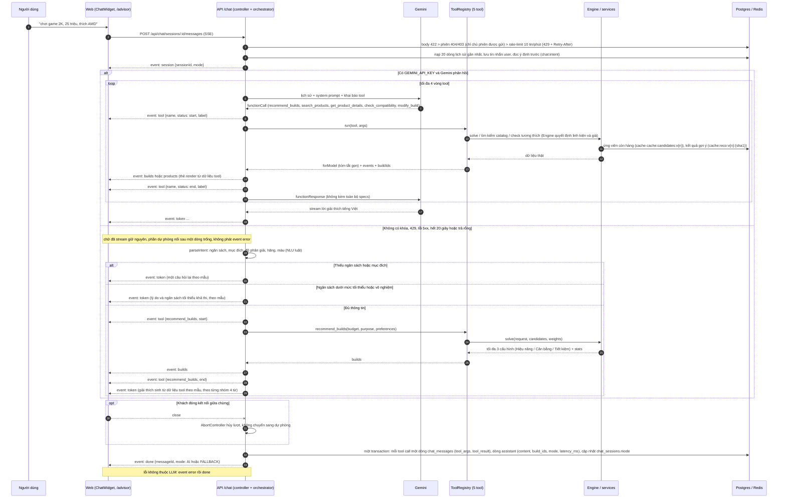
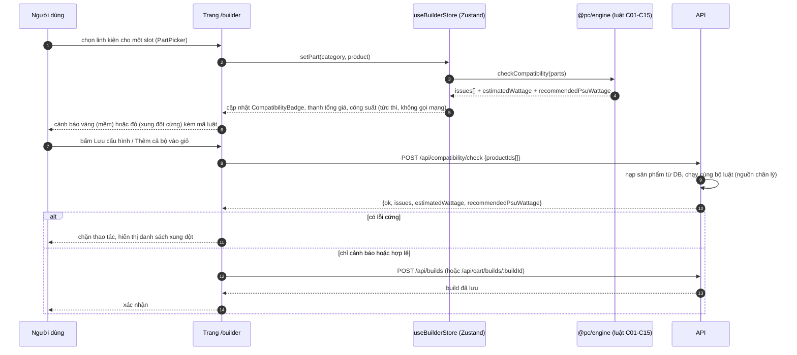
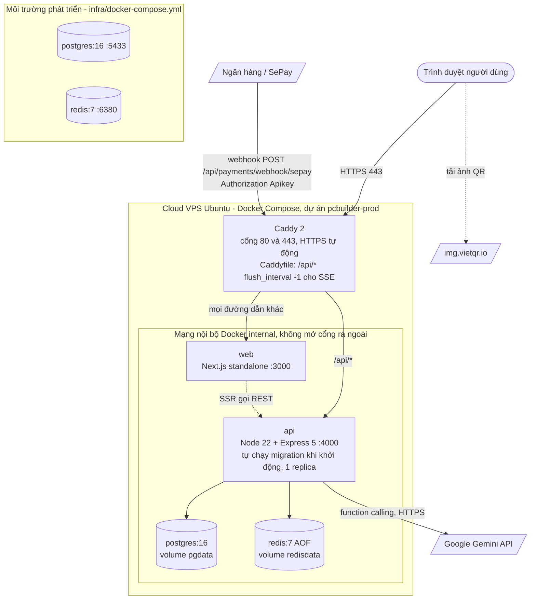
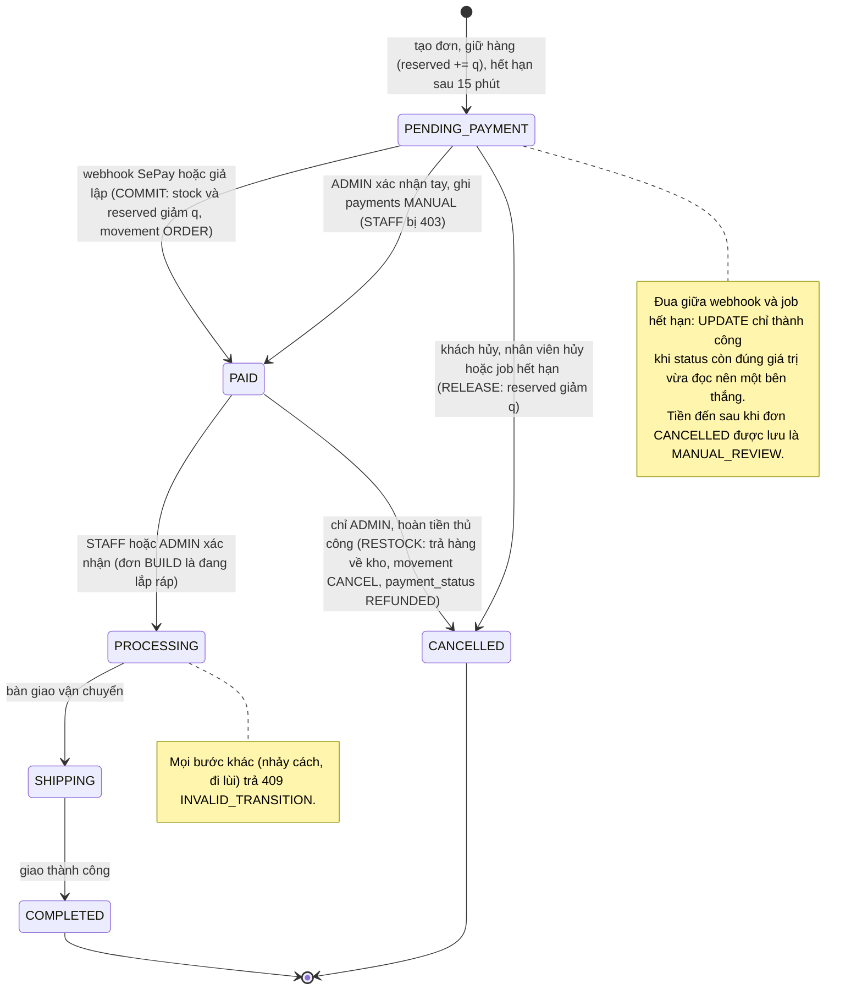
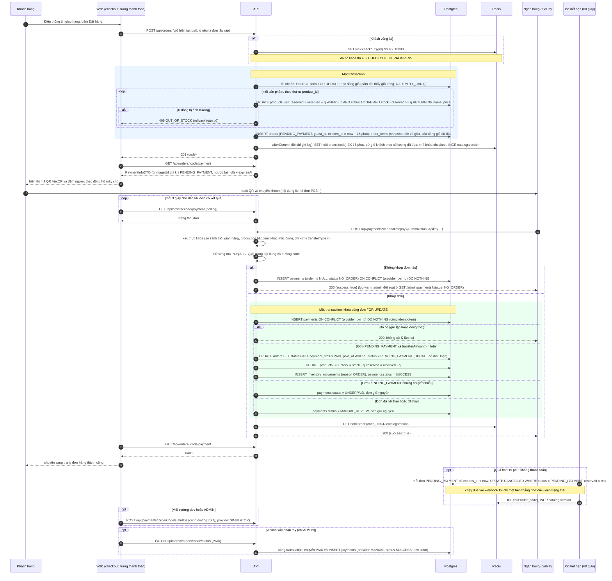
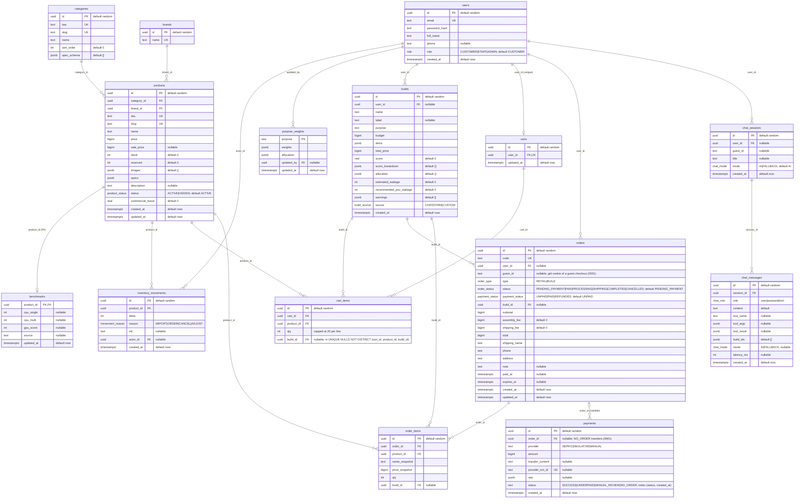

# CH4 — Chương 4 - Thiết kế, triển khai và đánh giá

Sinh tự động bởi `pnpm graph` — tư liệu thô để viết báo cáo, không sửa tay (sửa ở node tương ứng).

## Dàn ý chương

**Nội dung cần viết:**
1. **Thiết kế kiến trúc** - sơ đồ thành phần, monorepo, tầng module (xem sơ đồ kiến trúc bên dưới và ADR-001).
2. **Thiết kế cơ sở dữ liệu** - ERD (node M-DB) và mô tả từng bảng (các node E-xx).
3. **Thiết kế API** - các node API-xx, lỗi chuẩn.
4. **Thiết kế thuật toán** - mô hình CSP, bộ luật C01-C15, MCKP, chấm điểm (các node ALG-xx, R-Cxx; biểu đồ lớp Engine).
5. **Thiết kế luồng nghiệp vụ** - biểu đồ tuần tự AI Advisor, đặt hàng - VietQR, kiểm tra tương thích; máy trạng thái đơn.
6. **Thiết kế giao diện** - các node SCR-xx và hệ thống thiết kế.
7. **Triển khai** - từng tính năng (F-xx): mô tả, file code (`code:`), cách cài đặt.
8. **Kiểm thử và đánh giá** - các node T-xx; số liệu benchmark Engine, hiệu năng API, golden set AI, kết quả UAT.
9. **Triển khai thực tế** - Docker, VPS.

**Liên hệ phiếu giao nhiệm vụ:** Nội dung 1 (thiết kế kiến trúc, Class, ERD), Nội dung 3 (mô hình hóa CSP/MCKP, bộ quy tắc), Nội dung 4 (xây dựng, tuần 8-14), Nội dung 5 (thử nghiệm, tuần 15-16), Nội dung 6 (triển khai, tuần 16-17).

**Sơ đồ:** `docs/diagrams/component-architecture.mmd`

Tổng cộng **161** node thuộc chương này.

## Tính năng

### F-ADMIN-INVENTORY — Quản trị tồn kho và bảng benchmark

Trạng thái: **done**
Liên kết — realizes: FR-13, UC-13 · dependsOn: M-ADMIN, E-INVENTORY-MOVEMENT, E-BENCHMARK, F-AUTH · shownIn: SCR-ADMIN-INVENTORY

**Mục đích:** theo dõi hàng trong kho theo thời gian thực và cung cấp dữ liệu hiệu năng cho Engine.

**Mô tả:** `POST /admin/inventory/:productId/adjust` (`{delta, reason: IMPORT|ADJUST, note?}`) đổi tồn kho bằng một câu UPDATE có điều kiện `stock + delta >= reserved`, nên tồn kho không bao giờ thấp hơn số đang giữ cho đơn chờ thanh toán (vi phạm trả `409 STOCK_BELOW_RESERVED`), và luôn ghi một dòng `inventory_movements` (người thực hiện, lý do, ghi chú). `GET /admin/inventory/:productId/movements` trả lịch sử mới nhất trước, gồm cả movement ORDER/CANCEL do đơn hàng sinh ra (tham chiếu mã đơn). Danh sách sản phẩm quản trị có cờ `lowStock` (còn bán được ≤ 3). Bảng benchmark (`GET /admin/benchmarks`, `GET/PUT /admin/benchmarks/:productId`) chỉnh điểm CPU đơn/đa nhân và điểm GPU, có trường nguồn dữ liệu; sửa xong tăng `catalog:version` vì điểm là đầu vào hàm chấm điểm của Engine.

**Trạng thái:** API và trang quản trị xong. Web: danh sách sắp hết hàng đứng đầu, tự làm mới 15 giây, hộp thoại nhập/điều chỉnh kho kiểm trước các quy tắc của server, ngăn kéo lịch sử biến động; bảng benchmark sửa và lưu từng dòng (SCR-ADMIN-INVENTORY).

**Code:** `apps/api/src/modules/admin/inventory/**`, `apps/web/src/features/admin/inventory/**`, `apps/web/src/features/admin/benchmarks/**`

**Test:** `apps/api/src/modules/admin/**/*.int.test.ts`, `apps/web/src/features/admin/inventory/**/*.test.ts`

### F-ADMIN-ORDERS — Quản trị đơn hàng

Trạng thái: **done**
Liên kết — realizes: FR-15, UC-15 · dependsOn: M-ADMIN, F-ORDER, F-AUTH · decidedBy: ADR-021 · shownIn: SCR-ADMIN-ORDERS

**Mục đích:** xử lý đơn từ khi nhận tiền đến khi giao.

**Mô tả:** `GET /admin/orders` lọc theo trạng thái, loại (RETAIL/BUILD) và tìm theo mã đơn, số điện thoại, tên người nhận; `GET /admin/orders/:code` kèm email khách và các giao dịch `payments`. Chuyển trạng thái qua `PATCH /admin/orders/:code/status`, dùng lại máy trạng thái của F-ORDER dưới khóa dòng nên không thể nhảy bước (`409 INVALID_TRANSITION`). Hủy đơn đã thanh toán chỉ dành cho ADMIN (cần hoàn tiền thủ công): hàng được trả về kho (movement CANCEL) và trạng thái thanh toán của đơn chuyển REFUNDED. Xác nhận thanh toán thủ công (PENDING_PAYMENT sang PAID) cũng chỉ dành cho ADMIN và ghi một dòng `payments` loại MANUAL cùng transaction (ADR-021); STAFF nhận `403 FORBIDDEN` và giao diện ẩn hai nút này. Đơn BUILD ở bước PROCESSING được hiểu là đang lắp ráp.

**Trạng thái:** API và trang quản trị xong. Web: lọc theo trạng thái/loại/mã đơn/số điện thoại, chi tiết đơn với đối soát giao dịch VietQR, `OrderTimeline`, `OrderStatusControl` chỉ đưa ra bước chuyển hợp lệ (bản sao máy trạng thái có test), hủy đơn đã thanh toán khóa với STAFF (SCR-ADMIN-ORDERS).

**Code:** `apps/api/src/modules/admin/orders/**`, `apps/web/src/features/admin/orders/**`, `apps/web/src/features/admin/OrderStatusControl.tsx`

**Test:** `apps/api/src/modules/admin/**/*.int.test.ts`, `apps/web/src/features/admin/orders/**/*.test.ts`

### F-ADMIN-PRODUCTS — Quản trị sản phẩm với form schema động

Trạng thái: **done**
Liên kết — realizes: FR-12, UC-12 · dependsOn: M-ADMIN, E-PRODUCT, E-CATEGORY, E-BRAND, F-AUTH · decidedBy: ADR-002 · shownIn: SCR-ADMIN-PRODUCTS

**Mục đích:** để chủ cửa hàng tự thêm và sửa linh kiện mà không cần lập trình.

**Mô tả:** form nhập thông số (`DynamicSpecForm`) sinh từ `specSchema` của danh mục. Server kiểm tra `specs` theo **hai lớp**: `spec_schema` (danh sách `SpecField` admin sửa được: bắt buộc, kiểu, tập giá trị) và schema có kiểu `SPEC_SCHEMAS[category]` mà Engine dựa vào (ví dụ số nhân phải là số nguyên dương). Sai ở lớp nào cũng trả `422 VALIDATION_ERROR` với đường dẫn từng trường (`specs.socket`). Khóa không thuộc schema nào bị loại bỏ trước khi lưu. Giá khuyến mãi phải nhỏ hơn giá gốc; SKU/slug trùng trả `409 DUPLICATE`; slug tự sinh bỏ dấu tiếng Việt. Tồn kho chỉ đặt lúc tạo (ghi movement IMPORT), sau đó chỉ đổi qua điều chỉnh tồn kho có nhật ký. Xóa là ẩn mềm (`status = HIDDEN`) vì sản phẩm đã nằm trong đơn và cấu hình. ADMIN sửa `specSchema` qua `PUT /admin/categories/:id/schema`; trường bắt buộc mới áp dụng ngay cho lần ghi sản phẩm sau. Mọi lần ghi tăng `catalog:version` để cache ứng viên/gợi ý tự hết hiệu lực.

**Trạng thái:** API và trang quản trị xong. Web: danh sách sản phẩm, form tạo/sửa với `DynamicSpecForm` (lỗi 422 của server hiện đúng ô `specs.<khóa>`), thanh trượt hệ số ưu tiên thương mại, ẩn mềm có bước xác nhận, trình sửa lược đồ thông số chỉ ADMIN lưu được (SCR-ADMIN-PRODUCTS).

**Code:** `apps/api/src/modules/admin/products/**`, `apps/web/src/features/admin/products/**`, `apps/web/src/features/admin/DynamicSpecForm.tsx`, `apps/web/src/app/admin/products/**`

**Test:** `apps/api/src/modules/admin/**/*.int.test.ts`, `apps/api/src/modules/admin/products/**/*.test.ts`, `apps/web/src/features/admin/products/**/*.test.ts`, `apps/web/src/features/admin/errors.test.ts`

### F-ADMIN-STATS — Thống kê doanh thu và đối soát thanh toán

Trạng thái: **done**
Liên kết — realizes: FR-16, UC-16 · dependsOn: M-ADMIN, E-ORDER, E-PAYMENT, F-AUTH · shownIn: SCR-ADMIN-DASH

**Mục đích:** cho chủ cửa hàng thấy tình hình kinh doanh.

**Mô tả:** `GET /admin/stats/revenue?from&to&groupBy=day|week|month` cộng `total` của các đơn ở trạng thái PAID, PROCESSING, SHIPPING, COMPLETED theo `paid_at`, gộp bằng `date_trunc` theo giờ Việt Nam (tuần bắt đầu thứ Hai) và lấp kỳ trống bằng `generate_series` để biểu đồ liên tục; mặc định 30 ngày gần nhất. `GET /admin/stats/summary` trả doanh thu và số đơn hôm nay, số đơn theo từng trạng thái, số sản phẩm sắp hết (còn bán được ≤ 3) và số phiên chat 7 ngày qua. `GET /admin/payments` là bảng đối soát: liệt kê giao dịch `payments` (SUCCESS, UNDERPAID, MANUAL_REVIEW) cạnh mã đơn tương ứng.

**Trạng thái:** API và dashboard xong. Web: ô số liệu từ `/admin/stats/summary`, biểu đồ doanh thu recharts gộp ngày/tuần/tháng kèm bảng số liệu, đơn mới, số đơn theo trạng thái, tỉ lệ phiên chat chạy chế độ dự phòng (SCR-ADMIN-DASH). Đối soát từng đơn nằm ở trang chi tiết đơn.

**Code:** `apps/api/src/modules/admin/stats/**`, `apps/web/src/features/admin/dashboard/**`, `apps/web/src/features/admin/RevenueChart.tsx`

**Test:** `apps/api/src/modules/admin/**/*.int.test.ts`

### F-ADMIN-WEIGHTS — Quản trị ma trận trọng số và hệ số ưu tiên thương mại

Trạng thái: **done**
Liên kết — realizes: FR-14, UC-14 · dependsOn: M-ADMIN, E-PURPOSE-WEIGHT, ALG-MCKP, ALG-SCORING, F-AUTH · shownIn: SCR-ADMIN-WEIGHTS

**Mục đích:** cho phép hiệu chỉnh hành vi thuật toán theo phản hồi thực tế (nội dung 6 của phiếu) mà không phải sửa code.

**Mô tả:** `WeightMatrixEditor` hiển thị ma trận 4 mục đích x 8 danh mục gồm trọng số `w` và khoảng phân bổ ngân sách (min-max %), lưu vào bảng `purpose_weights` (`updated_by` ghi người sửa). `GET /admin/weights` cho STAFF/ADMIN xem; `PUT /admin/weights/:purpose` chỉ ADMIN, kiểm tra đủ 8 danh mục, tổng trọng số bằng 1 (sai số ±0,001) và mỗi khoảng phân bổ có min ≤ max (lỗi trả 422 với đường dẫn `weights` hoặc `allocation.{danh mục}`). `commercialBoost` của sản phẩm (sửa qua API sản phẩm, trong khoảng ±0,5) cộng thêm vào giá trị MCKP để đẩy hàng tồn hoặc hàng khuyến mại. Lưu xong tăng `catalog:version` (khóa cache gợi ý chứa phiên bản nên tự hết hiệu lực) và xóa thêm các khóa `cache:reco:*` còn sót.

**Trạng thái:** API và trình sửa ma trận xong (SCR-ADMIN-WEIGHTS): tổng mỗi nhu cầu tính trực tiếp, nút Lưu khóa khi tổng khác 1,00 ± 0,001, khoảng phân bổ sửa trong dòng mở rộng, "Khôi phục mặc định" dùng `DEFAULT_PROFILES` của Engine, STAFF chỉ xem. E2E đổi trọng số rồi so sánh gợi ý (T-E2E-ADMIN-WEIGHTS) vẫn chờ nhóm kiểm thử.

**Code:** `apps/api/src/modules/admin/weights/**`, `apps/web/src/features/admin/weights/**`, `apps/web/src/features/admin/WeightMatrixEditor.tsx`

**Test:** `apps/api/src/modules/admin/**/*.int.test.ts`, `apps/web/src/features/admin/weights/**/*.test.ts`

### F-AI-ADVISOR — AI PC Advisor: chatbot Gemini điều phối Engine qua function calling

Trạng thái: **done**
Liên kết — realizes: FR-07, UC-03, NFR-02, NFR-05 · dependsOn: M-CHAT, M-CHAT-LLM, F-ENGINE-CORE, F-FALLBACK-NLU, F-RECOMMEND, E-CHAT-SESSION, E-CHAT-MESSAGE · decidedBy: ADR-003, ADR-004, ADR-005, ADR-018, ADR-019 · shownIn: SCR-ADVISOR, SCR-HOME, SCR-ADMIN-CHATLOGS

**Mục đích:** tính năng nổi bật của hệ thống - người dùng nói nhu cầu bằng tiếng Việt, nhận cấu hình thật trong kho thay vì tự học thuật ngữ phần cứng.

**Trạng thái:** đã xong cả API (module chat, 5 tool, luồng SSE, lưu hội thoại, đánh giá golden set) và giao diện web (`/advisor`, widget chat nổi; chi tiết ở SCR-ADVISOR). Đã chạy thử đầu-cuối ở chế độ dự phòng: "chơi game 25 triệu" → chip công cụ → 3 BuildCard → "Mở trong Customizer" nạp đủ 8 linh kiện không lỗi.

**Mô tả:** API `POST /chat/sessions/:id/messages` trả luồng SSE. Orchestrator gửi 20 dòng lịch sử gần nhất và system prompt kèm 5 tool cho Gemini (`recommend_builds`, `search_products`, `get_product_details`, `check_compatibility`, `modify_build`). Khi model gọi tool, API chạy Engine/DB thật và trả về cho model bản tóm tắt gọn (id, nhãn, tổng giá, tên và giá linh kiện, phân bổ, cảnh báo - không kèm toàn bộ thông số); thẻ cấu hình được gửi riêng tới web qua sự kiện `builds` từ dữ liệu tool nên giá luôn đúng. `modify_build` giữ nguyên mọi linh kiện trừ danh mục cần đổi, giải lại bằng Engine; nếu giữ nguyên làm bài toán vô nghiệm thì thử lại và cho đổi thêm các linh kiện phụ thuộc (ví dụ đổi card thì được đổi nguồn, vỏ case) rồi báo rõ cho khách. Giới hạn 4 vòng tool mỗi lượt, timeout 20 giây, rate limit 10 tin/phút, cache kết quả gợi ý theo băm tham số 10 phút. Toàn bộ hội thoại và tool call được lưu để xem lại và phân tích.

**Quyết định chính:** ADR-003 chọn Gemini free tier với function calling; ADR-004 LLM chỉ điều phối, Engine quyết định; ADR-005 chế độ dự phòng khi Gemini không dùng được. Khai báo tool chỉ dùng tập con JSON Schema mà Gemini chấp nhận (bộ lọc thông số của `search_products` là danh sách cặp `{key, value}` thay vì object tự do), có unit test kiểm tra.

**Điểm nhấn cho báo cáo (CH5):** kiến trúc chống ảo giác (guardrails), so sánh với chatbot thuần LLM, kết quả golden-set 30 kịch bản (`apps/api/eval/results.md`). Lần chạy ở chế độ dự phòng (2026-11-07), chấm **nghiêm ngặt** theo kỳ vọng của trợ lý AI: gọi đúng tool **26/30**, tham số đúng 23/25, sở thích 9/10, đạt mọi tiêu chí 26/30; 4 kịch bản trượt là 2 câu chỉnh cấu hình (luật dự phòng gọi lại `recommend_builds` thay vì `modify_build`) và 2 câu hỏi sản phẩm (dự phòng hỏi lại thay vì `search_products`). Nếu chấm theo khả năng thiết kế của chế độ luật (`fallbackExpect`) thì đạt 30/30. Ở cả hai cách chấm, 69/69 cấu hình trả về đều hợp lệ khi kiểm tra lại bằng bộ luật C01–C15 và ngân sách; độ trễ p50 10 ms / p95 22 ms.

**Sự kiện SSE và dự phòng:** luồng gồm `session` (id phiên), `token` (từng đoạn văn bản), `tool` (`start`/`end` kèm nhãn tiếng Việt, web hiện thành chip), `builds` và `products` (thẻ dữ liệu thật lấy từ kết quả tool, không từ lời model), `error` và `done` (kèm `messageId` và `mode`). Gemini hết quota (429), quá thời gian (20 giây), thiếu khóa hoặc trả rỗng thì orchestrator chuyển sang NLU luật (ADR-005, ADR-018) ngay trong cùng lượt: chữ đã phát vẫn giữ, phần dự phòng nối thêm sau một dòng trống, kết thúc `done{mode:'FALLBACK'}`; không phát `error`. Khách đóng kết nối thì hủy cả lượt (không chuyển dự phòng). Chỉ chủ phiên được gửi tin (STAFF/ADMIN chỉ đọc, nhật ký ở SCR-ADMIN-CHATLOGS); 10 tin/phút và 10 phiên mới/phút.

**Kiểm thử:** phía API có hơn 240 test cho module chat (đơn vị, tích hợp có DB và Redis thật), toàn bộ API 529 test và web 166 test (số liệu của Lead khi tích hợp, gồm cả store chat và trình đọc SSE). Cách chấm golden set và hai mức điểm nằm ở ADR-019.

**Hạn chế cần nêu trong báo cáo:** bộ golden set do chính người phát triển viết khi đã biết phạm vi của NLU dự phòng và không mang tính đối kháng, nên điểm chế độ dự phòng là cận trên chứ không phải độ chính xác trên câu hỏi thật; chỉ 30 kịch bản, một lần chạy, trên catalog dev. Hãy dẫn con số nghiêm ngặt (26/30). Kết quả chế độ Gemini thật cần khóa API: chạy `eval/smoke-gemini.ts` rồi `eval:ai`.

**Code:** `apps/api/src/modules/chat/**`, `apps/web/src/features/advisor/**`, `apps/web/src/stores/chat.ts`, `apps/web/src/components/ChatWidget.tsx`

**Test:** `apps/api/src/modules/chat/**/*.test.ts`, `apps/api/src/modules/chat/**/*.int.test.ts`, `apps/api/eval/**`, `apps/web/src/features/advisor/**/*.test.ts`, `apps/web/src/stores/chat.test.ts`

**Sơ đồ:** `docs/diagrams/seq-ai-advisor.mmd`

### F-AUTH — Xác thực JWT và phân quyền RBAC

Trạng thái: **done**
Liên kết — realizes: FR-03, UC-02, NFR-03 · dependsOn: M-AUTH, M-API-CORE, E-USER · decidedBy: ADR-006, ADR-016 · shownIn: SCR-AUTH, SCR-ACCOUNT

**Mục đích:** nhận diện người dùng và chặn truy cập trái quyền vào API quản trị.

**Mô tả:** đăng ký/đăng nhập bằng email và mật khẩu (bcrypt, cost 10). Access token JWT sống 15 phút, gửi qua header `Authorization: Bearer` hoặc cookie httpOnly `access_token`; refresh token sống 7 ngày, lưu trong cookie httpOnly `refresh_token` (path `/api/auth`) và đăng ký ở Redis theo khóa `rt:{userId}:{jti}`. Mỗi lần refresh, `jti` cũ bị xóa và cấp `jti` mới (xoay vòng), nên token cũ bị đánh cắp không dùng lại được; đăng xuất xóa khóa nên có hiệu lực ngay. Middleware `optionalAuth` gắn `req.user` nếu có token hợp lệ, `requireAuth` và `requireRole` bảo vệ route. Giới hạn đăng nhập 5 lần/phút/IP; sai email hay sai mật khẩu đều trả cùng thông báo để không lộ email nào đã đăng ký.

**Củng cố sau rà soát (ADR-016):** JWT mang trường `typ` (`access` hoặc `refresh`) nên token sai loại bị từ chối ở cả hai đầu; khi hai tab cùng refresh, tab thua nhận `401 INVALID_REFRESH_TOKEN` nhưng cookie được giữ nguyên để không đăng xuất oan phiên mà tab thắng vừa làm mới; chỉ token thiếu, giả, hết hạn, sai `typ` hoặc người dùng bị xóa mới bị xóa cookie. Phía web refresh theo kiểu single-flight (`apps/web/src/stores/auth.ts`).

**Trạng thái:** API và giao diện web đều xong: đăng ký/đăng nhập (SCR-AUTH), menu tài khoản, trang tài khoản với đơn hàng và cấu hình đã lưu (SCR-ACCOUNT), xóa cache cá nhân khi đăng xuất hoặc khi refresh thất bại.

**Quyết định chính:** ADR-006 - access token ngắn + refresh token thu hồi được thay vì một JWT dài hạn, để đăng xuất có hiệu lực thật.

**Code:** `apps/api/src/modules/auth/**`, `apps/web/src/features/auth/**`, `apps/web/src/features/account/**`

**Test:** `apps/api/src/modules/auth/**/*.int.test.ts`

### F-BUILD-SHARE — Lưu, chia sẻ và nhân bản cấu hình

Trạng thái: **done**
Liên kết — realizes: FR-10, UC-06 · dependsOn: M-BUILDS, E-BUILD, F-COMPAT-CHECK · shownIn: SCR-BUILD-SHARE

**Mục đích:** biến một cấu hình thành thứ có thể lưu, gửi cho bạn bè hoặc kỹ thuật viên và mua lại sau.

**Mô tả:** bảng `builds` lưu danh sách linh kiện (kèm tên và giá tại thời điểm lưu), điểm, phân bổ, công suất ước tính và cảnh báo; `user_id` có thể trống cho khách vãng lai. Cấu hình đến từ chat, form gợi ý hoặc Customizer (`POST /builds`, bị từ chối nếu vi phạm luật cứng). `GET /builds/:id` công khai để chia sẻ qua liên kết; khi xem lại, linh kiện hiển thị giá và tồn kho hiện tại, còn tổng giá và điểm giữ nguyên như lúc lưu. Trang `/builds/[id]` render SSR, xem được qua liên kết.

**Trạng thái:** API và trang chia sẻ web `/builds/[id]` đã xong (SCR-BUILD-SHARE, `BuildView`), kèm hành động thêm cả cấu hình vào giỏ và xuất báo giá PDF.

**Code:** `apps/api/src/modules/builds/**`, `apps/web/src/features/account/BuildView.tsx`, `apps/web/src/features/cart/BuildActions.tsx`

**Test:** `apps/api/src/modules/builds/**/*.test.ts`

### F-CART — Giỏ hàng (khách vãng lai ở Redis, người dùng ở DB, gộp khi đăng nhập)

Trạng thái: **done**
Liên kết — realizes: FR-04, UC-08 · dependsOn: M-CART, E-CART, E-CART-ITEM, F-BUILD-SHARE · decidedBy: ADR-017 · shownIn: SCR-CART

**Mục đích:** gom linh kiện lẻ và cả cấu hình trước khi đặt.

**Mô tả:** khách vãng lai có giỏ ở Redis: hash `cart:guest:{guestId}`, mỗi field `{productId}:{buildId|-}` → số lượng, TTL trượt 7 ngày. Người dùng đăng nhập có giỏ trong `carts`/`cart_items`. Ở request giỏ hàng đầu tiên có token kèm cookie `gid`, giỏ tạm được gộp vào giỏ tài khoản bằng một câu upsert (cộng số lượng, tối đa 20 mỗi dòng, bỏ qua sản phẩm đã ẩn); chỉ khi ghi DB thành công mới trừ khỏi giỏ Redis đúng số lượng đã đọc (không xóa cả hash), nên lỗi giữa chừng hay món khách vừa thêm trong lúc gộp đều không mất, và một khóa Redis ngắn ngăn hai request gộp hai lần. Mọi thao tác thêm/sửa là nguyên tử (Lua script cho Redis, khóa dòng `carts` + `ON CONFLICT DO UPDATE` cho DB), nên nhiều request song song không mất số lượng và không vượt tồn khả dụng. `POST /cart/builds/:buildId` đọc cấu hình đã lưu và thêm từng linh kiện với `build_id` (thêm lại không nhân đôi). Giá dòng luôn là `effectivePrice` lấy từ DB; số lượng vượt tồn khả dụng (`stock - reserved`, tính trên mọi dòng cùng sản phẩm) bị từ chối `409 INSUFFICIENT_STOCK`.

**Kết quả kiểm thử đồng thời (báo cáo task 6b, ADR-017):** trước khi sửa, 5 lần thêm giỏ song song cho tài khoản trả `[500, 500, 500, 500, 201]`; sau khi sửa cho một dòng qty 5. Tồn kho 3 mà 5 lần thêm song song thì đúng 3 thành công và 2 nhận 409, cả giỏ khách lẫn giỏ tài khoản. Giỏ tài khoản dựa vào ràng buộc `UNIQUE NULLS NOT DISTINCT (cart_id, product_id, build_id)`.

**Trạng thái:** API và giao diện giỏ hàng web đã xong (SCR-CART): bộ tăng giảm số lượng, thêm cả cấu hình vào giỏ, mua lại đơn cũ.

**Code:** `apps/api/src/modules/cart/**`, `apps/web/src/features/cart/**`

**Test:** `apps/api/src/modules/cart/**/*.int.test.ts`

### F-CATALOG — Danh mục sản phẩm, lọc theo thông số JSONB và trang chi tiết

Trạng thái: **done**
Liên kết — realizes: FR-01, FR-02, UC-01 · dependsOn: M-CATALOG, E-PRODUCT, E-CATEGORY, E-BENCHMARK · decidedBy: ADR-002, ADR-015 · shownIn: SCR-CATEGORY, SCR-PRODUCT

**Mục đích:** cho khách duyệt và lọc hàng trăm linh kiện có thuộc tính kỹ thuật khác nhau mà không cần một bảng cột riêng cho từng loại.

**Mô tả:** mỗi danh mục khai báo `specSchema` (danh sách trường: khóa, nhãn, kiểu, có lọc được hay không). Thông số của sản phẩm nằm trong cột JSONB `products.specs`. API trả facet (các giá trị và số lượng sản phẩm ACTIVE) sinh từ schema để web dựng bộ lọc động. Lọc theo thông số dùng phép chứa JSONB, ví dụ `specs @> '{"socket":"AM5","memoryTypes":["DDR5"]}'`, giá trị được định kiểu theo schema (số, boolean, phần tử mảng), nhiều giá trị của một khóa được OR; khoảng số dùng `specsMin`/`specsMax`. Phép chứa được tăng tốc bằng chỉ mục GIN `jsonb_path_ops`; lọc giá dùng giá thực trả; tìm theo tên dùng ILIKE và GIN trên `to_tsvector`. Danh mục được đổi sang `category_id` trước khi truy vấn để planner thấy đúng phân bố dữ liệu và chọn GIN.

**Trạng thái:** API và giao diện đã xong: trang danh mục với bộ lọc sinh từ facet (SCR-CATEGORY), tìm kiếm, trang chi tiết có bảng thông số và benchmark (SCR-PRODUCT). Danh sách ứng viên của Engine được cache theo phiên bản catalog (`cache:candidates:v{version}`, TTL 300 giây, ADR-015).

**Quyết định chính:** dùng JSONB + GIN thay vì mô hình EAV để truy vấn nhanh và thêm danh mục/thuộc tính mà không đổi schema; dữ liệu JSONB vẫn được kiểm tra bằng Zod theo schema từng danh mục. Trang chi tiết render SSR để tối ưu SEO.

**Điểm nhấn cho báo cáo (CH5):** truy vấn JSONB containment + GIN. Integration test (`catalog.int.test.ts`) chèn 5.000 sản phẩm tổng hợp, chạy `ANALYZE`, rồi `EXPLAIN` đúng câu SQL mà API sinh ra (`category=cpu&specs[socket]=AM5`) với cấu hình planner mặc định và khẳng định kế hoạch dùng chỉ mục `products_specs_gin` (GIN `jsonb_path_ops` trên `specs`); nó chạy ổn định 3/3 lần liên tiếp. **Bằng chứng EXPLAIN đáng nêu:** lần đầu kế hoạch lại là `Bitmap Index Scan on products_category_price_idx`, vì bộ lọc danh mục đi qua phép nối `categories` nên planner ước lượng 655 dòng mỗi danh mục và bỏ qua GIN; sau khi API phân giải `category_id` trước và lọc `products.category_id = $1` (giống câu truy vấn mẫu của spec), kế hoạch chuyển sang `products_specs_gin`. Bài học: chỉ mục JSONB chỉ phát huy khi planner thấy đúng thống kê. Báo cáo chưa có thời gian EXPLAIN ANALYZE có và không có chỉ mục (test chỉ khẳng định dạng kế hoạch); nếu cần số đo thì chạy thêm trên catalog 5.000 dòng. Đo thêm: các biến thể phép chứa, khoảng số (`specsMin`/`specsMax`), phân trang và facet có test riêng (16 test tích hợp catalog).

**Code:** `apps/api/src/modules/catalog/**`, `apps/web/src/features/catalog/**`

**Test:** `apps/api/src/modules/catalog/**/*.test.ts`

### F-COMPAT-CHECK — Kiểm tra tương thích linh kiện theo bộ luật C01-C15

Trạng thái: **done**
Liên kết — realizes: FR-09, UC-05 · dependsOn: M-COMPATIBILITY, M-ENGINE, ALG-CSP · decidedBy: ADR-001, ADR-014

**Mục đích:** trả lời "bộ linh kiện này có lắp được và chạy ổn không?" bằng danh sách lỗi (cứng) và cảnh báo (mềm).

**Mô tả:** mỗi luật là một hàm thuần có mã (C01-C15), mức độ (error/warning) và thông điệp tiếng Việt, ví dụ socket CPU không khớp mainboard, RAM sai chuẩn, GPU dài hơn case cho phép, nguồn thiếu công suất. Kết quả kèm công suất ước tính và công suất nguồn khuyến nghị. API `POST /compatibility/check` bọc cùng bộ luật cho client không có Engine.

**Quyết định chính:** luật là dữ liệu của miền (có mã) nên có thể xuất hiện trong thông báo và test; luật nhị phân được dùng lại làm ràng buộc cho CSP.

**Code:** `packages/engine/src/rules.ts`, `packages/engine/src/compatibility.ts`, `apps/api/src/modules/compatibility/**`

**Test:** `packages/engine/src/rules.test.ts`, `apps/api/src/modules/compatibility/**/*.int.test.ts`

### F-CUSTOMIZER — Interactive PC Customizer: lắp ráp tự do với kiểm tra tương thích tức thì

Trạng thái: **done**
Liên kết — realizes: FR-09, UC-05 · dependsOn: F-COMPAT-CHECK, M-WEB-STATE, M-ENGINE, F-CATALOG · decidedBy: ADR-001 · shownIn: SCR-BUILDER

**Mục đích:** cho người đã biết mình muốn gì tự lắp từng linh kiện nhưng vẫn được bảo vệ khỏi chọn sai.

**Mô tả:** trang `/builder` có 8 slot linh kiện; chọn linh kiện qua `PartPicker` (drawer có lọc). Mỗi lần đổi, trang chạy bộ luật của `@pc/engine` (`checkCompatibility`) ngay trên trình duyệt để cập nhật huy hiệu tương thích, tổng giá và công suất mà không gọi mạng; ngay trong PartPicker, từng sản phẩm được xem trước tương thích và món xung đột bị làm mờ kèm mã luật. Khi lưu hoặc thêm vào giỏ, server kiểm tra lại trong `POST /builds` (lỗi cứng → 422 INCOMPATIBLE kèm danh sách luật). Luật cân bằng CPU–GPU (C13) cần toàn bộ danh mục để xếp bậc nên chỉ server tính. Nút "Mở trong Customizer" nhận cấu hình từ chatbot hoặc form qua `/builder?build=<id>`.

**Quyết định chính:** chạy cùng một bộ luật ở client và server (ADR-001) - phản hồi tức thì nhưng server vẫn là nguồn chân lý.

**Code:** `apps/web/src/features/builder/**`, `apps/web/src/stores/builder.ts`, `apps/web/src/app/*/builder/**`

**Test:** `apps/web/src/features/builder/**/*.test.ts`, `apps/web/src/stores/builder.test.ts`

**Sơ đồ:** `docs/diagrams/seq-customizer-check.mmd`

### F-DEPLOY — Đóng gói Docker và triển khai lên VPS

Trạng thái: **done**
Liên kết — realizes: NFR-07 · dependsOn: M-INFRA

**Mục đích:** đưa hệ thống lên máy chủ thật để người dùng và kỹ thuật viên dùng thử (nội dung 6 của phiếu), bằng một lệnh và không cần cài Node hay Postgres trên máy chủ.

**Mô tả (theo `infra/docker-compose.prod.yml`, dự án `pcbuilder-prod`):** năm dịch vụ trên một mạng nội bộ `internal`.
- **caddy** (`caddy:2-alpine`) là dịch vụ duy nhất mở cổng 80 và 443; tự xin và gia hạn chứng chỉ HTTPS Let's Encrypt cho `DOMAIN`. `Caddyfile` chuyển `/api/*` tới `api:4000` với `flush_interval -1` (để luồng SSE của chatbot không bị đệm) và mọi đường dẫn khác tới `web:3000`. Web và API dùng chung một tên miền nên cookie `Secure; SameSite=Lax` hoạt động như cùng một site.
- **api** (Node 22 alpine, build nhiều giai đoạn bằng `pnpm deploy --prod`, 257 MB) chạy bằng người dùng `node`, có HEALTHCHECK `/api/health`, tự chạy migration (`src/db/migrate.ts`) rồi mới mở server. Migrator không có advisory lock nên chỉ chạy đúng 1 replica.
- **web** (Next.js `standalone`, 223 MB, người dùng không phải root) với `NEXT_PUBLIC_API_URL` được nhúng lúc build từ `DOMAIN`, nên đổi tên miền phải build lại web.
- **postgres:16** và **redis:7** (bật AOF) chỉ nằm trong mạng nội bộ, không mở cổng ra ngoài; dữ liệu ở volume `pgdata`, `redisdata`.
- Cấu hình qua `infra/.env.prod` (mẫu `.env.prod.example`, bị gitignore). API production từ chối khởi động nếu JWT secret hoặc `SEPAY_API_KEY` còn là giá trị dev. Bản dev chỉ chạy postgres và redis bằng `infra/docker-compose.yml`.
- `docs/deploy.md` (tiếng Việt) hướng dẫn trên Ubuntu 22.04/24.04: yêu cầu VPS, secret, khởi chạy, nạp seed thủ công một lần (seed xóa dữ liệu cũ), xin khóa Gemini, cấu hình webhook SePay `https://<DOMAIN>/api/payments/webhook/sepay` với `Authorization: Apikey <khóa>`, sao lưu `pg_dump` bằng cron.

**Kiểm chứng đã làm (báo cáo task 12):** chạy toàn bộ stack production trên máy dev ở cổng 8081/8443: cả năm dịch vụ khỏe, `GET /api/health` qua Caddy trả `{"status":"ok","db":"up","redis":"up","ai":"fallback"}`, cookie đặt `Secure; SameSite=Lax`, trang chủ trả 200, đăng nhập tài khoản mẫu qua Caddy 200, các container chạy uid 1000.

**Chưa kiểm chứng (nêu trong báo cáo):** cấp chứng chỉ Let's Encrypt thật (cần tên miền công khai), luồng SSE đi xuyên Caddy đầu-cuối, và webhook SePay thật; ba mục này thuộc phần kiểm thử QA và triển khai trên VPS.

**Code:** `infra/docker-compose.prod.yml`, `infra/Caddyfile`, `infra/.env.prod.example`, `apps/api/Dockerfile`, `apps/web/Dockerfile`, `docs/deploy.md`

**Test:** `e2e/smoke.spec.ts`

**Sơ đồ:** `docs/diagrams/deployment.mmd`

### F-ENGINE-CORE — Optimization Engine: bộ giải CSP + MCKP thuần TypeScript

Trạng thái: **done**
Liên kết — realizes: FR-08, FR-09, NFR-01, NFR-08 · dependsOn: M-ENGINE, ALG-CSP, ALG-AC3, ALG-FC, ALG-BNB, ALG-MCKP, ALG-SCORING, ALG-TOPK, F-COMPAT-CHECK · decidedBy: ADR-001, ADR-004, ADR-012, ADR-013, ADR-014, ADR-020

**Mục đích:** là lõi học thuật của đề tài: biến bài toán "chọn linh kiện tương thích và tối ưu hiệu năng trong ngân sách" thành bài toán CSP kết hợp MCKP và giải bằng tìm kiếm có cắt tỉa, kèm chứng minh thực nghiệm rằng kết quả là tối ưu.

**Mô tả:** Engine là package thuần (không I/O, không phụ thuộc DB) nhận danh sách ứng viên còn hàng và yêu cầu (ngân sách, mục đích, sở thích, linh kiện cố định, linh kiện loại trừ, `topK`, chiến lược) rồi trả về tối đa 3 cấu hình có nhãn Hiệu năng / Cân bằng / Tiết kiệm (ADR-020), kèm điểm theo danh mục, tỉ lệ phân bổ ngân sách, công suất ước tính, cảnh báo và thống kê (số nút duyệt, số giá trị bị loại bởi dominance, AC-3, forward checking, cận; cờ `capped`; thời gian). Khi vô nghiệm trả lý do (`BUDGET_TOO_LOW` kèm ngân sách tối thiểu, `FIXED_PART_CONFLICT`, `NO_COMPATIBLE_COMBINATION`, `SEARCH_LIMIT`). Cùng bộ luật C01-C15 chạy ở server (nguồn chân lý), trong Engine và ở client (Customizer).

**Cấu trúc (phẳng, một file mỗi mối quan tâm):** `rules.ts` (15 hàm luật thuần và hàm công suất), `compatibility.ts` (`checkCompatibility`), `scoring.ts` và `profiles.ts` (ALG-SCORING), `domains.ts` (mô hình bài toán, dominance), `ac3.ts`, `search.ts` (quay lui, forward checking, B&B), `topk.ts` (hợp đồng nhãn), `bruteforce.ts`, `solver.ts` (`solve`, `solveWithOptions` cho bench), `index.ts` (API công khai). Sơ đồ ở `class-engine.mmd`.

**Quyết định chính:** ADR-001 tách thành package riêng để test độc lập và dùng chung web/api; ADR-004 Engine quyết định linh kiện, LLM chỉ điều phối. Các quyết định rút ra trong quá trình phát triển: chấm theo mức đủ dùng (ADR-012), hệ số CUDA (ADR-013), luật mềm C15 (ADR-014), hợp đồng nhãn và thứ tự biến theo mục tiêu (ADR-020).

**Số liệu cho báo cáo (nguồn: báo cáo task 3 §3 và §5, `bench/results.md`; Apple M3, Node 22, hạt giống 7):**
- **175 test, phủ nhánh 98,85%** (691/699), phủ câu lệnh 99,51%, hàm 99,44%, dòng 99,63%. NFR-08 yêu cầu tối thiểu 90%.
- **Hiệu năng `full`:** p95 **11,5 ms** ở catalog 250 sản phẩm (221 còn hàng) và **40,3 ms** ở 500 sản phẩm (NFR-01: 300 ms). Mean nút duyệt 8.937 và 16.775.
- **So sánh 4 chiến lược** (kịch bản văn phòng 20 triệu, game 25 triệu, đồ họa 40 triệu, AI 60 triệu; 25 lần chạy cho `full`, 3 lần cho mỗi chiến lược vét cạn; trần 2.000.000 nút): ở 250 và 500 sản phẩm brute force, backtracking và forward checking đều chạm trần và không lần nào tìm được cấu hình tối ưu (0/12), còn `full` tối ưu 100/100. Ở 50 sản phẩm cả bốn đều giải được (p95: brute force 57,1 ms, BT 5,9 ms, FC 9,9 ms, full 1,2 ms).
- **Kiểm tra tương đương:** `bench:equivalence` so `full` với forward checking vét cạn trên 1.502 ca ngẫu nhiên (1.080 + 422), **0 sai khác**, 0 vi phạm hợp đồng nhãn.
- **Seed thật** (240 sản phẩm, 213 còn hàng): mọi cấu hình đều tương thích, mỗi lần giải 2-14 ms.
- **Trung thực về AC-3:** AC-3 loại **gần như 0** giá trị trên dữ liệu tổng hợp (2 ở 50 sản phẩm, 0 ở 100 trở lên); mức tăng tốc đến từ cận LP của MCKP cùng thứ tự biến theo mục tiêu, không phải AC-3 (ADR-020). Ablation MRV: p95 1.896 ms so với 11,8 ms ở 250 sản phẩm.
- Không gian tìm kiếm của vét cạn: 1,69e8 (100 sản phẩm), 3,16e11 (250), 8,09e13 (500) tổ hợp.

**Hạn chế đã biết (cần nêu trong báo cáo):** dữ liệu benchmark và thông số của seed là giá trị tham chiếu gần đúng; TDP CPU Intel lấy công suất cơ sở nên cỡ nguồn hơi lạc quan; `commercialBoost` nhân thay vì cộng như công thức spec; điểm văn phòng không nhạy giá; cache điểm theo định danh mảng catalog nên không được sửa catalog tại chỗ.

**Code:** `packages/engine/src/**`

**Test:** `packages/engine/src/**/*.test.ts`, `packages/engine/bench/**`

**Sơ đồ:** `docs/diagrams/class-engine.mmd`

```mermaid
%% Mirrors packages/engine/src (flat files). Data types come from types.ts; the module classes group the exported functions of each file.
classDiagram
  class EngineProduct {
    +string id
    +CategoryKey category
    +string name
    +string brand
    +number price
    +number stock
    +AnySpecs specs
    +Benchmark benchmark?
    +number commercialBoost?
  }
  class SolveRequest {
    +number budget
    +Purpose purpose
    +Preferences preferences?
    +Record fixed?
    +string[] exclude?
    +number topK?
    +SolveStrategy strategy?
    +number nodeLimit?
  }
  class Build {
    +BuildLabel label
    +PartMap parts
    +number totalPrice
    +number score
    +Record scoreBreakdown
    +Record allocation
    +number estimatedWattage
    +number recommendedPsuWattage
    +CompatibilityIssue[] warnings
  }
  class SolveResult {
    +Build[] builds
    +SolveStats stats
    +InfeasibleReason infeasibleReason?
    +number minFeasibleBudget?
  }
  class SolveStats {
    +SolveStrategy strategy
    +number nodesExplored
    +number prunedByDominance?
    +number prunedByAc3
    +number prunedByForwardChecking
    +number prunedByBound
    +boolean capped?
    +number timeMs
  }
  class PurposeProfile {
    +Purpose purpose
    +Record weights
    +Record allocation
  }
  class CompatibilityIssue {
    +RuleCode code
    +severity error or warning
    +string message
    +CategoryKey[] categories
  }
  class CompatibilityReport {
    +CompatibilityIssue[] issues
    +number estimatedWattage
    +number recommendedPsuWattage
  }
  class CompatibilityContext {
    +Purpose purpose?
    +number budget?
    +EngineProduct[] catalog?
  }
  class SolveStrategy {
    <<enumeration>>
    bruteforce
    backtracking
    forwardChecking
    full
  }
  class InfeasibleReason {
    <<enumeration>>
    BUDGET_TOO_LOW
    NO_COMPATIBLE_COMBINATION
    FIXED_PART_CONFLICT
    SEARCH_LIMIT
  }

  class rules_ts["rules.ts"] {
    <<module>>
    +RULES one pure function per rule C01 to C15
    +PAIR_RULES hard binary rules per category pair
    +pairCompatible(codes, parts) boolean
    +estimateWattage(tdp, tgp) number
    +minPsuWattage(estimated) number
    +recommendedPsuWattage(estimated) number
    +lacksPsuHeadroom(wattage, estimated) boolean
    +isEntryChipset(chipset) boolean
    +isHighClassCpu(cpu, catalog) boolean
  }
  class compatibility_ts["compatibility.ts"] {
    <<module>>
    +checkCompatibility(parts, ctx) CompatibilityReport
  }
  class scoring_ts["scoring.ts"] {
    <<module>>
    +scoreProduct(product, purpose, catalog) number
    +createScorer(catalog, purpose) Scorer
    +ecosystemFactor(product, purpose, prefs) number
    +cpuGpuTier(product, catalog) Tier
    +CUDA_ECOSYSTEM_FACTOR Record
  }
  class profiles_ts["profiles.ts"] {
    <<module>>
    +DEFAULT_PROFILES Record
    +profileForRequest(profile, prefs) PurposeProfile
  }
  class domains_ts["domains.ts"] {
    <<module>>
    +buildProblem(req, catalog, profile) Problem
    +initialDomains(problem) number[][]
    +compatible(problem, a, i, b, j) boolean
    +psuSufficient(problem, cpu, gpu, psu) boolean
    +softPenalty(problem, idx) number
    +exactScore(problem, idx) number
    +exactPrice(problem, idx) number
    +pruneDominated(problem, domains) number
  }
  class ac3_ts["ac3.ts"] {
    <<module>>
    +ac3(problem, domains) Ac3Result
  }
  class search_ts["search.ts"] {
    <<module>>
    +search(problem, initial, cfg) SearchResult
    +search uses forward checking and a MCKP LP bound
  }
  class bruteforce_ts["bruteforce.ts"] {
    <<module>>
    +bruteForce(problem, domains, onLeaf, nodeLimit) BruteForceResult
  }
  class topk_ts["topk.ts"] {
    <<module>>
    +labelRoles(candidates) LabelledCandidate[]
    +selectDiverse(candidates) LabelledCandidate[]
    +CandidatePool per cpu-gpu Pareto fronts
    +BUDGET_SCORE_RATIO 0.85
  }
  class solver_ts["solver.ts"] {
    <<module>>
    +solve(req, catalog, profile) SolveResult
    +solveWithOptions(req, catalog, profile, options) SolveResult
    +DEFAULT_NODE_LIMIT 2000000
  }

  solver_ts ..> SolveRequest : nhận
  solver_ts ..> EngineProduct : miền giá trị
  solver_ts ..> PurposeProfile : trọng số MCKP
  solver_ts --> SolveResult : trả về
  solver_ts --> domains_ts : dựng bài toán CSP, dominance
  solver_ts --> ac3_ts : tiền xử lý (full)
  solver_ts --> search_ts : quay lui, FC, B&B
  solver_ts --> bruteforce_ts : chiến lược vét cạn
  solver_ts --> topk_ts : gán nhãn top-3
  domains_ts --> rules_ts : ma trận tương thích từ hàm luật
  domains_ts --> scoring_ts : giá trị MCKP, hệ số CUDA
  domains_ts --> profiles_ts : trọng số theo mục đích
  ac3_ts --> domains_ts
  search_ts --> domains_ts
  compatibility_ts --> rules_ts : chạy C01..C15
  compatibility_ts --> CompatibilityReport
  rules_ts --> CompatibilityIssue
  CompatibilityReport "1" o-- "*" CompatibilityIssue
  CompatibilityContext ..> compatibility_ts : tùy chọn
  SolveResult "1" o-- "*" Build
  SolveResult "1" *-- "1" SolveStats
  SolveResult ..> InfeasibleReason
  SolveRequest ..> SolveStrategy
  Build "1" o-- "*" EngineProduct : parts
  Build "1" o-- "*" CompatibilityIssue : warnings
```

### F-FALLBACK-NLU — Chế độ dự phòng: NLU tiếng Việt theo luật và giải thích theo mẫu

Trạng thái: **done**
Liên kết — realizes: FR-17, NFR-04 · dependsOn: M-CHAT, ALG-NLU-FALLBACK, F-ENGINE-CORE · decidedBy: ADR-005, ADR-018

**Mục đích:** bảo đảm buổi demo và người dùng thật không bao giờ gặp "trang trắng" khi Gemini hết quota hoặc mất mạng.

**Mô tả:** khi không có `GEMINI_API_KEY`, Gemini trả 429/5xx hoặc quá thời gian chờ, orchestrator chuyển sang parser rule-based tách ngân sách (`25tr`, `25 triệu`, `25.000.000`, `25m`), mục đích (từ khóa game, valorant, đồ họa, premiere, AI, văn phòng...), độ phân giải, hãng, màu, Wi-Fi. Thiếu ngân sách hoặc mục đích thì hỏi lại theo mẫu. Sau đó gọi đúng Engine như chế độ AI và sinh lời giải thích từ số liệu (phân bổ %, bậc CPU/GPU, dư công suất nguồn). Giao diện hiển thị nhãn "Chế độ dự phòng" (phần web thuộc SCR-ADVISOR, đã làm: badge cạnh ô nhập). Code: `fallback/nlu.ts` (parser) và `fallback/responder.ts` (câu hỏi lại, gọi `recommend_builds`, giải thích theo mẫu); ý định của phiên được giữ giữa các lượt nên "rẻ hơn", "đổi card AMD" hiểu theo cấu hình trước.

**Code:** `apps/api/src/modules/chat/fallback/**`

**Test:** `apps/api/src/modules/chat/fallback/**/*.test.ts`

### F-INVENTORY-LOCK — Chống bán vượt: cập nhật có điều kiện trong transaction và giữ hàng 15 phút

Trạng thái: **done**
Liên kết — realizes: FR-18, UC-09 · dependsOn: M-ORDERS, E-PRODUCT, E-INVENTORY-MOVEMENT · decidedBy: ADR-007, ADR-017

**Mục đích:** hai khách cùng đặt chiếc cuối cùng thì chỉ một người đặt được, không âm kho.

**Mô tả:** khi tạo đơn, trong một transaction chạy `UPDATE products SET reserved = reserved + q WHERE id = $1 AND status = 'ACTIVE' AND stock - reserved >= q` cho từng sản phẩm; nếu một câu không cập nhật được dòng nào thì rollback toàn bộ và trả `409 OUT_OF_STOCK` kèm tên sản phẩm, số yêu cầu và số còn lại. Các dòng được khóa theo thứ tự `product_id` tăng dần (cả khi tạo đơn lẫn khi đổi trạng thái) nên hai đơn chứa cùng sản phẩm theo thứ tự khác nhau không gây deadlock. Sau khi thanh toán: `stock -= q, reserved -= q` và ghi `inventory_movements`. Hủy hoặc quá hạn: `reserved -= q`. Khóa Redis `hold:order:{code}` (TTL = `ORDER_HOLD_MINUTES`) làm đồng hồ giữ hàng; nguồn sự thật là `orders.expires_at`, được job `startOrderExpiryJob` quét mỗi 60 giây (`expirePendingOrders`), mỗi đơn hủy bằng một câu UPDATE có điều kiện trạng thái nên thanh toán đến cùng lúc vẫn thắng.

Bấm đặt hàng trùng của cùng một người mua được chặn riêng (khóa dòng `carts` với tài khoản, khóa Redis `lock:checkout:{gid}` với khách vãng lai), nên không có hai đơn cùng giữ hàng cho một giỏ.

Kết quả sau vòng rà soát (báo cáo task 6b, ADR-017): đặt hàng đôi của tài khoản trước khi sửa cho `[201, 201, 409]` tức hai đơn, sau khi sửa `[201, 400, 400]` và một đơn; khách vãng lai gửi 3 yêu cầu song song chỉ một 201 (còn lại `CHECKOUT_IN_PROGRESS` hoặc `EMPTY_CART`), `reserved = 2`. Job hết hạn chịu lỗi từng đơn (mỗi đơn một try/catch) và chạy đua với webhook thanh toán thì chỉ một bên thắng nhờ UPDATE có điều kiện trạng thái.

**Quyết định chính:** ADR-007 - điều kiện nằm trong câu UPDATE nên atomic ở tầng cơ sở dữ liệu (READ COMMITTED: giao dịch đến sau chờ khóa dòng rồi đánh giá lại điều kiện trên bản ghi mới), không cần khóa phân tán; Redis chỉ làm đồng hồ giữ hàng.

**Điểm nhấn cho báo cáo (CH5):** `orders.concurrency.int.test.ts` bắn song song thật (5 agent supertest, mỗi agent một giỏ khách riêng, `Promise.all`): sản phẩm tồn 1 → đúng 1 phản hồi 201 và 4 phản hồi `409 OUT_OF_STOCK`, `reserved = 1`; 8 yêu cầu cho 3 sản phẩm → đúng 3 đơn; 6 đơn khóa hai sản phẩm theo thứ tự ngược nhau → không deadlock, không bán vượt. Đối chứng: thay câu UPDATE có điều kiện bằng kiểu "đọc rồi ghi" (SELECT kiểm tra rồi UPDATE không điều kiện) thì cùng bài test cho 5/5 đơn thành công với tồn kho 1, tức bán vượt 4 chiếc.

**Code:** `apps/api/src/modules/orders/**`, `apps/api/src/jobs/**`

**Test:** `apps/api/src/modules/orders/**/*.int.test.ts`, `apps/api/src/jobs/**/*.int.test.ts`

### F-ORDER — Đặt hàng lẻ / nguyên bộ và vòng đời đơn

Trạng thái: **done**
Liên kết — realizes: FR-05, UC-09, UC-11 · dependsOn: M-ORDERS, E-ORDER, E-ORDER-ITEM, F-INVENTORY-LOCK, F-CART · decidedBy: ADR-017, ADR-021 · shownIn: SCR-CHECKOUT, SCR-ACCOUNT

**Mục đích:** biến giỏ hàng thành đơn có thể thanh toán, theo dõi và xử lý.

**Mô tả:** `POST /orders` nhận thông tin giao hàng (`checkoutSchema`) và dùng giỏ hiện tại của người gọi. Có `buildId` thì tạo đơn BUILD chỉ gồm các dòng của cấu hình đó và cộng `ASSEMBLY_FEE`; không có thì tạo đơn RETAIL từ toàn bộ giỏ; phí giao hàng 0. Giá được tính lại từ DB ngay trong câu UPDATE giữ hàng và lưu vào `name_snapshot`/`price_snapshot`, nên lịch sử đơn không đổi khi giá đổi. Mã đơn `PCB` + 8 ký tự base32 in hoa (an toàn khi ngân hàng bỏ chữ thường/dấu câu trong nội dung chuyển khoản). Bấm đặt hàng hai lần không tạo hai đơn: với tài khoản, transaction khóa dòng `carts` (`SELECT … FOR UPDATE`), đọc và xóa các dòng đã đặt ngay trong transaction nên lần bấm sau thấy giỏ trống; với khách vãng lai, khóa Redis `lock:checkout:{gid}` (`SET NX PX 10000`) trả `409 CHECKOUT_IN_PROGRESS` cho lần bấm trùng. Việc ghi Redis sau commit (khóa giữ hàng, trừ số lượng đã đặt khỏi giỏ khách bằng Lua `HINCRBY` âm, tăng `catalog:version`) lỗi thì chỉ ghi log, đơn đã tạo vẫn hợp lệ. Khách xem đơn qua `GET /orders/:code` (chủ đơn, đúng khách vãng lai đã đặt theo cột `orders.guest_id`, hoặc STAFF/ADMIN) và hủy qua `POST /orders/:code/cancel` khi còn chờ thanh toán; `GET /me/orders` liệt kê đơn của tài khoản.

**Máy trạng thái (`orders.state.ts`):** PENDING_PAYMENT → PAID | CANCELLED; PAID → PROCESSING | CANCELLED; PROCESSING → SHIPPING → COMPLETED; mọi bước khác trả `409 INVALID_TRANSITION`. Đây là đường duy nhất đổi trạng thái: câu UPDATE có điều kiện `status = trạng thái vừa đọc`, nên khi hai luồng tranh nhau (webhook thanh toán và sweeper hết hạn) chỉ một luồng thắng. Hiệu ứng kho đi kèm trong cùng transaction: hủy khi chờ thanh toán nhả `reserved`; thanh toán chuyển giữ hàng thành bán (`stock -= q, reserved -= q`, ghi movement ORDER); hủy đơn đã thanh toán (chỉ ADMIN) trả hàng về kho (movement CANCEL) và đánh dấu REFUNDED; xác nhận thanh toán thủ công PENDING_PAYMENT → PAID (chỉ ADMIN) ghi thêm một dòng `payments` với provider MANUAL và người xác nhận.

**Trạng thái:** API và giao diện web xong: trang checkout (SCR-CHECKOUT), trang thanh toán (SCR-PAY), danh sách và chi tiết đơn trong tài khoản với dòng thời gian trạng thái (SCR-ACCOUNT). Schema được củng cố bằng migration `0001_commerce_hardening` (ADR-017: `orders.guest_id`, `payments.order_id` cho phép rỗng, ràng buộc giỏ). Máy trạng thái có sơ đồ ở `state-order.mmd`.

**Code:** `apps/api/src/modules/orders/**`, `apps/web/src/features/checkout/**`

**Test:** `apps/api/src/modules/orders/**/*.test.ts`, `apps/api/src/modules/orders/**/*.int.test.ts`

**Sơ đồ:** `docs/diagrams/state-order.mmd`

### F-PAYMENT-VIETQR — Thanh toán VietQR động, webhook SePay và giả lập

Trạng thái: **done**
Liên kết — realizes: FR-06, UC-10 · dependsOn: M-PAYMENTS, E-PAYMENT, F-ORDER, F-INVENTORY-LOCK · decidedBy: ADR-008, ADR-021 · shownIn: SCR-PAY

**Mục đích:** nhận tiền chuyển khoản và tự chuyển đơn sang đã thanh toán mà không cần nhân viên đối soát tay.

**Mô tả:** `GET /orders/:code/payment` trả `PaymentInfoDTO`; chỉ khi đơn đang chờ thanh toán mới có URL ảnh QR (đã thanh toán/hủy/hết hạn thì `qrImageUrl = null` để không ai chuyển tiền nhầm), `https://img.vietqr.io/image/{BANK_BIN}-{ACCOUNT_NO}-compact2.png?amount={total}&addInfo={orderCode}&accountName={tên đã mã hóa URL}` (hàm thuần `buildVietQrUrl`). Webhook `POST /payments/webhook/sepay` kiểm tra header `Authorization: Apikey ...` (so sánh thời gian hằng), chỉ xử lý `transferType = 'in'`, thử lần lượt mọi mã khớp `/PCB[A-Z2-7]{8}/` trong `content` (khách có thể dán nhầm một mã trước), giao dịch không khớp đơn nào vẫn được lưu với `order_id` null, trạng thái NO_ORDER (ghi log mức warn, xem ở `GET /admin/payments?status=NO_ORDER`), và idempotent theo `provider_txn_id` (cột unique): bản ghi `payments` được chèn dưới khóa dòng của đơn với `ON CONFLICT DO NOTHING`, nên gửi lặp hay gửi đồng thời đều không xử lý hai lần. `transferAmount >= total` → đơn PAID qua máy trạng thái (trừ kho, ghi movement), payment SUCCESS; thiếu tiền → payment UNDERPAID, đơn giữ nguyên; tiền đến khi đơn đã hết hạn/hủy → payment MANUAL_REVIEW để xử lý tay. Mọi lời gọi đã xác thực đều nhận `200 {success:true}` (kể cả giao dịch bị bỏ qua hoặc body sai) để SePay không gửi lại; riêng lỗi hệ thống bất ngờ (ví dụ mất kết nối DB) trả 5xx để SePay gửi lại, điều này an toàn nhờ tính idempotent. `POST /payments/:orderCode/simulate` chạy đúng đường xử lý đó với giao dịch giả, chỉ cho phép ngoài production hoặc với ADMIN.

**Quyết định chính:** ADR-008 - dùng dịch vụ miễn phí và chuẩn webhook SePay để demo được mà không cần hợp đồng ngân hàng thật.

**Chuyển khoản không khớp và xác nhận tay (ADR-021):** tiền của giao dịch không tìm được đơn không biến mất mà nằm ở bảng `payments` với `order_id` rỗng (NO_ORDER) để admin đối soát; xác nhận thanh toán thủ công chỉ ADMIN và luôn sinh một dòng `payments` loại MANUAL cùng transaction. Khóa SePay bắt buộc khác mặc định ở production (fail closed). Mọi bước hậu kỳ Redis sau commit không làm hỏng giao dịch đã chốt.

**Kiểm thử đồng thời (báo cáo task 6b):** 5 webhook giống hệt gửi song song cho đúng một dòng `payments`, đơn PAID một lần, kho giảm một lần, một movement ORDER; webhook chạy đua với job hết hạn 6 vòng cho kết quả hoặc PAID (payment SUCCESS) hoặc CANCELLED (payment MANUAL_REVIEW), không bao giờ cả hai, cuối cùng `reserved = 0` và `stock = 50 − số đơn đã trả`.

**Trạng thái:** API và trang thanh toán web (`PaymentView`: mã QR, đồng hồ đếm ngược theo đồng hồ máy chủ, poll trạng thái 3 giây, nút giả lập ngoài production) đã xong (SCR-PAY).

**Code:** `apps/api/src/modules/payments/**`, `apps/web/src/features/checkout/PaymentView.tsx`, `apps/web/src/features/checkout/payment.ts`

**Test:** `apps/api/src/modules/payments/**/*.test.ts`, `apps/api/src/modules/payments/**/*.int.test.ts`

**Sơ đồ:** `docs/diagrams/seq-checkout-vietqr.mmd`

### F-QUOTE-PDF — Xuất báo giá PDF tiếng Việt

Trạng thái: **done**
Liên kết — realizes: FR-11, UC-07 · dependsOn: M-QUOTES, E-BUILD · decidedBy: ADR-009

**Mục đích:** cho khách mang báo giá đi so sánh hoặc xin duyệt chi.

**Mô tả:** `GET /quotes/builds/:id.pdf` và `GET /quotes/cart.pdf` dựng PDF phía server bằng pdfkit với font DejaVu Sans/Sans Bold (ADR-009, nạp từ gói `dejavu-fonts-ttf`) để hiển thị đúng dấu tiếng Việt. Nội dung: tiêu đề "PC BUILDER — BÁO GIÁ CẤU HÌNH", ngày lập (múi giờ Việt Nam), tên cấu hình và nhu cầu, công suất ước tính và nguồn đề xuất, bảng Linh kiện / Sản phẩm / SL / Đơn giá / Thành tiền, tạm tính, phí lắp ráp (báo giá cấu hình), tổng cộng định dạng `vi-VN` + ₫ và ghi chú "Giá tham khảo, có hiệu lực 7 ngày". Giá luôn lấy từ cơ sở dữ liệu tại thời điểm xuất (linh kiện đã ngừng bán dùng giá lưu trong cấu hình). Phản hồi `Content-Type: application/pdf`, `Content-Disposition: inline; filename="bao-gia-{id}.pdf"`.

**Kiểm thử:** integration test giải mã văn bản thật trong PDF (ánh xạ glyph qua bảng ToUnicode của từng font) để khẳng định chuỗi tiếng Việt có dấu được vẽ bằng font DejaVu nhúng.

**Code:** `apps/api/src/modules/quotes/**`

**Test:** `apps/api/src/modules/quotes/**/*.test.ts`

### F-RECOMMEND — Gợi ý cấu hình theo form (ngân sách, mục đích, tùy chọn)

Trạng thái: **done**
Liên kết — realizes: FR-08, UC-04, NFR-01 · dependsOn: M-RECOMMENDATION, F-ENGINE-CORE, E-PURPOSE-WEIGHT, E-BUILD · decidedBy: ADR-004, ADR-013, ADR-015, ADR-020 · shownIn: SCR-HOME, SCR-ADVISOR

**Mục đích:** cho người dùng không muốn chat vẫn nhận 2-3 cấu hình tối ưu chỉ với một form ngắn.

**Mô tả:** `POST /recommendations` nhận `{budget, purpose, preferences}`, nạp ứng viên còn hàng (cache Redis 5 phút theo phiên bản catalog `cache:candidates:v{n}`), nạp ma trận trọng số từ bảng `purpose_weights` (thiếu thì dùng mặc định của Engine), gọi Engine và lưu các cấu hình thành `builds` (nguồn FORM; chatbot gọi cùng service với nguồn CHAT). Kết quả cache 10 phút theo băm của request đã chuẩn hóa tại `cache:reco:v{n}:{sha1}`, header `X-Cache` cho biết trúng hay trượt; lần gọi lặp lại trả đúng các build đã lưu. Khi admin đổi giá, tồn kho hay trọng số, phiên bản catalog tăng nên mọi cache cũ tự vô hiệu. Nếu không khả thi, trả HTTP 200 với lý do (ngân sách quá thấp, không có tổ hợp tương thích, linh kiện cố định xung đột) kèm ngân sách tối thiểu khả thi.

**Khóa cache và giới hạn tần suất:** khóa kết quả gồm yêu cầu đã chuẩn hóa, nguồn tạo build (FORM hoặc CHAT) và chủ sở hữu, để một lần trúng cache không đưa build của người này sang người khác (ADR-015). Kết quả `SEARCH_LIMIT` không được cache. Endpoint giới hạn 20 lần/phút theo người dùng, theo cookie khách hoặc theo IP (Redis `MULTI INCR/EXPIRE`, trả `429 RATE_LIMITED` kèm `Retry-After`).

**Điểm nhấn cho báo cáo:** các cấu hình trả về mang nhãn Hiệu năng / Cân bằng / Tiết kiệm theo hợp đồng nhãn của Engine (ADR-020); với mục đích AI hoặc đồ họa, GPU NVIDIA được ưu tiên bằng hệ số CUDA trừ khi người dùng chọn hãng khác (ADR-013).

**Trạng thái:** API và giao diện web đều xong: biểu mẫu trong `/advisor` và `/builder` (`apps/web/src/features/advisor`, `apps/web/src/features/builder`) gọi cùng endpoint này, thẻ cấu hình mở được trong Customizer.

**Code:** `apps/api/src/modules/recommendation/**`, `apps/web/src/features/advisor/**`, `apps/web/src/features/builder/**`

**Test:** `apps/api/src/modules/recommendation/**/*.test.ts`

### F-SPEC-GRAPH — Spec-Code Graph: truy vết yêu cầu - code - test - báo cáo

Trạng thái: **done**
Liên kết — realizes: NFR-09 · dependsOn: M-GRAPH-CLI · decidedBy: ADR-010, ADR-011

**Mục đích:** một nguồn truy vết duy nhất để viết báo cáo mà không bị lệch với code.

**Mô tả:** mỗi yếu tố của hệ thống là một file Markdown (node) có frontmatter mô tả liên kết; CLI `pnpm graph` sinh `graph.json`, `graph.mmd`, `traceability.md`, `coverage.md`, `chapters/CH1..CH6.md` và `index.html` (viewer Cytoscape). `pnpm graph:check` (nằm trong `pnpm verify`) bắt lỗi trùng id, liên kết hỏng, node `done` mà không còn file code/test.

**Quyết định chính:** ADR-010 dùng Markdown + frontmatter để diff/review được; ADR-011 không ghi mã spec vào comment code - ánh xạ nằm ở node.

**Code:** `tools/graph/src/**`, `docs/graph/README.md`, `docs/graph/nodes/**`

**Test:** `tools/graph/src/*.test.ts`

### F-UAT-SURVEY — Khảo sát người dùng (UAT) và hiệu chỉnh trọng số theo phản hồi

Trạng thái: **planned**
Liên kết — realizes: NFR-11 · dependsOn: F-DEPLOY, F-ADMIN-WEIGHTS

**Mục đích:** thu thập bằng chứng về mức độ dùng được và hài lòng từ người dùng thật (nội dung 6 của phiếu).

**Mô tả:** mời người dùng phổ thông và kỹ thuật viên lắp ráp thử hệ thống đã triển khai, điền biểu mẫu Google Form (thang SUS và mức hài lòng, câu hỏi mở về độ hợp lý của cấu hình gợi ý). Phản hồi được dùng để chỉnh ma trận trọng số (F-ADMIN-WEIGHTS) rồi đo lại. Kết quả đưa vào chương 4 (đánh giá) và chương 6 (kết luận).

### F-UI-DESIGN-SYSTEM — Hệ thống thiết kế "Tech Workshop" và các thành phần giao diện

Trạng thái: **done**
Liên kết — realizes: NFR-06 · dependsOn: M-WEB

**Mục đích:** giao diện nhất quán, dễ đọc thông số kỹ thuật, tiếng Việt chuẩn.

**Mô tả:** token Tailwind v4 `@theme` (màu ngữ nghĩa bg/surface/fg/muted/accent/ok/warn/danger, bo góc 8/12/16, khoảng cách 4-pt, 2 cấp bóng, sáng/tối). Nền tối than chì cho khu Advisor/Builder, nền sáng cho storefront. Accent Electric Cyan `#22D3EE`, Signal Lime `#A3E635`, cảnh báo Amber `#F59E0B`, xung đột Red `#EF4444`. Font Be Vietnam Pro (UI) và JetBrains Mono (thông số, giá). Thành phần: ProductCard, SpecTable, PriceTag, CompatibilityBadge, BuildSlot, PartPicker, BuildSummaryBar, BuildCard, ChatMessage, AllocationBar, PerfMeter, VietQRPanel, OrderTimeline, DynamicSpecForm, WeightMatrixEditor. Chuẩn chất lượng: 360-1440 px, WCAG AA, focus ring rõ, `prefers-reduced-motion`.

**Code:** `apps/web/src/components/ui/**`, `apps/web/src/app/globals.css`

## Module

### M-ADMIN — Module admin: sản phẩm, tồn kho, benchmark, trọng số, đơn hàng, thống kê

Trạng thái: **done**
Liên kết — dependsOn: M-AUTH, M-CATALOG, M-ORDERS, E-PURPOSE-WEIGHT, E-INVENTORY-MOVEMENT · decidedBy: ADR-002, ADR-021

Toàn bộ route dưới `/admin`, yêu cầu vai trò ADMIN hoặc STAFF; sửa `specSchema` danh mục và ma trận trọng số chỉ ADMIN. Chia thư mục theo chức năng: `products/` (CRUD, ẩn mềm, `spec-validator.ts` kiểm tra `specs` theo cả `specSchema` lẫn schema có kiểu của Engine), `inventory/` (điều chỉnh tồn có nhật ký, lịch sử, benchmark), `weights/`, `orders/` (danh sách, chi tiết, chuyển trạng thái qua máy trạng thái), `stats/` (doanh thu theo kỳ, tổng quan, đối soát thanh toán), `chats/` (nhật ký chat cho màn hình xem lại). Mọi lần ghi ảnh hưởng giá, tồn kho, thông số hay trọng số đều tăng `catalog:version` để cache dữ liệu Engine tự hết hiệu lực. Hợp đồng dữ liệu (schema đầu vào, DTO) nằm ở `packages/shared/src/admin.ts`.

**Cổng quản trị phía web (báo cáo task 10):** `apps/web/src/app/admin/**` và `apps/web/src/features/admin/**`. `AdminLayoutClient` bảo vệ theo `useAuthStore` (chưa đăng nhập chuyển tới `/login?redirect=...`, khách hàng thấy trang 403, STAFF và ADMIN vào được; mọi nút chỉ ADMIN được làm đều bị ẩn hoặc khóa kèm lý do với STAFF). Các trang: bảng điều khiển với biểu đồ doanh thu (recharts, ngày/tuần/tháng), sản phẩm với `DynamicSpecForm` và trình sửa lược đồ thông số, tồn kho (hàng cần nhập đứng đầu, tự làm mới 15 giây) và benchmark, ma trận trọng số, đơn hàng với đối soát VietQR và nút chuyển trạng thái chỉ hiện bước hợp lệ (bản sao máy trạng thái của server, có test), nhật ký chat AI. Quản trị có 42 test web riêng ở thời điểm bàn giao; toàn dự án khi tích hợp: API 529, web 166, engine 175 test (số liệu của Lead). Phía server, mọi lần ghi giá, tồn kho, thông số, trạng thái hay trọng số đều gọi `bumpCatalogVersion` để cache hết hiệu lực (ADR-015), và hai thao tác tiền (xác nhận thanh toán tay, hủy đơn đã thanh toán) chỉ ADMIN (ADR-021).

**Code:** `apps/api/src/modules/admin/**`

**Test:** `apps/api/src/modules/admin/**/*.test.ts`

### M-API-CORE — Khung ứng dụng API: Express app, middleware, lỗi chuẩn, cấu hình

Trạng thái: **done**
Liên kết — realizes: NFR-03 · dependsOn: M-DB, M-SHARED · decidedBy: ADR-002, ADR-006

**Mục đích:** bộ khung để các module nghiệp vụ cắm vào theo cùng một cách.

**Mô tả:**
- `createApp(deps)` dựng Express 5 với helmet, CORS theo whitelist (`WEB_ORIGIN`), log `pino-http` (ẩn header Authorization và Cookie), JSON giới hạn 1 MB, cookie-parser, middleware `guestId` và `optionalAuth`, gắn router tại `/api`, cuối cùng là `notFoundHandler` và `errorHandler`.
- `AppDeps` (db, redis, env, llm tùy chọn, now) được truyền vào mọi module để test thay bằng đối tượng thật hoặc giả - `llm` trống nghĩa là chatbot chạy dự phòng.
- `errors.ts`: `AppError(status, code, message)` và định dạng lỗi chuẩn `{error:{code,message,details}}`; lỗi Zod trả 422 `VALIDATION_ERROR` kèm đường dẫn trường.
- `auth.ts`: ký/kiểm access token (15 phút), `optionalAuth`, `requireAuth`, `requireRole`.
- `env.ts`: đọc và kiểm tra biến môi trường bằng Zod; production từ chối secret mặc định.
- `routes.ts`: mỗi module sở hữu đầy đủ sub-path của mình nên router được gắn ở gốc `/api`; `GET /health` kiểm tra db, redis và chế độ AI.

**Code:** `apps/api/src/app.ts`, `apps/api/src/routes.ts`, `apps/api/src/deps.ts`, `apps/api/src/server.ts`, `apps/api/src/middleware/**`, `apps/api/src/lib/**`, `apps/api/src/config/**`

**Test:** `apps/api/src/app.test.ts`

### M-AUTH — Module auth: đăng ký, đăng nhập, refresh, đăng xuất

Trạng thái: **done**
Liên kết — dependsOn: M-API-CORE, E-USER · decidedBy: ADR-002, ADR-016

Gồm `auth.service.ts` (đăng ký, đăng nhập, refresh, đăng xuất, `me`), `auth.tokens.ts` (ký/kiểm refresh token, đặt/xóa cookie) và router trong `index.ts`. Mật khẩu băm bằng bcryptjs (cost 10); email được chuẩn hóa chữ thường. Đăng ký và đăng nhập trả `{ accessToken, user }` và đặt hai cookie httpOnly: `access_token` (15 phút, path `/`) và `refresh_token` (7 ngày, path `/api/auth`), cả hai `SameSite=Lax`, `Secure` khi chạy production.

Refresh token là JWT có `jti`; `jti` được ghi vào Redis tại `rt:{userId}:{jti}` (TTL 7 ngày). Mỗi lần refresh, khóa cũ bị xóa nguyên tử (`DEL` trả về 1 mới hợp lệ) rồi cấp cặp token mới, nên token cũ dùng lại sẽ bị 401 `INVALID_REFRESH_TOKEN`. Trường hợp này không xóa cookie (tab khác vừa thắng cuộc đua refresh và trình duyệt đang giữ cookie mới); chỉ token thiếu, sai chữ ký hoặc hết hạn mới bị xóa cookie. Access token và refresh token mang claim `typ` (`access`/`refresh`) và được kiểm tra khi xác thực, nên không token nào thay được cho token kia. Đăng xuất xóa khóa và xóa cookie. Sai email hay sai mật khẩu đều trả cùng một lỗi 401 `INVALID_CREDENTIALS` (khi email không tồn tại vẫn so bcrypt với một hash giả để thời gian phản hồi tương đương). Đăng nhập bị giới hạn 5 lần/phút/IP bằng express-rate-limit (bộ nhớ trong), tắt trong môi trường test trừ khi test bật `loginRateLimit`. Middleware `optionalAuth`/`requireAuth`/`requireRole` nằm ở M-API-CORE.

**Code:** `apps/api/src/modules/auth/**`

**Test:** `apps/api/src/modules/auth/**/*.test.ts`

### M-BUILDS — Module builds: lưu, lấy và nhân bản cấu hình

Trạng thái: **done**
Liên kết — dependsOn: M-COMPATIBILITY, E-BUILD · decidedBy: ADR-002

`builds.service.ts` lưu cấu hình từ chat/form (`save`, `saveMany` nhận `Build` của Engine kèm `{ userId?, source, purpose, budget, name? }`) và từ Customizer (`createCustom`: nạp linh kiện, kiểm tra tương thích, từ chối lỗi cứng bằng 422 `INCOMPATIBLE`, tính tổng giá, điểm theo trọng số mục đích, phân bổ % và công suất). `get`/`getMany` lấy theo id, `listByUser` liệt kê cấu hình của người dùng (mới nhất trước).

`builds.mapper.ts` có `toBuildDTO` (dùng lại cho chatbot): các mục linh kiện được nạp lại thông tin sản phẩm hiện tại (giá, tồn kho), còn tổng giá, điểm, cảnh báo là giá trị đã lưu lúc tạo; sản phẩm đã bị xóa thì hiển thị theo ảnh chụp tên/giá đã lưu với tồn kho 0. Nhân bản cấu hình thực hiện bằng cách gửi lại danh sách `productIds` của build qua `POST /builds`.

**Code:** `apps/api/src/modules/builds/**`

**Test:** `apps/api/src/modules/builds/**/*.test.ts`

### M-CART — Module cart: giỏ hàng Redis/DB và gộp giỏ

Trạng thái: **done**
Liên kết — dependsOn: E-CART, E-CART-ITEM, M-BUILDS · decidedBy: ADR-002, ADR-017

Giỏ khách vãng lai ở Redis (hash `cart:guest:{gid}`, 7 ngày), giỏ người dùng ở DB, gộp khi đăng nhập, thêm cả cấu hình, kiểm tra tồn kho khả dụng khi thêm. Cấu trúc: `cart.store.ts` (hai kho lưu cùng giao diện `CartStore` với thao tác `write` nguyên tử: giỏ khách dùng một Lua script trong Redis kiểm tra giới hạn 20/dòng và tồn khả dụng rồi `HINCRBY`/`HSET` trong cùng một bước; giỏ tài khoản khóa dòng `carts` bằng `SELECT … FOR UPDATE` rồi `INSERT … ON CONFLICT DO UPDATE SET qty = LEAST(qty + excluded.qty, 20)`), `redis-lock.ts` (khóa ngắn `SET NX PX`, chỉ chủ khóa mới xóa được), `cart.service.ts` (định giá bằng `effectivePrice`, kiểm tra tồn, gộp giỏ: upsert DB (cũng khóa dòng `carts` trước) rồi mới trừ khỏi Redis đúng số lượng đã đọc bằng Lua `HINCRBY` âm và xóa field ≤ 0, bỏ qua sản phẩm đã ẩn, có khóa chống gộp hai lần; id sản phẩm luôn dùng dạng chuẩn từ DB; được orders và quotes dùng lại), `cart.routes.ts`. Bộ dựng dữ liệu dùng chung cho integration test nằm ở `apps/api/test/test-support.ts`.

**Code:** `apps/api/src/modules/cart/**`

**Test:** `apps/api/src/modules/cart/**/*.test.ts`

### M-CATALOG — Module catalog: danh mục, sản phẩm, facet lọc động

Trạng thái: **done**
Liên kết — dependsOn: M-API-CORE, E-PRODUCT, E-CATEGORY, E-BRAND, E-BENCHMARK · decidedBy: ADR-002, ADR-015

Gồm `catalog.filters.ts` (thuần, có unit test), `catalog.repository.ts` (truy vấn Drizzle) và `catalog.service.ts`. Tham số `specs[key]=v` được định kiểu theo `specSchema` của danh mục (số, boolean, phần tử mảng `enum[]`/`number[]`) rồi dịch sang phép chứa JSONB `specs @> $json`; các khóa một giá trị gộp thành một đối tượng chứa, nhiều giá trị cách nhau bởi dấu phẩy thì OR. `specsMin[key]`/`specsMax[key]` lọc khoảng số qua `(specs->>'key')::numeric` (chỉ cho thuộc tính kiểu số). Tìm kiếm `q` dùng ILIKE trên tên/SKU và `to_tsvector('simple', name)`. Lọc giá theo giá thực trả (`coalesce(sale_price, price)`). Danh mục được đổi sang `category_id` trước khi truy vấn để planner dùng thống kê thật và chọn chỉ mục GIN.

Facet đếm giá trị của các trường `filterable` trên sản phẩm ACTIVE của danh mục (mảng được tách từng phần tử), sắp theo kiểu: số tăng dần, enum theo thứ tự `options`, boolean `true` trước. `getEngineCatalog()` nạp sản phẩm ACTIVE còn hàng khả dụng (`stock - reserved > 0`) thành `EngineProduct` và cache cả danh sách ở Redis `cache:candidates:v{catalogVersion}` (5 phút); khi giá, tồn kho, thông số hoặc trọng số đổi, chỉ cần tăng `catalog:version`, khóa cũ tự hết hạn.

**Code:** `apps/api/src/modules/catalog/**`

**Test:** `apps/api/src/modules/catalog/**/*.test.ts`

### M-CHAT — Module chat: phiên chat, SSE, orchestrator Gemini và chế độ dự phòng

Trạng thái: **done**
Liên kết — dependsOn: M-CHAT-LLM, M-RECOMMENDATION, M-COMPATIBILITY, M-CATALOG, M-BUILDS, E-CHAT-SESSION, E-CHAT-MESSAGE · decidedBy: ADR-002, ADR-018

Quản lý `chat_sessions` và `chat_messages`, phát luồng SSE theo các sự kiện của `@pc/shared`, điều phối vòng lặp tool-calling (tối đa 4 vòng), giới hạn tần suất hai lớp: theo người dùng/khách (10 tin/phút, 10 phiên mới/phút) và theo IP (40 tin/phút, 30 phiên mới/phút), chuyển sang NLU dự phòng khi cần.

**Cấu trúc file:**
- `chat.routes.ts`: 3 endpoint, kiểm tra quyền sở hữu phiên (người dùng theo `user_id`, khách theo cookie `gid`; STAFF/ADMIN chỉ được xem, không được gửi tin vào phiên của khách) và rate limit trước khi mở luồng SSE.
- `chat.controller.ts`: một lượt chat - lưu tin nhắn user, phát `session`, gọi `runTurn`, lưu tool call và câu trả lời rồi mới phát `done`; lỗi không phải của LLM thành sự kiện `error` + `done`; khách ngắt kết nối thì hủy lượt (AbortController gắn với sự kiện `close` của response, và kiểm tra ngay nếu response đã đóng trước đó). Lượt bị hủy khi chưa có chữ hay build nào thì không lưu câu trả lời rỗng.
- `chat.service.ts`: truy cập DB/Redis - tạo phiên, đặt tiêu đề (60 ký tự đầu của tin nhắn đầu tiên), lưu mỗi tool call một dòng (`tool_name`, `tool_args`, `tool_result` = dữ liệu đã gửi model, `build_ids`), cập nhật `chat_sessions.mode` theo lượt gần nhất, giới hạn tần suất dùng chung `lib/rate-limit.ts` với khóa `rl:chat:{who}`, `rl:chat-ip:ip:{ip}`, `rl:chat-session:{who}`, `rl:chat-session-ip:ip:{ip}` (cửa sổ cố định mở từ lần gọi đầu, fail-open khi Redis lỗi), ý định dự phòng của phiên ở `chat:intent:{sessionId}` (TTL 1 ngày).
- `chat.history.ts`: dựng lại lịch sử cho model từ 20 dòng gần nhất (user → phần text của user, assistant → text của model, mỗi tool → `functionCall` của model rồi `functionResponse` của user), luôn bắt đầu bằng lượt user và gộp các lượt cùng vai liên tiếp.
- `orchestrator.ts`, `prompts.ts`, `sse.ts`, `llm/*`, `fallback/*`: lõi hội thoại (vòng lặp tool, prompt hệ thống, ghi SSE có heartbeat, client Gemini, NLU và câu trả lời theo mẫu).
- `tools/*`: 5 tool trên các service thật (`registry.ts` lắp ráp). `recommend_builds` kẹp ngân sách vào khoảng 5-200 triệu và báo cho model khi phải kẹp, đổi mã lý do vô nghiệm sang tiếng Việt (kể cả `SEARCH_LIMIT` → lời mời thử lại); `search_products` tối đa 8 sản phẩm còn hàng; `get_product_details` thông số chính + benchmark; `check_compatibility` lỗi/cảnh báo, công suất ước tính, danh mục còn thiếu; `modify_build` giải lại với các linh kiện còn lại cố định. Yêu cầu gốc (ngân sách, mục đích, sở thích) của mỗi build chat được nhớ ở `chat:build-request:{buildId}` để `modify_build` giữ được sở thích mà bảng `builds` không lưu.

**Số liệu (báo cáo task 7a/7b):** module chat có hơn 240 test (đơn vị cho NLU, orchestrator, client Gemini, lịch sử, SSE, khai báo tool; tích hợp cho phiên chat, tool trên DB và Redis thật, hủy lượt, giới hạn tần suất). Golden set 30 kịch bản và hai mức điểm 26/30 (nghiêm ngặt) và 30/30 (theo kỳ vọng của chế độ dự phòng) ở ADR-019; 69/69 cấu hình trả về hợp lệ; độ trễ chế độ dự phòng p50 10 ms, p95 22 ms. Khả năng của khai báo tool với Gemini thật (schema được chấp nhận hay không) chưa kiểm chứng vì thiếu khóa API: dùng `apps/api/eval/smoke-gemini.ts` khi có khóa.

**Code:** `apps/api/src/modules/chat/**`

**Test:** `apps/api/src/modules/chat/**/*.test.ts`

**Sơ đồ:** `docs/diagrams/seq-ai-advisor.mmd` (đã nêu ở trên trong chương này)

### M-CHAT-LLM — Lớp trừu tượng LlmClient và bộ chọn nhà cung cấp

Trạng thái: **done**
Liên kết — dependsOn: M-API-CORE · decidedBy: ADR-003, ADR-005

Giao diện `LlmClient` che Gemini (`@google/genai`, model cấu hình qua `GEMINI_MODEL`) sau một interface nhỏ, nên integration test thay bằng LLM giả có kịch bản. `factory.ts` trả `undefined` khi chưa cấu hình khóa API, khiến hệ thống chạy ở chế độ dự phòng.

**Code:** `apps/api/src/modules/chat/llm/**`

**Test:** `apps/api/src/modules/chat/llm/**/*.test.ts`

### M-COMPATIBILITY — Module compatibility: API kiểm tra tương thích

Trạng thái: **done**
Liên kết — dependsOn: M-ENGINE, M-CATALOG · decidedBy: ADR-002

`loadParts` nạp sản phẩm theo id thành bản đồ một linh kiện mỗi danh mục (id trùng được bỏ qua; id không tồn tại → 404 kèm danh sách `missing`; hai sản phẩm cùng danh mục → 422 `DUPLICATE_CATEGORY`), đổi sang `EngineProduct` và gọi `checkCompatibility` của Engine. Kết quả là `CompatibilityResultDTO` với `ok` = không có lỗi mức `error`. Khi có `purpose`/`budget`, luật cân bằng CPU–GPU (C13, cần catalog tham chiếu từ M-CATALOG) và luật ngân sách (C14) cũng được chạy. Module xuất `loadParts`, `referenceCatalog`, `toCompatibilityResult` để M-BUILDS dùng lại.

**Code:** `apps/api/src/modules/compatibility/**`

**Test:** `apps/api/src/modules/compatibility/**/*.test.ts`

### M-DB — Tầng dữ liệu: Drizzle schema, migration và kết nối PostgreSQL

Trạng thái: **done**
Liên kết — dependsOn: M-SHARED · decidedBy: ADR-002, ADR-017

**Mục đích:** định nghĩa toàn bộ lược đồ cơ sở dữ liệu bằng TypeScript (Drizzle) để kiểu và SQL luôn khớp nhau.

**Mô tả:** 15 bảng và 9 kiểu enum (role, product_status, order_status, order_type, payment_status, movement_reason, build_source, chat_mode, chat_role). Tiền là `bigint` mode number. Cột JSONB có kiểu TypeScript (`specs`, `spec_schema`, `items`, `weights`...). Chỉ mục đáng chú ý: GIN `jsonb_path_ops` trên `products.specs`, GIN `to_tsvector('simple', name)`, `(category_id, price)`, unique `(cart_id, product_id, build_id)`, `(status, expires_at)` cho sweeper đơn hết hạn. Migration `0000_init.sql` sinh bởi drizzle-kit.

Sơ đồ ERD (`erd.mmd`) được sinh từ đúng file `schema.ts` này.

**Code:** `apps/api/src/db/**`, `apps/api/drizzle/**`, `apps/api/drizzle.config.ts`

**Test:** `apps/api/src/app.test.ts`

**Sơ đồ:** `docs/diagrams/erd.mmd`

### M-ENGINE — Package @pc/engine: Optimization Engine thuần TypeScript

Trạng thái: **done**
Liên kết — dependsOn: M-SHARED, ALG-CSP, ALG-MCKP, ALG-SCORING · decidedBy: ADR-001, ADR-004, ADR-012, ADR-013, ADR-014, ADR-020

**Mục đích:** nơi chứa luật tương thích, bộ giải CSP, MCKP và hàm chấm điểm; không có I/O nên test nhanh và chạy được trên cả trình duyệt lẫn Node.

**Giao diện công khai (kiểu hiện có trong `types.ts`):** `EngineProduct`, `PartMap`, `RuleCode` (C01-C15), `CompatibilityIssue/Report`, `PurposeProfile`, `SolveRequest` (budget, purpose, preferences, fixed, exclude, topK, strategy), `Build`, `SolveStats`, `SolveResult` (kèm `infeasibleReason` và `minFeasibleBudget`).

**Quyết định:** engine chỉ phụ thuộc @pc/shared; mọi dữ liệu vào ra qua tham số.

**Code:** `packages/engine/src/**`

**Test:** `packages/engine/src/**/*.test.ts`

### M-GRAPH-CLI — Công cụ tools/graph: nạp node, kiểm tra, sinh tài liệu

Trạng thái: **done**
Liên kết — decidedBy: ADR-010, ADR-011

Gói `@pc/graph`: `load.ts` (gray-matter + fast-glob + Zod), `validate.ts` (DUPLICATE_ID, BROKEN_LINK, MISSING_CODE, MISSING_TEST, MISSING_DIAGRAM, cảnh báo requirement chưa có tính năng/test), `trace.ts` (truy vết yêu cầu), các bộ sinh `emit-json`, `emit-traceability`, `emit-chapters`, `emit-html` và `cli.ts`.

**Code:** `tools/graph/src/**`

**Test:** `tools/graph/src/*.test.ts`

### M-INFRA — Hạ tầng phát triển: Docker Compose Postgres và Redis

Trạng thái: **done**
Liên kết — decidedBy: ADR-001

`infra/docker-compose.yml` (project `pcbuilder`) chạy `postgres:16-alpine` (cổng 5433, user/pass `pc`, DB `pcbuilder`, volume `pgdata`, healthcheck `pg_isready`) và `redis:7-alpine` (cổng 6380). Script khởi tạo `postgres-init/01-test-db.sql` tạo thêm DB `pcbuilder_test` cho integration test. Test `app.test.ts` chạy với hạ tầng này.

**Code:** `infra/docker-compose.yml`, `infra/postgres-init/**`

**Test:** `apps/api/src/app.test.ts`

### M-ORDERS — Module orders: tạo đơn, máy trạng thái, giữ hàng, sweeper

Trạng thái: **done**
Liên kết — dependsOn: E-ORDER, E-ORDER-ITEM, E-PRODUCT, E-INVENTORY-MOVEMENT, M-CART · decidedBy: ADR-002, ADR-017, ADR-021

Chứa `orders.state.ts` (bảng chuyển trạng thái, `assertTransition`, `inventoryEffect` và `applyTransition` - đường duy nhất đổi trạng thái, UPDATE có điều kiện trạng thái kèm hiệu ứng kho trong cùng transaction), `orders.service.ts` (giữ hàng bằng UPDATE có điều kiện theo thứ tự `product_id`, tính phí lắp ráp, snapshot tên/giá, chống đặt trùng bằng khóa dòng `carts` hoặc khóa Redis `lock:checkout:{gid}`, phân quyền xem đơn theo `user_id`/`guest_id`, việc Redis sau commit không làm hỏng đơn đã tạo, danh sách đơn), `order-code.ts` (sinh và nhận diện mã `PCB` + 8 ký tự base32) và `orders.routes.ts`. Job `apps/api/src/jobs/order-expiry.ts` (`expirePendingOrders`, `startOrderExpiryJob` chạy mỗi 60 giây, khởi động và dừng cùng `server.ts`) hủy đơn quá hạn giữ hàng và nhả `reserved`; mỗi đơn xử lý trong try/catch riêng nên một đơn lỗi không chặn các đơn khác hay bước dọn dẹp sau commit.

**Code:** `apps/api/src/modules/orders/**`, `apps/api/src/jobs/**`

**Test:** `apps/api/src/modules/orders/**/*.test.ts`, `apps/api/src/jobs/**/*.test.ts`

### M-PAYMENTS — Module payments: VietQR, webhook SePay, giả lập

Trạng thái: **done**
Liên kết — dependsOn: E-PAYMENT, M-ORDERS · decidedBy: ADR-002, ADR-021

Bộ dựng URL VietQR (hàm thuần `buildVietQrUrl`), xác thực webhook bằng API key (so sánh thời gian hằng), đối chiếu nội dung và số tiền, xử lý idempotent theo `provider_txn_id` (chèn `payments` dưới khóa dòng của đơn, `ON CONFLICT DO NOTHING`), chuyển đơn sang PAID qua máy trạng thái của M-ORDERS, endpoint trạng thái cho trang thanh toán poll, API giả lập thanh toán (không ghi giao dịch thừa khi đơn đã thanh toán).

**Code:** `apps/api/src/modules/payments/**`

**Test:** `apps/api/src/modules/payments/**/*.test.ts`

### M-QUOTES — Module quotes: xuất báo giá PDF

Trạng thái: **done**
Liên kết — dependsOn: M-BUILDS, M-CART · decidedBy: ADR-002

`quote-pdf.ts` dựng PDF bằng pdfkit với font DejaVu Sans/Sans Bold cho tiếng Việt (hàm thuần nhận dữ liệu báo giá, trả `Buffer`); `quotes.service.ts` lấy cấu hình từ bảng `builds` hoặc giỏ hiện tại và định giá lại theo DB; `quotes.routes.ts` trả `application/pdf` (`inline`). `test-pdf-text.ts` là tiện ích kiểm thử giải mã văn bản trong PDF qua bảng ToUnicode.

**Code:** `apps/api/src/modules/quotes/**`

**Test:** `apps/api/src/modules/quotes/**/*.test.ts`

### M-RECOMMENDATION — Module recommendation: API gợi ý cấu hình

Trạng thái: **done**
Liên kết — dependsOn: M-ENGINE, M-CATALOG, E-PURPOSE-WEIGHT, E-BUILD · decidedBy: ADR-002, ADR-015

`recommendation.service.ts` kiểm tra request bằng `recommendationRequestSchema`, nạp ứng viên từ M-CATALOG (`getEngineCatalog`) và trọng số từ bảng `purpose_weights` (`profile.ts`, thiếu hoặc sai dạng thì dùng `DEFAULT_PROFILES` của Engine), gọi `solve`, lưu mọi build trả về qua M-BUILDS với nguồn do bên gọi truyền vào (FORM cho HTTP, CHAT cho chatbot). Kết quả (danh sách id build, `stats`, lý do không khả thi) được cache 10 phút ở `cache:reco:v{catalogVersion}:{sha1}`; lần gọi giống hệt trả lại đúng các build đã lưu. Đây cũng là nơi tool `recommend_builds` của chatbot gọi vào.

Băm được tính trên request đã chuẩn hóa (`recommendation.cache.ts`: sắp khóa, bỏ trường rỗng/undefined, sắp và khử trùng `exclude`) cùng nguồn build và chủ sở hữu, để một lần trúng cache không trả build của người khác.

**Code:** `apps/api/src/modules/recommendation/**`

**Test:** `apps/api/src/modules/recommendation/**/*.test.ts`

### M-SEED — Dữ liệu mẫu: danh mục, thương hiệu, khoảng 250 sản phẩm, benchmark, trọng số

Trạng thái: **done**
Liên kết — dependsOn: M-DB

Seed khoảng 250 linh kiện đại diện thị trường Việt Nam 2026 (giá tham khảo), điểm benchmark, `specSchema` của 8 danh mục và ma trận trọng số mặc định cho 4 mục đích. Dùng cho demo, benchmark Engine và integration test.

**Code:** `apps/api/src/db/seed/**`

**Test:** `apps/api/src/db/seed/**/*.test.ts`

### M-SHARED — Package @pc/shared: kiểu dữ liệu, Zod schema và hằng số dùng chung

Trạng thái: **done**
Liên kết — realizes: NFR-10 · decidedBy: ADR-001

**Mục đích:** hợp đồng dữ liệu duy nhất giữa web, api và engine, để ba nơi không bao giờ hiểu khác nhau về cùng một khái niệm.

**Nội dung:**
- `constants.ts`: 8 danh mục (`CATEGORY_KEYS`), 4 mục đích (`PURPOSES`), vai trò, trạng thái đơn và nhãn tiếng Việt, loại đơn, nguồn cấu hình, nhãn cấu hình (performance/balanced/budget), chế độ chat, giới hạn ngân sách 5-200 triệu.
- `specs.ts`: Zod schema thông số cho từng danh mục (socket AM4/AM5/LGA1700/LGA1851, DDR4/DDR5, form factor...), `SpecField` mô tả form động, `Benchmark`.
- `schemas.ts`: schema đầu vào API (yêu cầu gợi ý, kiểm tra tương thích, truy vấn sản phẩm, đơn hàng...).
- `dto.ts`: kiểu dữ liệu trả về (ProductDTO, BuildDTO, OrderDTO, PaymentInfoDTO, ChatSessionDTO, RecommendationResultDTO...).
- `chat-events.ts`: các sự kiện SSE của chat (session, tool, builds, products, token, error, done) và dạng lỗi chuẩn `ApiErrorBody`.
- `format.ts`: `formatVnd` - định dạng `vi-VN` kèm ₫.

**Quyết định:** tiền là số nguyên VND (NFR-10); kiểu suy ra từ Zod để schema và kiểu không lệch nhau.

**Code:** `packages/shared/src/**`

**Test:** `apps/api/src/lib/products.test.ts`

### M-WEB — Ứng dụng web Next.js: storefront, advisor, builder, admin

Trạng thái: **done**
Liên kết — dependsOn: M-SHARED, M-ENGINE, M-WEB-STATE · decidedBy: ADR-001

Next.js 16 (App Router), TypeScript, Tailwind v4. Trang SEO (trang chủ, chi tiết sản phẩm, cấu hình chia sẻ) render phía server; Advisor, Builder, giỏ, thanh toán và admin render phía client. API client có kiểu từ @pc/shared; SSE đọc bằng `fetch` + `ReadableStream`.

**Code:** `apps/web/src/**`

**Test:** `apps/web/src/**/*.test.ts`, `apps/web/src/**/*.test.tsx`

### M-WEB-STATE — Kho trạng thái phía web (Zustand) và TanStack Query

Trạng thái: **done**
Liên kết — dependsOn: M-SHARED, M-ENGINE · decidedBy: ADR-016

Bốn store: `useBuilderStore` (8 slot, kiểm tra tương thích bằng luật của `@pc/engine`), `useCartStore` (đồng bộ với server), `useChatStore` (tin nhắn, streaming, cấu hình hiện tại), `useAuthStore`. TanStack Query cho dữ liệu server.

**Code:** `apps/web/src/stores/**`

**Test:** `apps/web/src/stores/**/*.test.ts`

## API

### API-ADMIN-CHATS — API xem nhật ký chat (quản trị)

Trạng thái: **done**
Liên kết — realizes: F-AI-ADVISOR · dependsOn: M-ADMIN, E-CHAT-SESSION, E-CHAT-MESSAGE

**Endpoint:**
- `GET /api/admin/chats?mode=AI|FALLBACK&page=&pageSize=` (`Paginated<ChatLogSummaryDTO>`: tiêu đề, chế độ, email hoặc guestId, số tin nhắn, thời điểm tin cuối)
- `GET /api/admin/chats/:id` (`ChatLogDetailDTO`: toàn bộ tin nhắn theo thứ tự, gồm tool call với tham số, kết quả, độ trễ)

Phục vụ màn hình SCR-ADMIN-CHATLOGS để phân tích chất lượng trợ lý AI và chế độ dự phòng. Chỉ STAFF/ADMIN.

**Code:** `apps/api/src/modules/admin/chats/**`

**Test:** `apps/api/src/modules/admin/chats/**/*.int.test.ts`

### API-ADMIN-INVENTORY — API quản trị tồn kho và benchmark

Trạng thái: **done**
Liên kết — realizes: F-ADMIN-INVENTORY · dependsOn: M-ADMIN

**Endpoint:**
- `POST /api/admin/inventory/:productId/adjust` (`{delta, reason: IMPORT|ADJUST, note?}`)
- `GET /api/admin/inventory/:productId/movements?page=&pageSize=`
- `GET /api/admin/benchmarks?category=`
- `GET/PUT /api/admin/benchmarks/:productId`

Điều chỉnh tồn kho luôn ghi `inventory_movements` và không cho tồn kho thấp hơn `reserved` (`409 STOCK_BELOW_RESERVED`). Trả `{product: AdminProductDTO, movement: InventoryMovementDTO}`; benchmark trả `BenchmarkDTO`.

**Code:** `apps/api/src/modules/admin/inventory/**`

**Test:** `apps/api/src/modules/admin/**/*.int.test.ts`

### API-ADMIN-ORDERS — API quản trị đơn hàng

Trạng thái: **done**
Liên kết — realizes: F-ADMIN-ORDERS · dependsOn: M-ADMIN

**Endpoint:**
- `GET /api/admin/orders?status=&type=&q=&page=&pageSize=`
- `GET /api/admin/orders/:code` (`AdminOrderDetailDTO`: đơn + email khách + giao dịch)
- `PATCH /api/admin/orders/:code/status` (`{status}`)

Danh sách có lọc và chuyển trạng thái theo máy trạng thái (`409 INVALID_TRANSITION`); hủy đơn đã thanh toán và xác nhận thanh toán thủ công (PENDING_PAYMENT → PAID, ghi `payments` provider MANUAL) chỉ ADMIN (STAFF nhận 403).

**Code:** `apps/api/src/modules/admin/orders/**`

**Test:** `apps/api/src/modules/admin/**/*.int.test.ts`

### API-ADMIN-PRODUCTS — API quản trị sản phẩm

Trạng thái: **done**
Liên kết — realizes: F-ADMIN-PRODUCTS · dependsOn: M-ADMIN

**Endpoint:**
- `GET /api/admin/products?category=&q=&status=&lowStock=&page=&pageSize=`
- `GET /api/admin/products/:id`
- `POST /api/admin/products` (`adminProductCreateSchema`, 201)
- `PATCH /api/admin/products/:id` (`adminProductPatchSchema`, không sửa tồn kho)
- `DELETE /api/admin/products/:id` (ẩn mềm, `status = HIDDEN`)
- `PUT /api/admin/categories/:id/schema` (chỉ ADMIN, mảng `SpecField`)

Chỉ ADMIN/STAFF. Trả `AdminProductDTO` (thêm `stockOnHand`, `reserved`, `status`). Thông số được kiểm tra theo `specSchema` của danh mục và schema có kiểu của Engine; lỗi trả 422 kèm chi tiết từng trường (`specs.socket`), trùng SKU/slug trả `409 DUPLICATE`.

**Code:** `apps/api/src/modules/admin/products/**`

**Test:** `apps/api/src/modules/admin/**/*.int.test.ts`

### API-ADMIN-STATS — API thống kê doanh thu

Trạng thái: **done**
Liên kết — realizes: F-ADMIN-STATS · dependsOn: M-ADMIN

**Endpoint:**
- `GET /api/admin/stats/revenue?from=&to=&groupBy=day|week|month`
- `GET /api/admin/stats/summary`
- `GET /api/admin/payments?status=&page=&pageSize=`

`revenue` trả mảng `RevenuePointDTO` (kỳ, doanh thu, số đơn) đã lấp kỳ trống; `summary` trả `AdminSummaryDTO`; `payments` trả danh sách `AdminPaymentDTO` để đối soát.

**Code:** `apps/api/src/modules/admin/stats/**`

**Test:** `apps/api/src/modules/admin/**/*.int.test.ts`

### API-ADMIN-WEIGHTS — API quản trị trọng số thuật toán

Trạng thái: **done**
Liên kết — realizes: F-ADMIN-WEIGHTS · dependsOn: M-ADMIN

**Endpoint:**
- `GET /api/admin/weights` (STAFF/ADMIN)
- `PUT /api/admin/weights/:purpose` (chỉ ADMIN, `purposeWeightsSchema`)

Đọc và ghi ma trận trọng số/phân bổ theo mục đích; tổng trọng số phải bằng 1 ± 0,001 và mỗi khoảng phân bổ min ≤ max (422). Ghi xong tăng `catalog:version` và xóa `cache:reco:*` để gợi ý dùng trọng số mới. `commercialBoost` sửa qua API sản phẩm.

**Code:** `apps/api/src/modules/admin/weights/**`

**Test:** `apps/api/src/modules/admin/**/*.int.test.ts`

### API-AUTH — API xác thực

Trạng thái: **done**
Liên kết — realizes: F-AUTH · dependsOn: M-AUTH

**Endpoint:**
- `POST /api/auth/register` → 201 `{ accessToken, user: UserDTO }`
- `POST /api/auth/login` → 200 `{ accessToken, user: UserDTO }` (giới hạn 5 lần/phút/IP)
- `POST /api/auth/refresh` → 200 `{ accessToken, user }`, đọc cookie `refresh_token` và xoay vòng token
- `POST /api/auth/logout` → 204, thu hồi refresh token và xóa cookie
- `GET /api/auth/me` → `UserDTO` (cần access token qua `Authorization: Bearer` hoặc cookie `access_token`)

Đăng ký/đăng nhập/refresh đặt cookie httpOnly `access_token` (15 phút) và `refresh_token` (7 ngày, path `/api/auth`). Lỗi: 401 `INVALID_CREDENTIALS` (dùng chung cho sai email và sai mật khẩu), 401 `INVALID_REFRESH_TOKEN`, 401 `UNAUTHORIZED`, 403 `FORBIDDEN` (sai vai trò), 409 `EMAIL_TAKEN`, 422 `VALIDATION_ERROR`, 429 `TOO_MANY_REQUESTS`.

**Code:** `apps/api/src/modules/auth/**`

**Test:** `apps/api/src/modules/auth/**/*.int.test.ts`

### API-BUILDS — API cấu hình đã lưu

Trạng thái: **done**
Liên kết — realizes: F-BUILD-SHARE · dependsOn: M-BUILDS

**Endpoint:**
- `POST /api/builds` → 201 `BuildDTO`
- `GET /api/builds/:id` → `BuildDTO` (công khai, dùng cho liên kết chia sẻ; 404 nếu không có)
- `GET /api/me/builds` → `BuildDTO[]` của người dùng đăng nhập, mới nhất trước (401 nếu chưa đăng nhập)

`POST /builds` nhận `{ name?, purpose, budget?, productIds[] (1-16) }` từ Customizer, kiểm tra tương thích bằng bộ luật C01-C15 và lưu với nguồn CUSTOM (gắn người dùng nếu đã đăng nhập). Lỗi cứng → 422 `INCOMPATIBLE` với `details` là danh sách issue; id không tồn tại hoặc sản phẩm đang ẩn → 404 với `details.missing`; hai sản phẩm cùng danh mục → 422 `DUPLICATE_CATEGORY`. Các mục linh kiện trong `BuildDTO` luôn mang thông tin sản phẩm hiện tại, còn `totalPrice` và `score` là giá trị lưu lúc tạo.

**Code:** `apps/api/src/modules/builds/**`

**Test:** `apps/api/src/modules/builds/**/*.int.test.ts`

### API-CART — API giỏ hàng

Trạng thái: **done**
Liên kết — realizes: F-CART · dependsOn: M-CART

**Endpoint:**
- `GET /api/cart`
- `POST /api/cart/items` (`{productId, qty}`, 201)
- `PATCH /api/cart/items/:id` (`{qty}`)
- `DELETE /api/cart/items/:id`
- `POST /api/cart/builds/:buildId` (201)

Trả `CartDTO` (dòng hàng, tạm tính, số lượng). Khách vãng lai nhận diện qua cookie `gid`; id dòng của khách là `{productId}:{buildId|-}`, của tài khoản là id `cart_items`. Lỗi: `404` sản phẩm/cấu hình không tồn tại, `409 INSUFFICIENT_STOCK` (kèm `productId`, `name`, `requested`, `available`), `422` số lượng ngoài 1..20.

**Code:** `apps/api/src/modules/cart/**`

**Test:** `apps/api/src/modules/cart/**/*.int.test.ts`

### API-CATALOG — API danh mục và sản phẩm

Trạng thái: **done**
Liên kết — realizes: F-CATALOG · dependsOn: M-CATALOG

**Endpoint:**
- `GET /api/categories` → `CategoryDTO[]` theo `sort_order`, kèm `specSchema`
- `GET /api/categories/:key/facets` → `FacetDTO[]` (chấp nhận key hoặc slug; 404 nếu không có danh mục)
- `GET /api/products?category=&q=&brand=&minPrice=&maxPrice=&inStock=&specs[socket]=AM5&specsMin[cores]=8&specsMax[cores]=16&sort=&page=&pageSize=` → `Paginated<ProductSummaryDTO>`
- `GET /api/products/:slugOrId` → `ProductDTO` kèm benchmark (404 nếu không có hoặc đang ẩn)

`specs[...]` được định kiểu theo `specSchema` và dịch sang phép chứa JSONB `specs @> $json`; nhiều giá trị cách nhau bởi dấu phẩy được OR (`specs[socket]=AM5,AM4`). `specsMin`/`specsMax` lọc khoảng cho thuộc tính số. `brand` nhận danh sách cách nhau bởi dấu phẩy, không phân biệt hoa thường; khoảng giá áp dụng trên giá thực trả (giá khuyến mãi nếu có). `sort`: `newest` (mặc định), `price_asc`, `price_desc`, `name`, `performance` (CPU theo điểm đa nhân, GPU theo điểm đồ họa, danh mục khác theo giá giảm dần). Chỉ sản phẩm ACTIVE được trả về. Giá trị sai kiểu → 422 `VALIDATION_ERROR` kèm đường dẫn trường.

**Code:** `apps/api/src/modules/catalog/**`

**Test:** `apps/api/src/modules/catalog/**/*.int.test.ts`

### API-CHAT — API chat và luồng SSE

Trạng thái: **done**
Liên kết — realizes: F-AI-ADVISOR · dependsOn: M-CHAT

**Endpoint:**
- `POST /api/chat/sessions` → 201 `ChatSessionDTO`; phiên thuộc người dùng đăng nhập hoặc khách (cookie `gid`); `mode` = AI khi có Gemini, ngược lại FALLBACK. Tối đa 10 phiên mới/phút cho mỗi người dùng, khách (theo cookie) hoặc IP (khi chưa có cookie), quá thì 429.
- `GET /api/chat/sessions/:id` → tin nhắn user và assistant theo thứ tự thời gian, câu trả lời kèm các cấu hình đã gợi ý (nạp lại từ bảng `builds`). Chỉ chủ phiên hoặc STAFF/ADMIN (chỉ đọc); người khác 403, id không tồn tại hoặc sai định dạng 404.
- `POST /api/chat/sessions/:id/messages` body `{text}` (1-1000 ký tự) → `text/event-stream`, mỗi sự kiện một dòng `data: <ChatEvent JSON>`.

Chỉ chủ phiên được gửi tin (STAFF/ADMIN cũng nhận 403 "Bạn không thể gửi tin vào cuộc trò chuyện này"). Thứ tự kiểm tra trước khi mở luồng: dữ liệu (422) → phiên và quyền ghi (404/403) → rate limit 10 tin/phút/người (429 JSON `RATE_LIMITED` kèm `Retry-After`). Luồng SSE phát lần lượt `session` → `tool` (start, nhãn "Đang tìm cấu hình tối ưu"...) → `builds`/`products` → `tool` (end) → `token`... → `done {messageId, mode}`; `done` chỉ được gửi sau khi lượt chat đã lưu xong, và `messageId` chính là id dòng assistant. Lỗi hệ thống giữa chừng → `error` rồi `done`, luồng luôn được đóng. Mỗi lượt lưu: tin nhắn user, mỗi tool call một dòng, câu trả lời (nội dung, `build_ids`, chế độ, `latency_ms`); lượt bị khách hủy trước khi có nội dung thì không lưu câu trả lời rỗng, và `GET` cũng bỏ qua câu trả lời rỗng.

**Code:** `apps/api/src/modules/chat/chat.routes.ts`, `apps/api/src/modules/chat/chat.controller.ts`, `apps/api/src/modules/chat/chat.service.ts`

**Test:** `apps/api/src/modules/chat/**/*.int.test.ts`, `apps/api/src/modules/chat/chat.controller.test.ts`

**Sơ đồ:** `docs/diagrams/seq-ai-advisor.mmd` (đã nêu ở trên trong chương này)

### API-COMPAT — API kiểm tra tương thích

Trạng thái: **done**
Liên kết — realizes: F-COMPAT-CHECK · dependsOn: M-COMPATIBILITY

**Endpoint:**
- `POST /api/compatibility/check`

Nhận `{ productIds[] (1-16), purpose?, budget? }` và trả `CompatibilityResultDTO`: `ok` (không có lỗi mức `error`), danh sách `issues` (mã luật, mức độ, thông điệp tiếng Việt, danh mục liên quan), `estimatedWattage`, `recommendedPsuWattage`. `purpose = gaming` bật cảnh báo cân bằng CPU–GPU, `budget` bật luật ngân sách. Lỗi: 404 `NOT_FOUND` với `details.missing` là các id không tồn tại hoặc sản phẩm đang ẩn (không ACTIVE), 422 `DUPLICATE_CATEGORY` khi chọn hai sản phẩm cùng danh mục, 422 `VALIDATION_ERROR`.

**Code:** `apps/api/src/modules/compatibility/**`

**Test:** `apps/api/src/modules/compatibility/**/*.int.test.ts`

### API-HEALTH — Kiểm tra sức khỏe hệ thống

Trạng thái: **done**
Liên kết — realizes: F-DEPLOY · dependsOn: M-API-CORE

**Endpoint:**
- `GET /api/health`

Trả `{status, db, redis, ai}`: `ok` (200) khi Postgres và Redis đều lên, `degraded` (503) khi một trong hai xuống; `ai` là `gemini` hoặc `fallback`. Dùng cho healthcheck triển khai và test.

**Code:** `apps/api/src/routes.ts`

**Test:** `apps/api/src/app.test.ts`

### API-ORDERS — API đơn hàng

Trạng thái: **done**
Liên kết — realizes: F-ORDER · dependsOn: M-ORDERS

**Endpoint:**
- `POST /api/orders` (`checkoutSchema`, 201 `OrderDTO`)
- `GET /api/me/orders?page=&pageSize=` (đăng nhập, `Paginated<OrderDTO>`)
- `GET /api/orders/:code` (chủ đơn, khách vãng lai đã đặt, hoặc STAFF/ADMIN; người khác nhận 404)
- `POST /api/orders/:code/cancel` (chủ đơn, chỉ khi PENDING_PAYMENT)

Tạo đơn RETAIL/BUILD, xem và hủy đơn. Lỗi nghiệp vụ: `400 EMPTY_CART`, `409 OUT_OF_STOCK` khi hết hàng (kèm tên sản phẩm), `409 INVALID_TRANSITION` khi chuyển trạng thái không hợp lệ.

**Code:** `apps/api/src/modules/orders/**`

**Test:** `apps/api/src/modules/orders/**/*.int.test.ts`

### API-PAYMENTS — API thanh toán

Trạng thái: **done**
Liên kết — realizes: F-PAYMENT-VIETQR · dependsOn: M-PAYMENTS

**Endpoint:**
- `GET /api/orders/:code/payment`
- `POST /api/payments/webhook/sepay`
- `POST /api/payments/:orderCode/simulate`

`PaymentInfoDTO` gồm URL ảnh QR (null khi đơn không còn chờ thanh toán), ngân hàng, số tài khoản, tên tài khoản, nội dung chuyển khoản (mã đơn), trạng thái đơn và thanh toán, hạn thanh toán; cùng quyền xem như `GET /orders/:code`. Webhook xác thực bằng `Authorization: Apikey ...` (sai hoặc thiếu → 401), body theo chuẩn SePay, luôn trả `200 {success:true}` cho lời gọi đã xác thực; chuyển khoản không khớp đơn nào được lưu với trạng thái NO_ORDER. `simulate` (body tùy chọn `{amount}`) chỉ ngoài production hoặc ADMIN (ngược lại 403), trả `PaymentInfoDTO` sau khi xử lý.

**Code:** `apps/api/src/modules/payments/**`

**Test:** `apps/api/src/modules/payments/**/*.int.test.ts`

### API-QUOTES — API báo giá PDF

Trạng thái: **done**
Liên kết — realizes: F-QUOTE-PDF · dependsOn: M-QUOTES

**Endpoint:**
- `GET /api/quotes/builds/:id.pdf`
- `GET /api/quotes/cart.pdf`

Trả `application/pdf` với `Content-Disposition: inline; filename="bao-gia-{id}.pdf"` (giỏ hàng: `bao-gia-gio-hang.pdf`). Cấu hình không tồn tại → 404; giỏ trống → `400 EMPTY_CART`.

**Code:** `apps/api/src/modules/quotes/**`

**Test:** `apps/api/src/modules/quotes/**/*.test.ts`

### API-RECO — API gợi ý cấu hình

Trạng thái: **done**
Liên kết — realizes: F-RECOMMEND · dependsOn: M-RECOMMENDATION

**Endpoint:**
- `POST /api/recommendations`

Nhận `{budget (5-200 triệu), purpose, preferences?, fixed?, exclude?}`, trả `RecommendationResultDTO` gồm 1-3 build đã được lưu (có `id`, nguồn FORM, thuộc người dùng nếu đã đăng nhập) và `stats` (số nút duyệt, số nhánh bị cắt, thời gian). Header `X-Cache: HIT|MISS` cho biết kết quả lấy từ cache Redis (10 phút) hay vừa giải; lần gọi giống hệt trả lại đúng các id build cũ. Khi không khả thi vẫn trả HTTP 200 với `builds: []`, `infeasibleReason` và `minFeasibleBudget`. Giới hạn tần suất hai lớp (`apps/api/src/lib/rate-limit.ts`): mỗi tài khoản/khách (cookie `gid`) tối đa 20 lần/phút (`rl:reco:{who}`) và mỗi IP tối đa 60 lần/phút (`rl:reco-ip:ip:{ip}`), cả hai đếm trong một giao dịch Redis MULTI (INCR + EXPIRE NX); vượt ngưỡng nào cũng → 429 `RATE_LIMITED` kèm `Retry-After`. Lớp theo IP chặn việc đổi cookie `gid` để lách giới hạn (BUG-02 trong báo cáo kiểm thử, đã sửa). Redis lỗi thì bộ giới hạn cho qua và ghi cảnh báo (fail-open). Kết quả bị cắt do giới hạn số nút tìm kiếm (`SEARCH_LIMIT`) không được cache. Request sai → 422 `VALIDATION_ERROR`.

**Code:** `apps/api/src/modules/recommendation/**`

**Test:** `apps/api/src/modules/recommendation/**/*.int.test.ts`

## Thực thể dữ liệu

### E-BENCHMARK — Điểm benchmark

Trạng thái: **done**
Liên kết — refines: M-DB

**Bảng:** `benchmarks`

Quan hệ 1-1 với sản phẩm (khóa chính cũng là khóa ngoại, xóa theo sản phẩm): điểm CPU đơn nhân, đa nhân, điểm GPU và nguồn dữ liệu. Đầu vào của hàm chấm điểm.

**Code:** `apps/api/src/db/schema.ts`

### E-BRAND — Thương hiệu

Trạng thái: **done**
Liên kết — refines: M-DB

**Bảng:** `brands`

Tên thương hiệu duy nhất (AMD, Intel, NVIDIA, ASUS...).

**Code:** `apps/api/src/db/schema.ts`

### E-BUILD — Cấu hình PC

Trạng thái: **done**
Liên kết — refines: M-DB

**Bảng:** `builds`

Một cấu hình đã lưu: tên, nhãn (performance/balanced/budget), mục đích, ngân sách, danh sách linh kiện (`items` JSONB gồm danh mục, id, tên, giá tại thời điểm lưu), tổng giá, điểm, chi tiết điểm theo danh mục, phân bổ ngân sách, công suất ước tính và khuyến nghị, cảnh báo, nguồn (CHAT/FORM/CUSTOM). `user_id` trống với khách vãng lai.

**Code:** `apps/api/src/db/schema.ts`

### E-CART — Giỏ hàng

Trạng thái: **done**
Liên kết — refines: M-DB

**Bảng:** `carts`

Mỗi người dùng có tối đa một giỏ (`user_id` duy nhất, xóa theo người dùng). Giỏ khách vãng lai nằm ở Redis, không có bảng.

**Code:** `apps/api/src/db/schema.ts`

### E-CART-ITEM — Dòng giỏ hàng

Trạng thái: **done**
Liên kết — refines: M-DB · decidedBy: ADR-017

**Bảng:** `cart_items`

Sản phẩm và số lượng trong giỏ, `build_id` tùy chọn để gom các dòng thuộc cùng cấu hình. Ràng buộc duy nhất `(cart_id, product_id, build_id)` dạng `NULLS NOT DISTINCT`, nên cả dòng mua lẻ (`build_id` null) cũng không trùng và thêm vào giỏ dùng được `INSERT … ON CONFLICT DO UPDATE` nguyên tử (migration `0001_commerce_hardening`).

**Code:** `apps/api/src/db/schema.ts`

### E-CATEGORY — Danh mục linh kiện

Trạng thái: **done**
Liên kết — refines: M-DB

**Bảng:** `categories`

Tám danh mục cố định (`key`: cpu, mainboard, ram, gpu, storage, psu, case, cooler) cùng `slug`, tên, thứ tự và **`spec_schema` (JSONB)**: danh sách `SpecField` mô tả các thuộc tính của danh mục, là cơ sở của form quản trị động và bộ lọc động.

**Code:** `apps/api/src/db/schema.ts`

### E-CHAT-MESSAGE — Tin nhắn chat

Trạng thái: **done**
Liên kết — refines: M-DB

**Bảng:** `chat_messages`

Vai trò user/assistant/tool, nội dung, và với tool call: tên tool, tham số và kết quả (JSONB); `build_ids` các cấu hình sinh ra, chế độ, độ trễ (`latency_ms`). Phục vụ xem lại và đánh giá chất lượng AI.

**Code:** `apps/api/src/db/schema.ts`

### E-CHAT-SESSION — Phiên chat

Trạng thái: **done**
Liên kết — refines: M-DB

**Bảng:** `chat_sessions`

Thuộc một người dùng hoặc một khách (`guest_id`), có tiêu đề và chế độ (AI hoặc FALLBACK).

**Code:** `apps/api/src/db/schema.ts`

### E-INVENTORY-MOVEMENT — Biến động tồn kho

Trạng thái: **done**
Liên kết — refines: M-DB

**Bảng:** `inventory_movements`

Nhật ký bất biến mỗi lần tồn kho đổi: `delta` (âm/dương), lý do (IMPORT, ORDER, CANCEL, ADJUST), tham chiếu (mã đơn...), người thực hiện. Phục vụ truy vết và theo dõi tồn kho thời gian thực.

**Code:** `apps/api/src/db/schema.ts`

### E-ORDER — Đơn hàng

Trạng thái: **done**
Liên kết — refines: M-DB · decidedBy: ADR-017

**Bảng:** `orders`

Mã đơn duy nhất (`code`), loại RETAIL/BUILD, trạng thái (PENDING_PAYMENT, PAID, PROCESSING, SHIPPING, COMPLETED, CANCELLED), trạng thái thanh toán (UNPAID, PAID, REFUNDED), tạm tính, phí lắp ráp, phí giao, tổng, thông tin giao hàng, `paid_at`, `expires_at` (hạn giữ hàng), `guest_id` (khách vãng lai đã đặt đơn, dùng kiểm tra quyền xem/hủy; null với đơn của tài khoản). Chỉ mục `(status, expires_at)` cho job quét đơn quá hạn.

**Code:** `apps/api/src/db/schema.ts`

### E-ORDER-ITEM — Dòng đơn hàng

Trạng thái: **done**
Liên kết — refines: M-DB

**Bảng:** `order_items`

Ảnh chụp tại thời điểm đặt: `name_snapshot`, `price_snapshot`, số lượng, `build_id` tùy chọn. Giá không đổi khi sản phẩm đổi giá sau đó.

**Code:** `apps/api/src/db/schema.ts`

### E-PAYMENT — Giao dịch thanh toán

Trạng thái: **done**
Liên kết — refines: M-DB · decidedBy: ADR-017

**Bảng:** `payments`

Mỗi giao dịch của một đơn (`order_id` để trống với chuyển khoản không khớp đơn nào, trạng thái NO_ORDER, giữ lại để đối soát tay): nhà cung cấp (SEPAY, SIMULATOR, MANUAL), số tiền, nội dung chuyển khoản, **`provider_txn_id` duy nhất** (khóa idempotent cho webhook), dữ liệu gốc `raw` (JSONB) và trạng thái.

**Code:** `apps/api/src/db/schema.ts`

### E-PRODUCT — Sản phẩm

Trạng thái: **done**
Liên kết — refines: M-DB

**Bảng:** `products`

Linh kiện bán được: thuộc một danh mục và một thương hiệu, có SKU/slug duy nhất, giá và giá khuyến mại (`bigint` VND), `stock` và `reserved` (số đang giữ chờ thanh toán; khả dụng = stock - reserved), ảnh, mô tả, trạng thái ACTIVE/HIDDEN, `commercial_boost` (hệ số ưu tiên thương mại cho Engine).

**Điểm nhấn:** cột `specs` (JSONB) lưu thông số động theo `spec_schema` của danh mục; chỉ mục GIN `jsonb_path_ops` trên `specs`, `(category_id, price)` và GIN tìm kiếm tên.

**Code:** `apps/api/src/db/schema.ts`

### E-PURPOSE-WEIGHT — Ma trận trọng số theo mục đích

Trạng thái: **done**
Liên kết — refines: M-DB

**Bảng:** `purpose_weights`

Mỗi dòng là một mục đích (khóa chính: gaming, graphics, ai, office) với `weights` (trọng số từng danh mục) và `allocation` (khoảng % ngân sách gợi ý min-max từng danh mục), cùng người sửa và thời điểm sửa. Admin chỉnh được.

**Code:** `apps/api/src/db/schema.ts`

### E-USER — Người dùng

Trạng thái: **done**
Liên kết — refines: M-DB

**Bảng:** `users`

Tài khoản với email duy nhất, mật khẩu băm, họ tên, số điện thoại tùy chọn và vai trò (`CUSTOMER`, `STAFF`, `ADMIN`, mặc định CUSTOMER). Là gốc của giỏ hàng, đơn, cấu hình, phiên chat.

**Code:** `apps/api/src/db/schema.ts`

## Thuật toán

### ALG-AC3 — Nhất quán cung AC-3 (tiền xử lý miền)

Trạng thái: **done**
Liên kết — refines: F-ENGINE-CORE · dependsOn: ALG-CSP

**Mục đích:** loại sớm các giá trị của miền không thể nằm trong bất kỳ lời giải nào.

**Mô tả (theo `ac3.ts`):** AC-3 chạy trên các ràng buộc nhị phân cứng (C01-C07, C10-C12 và phần bộ nhớ của CPU trong C02). Với mỗi cung (X, Y), hàm `revise` loại khỏi miền X mọi giá trị không có giá trị nào của Y hỗ trợ (thỏa ràng buộc); khi miền X đổi thì các cung liên quan được đưa lại vào hàng đợi cho đến khi ổn định. Kết quả trả về `consistent` (có miền rỗng hay không) và `removed` (số giá trị đã loại, ghi vào `stats.prunedByAc3`). Ví dụ: nếu kho chỉ còn mainboard AM5 thì mọi CPU LGA1700 và AM4 bị loại và `removed` đúng bằng chênh lệch kích thước miền (kiểm tra trong `ac3.test.ts`).

**Ràng buộc ba ngôi C08** (nguồn ≥ ⌈(TDP + TGP + 75) × 1,3⌉) không đưa về nhị phân được. Engine dùng nhất quán cận (bounds consistency): vì yêu cầu công suất đơn điệu tăng theo TDP và TGP, một giá trị có hỗ trợ khi nó thỏa với cận thuận lợi nhất của hai miền còn lại.

**Độ phức tạp:** O(e·d³) với e ràng buộc và d là kích thước miền lớn nhất.

**Kết quả đo, nói thẳng (báo cáo task 3, `bench/results.md`):** AC-3 gần như **không loại được gì** trên các catalog tổng hợp dùng để benchmark: trung bình 2 giá trị ở catalog 50 sản phẩm và 0 ở 100, 250, 500 sản phẩm (so với dominance pruning loại 66 giá trị và forward checking loại 42.068 giá trị ở catalog 250). Lý do là catalog sinh ra có nhiều CPU và mainboard cho mỗi socket nên hầu như giá trị nào cũng có hỗ trợ. Vì vậy báo cáo **không ghi công tăng tốc cho AC-3**: mức tăng tốc đến từ cận LP của MCKP kết hợp thứ tự biến theo hàm mục tiêu (ADR-020), còn forward checking và dominance thu nhỏ miền ở mỗi nút. AC-3 vẫn được giữ vì đúng về lý thuyết, rẻ, và phát hiện ngay trường hợp vô nghiệm hiển nhiên (ví dụ kho chỉ còn một socket cho CPU nhưng không có mainboard tương ứng) trước khi tìm kiếm.

**Code:** `packages/engine/src/ac3.ts`

**Test:** `packages/engine/src/ac3.test.ts`

### ALG-BNB — Branch and Bound cho mục tiêu tối đa hóa điểm trong ngân sách

Trạng thái: **done**
Liên kết — refines: F-ENGINE-CORE · dependsOn: ALG-CSP, ALG-MCKP, ALG-SCORING

**Mục đích:** không chỉ tìm cấu hình hợp lệ mà tìm cấu hình có điểm cao nhất trong ngân sách, và chứng minh được nó là tối ưu.

**Cận trên (theo `search.ts`):** là nghiệm của **nới lỏng tuyến tính (LP relaxation) của MCKP** trên các danh mục chưa gán. Mỗi danh mục lấy bao lồi phía trên của các điểm (giá, giá trị); sau đó đi tham lam theo hiệu suất giảm dần trong phần ngân sách còn lại. Cận này chặt hơn nhiều so với "cộng điểm lớn nhất của từng miền", và là nguyên nhân chính của mức tăng tốc: tìm cấu hình tốt nhất ở catalog 250 sản phẩm giảm từ 380 nghìn xuống 1,4 nghìn nút khi thay cận cũ bằng cận LP.
- **Mục tiêu tuyến tính** `điểm − λ·giá` có sàn điểm: bước đi tham lam dừng khi hiệu suất rơi xuống λ, kẹp theo sàn và ngân sách. Vẫn là tối ưu LP chính xác vì mục tiêu lõm dọc đường đi tham lam.
- **Giá nhỏ nhất với điểm ≥ T:** cận dưới LP của phần giá cần thêm để đạt T.
- Mọi biến thể đều **trừ sẵn các phạt mềm đã chắc chắn** (C08 thiếu dư công suất, C09, C13, C15). Phạt chỉ trừ nên cận vẫn admissible (không bao giờ cắt nhầm nhánh chứa nghiệm tối ưu). Việc tính phạt mềm vào cận làm gaming 40 triệu giảm từ 187 nghìn xuống 8 nghìn nút.

**Cận chi phí:** giá hiện tại cộng giá nhỏ nhất của mỗi miền chưa gán; vượt ngân sách thì cắt. Số nhánh bị cắt ghi vào `stats.prunedByBound`.

**Dùng cho top-3 có nhãn:** `full` giải mỗi vai trò (Hiệu năng, Tiết kiệm, Cân bằng) bằng một lượt B&B có ràng buộc (ADR-020); tỉ số điểm/giá được giải bằng phương pháp Dinkelbach (tối đa hóa `điểm − λ·giá` rồi cập nhật λ, thường 2 vòng, vòng hai khởi đầu từ nghiệm đã có).

**Số liệu (báo cáo task 3, bench Apple M3, Node 22, hạt giống 7):** biến thể `full` p95 **11,5 ms** ở 250 sản phẩm và **40,3 ms** ở 500 sản phẩm (NFR-01: 300 ms), số nút trung bình 8.937 và 16.775, đều tìm đúng nghiệm tối ưu 100/100 lần. Kiểm tra tương đương ngẫu nhiên: `full` so với duyệt vét cạn có forward checking trên 1.502 ca (1.080 + 422) không sai khác nào và không vi phạm hợp đồng nhãn.

**Code:** `packages/engine/src/search.ts`

**Test:** `packages/engine/src/strategies.test.ts`, `packages/engine/src/solve.test.ts`

### ALG-CSP — Mô hình CSP và tìm kiếm quay lui với thứ tự biến theo hàm mục tiêu

Trạng thái: **done**
Liên kết — refines: F-ENGINE-CORE · dependsOn: ALG-AC3, ALG-FC, ALG-BNB · decidedBy: ADR-004, ADR-014, ADR-020

**Mô hình hóa (phiếu giao nhiệm vụ, nội dung 3):** bài toán chọn linh kiện được phát biểu là một CSP.
- **Biến:** 8 biến, mỗi danh mục một biến (CPU, MAINBOARD, RAM, GPU, STORAGE, PSU, CASE, COOLER).
- **Miền:** các sản phẩm còn hàng sau khi lọc theo sở thích cứng và `exclude`, sắp theo id. Linh kiện cố định (`fixed`) ghi đè sở thích và `exclude` nhưng vẫn phải còn hàng. Miền GPU có thêm giá trị "không GPU" khi mục đích là văn phòng và người dùng không bắt buộc GPU rời (khi đó C10 trở thành ràng buộc nhị phân CPU-GPU).
- **Ràng buộc:** các luật cứng C01-C12 (ma trận tương thích từng cặp được tính sẵn từ chính các hàm luật nên bộ giải và Customizer dùng chung một nguồn sự thật; C08 là ba ngôi), luật toàn cục C14 (ngân sách), và bốn luật mềm C08-headroom, C09, C13, C15 tính vào hàm mục tiêu như phạt 2 điểm (CSP có trọng số). Ma trận mô tả đầy đủ ở các node R-C01..R-C15.
- **Mục tiêu:** tổng giá trị MCKP (xem ALG-MCKP) trừ phạt mềm.

**Thuật toán (`search.ts`):** một thủ tục tìm kiếm theo chiều sâu bao trùm cả bốn chiến lược: `bruteforce` (sinh và kiểm tra trên tích Descartes, có trần nút), `backtracking`, `forward-checking` (BT cộng ALG-FC) và `full`. `full` gồm: dominance pruning, AC-3 (ALG-AC3), forward checking (ALG-FC) và Branch and Bound với cận LP của MCKP (ALG-BNB). `solve()` chọn chiến lược, gán nhãn top-3 (ALG-TOPK), chẩn đoán vô nghiệm và dựng `Build`.

**Thứ tự biến (ADR-020).** Mặc định là **thứ tự theo hàm mục tiêu, miền đơn phần tử đi trước**: biến bị ép trước, rồi các danh mục theo trọng số mục đích giảm dần. **MRV (miền nhỏ nhất trước) chỉ giữ làm bản đối chứng.** MRV là heuristic tìm nghiệm khả thi nên rẽ nhánh sớm trên các miền nhỏ giá trị thấp (ổ cứng, nguồn), khiến cận LP siết chậm. Số liệu: ở 250 sản phẩm MRV có p95 1.896 ms (3/12 lần chạm trần nút), thứ tự theo mục tiêu 11,8 ms; ở 500 sản phẩm 2.447 ms so với 41,6 ms.

**Chẩn đoán vô nghiệm:** `BUDGET_TOO_LOW` (kèm `minFeasibleBudget` là tổng giá của cấu hình rẻ nhất tìm được khi bỏ ngân sách, ví dụ 12.820.000 ₫ trên fixture, đúng cả hai phía: có cấu hình ở đúng mức đó và không có ở thấp hơn 1 ₫), `FIXED_PART_CONFLICT` (bỏ linh kiện cố định thì giải được), `NO_COMPATIBLE_COMBINATION`, và `SEARCH_LIMIT` khi chạm trần nút (`nodeLimit`, mặc định 2.000.000, tính chung cả lần chẩn đoán; `stats.capped` báo cờ). Kết quả `SEARCH_LIMIT` không được cache (ADR-015).

**Vì sao cần:** tích các miền (hàng chục đến hàng trăm giá trị cho 8 biến) quá lớn để duyệt vét cạn: 1,69e8 tổ hợp ở catalog 100 sản phẩm, 3,16e11 ở 250 (ước tính 2,1 giờ theo tốc độ đo), 8,09e13 ở 500 (khoảng 25 ngày).

**Số liệu chính (báo cáo task 3 §3, §5; Apple M3, Node 22):**
- 175 test, độ phủ nhánh 98,85% (691/699), phủ câu lệnh 99,51%;
- `full` p95 **11,5 ms** (250 sản phẩm) và **40,3 ms** (500 sản phẩm) so với yêu cầu 300 ms (NFR-01); ba chiến lược còn lại chạm trần 2.000.000 nút ở 250 và 500 sản phẩm;
- kiểm tra tương đương ngẫu nhiên `full` so với forward checking vét cạn: 1.502 ca (1.080 ca catalog 48 sản phẩm + 422 ca catalog 80 sản phẩm), **0 sai khác**, 0 vi phạm hợp đồng nhãn;
- trên seed thật (240 sản phẩm, 213 còn hàng) mỗi lần giải 2-14 ms và mọi cấu hình trả về đều tương thích.

**Code:** `packages/engine/src/domains.ts`, `packages/engine/src/search.ts`, `packages/engine/src/solver.ts`, `packages/engine/src/bruteforce.ts`

**Test:** `packages/engine/src/solve.test.ts`, `packages/engine/src/solve.infeasible.test.ts`, `packages/engine/src/strategies.test.ts`, `packages/engine/src/domains.test.ts`

### ALG-FC — Forward Checking trong lúc gán biến

Trạng thái: **done**
Liên kết — refines: F-ENGINE-CORE · dependsOn: ALG-CSP

**Mục đích:** phát hiện sớm nhánh tìm kiếm chắc chắn thất bại.

**Mô tả (theo `search.ts`):** sau khi gán biến X = v, với mỗi biến Y chưa gán có ràng buộc với X, loại khỏi miền Y mọi giá trị mâu thuẫn với v; miền rỗng thì quay lui ngay. Forward checking của Engine kiểm tra bốn thứ: tính tương thích từng cặp (ma trận tính sẵn từ chính các hàm luật), ngân sách còn lại, ràng buộc ba ngôi C08 ngay khi đã gán 2 trong 3 biến (CPU, GPU, PSU), và các cặp (CPU, GPU) bị cấm. Miền được khôi phục khi quay lui. Số giá trị bị loại ghi vào `stats.prunedByForwardChecking`.

**So với backtracking thuần:** backtracking chỉ phát hiện mâu thuẫn khi gán biến vi phạm; FC phát hiện sớm nhiều tầng. Số liệu bench (nút trung bình trên bộ 4 kịch bản văn phòng 20 triệu, game 25 triệu, đồ họa 40 triệu, AI 60 triệu; báo cáo task 3): ở catalog 50 sản phẩm backtracking duyệt 35.315 nút còn FC 29.034 nút; FC là chiến lược thứ ba trong bảng so sánh bốn biến thể (brute force, backtracking, FC, full) và là chuẩn tham chiếu cho kiểm tra tương đương (`bench:equivalence`, xem ALG-CSP).

**Vai trò trong `full`:** FC đóng góp nhiều lượt loại nhất trong biến thể đầy đủ (trung bình 42.068 giá trị mỗi lần giải ở catalog 250 sản phẩm, 124.110 ở 500 sản phẩm), nhưng không một mình quyết định tốc độ: chạy FC mà không có cận LP vẫn chạm trần 2.000.000 nút ở 250 và 500 sản phẩm (0/12 lần tìm được tối ưu).

**Code:** `packages/engine/src/search.ts`

**Test:** `packages/engine/src/strategies.test.ts`, `packages/engine/src/solve.test.ts`

### ALG-MCKP — Mô hình Bài toán cái túi đa lựa chọn (MCKP) để phân bổ ngân sách

Trạng thái: **done**
Liên kết — refines: F-ENGINE-CORE · dependsOn: ALG-SCORING, ALG-BNB

**Mô hình hóa (phiếu giao nhiệm vụ, nội dung 3):** mỗi danh mục là một **lớp**, phải chọn đúng một sản phẩm từ mỗi lớp. Trọng lượng là giá, sức chứa là ngân sách. Trong `domains.ts`, giá trị của một sản phẩm là `w_purpose[c] × (điểm × hệ số CUDA + 5 × commercialBoost)` cộng thưởng màu (case 3 điểm, tản nhiệt/RAM/mainboard 1,5 điểm). Với văn phòng, miền GPU có thêm giá trị "không GPU" để cấu hình dùng đồ họa tích hợp. Hàm mục tiêu của một cấu hình hoàn chỉnh là tổng giá trị trừ các phạt mềm (mỗi cảnh báo C08, C09, C13, C15 trừ 2 điểm): đây là bài toán CSP có trọng số.

**Ma trận trọng số `w_purpose`** và khoảng phân bổ ngân sách gợi ý (trọng số ± 0,08, kẹp trong [0, 1]; GPU văn phòng cố định {0, 0}) nằm trong bảng `purpose_weights`, admin chỉnh được (FR-14). Với chơi game độ phân giải 1440p chuyển 0,04 trọng số từ CPU sang GPU, 4K chuyển 0,08.

**Vai trò của MCKP trong lời giải chính xác:** MCKP thuần không biểu diễn được ràng buộc giữa các lớp (socket, kích thước), nên việc giải chính xác do tìm kiếm có quay lui + forward checking đảm nhiệm. MCKP cung cấp **cận trên**: nới lỏng tuyến tính của MCKP trên các lớp còn lại, bằng đường bao lồi giá-giá trị và bước đi tham lam theo hiệu suất (xem ALG-BNB). Khoảng phân bổ % chỉ dùng để sắp xếp thứ tự giá trị thử (giá trị nằm trong khoảng được thử trước), không phải ràng buộc cứng, để không bỏ mất lời giải tốt chỉ vì lệch tỷ lệ gợi ý.

**Tiền xử lý dominance:** trong mainboard, RAM, ổ cứng, nguồn, case và tản nhiệt, loại sản phẩm B nếu có sản phẩm A giá trị ≥, giá ≤ và không kém linh hoạt hơn B dưới mọi luật cứng và phạt mềm liên quan. Trung bình loại 66 giá trị ở catalog 250 sản phẩm và 156 ở catalog 500. CPU và GPU không bao giờ bị loại vì chúng tạo ra sự đa dạng giữa các cấu hình.

**Ghi chú cho báo cáo:** hệ số thương mại nhân vào (điểm + 5 × boost) chứ không cộng như công thức spec, và điểm văn phòng không nhạy giá: hai khác biệt đã biết so với mô hình trong spec (báo cáo task 3).

**Code:** `packages/engine/src/search.ts`, `packages/engine/src/domains.ts`

**Test:** `packages/engine/src/strategies.test.ts`, `packages/engine/src/domains.test.ts`, `packages/engine/bench/equivalence.ts`

### ALG-NLU-FALLBACK — Bộ phân tích ngôn ngữ tiếng Việt theo luật cho chế độ dự phòng

Trạng thái: **done**
Liên kết — refines: F-FALLBACK-NLU · decidedBy: ADR-018, ADR-019

**Mục đích:** hiểu tối thiểu "ngân sách, mục đích, tùy chọn" từ câu tiếng Việt khi không có Gemini (không khóa API, hết quota, quá thời gian chờ).

**Mô tả (`nlu.ts`, `parseIntent(text, previous?)`):** văn bản được bỏ dấu để so khớp từ khóa, nhưng giữ dấu ở những chỗ bỏ dấu gây trùng ("đen" với "đến", "tỷ" với "Ti"). Mỗi thực thể được tách bằng biểu thức chính quy và từ điển từ khóa:
- **Ngân sách:** `25tr`, `25tr5`, `25 triệu rưỡi`, `25,5 triệu`, `25.000.000đ`, `25m`, `30 củ`, `1 tỷ` (cắt về trần 200 triệu); số viết bằng chữ ("hai mươi lăm", "hai lăm", "mười lăm"); khoảng ("20-25 triệu", "từ 18 đến 22 triệu", cận trên làm ngân sách). Phần đọc tiền có nhiều bẫy (số hiệu sản phẩm, "cũ" với "củ", so sánh hơn) và được xử lý bằng bộ luật ở ADR-018.
- **Mục đích:** đếm từ khóa của từng mục đích, đồng điểm thì từ khóa xuất hiện sớm nhất thắng (game, valorant → gaming; premiere, blender → graphics; "AI" viết hoa, deep learning → ai, trừ khi người dùng đang gọi bot như "AI ơi"; văn phòng, học tập → office).
- **Độ phân giải** 1080p/FHD, 2K/QHD/1440p, 4K ("GTX 1080" không bị đọc là độ phân giải); **hãng CPU/GPU** theo họ sản phẩm (ryzen, i5, rtx, rx 7800, arc) hoặc từ ngữ cảnh xung quanh, phủ định đảo hãng; **màu** (có phủ định), **Wi-Fi**, RAM, ổ cứng (1 TB = 1.000 GB), kích cỡ máy, GPU rời.
- **`wantsChange`:** rẻ hơn, mạnh hơn, đổi hãng GPU hoặc CPU. Được gộp lên ý định của lượt trước.

**Phản hồi (`responder.ts`):** thiếu ngân sách hoặc mục đích thì hỏi đúng một câu ngắn; ngân sách dưới mức tối thiểu thì giải thích mức tối thiểu; còn lại chạy `recommend_builds` qua cùng registry với đường AI và viết lời giải thích theo mẫu chỉ từ dữ liệu tool (nhãn và tổng giá, hai phần chia ngân sách lớn nhất, tên CPU và GPU, cảnh báo; nếu vô nghiệm thì nêu lý do và `minFeasibleBudget`). Không bịa linh kiện hoặc giá vì mọi số liệu đến từ Engine.

**Kiểm thử:** `nlu.test.ts` có hơn 50 test (gồm bảng các câu thăm dò hồi quy), cộng test của orchestrator và int test chat. Golden set 30 prompt (`apps/api/eval`) chấm ở chế độ này cho **26/30 theo chuẩn nghiêm ngặt** và 30/30 theo kỳ vọng riêng của chế độ luật (`fallbackExpect`); con số dẫn trong báo cáo là 26/30 vì bộ test do chính người phát triển viết khi đã biết phạm vi NLU (ADR-019). Độ trễ phân tích và giải p50 10 ms, p95 22 ms.

**Hạn chế:** đây là heuristic, câu phát biểu lạ có thể đọc sai và người dùng chỉ cần nói lại; không hiểu ngữ cảnh dài, nên các ca hỏi sản phẩm cụ thể (`search_products`) hoặc chỉnh một linh kiện (`modify_build`) mà chế độ luật không xử lý đúng được trình bày ở F-AI-ADVISOR.

**Code:** `apps/api/src/modules/chat/fallback/**`

**Test:** `apps/api/src/modules/chat/fallback/**/*.test.ts`

### ALG-SCORING — Chuẩn hóa điểm hiệu năng theo danh mục và mục đích

Trạng thái: **done**
Liên kết — refines: F-ENGINE-CORE · dependsOn: E-BENCHMARK · decidedBy: ADR-012, ADR-013

**Mục đích:** đưa các đại lượng khác nhau (điểm benchmark CPU/GPU, dung lượng, tốc độ) về thang 0-100 trong từng danh mục để cộng được với nhau, đồng thời không thưởng cho phần "thừa" ở các linh kiện chỉ cần đủ dùng.

**Mô tả (theo `scoring.ts`, `profiles.ts`):** `scoreProduct(p, purpose, catalog)` cho điểm 0-100 trong danh mục.
- **Linh kiện hiệu năng (CPU, GPU):** tổ hợp có trọng số các điểm benchmark theo mục đích: chơi game coi trọng đơn nhân + GPU; đồ họa coi trọng đa nhân + VRAM; AI coi trọng VRAM (card 16 GB xếp trên card nhanh hơn nhưng 8 GB). Khi sản phẩm thiếu benchmark dùng ước lượng từ thông số.
- **Linh kiện chấm theo mức đủ dùng (ADR-012):** nguồn = 0,85 + 0,12 × bậc hiệu suất + 0,03 modular, công suất không cho điểm ngoài C08; mainboard = 0,7 + 0,1 cho mỗi tiêu chí khe M.2, khe RAM, RAM tối đa đạt ngưỡng, bỏ qua chipset (lệch phân khúc xử lý ở C15); tản nhiệt = 0,92 + 0,08 × độ dư định mức; case phẳng; tốc độ RAM bão hòa ở DDR5-6000; tốc độ đọc ổ cứng bão hòa ở 5.000 MB/s (game), 3.500 (văn phòng), 7.500 (đồ họa, AI).
- **Hệ số CUDA (ADR-013):** `ecosystemFactor` nhân điểm GPU không phải NVIDIA với 0,55 (AI) hoặc 0,8 (đồ họa), tắt khi người dùng nêu hãng GPU.
- `cpuGpuTier` cho cấp 1-5 theo ngũ phân vị hạng trung bình trong danh mục của catalog tham chiếu (3 nếu không có tham chiếu); dùng cho luật C13 và C15.
- Kết quả được ghi nhớ theo mảng catalog (WeakMap), vì vậy không được sửa catalog tại chỗ.

**Hồ sơ mục đích (`DEFAULT_PROFILES`):** bốn mục đích với ma trận trọng số lấy đúng từ kế hoạch, khoảng phân bổ = trọng số ± 0,08 kẹp trong [0, 1]; `profileForRequest` dịch trọng số theo độ phân giải. Điểm tổng của cấu hình là tổng có trọng số; `scoreBreakdown` ghi điểm từng danh mục (sau hệ số CUDA nên có thể khác `scoreProduct` thuần), `allocation` là tỉ lệ phần trăm giá (0..1).

**Ghi chú cho báo cáo:** điểm văn phòng không nhạy giá (chỉ nhãn ngân sách có tác dụng); hệ số 0,55/0,8 là hệ số kinh nghiệm đo trên seed. Bộ test `scoring.test.ts` kiểm tra thứ hạng, bão hòa, hệ số CUDA, cấp CPU/GPU và hồ sơ.

**Code:** `packages/engine/src/scoring.ts`, `packages/engine/src/profiles.ts`

**Test:** `packages/engine/src/scoring.test.ts`

### ALG-TOPK — Chọn top-K cấu hình đa dạng và gắn nhãn

Trạng thái: **done**
Liên kết — refines: F-ENGINE-CORE · dependsOn: ALG-BNB · decidedBy: ADR-020

**Mục đích:** trả cho người dùng 2-3 lựa chọn thật sự khác nhau, mỗi lựa chọn có một vai trò rõ ràng, thay vì ba biến thể gần giống.

**Hợp đồng nhãn (`topk.ts`, ADR-020).** Gọi P là cấu hình điểm cao nhất, T = 0,85 × P.điểm. Mọi cấu hình còn lại có giá ≤ P.giá và dùng cặp (CPU, GPU) chưa cấu hình nào khác dùng.
- **performance** (Hiệu năng) = P; hòa thì giá thấp hơn, rồi theo id sản phẩm.
- **budget** (Tiết kiệm) = cấu hình rẻ nhất có điểm ≥ T. Không có thì bỏ vai trò này.
- **balanced** (Cân bằng) = điểm/giá lớn nhất trong số cấu hình có điểm ≥ (P.điểm + budget.điểm)/2. Không có thì: nếu có budget lấy điểm cao nhất ≥ T với giá ≤ P.giá; nếu không có budget lấy điểm cao nhất với giá ≤ P.giá.
- Vai trò được giữ như đã chọn, không suy lại từ việc sắp theo điểm; thiếu vai trò thì bỏ, nên kết quả có thể có 2 cấu hình.
- Bất biến được test: budget.giá ≤ balanced.giá ≤ performance.giá; budget.điểm ≥ 0,85 × performance.điểm; performance.điểm ≥ mọi điểm khác.
- Cảnh báo C14 "dùng chưa hết ngân sách" chỉ gắn vào `performance`.

**Vì sao không đơn giản là sắp theo điểm:** bản đầu sắp xếp rồi gán nhãn theo thứ hạng nên đổi vai trò: cấu hình "Tiết kiệm" đắt hơn "Cân bằng" ở 6/302 ca thường và 44/1.200 ca có sở thích. Định nghĩa "cân bằng = điểm/giá lớn nhất" cũng suy biến về chính cấu hình rẻ nhất (18,61 triệu so với 18,57 triệu ở cùng điểm); sàn trung điểm và trần giá khắc phục điều đó. Ví dụ bench 250 sản phẩm, gaming 25 triệu: Hiệu năng 24,67 triệu (68,05 điểm), Cân bằng 19,67 triệu (63,15), Tiết kiệm 17,56 triệu (58,05).

**Hai cách chọn.** `full` chạy một lượt B&B có ràng buộc cho mỗi vai trò (tỉ số điểm/giá bằng Dinkelbach). Các chiến lược vét cạn (brute force, BT, FC) đưa mọi cấu hình khả thi vào mặt Pareto theo từng cặp (CPU, GPU) trên (điểm tăng, giá giảm) rồi dùng `selectDiverse` với cùng hợp đồng; mỗi vai trò đều Pareto-tối ưu trong cặp của nó dưới trần giá nên phép chọn là chính xác. Mọi hòa nhau được phá theo thứ tự chuẩn (điểm, giá, id) và điểm lá được cộng theo thứ tự chuẩn nên các chiến lược cho kết quả trùng từng bit; `bench:equivalence` xác nhận trên 1.502 ca, 0 sai khác.

**Code:** `packages/engine/src/topk.ts`

**Test:** `packages/engine/src/topk.test.ts`, `packages/engine/src/labels.test.ts`

## Luật ràng buộc

### R-C01 — C01: Socket CPU phải khớp mainboard

Trạng thái: **done**
Liên kết — refines: F-COMPAT-CHECK · dependsOn: ALG-CSP

**Mã luật:** `C01` (giá trị của `RuleCode`)
**Loại:** cứng - ràng buộc nhị phân, dùng cho AC-3 và forward checking
**Danh mục liên quan:** cpu, mainboard

**Điều kiện:** `cpu.socket == mainboard.socket`

**Giải thích:** Socket quyết định chân cắm vật lý; sai socket thì không lắp được (ví dụ CPU AM5 trên mainboard AM4).

Luật là một hàm thuần trả `CompatibilityIssue` (mã, mức độ, thông điệp tiếng Việt, danh mục liên quan) khi bị vi phạm; cùng hàm được dùng ở server, trong Engine và ở client (Customizer). Test: đúng, sai và các giá trị biên.

**Code:** `packages/engine/src/rules.ts`

**Test:** `packages/engine/src/rules.test.ts`

### R-C02 — C02: Chuẩn RAM phải được mainboard hỗ trợ

Trạng thái: **done**
Liên kết — refines: F-COMPAT-CHECK · dependsOn: ALG-CSP

**Mã luật:** `C02` (giá trị của `RuleCode`)
**Loại:** cứng - ràng buộc nhị phân, dùng cho AC-3 và forward checking
**Danh mục liên quan:** ram, mainboard

**Điều kiện:** `ram.type ∈ mainboard.memoryType (DDR4 hoặc DDR5)`

**Giải thích:** Khe cắm DDR4 và DDR5 khác nhau về vật lý và điện; không cắm lẫn được.

Luật là một hàm thuần trả `CompatibilityIssue` (mã, mức độ, thông điệp tiếng Việt, danh mục liên quan) khi bị vi phạm; cùng hàm được dùng ở server, trong Engine và ở client (Customizer). Test: đúng, sai và các giá trị biên.

**Code:** `packages/engine/src/rules.ts`

**Test:** `packages/engine/src/rules.test.ts`

### R-C03 — C03: Số thanh và dung lượng RAM không vượt khả năng mainboard

Trạng thái: **done**
Liên kết — refines: F-COMPAT-CHECK · dependsOn: ALG-CSP

**Mã luật:** `C03` (giá trị của `RuleCode`)
**Loại:** cứng - ràng buộc nhị phân, dùng cho AC-3 và forward checking
**Danh mục liên quan:** ram, mainboard

**Điều kiện:** `ram.modules ≤ mainboard.memorySlots và ram.capacity ≤ mainboard.maxMemoryGB`

**Giải thích:** Mainboard giới hạn số khe và tổng dung lượng bộ nhớ.

Luật là một hàm thuần trả `CompatibilityIssue` (mã, mức độ, thông điệp tiếng Việt, danh mục liên quan) khi bị vi phạm; cùng hàm được dùng ở server, trong Engine và ở client (Customizer). Test: đúng, sai và các giá trị biên.

**Code:** `packages/engine/src/rules.ts`

**Test:** `packages/engine/src/rules.test.ts`

### R-C04 — C04: Kích thước mainboard phải được case hỗ trợ

Trạng thái: **done**
Liên kết — refines: F-COMPAT-CHECK · dependsOn: ALG-CSP

**Mã luật:** `C04` (giá trị của `RuleCode`)
**Loại:** cứng - ràng buộc nhị phân, dùng cho AC-3 và forward checking
**Danh mục liên quan:** mainboard, case

**Điều kiện:** `mainboard.formFactor ∈ case.supportedFormFactors`

**Giải thích:** Case ATX chứa được ATX/mATX/ITX nhưng case ITX không chứa được ATX.

Luật là một hàm thuần trả `CompatibilityIssue` (mã, mức độ, thông điệp tiếng Việt, danh mục liên quan) khi bị vi phạm; cùng hàm được dùng ở server, trong Engine và ở client (Customizer). Test: đúng, sai và các giá trị biên.

**Code:** `packages/engine/src/rules.ts`

**Test:** `packages/engine/src/rules.test.ts`

### R-C05 — C05: Chiều dài card đồ họa không vượt giới hạn của case

Trạng thái: **done**
Liên kết — refines: F-COMPAT-CHECK · dependsOn: ALG-CSP

**Mã luật:** `C05` (giá trị của `RuleCode`)
**Loại:** cứng - ràng buộc nhị phân, dùng cho AC-3 và forward checking
**Danh mục liên quan:** gpu, case

**Điều kiện:** `gpu.lengthMm ≤ case.maxGpuLengthMm`

**Giải thích:** Card dài hơn khoang chứa thì không lắp được; đây là lỗi hay gặp với case nhỏ.

Luật là một hàm thuần trả `CompatibilityIssue` (mã, mức độ, thông điệp tiếng Việt, danh mục liên quan) khi bị vi phạm; cùng hàm được dùng ở server, trong Engine và ở client (Customizer). Test: đúng, sai và các giá trị biên.

**Code:** `packages/engine/src/rules.ts`

**Test:** `packages/engine/src/rules.test.ts`

### R-C06 — C06: Tản nhiệt vừa case (chiều cao hoặc két AIO)

Trạng thái: **done**
Liên kết — refines: F-COMPAT-CHECK · dependsOn: ALG-CSP

**Mã luật:** `C06` (giá trị của `RuleCode`)
**Loại:** cứng - ràng buộc nhị phân, dùng cho AC-3 và forward checking
**Danh mục liên quan:** cooler, case

**Điều kiện:** `cooler.heightMm ≤ case.maxCoolerHeightMm (tản khí) hoặc kích thước radiator ∈ case.radiatorSupport (tản AIO)`

**Giải thích:** Tản khí cao quá không đóng được nắp case; két AIO cần vị trí gắn tương ứng.

Luật là một hàm thuần trả `CompatibilityIssue` (mã, mức độ, thông điệp tiếng Việt, danh mục liên quan) khi bị vi phạm; cùng hàm được dùng ở server, trong Engine và ở client (Customizer). Test: đúng, sai và các giá trị biên.

**Code:** `packages/engine/src/rules.ts`

**Test:** `packages/engine/src/rules.test.ts`

### R-C07 — C07: Tản nhiệt hỗ trợ socket của CPU

Trạng thái: **done**
Liên kết — refines: F-COMPAT-CHECK · dependsOn: ALG-CSP

**Mã luật:** `C07` (giá trị của `RuleCode`)
**Loại:** cứng - ràng buộc nhị phân, dùng cho AC-3 và forward checking
**Danh mục liên quan:** cpu, cooler

**Điều kiện:** `cpu.socket ∈ cooler.sockets`

**Giải thích:** Mỗi tản đi kèm bộ gá cho một số socket nhất định.

Luật là một hàm thuần trả `CompatibilityIssue` (mã, mức độ, thông điệp tiếng Việt, danh mục liên quan) khi bị vi phạm; cùng hàm được dùng ở server, trong Engine và ở client (Customizer). Test: đúng, sai và các giá trị biên.

**Code:** `packages/engine/src/rules.ts`

**Test:** `packages/engine/src/rules.test.ts`

### R-C08 — C08: Nguồn đủ công suất

Trạng thái: **done**
Liên kết — refines: F-COMPAT-CHECK · dependsOn: ALG-CSP

**Mã luật:** `C08` (giá trị của `RuleCode`)
**Loại:** cứng và mềm - ràng buộc toàn cục, kiểm tra khi đủ biến hoặc dùng làm cận
**Danh mục liên quan:** psu, cpu, gpu

**Điều kiện:** `psu.wattage ≥ ceil((cpu.tdp + gpu.tgp + 75) × 1.3); khuyến nghị ≥ ×1.5`

**Giải thích:** Công suất tiêu thụ ước tính = TDP CPU + TGP GPU + 75 W cho phần còn lại; hệ số 1.3 là dự phòng đỉnh tải, mức ×1.5 là khuyến nghị để nguồn chạy hiệu suất cao và bền.

Luật là một hàm thuần trả `CompatibilityIssue` (mã, mức độ, thông điệp tiếng Việt, danh mục liên quan) khi bị vi phạm; cùng hàm được dùng ở server, trong Engine và ở client (Customizer). Test: đúng, sai và các giá trị biên.

**Code:** `packages/engine/src/rules.ts`

**Test:** `packages/engine/src/rules.test.ts`

### R-C09 — C09: Tản nhiệt đủ công suất tản cho CPU

Trạng thái: **done**
Liên kết — refines: F-COMPAT-CHECK · dependsOn: ALG-CSP

**Mã luật:** `C09` (giá trị của `RuleCode`)
**Loại:** mềm (cảnh báo) - ràng buộc nhị phân, dùng cho AC-3 và forward checking
**Danh mục liên quan:** cooler, cpu

**Điều kiện:** `cooler.tdpRating ≥ cpu.tdp`

**Giải thích:** Tản yếu vẫn lắp được nhưng CPU nóng và giảm xung; do đó chỉ cảnh báo.

Luật là một hàm thuần trả `CompatibilityIssue` (mã, mức độ, thông điệp tiếng Việt, danh mục liên quan) khi bị vi phạm; cùng hàm được dùng ở server, trong Engine và ở client (Customizer). Test: đúng, sai và các giá trị biên.

**Code:** `packages/engine/src/rules.ts`

**Test:** `packages/engine/src/rules.test.ts`

### R-C10 — C10: Không có card rời thì CPU phải có đồ họa tích hợp

Trạng thái: **done**
Liên kết — refines: F-COMPAT-CHECK · dependsOn: ALG-CSP

**Mã luật:** `C10` (giá trị của `RuleCode`)
**Loại:** cứng - ràng buộc nhị phân, dùng cho AC-3 và forward checking
**Danh mục liên quan:** cpu, gpu

**Điều kiện:** `không có GPU rời ⇒ cpu.integratedGraphics == true`

**Giải thích:** Máy không có hình ảnh nếu thiếu cả card rời lẫn iGPU; áp dụng cho cấu hình văn phòng bỏ card.

Luật là một hàm thuần trả `CompatibilityIssue` (mã, mức độ, thông điệp tiếng Việt, danh mục liên quan) khi bị vi phạm; cùng hàm được dùng ở server, trong Engine và ở client (Customizer). Test: đúng, sai và các giá trị biên.

**Code:** `packages/engine/src/rules.ts`

**Test:** `packages/engine/src/rules.test.ts`

### R-C11 — C11: Ổ NVMe cần khe M.2 trên mainboard

Trạng thái: **done**
Liên kết — refines: F-COMPAT-CHECK · dependsOn: ALG-CSP

**Mã luật:** `C11` (giá trị của `RuleCode`)
**Loại:** cứng - ràng buộc nhị phân, dùng cho AC-3 và forward checking
**Danh mục liên quan:** storage, mainboard

**Điều kiện:** `storage.interface == NVMe ⇒ mainboard.m2Slots ≥ 1`

**Giải thích:** Ổ NVMe cắm khe M.2, không dùng cáp SATA.

Luật là một hàm thuần trả `CompatibilityIssue` (mã, mức độ, thông điệp tiếng Việt, danh mục liên quan) khi bị vi phạm; cùng hàm được dùng ở server, trong Engine và ở client (Customizer). Test: đúng, sai và các giá trị biên.

**Code:** `packages/engine/src/rules.ts`

**Test:** `packages/engine/src/rules.test.ts`

### R-C12 — C12: Kiểu nguồn vừa case (ATX hoặc SFX)

Trạng thái: **done**
Liên kết — refines: F-COMPAT-CHECK · dependsOn: ALG-CSP

**Mã luật:** `C12` (giá trị của `RuleCode`)
**Loại:** cứng - ràng buộc nhị phân, dùng cho AC-3 và forward checking
**Danh mục liên quan:** psu, case

**Điều kiện:** `psu.formFactor phù hợp case`

**Giải thích:** Case nhỏ chỉ nhận nguồn SFX.

Luật là một hàm thuần trả `CompatibilityIssue` (mã, mức độ, thông điệp tiếng Việt, danh mục liên quan) khi bị vi phạm; cùng hàm được dùng ở server, trong Engine và ở client (Customizer). Test: đúng, sai và các giá trị biên.

**Code:** `packages/engine/src/rules.ts`

**Test:** `packages/engine/src/rules.test.ts`

### R-C13 — C13: Cân bằng CPU-GPU để tránh nghẽn cổ chai

Trạng thái: **done**
Liên kết — refines: F-COMPAT-CHECK · dependsOn: ALG-CSP

**Mã luật:** `C13` (giá trị của `RuleCode`)
**Loại:** mềm (cảnh báo) - ràng buộc toàn cục, kiểm tra khi đủ biến hoặc dùng làm cận
**Danh mục liên quan:** cpu, gpu

**Điều kiện:** `|tier(cpu) − tier(gpu)| ≤ 2 (với mục đích chơi game)`

**Giải thích:** CPU quá yếu so với GPU (hoặc ngược lại) làm một thành phần không phát huy hết sức; đây là "nghẽn cổ chai" mà phiếu giao nhiệm vụ nêu. Chỉ cảnh báo vì có thể là lựa chọn có chủ đích.

Luật là một hàm thuần trả `CompatibilityIssue` (mã, mức độ, thông điệp tiếng Việt, danh mục liên quan) khi bị vi phạm; cùng hàm được dùng ở server, trong Engine và ở client (Customizer). Test: đúng, sai và các giá trị biên.

**Code:** `packages/engine/src/rules.ts`

**Test:** `packages/engine/src/rules.test.ts`

### R-C14 — C14: Tổng giá trong ngân sách và tận dụng tối thiểu 85%

Trạng thái: **done**
Liên kết — refines: F-COMPAT-CHECK · dependsOn: ALG-CSP

**Mã luật:** `C14` (giá trị của `RuleCode`)
**Loại:** cứng và mềm - ràng buộc toàn cục, kiểm tra khi đủ biến hoặc dùng làm cận
**Danh mục liên quan:** cpu, mainboard, ram, gpu, storage, psu, case, cooler

**Điều kiện:** `Σ price ≤ budget (cứng); Σ price ≥ 85% budget (mềm)`

**Giải thích:** Không được vượt ngân sách (lỗi); dưới 85% bị coi là lãng phí nên cảnh báo. Trong kết quả của Engine, cảnh báo dùng thiếu ngân sách chỉ gắn vào cấu hình `performance`: hai cấu hình rẻ hơn (`balanced`, `budget`) tiêu ít hơn là có chủ đích nên không bị coi là lỗi (xem ADR-020). `checkCompatibility` có ngân sách (Customizer) vẫn cảnh báo bình thường.

Luật là một hàm thuần trả `CompatibilityIssue` (mã, mức độ, thông điệp tiếng Việt, danh mục liên quan) khi bị vi phạm; cùng hàm được dùng ở server, trong Engine và ở client (Customizer). Test: đúng, sai và các giá trị biên.

**Code:** `packages/engine/src/rules.ts`

**Test:** `packages/engine/src/rules.test.ts`

### R-C15 — C15: CPU phân khúc cao trên mainboard chipset phổ thông (cảnh báo mềm)

Trạng thái: **done**
Liên kết — refines: F-COMPAT-CHECK · dependsOn: ALG-CSP · decidedBy: ADR-014

**Mã luật:** `C15` (giá trị của `RuleCode`, thêm sau 14 luật đầu của phiếu giao nhiệm vụ)
**Loại:** mềm (cảnh báo, mức `warning`) - ràng buộc nhị phân giữa CPU và mainboard
**Danh mục liên quan:** mainboard, cpu

**Điều kiện:** chipset thuộc nhóm phổ thông (A520, A620, H610, H810) **và** CPU thuộc phân khúc cao (TDP > 105 W, hoặc cấp hiệu năng ≥ 4 khi có catalog tham chiếu).

**Thông điệp (nguyên văn trong `rules.ts`):** `Mainboard {chipset} phân khúc phổ thông, không tối ưu cho CPU {tên CPU} (VRM/tính năng hạn chế)`.

**Giải thích:** về mặt vật lý hai linh kiện vẫn lắp được (C01 đạt), nhưng mainboard phổ thông có VRM yếu và ít tính năng nên không phát huy CPU cao cấp. Luật này sinh ra vì kiểm tra seed catalog cho thấy khi mainboard chỉ được chấm theo "đủ dùng" (ADR-012) thì bộ giải ghép Ryzen 9 9900X với A620M. Phạt mềm 2 điểm trong hàm mục tiêu, chỉ trừ điểm nên cận B&B vẫn chấp nhận được (admissible); dominance pruning không bao giờ thay một mainboard bằng bản chipset phổ thông. Seed hiện tại: bản gaming 40 triệu ghép i7-14700K với MSI PRO B660M và không bản nào kích hoạt C15.

Nguồn: báo cáo task 3 (fix round 2), commit `f70745e`. Test: 125 W trên H610 có đúng thông điệp; 105 W đạt, 106 W cảnh báo; nhánh tier ≥ 4 có và không có catalog; chipset trung/cao đạt; trong `solve.test.ts` bản 30 triệu chuyển sang B760M, bản 25 triệu giữ H610M kèm cảnh báo vì B760M buộc hạ GPU một bậc.

**Code:** `packages/engine/src/rules.ts`

**Test:** `packages/engine/src/rules.test.ts`, `packages/engine/src/solve.test.ts`

## Màn hình

### SCR-ACCOUNT — Tài khoản và đơn hàng của tôi

Trạng thái: **done**

**Route:** `/account`, `/account/orders`, `/account/builds`, `/orders/[code]` (CSR)

Khu tài khoản yêu cầu đăng nhập (khách bị chuyển tới `/login?redirect=...`). Tổng quan hiển thị hồ sơ, ba đơn gần nhất và cấu hình đã lưu; `/account/orders` liệt kê `GET /me/orders` có phân trang trên URL; `/account/builds` liệt kê `GET /me/builds` với điểm hiệu năng, AllocationBar và nút "Mua cả bộ".

Trang chi tiết đơn `/orders/[code]` dùng chung cho người dùng và khách vãng lai (server cho phép người đã đặt đơn bằng cookie khách xem lại): danh sách sản phẩm gom theo cấu hình, phí, địa chỉ giao, OrderTimeline suy ra từ trạng thái (bước "Đang lắp ráp và kiểm tra" cho đơn nguyên bộ), nút "Thanh toán ngay" và "Hủy đơn" (hộp thoại xác nhận, gọi `POST /orders/:code/cancel`) khi đơn còn chờ thanh toán.

**Code:** `apps/web/src/app/[(]shop[)]/account/**`, `apps/web/src/app/[(]shop[)]/orders/**`, `apps/web/src/features/account/**`

**Test:** `apps/web/src/features/account/timeline.test.ts`

### SCR-ADMIN-CHATLOGS — Admin: nhật ký chat

Trạng thái: **done**

**Route:** `/admin/chats`, `/admin/chats/[id]` (CSR)

Danh sách phiên lọc theo chế độ (AI Gemini / Dự phòng), có tiêu đề, người dùng, số tin nhắn, thời điểm bắt đầu và tin cuối. Trang chi tiết dựng lại hội thoại: tin của khách, câu trả lời của trợ lý (markdown, độ trễ, nhãn Dự phòng) và từng lần gọi công cụ dưới dạng thẻ thu gọn (tên công cụ, tóm tắt kết quả như "3 cấu hình", tham số một dòng; mở ra xem JSON đầy đủ của tham số và kết quả trả cho mô hình). Mã cấu hình được gợi ý là liên kết tới `/builds/[id]`. Cột "Chuỗi lập luận" liệt kê thứ tự các công cụ đã gọi để hội đồng thấy chatbot suy luận thế nào.

Ảnh: `chats-1440.png`, `chat-detail-1440.png`.

**Code:** `apps/web/src/app/admin/chats/**`, `apps/web/src/features/admin/chats/**`

**Test:** `apps/web/src/features/admin/chats/**/*.test.ts`

### SCR-ADMIN-DASH — Admin: tổng quan và thống kê

Trạng thái: **done**

**Route:** `/admin` (CSR, giới hạn theo vai trò)

`admin/layout.tsx` bọc mọi trang quản trị trong `AdminShell` (sidebar than chì, menu thành drawer trên điện thoại) và chặn quyền ngay phía client bằng `useAuthStore`: chưa đăng nhập chuyển tới `/login?redirect=…`, tài khoản khách hàng thấy màn hình 403, STAFF và ADMIN vào được (vài trình sửa chỉ ADMIN). Tiêu đề và nút của từng trang được vẽ vào thanh trên cùng bằng portal (`AdminPageHeader`).

Trang tổng quan gồm 4 ô số liệu (doanh thu hôm nay, đơn chờ thanh toán kèm số đơn đã thanh toán cần xử lý, sản phẩm sắp hết hàng, phiên chat AI 7 ngày), biểu đồ cột doanh thu bằng recharts (gộp theo ngày/tuần/tháng; mặc định 30 ngày; trục tiền dạng vi-VN "25 tr", màu `--color-ring` đã kiểm bằng validator dataviz; có bảng số liệu thay thế), bảng đơn hàng mới, số đơn theo từng trạng thái (liên kết sang danh sách đã lọc) và tỉ lệ phiên chạy chế độ dự phòng.

Ảnh: `docs/design/screenshots/admin/dashboard-1440.png`, `dashboard-375.png`, `mobile-menu-375.png`, `forbidden-customer-1440.png`.

**Code:** `apps/web/src/app/admin/layout.tsx`, `apps/web/src/app/admin/page.tsx`, `apps/web/src/features/admin/dashboard/**`, `apps/web/src/features/admin/RevenueChart.tsx`, `apps/web/src/features/admin/AdminLayoutClient.tsx`, `apps/web/src/features/admin/AdminChrome.tsx`

**Test:** `apps/web/src/features/admin/errors.test.ts`

### SCR-ADMIN-INVENTORY — Admin: tồn kho và benchmark

Trạng thái: **done**

**Route:** `/admin/inventory`, `/admin/benchmarks` (CSR)

Tồn kho: phần "Cần nhập thêm" (sản phẩm đang bán còn bán được ≤ 3, ít nhất lên trước) nằm trên bảng toàn bộ tồn kho có tìm kiếm, lọc danh mục và phân trang; số liệu tự làm mới mỗi 15 giây. Mỗi dòng có trong kho, đang giữ, có thể bán và mức tồn. Hộp thoại điều chỉnh: chọn Nhập kho hoặc Điều chỉnh (kiểm kê), số lượng, ghi chú, xem trước tồn kho sau thay đổi và báo trước các trường hợp server sẽ từ chối (bằng 0, nhập âm, thấp hơn số đang giữ). Ngăn kéo lịch sử kho liệt kê từng biến động (nhập, bán ra, hoàn kho, điều chỉnh) kèm mã đơn liên kết và người thực hiện.

Benchmark: bảng sửa trực tiếp điểm CPU đơn nhân/đa nhân hoặc điểm GPU và nguồn số liệu; lưu từng dòng bằng nút hoặc phím Enter, thanh nhỏ dưới mỗi ô cho thấy điểm tương đối trong danh mục.

Ảnh: `inventory-1440.png`, `inventory-adjust-dialog-1440.png`, `inventory-movements-1440.png`, `benchmarks-gpu-editing-1440.png`, `benchmarks-cpu-1440.png`.

**Code:** `apps/web/src/app/admin/inventory/**`, `apps/web/src/app/admin/benchmarks/**`, `apps/web/src/features/admin/inventory/**`, `apps/web/src/features/admin/benchmarks/**`

**Test:** `apps/web/src/features/admin/inventory/**/*.test.ts`

### SCR-ADMIN-ORDERS — Admin: đơn hàng

Trạng thái: **done**

**Route:** `/admin/orders`, `/admin/orders/[code]` (CSR)

Danh sách lọc theo trạng thái, loại đơn (mua lẻ/nguyên bộ), tìm theo mã đơn, số điện thoại hoặc tên; phân trang, tự làm mới.

Chi tiết đơn: sản phẩm (nhóm theo bộ PC, liên kết `/builds/[id]`), tạm tính, phí lắp ráp, phí vận chuyển, tổng; bảng đối soát VietQR liệt kê từng giao dịch (nguồn SePay hoặc giả lập, nội dung chuyển khoản, số tiền, kết quả Khớp/Chuyển thiếu/Cần đối soát tay) và tóm tắt đã khớp hay chưa; `OrderTimeline` (chấm 8 px, bước hiện tại màu accent). `OrderStatusControl` chỉ hiện các bước chuyển hợp lệ theo bản sao máy trạng thái phía client (server vẫn là nơi quyết định, lỗi 409 sẽ tải lại đơn); hủy hoặc xác nhận tiền thủ công cần xác nhận ngay trên trang; xác nhận tiền thủ công và hủy đơn đã thanh toán chỉ ADMIN làm được, STAFF thấy nút khóa kèm lý do.

Ảnh: `orders-1440.png`, `order-shipping-1440.png`, `order-staff-cancel-locked-1440.png` (đơn đã thanh toán, STAFF thấy nút hủy bị khóa).

**Code:** `apps/web/src/app/admin/orders/**`, `apps/web/src/features/admin/orders/**`, `apps/web/src/features/admin/OrderStatusControl.tsx`

**Test:** `apps/web/src/features/admin/orders/**/*.test.ts`

### SCR-ADMIN-PRODUCTS — Admin: sản phẩm

Trạng thái: **done**

**Route:** `/admin/products`, `/admin/products/new`, `/admin/products/[id]`, `/admin/products/schema` (CSR)

Danh sách có tìm theo tên/SKU, lọc danh mục và trạng thái (Đang bán/Đã ẩn), cột có thể bán/trong kho/đang giữ, giá (kèm khuyến mãi) và hệ số ưu tiên; bộ lọc nằm trên URL.

Form tạo/sửa: `DynamicSpecForm` sinh ô nhập từ `SpecField[]` của danh mục: số kèm đơn vị, chuỗi, công tắc có/không, chọn một (enum), nhiều ô đánh dấu (enum[]), chip số (number[]); dấu * cho trường bắt buộc. Client chỉ kiểm lỗi đọc số và trường bắt buộc; quy tắc ngữ nghĩa (số nguyên dương, giá trị cho phép) do server quyết định, lỗi `422` được ánh xạ theo đường dẫn `specs.<khóa>` vào đúng ô (thông điệp zod tiếng Anh được dịch). Sửa sản phẩm chỉ gửi các trường đã đổi. Có giá, giá khuyến mãi, tồn kho ban đầu (chỉ khi tạo), mô tả, ảnh, thanh trượt "Hệ số ưu tiên thương mại" 0–0,5 và nút ẩn sản phẩm với bước xác nhận ngay trên trang.

Trình sửa lược đồ thông số (`/admin/products/schema`): thêm, xóa, sắp xếp trường, đổi kiểu/đơn vị/danh sách giá trị, cờ bắt buộc/bộ lọc; khóa mà bộ luật tương thích đọc bị khóa đổi tên/kiểu; xem trước biểu mẫu ngay. Chỉ ADMIN lưu được, STAFF xem chỉ đọc.

Ảnh: `products-1440.png`, `product-edit-1440.png`, `product-spec-422-1440.png`, `product-new-case-1440.png`, `spec-schema-admin-1440.png`, `spec-schema-staff-1440.png`.

**Code:** `apps/web/src/app/admin/products/**`, `apps/web/src/features/admin/products/**`, `apps/web/src/features/admin/DynamicSpecForm.tsx`

**Test:** `apps/web/src/features/admin/products/**/*.test.ts`, `apps/web/src/features/admin/errors.test.ts`

### SCR-ADMIN-WEIGHTS — Admin: ma trận trọng số

Trạng thái: **done**

**Route:** `/admin/weights` (CSR)

`WeightMatrixEditor`: lưới 8 danh mục x 4 nhu cầu, mỗi ô là trọng số hai chữ số thập phân kèm thanh màu danh mục. Dòng tổng cuối mỗi cột tính trực tiếp và phải bằng 1,00 ± 0,001; nếu lệch, nút Lưu của cột bị khóa và có gợi ý "Thêm/Bớt …". Mở một dòng để sửa khoảng phân bổ ngân sách tối thiểu – tối đa của danh mục cho từng nhu cầu (báo lỗi khi min > max, có thanh biểu diễn khoảng). Mỗi nhu cầu lưu riêng; "Khôi phục mặc định" nạp `DEFAULT_PROFILES` của `@pc/engine`, "Hoàn tác" quay về bản đang lưu. Lời giải thích trên trang nói rõ trọng số là `w` trong giá trị MCKP, khoảng phân bổ là heuristic của bộ giải CSP và lưu sẽ xóa cache gợi ý. STAFF xem chỉ đọc.

Ảnh: `weights-sum-check-1440.png`, `weights-saved-1440.png`, `weights-staff-readonly-1440.png`.

**Code:** `apps/web/src/app/admin/weights/**`, `apps/web/src/features/admin/weights/**`, `apps/web/src/features/admin/WeightMatrixEditor.tsx`

**Test:** `apps/web/src/features/admin/weights/**/*.test.ts`

### SCR-ADVISOR — AI PC Advisor toàn màn hình

Trạng thái: **done**

**Route:** `/advisor` (CSR, toàn trang Workshop than chì). Ảnh chụp 375/1440: `docs/design/screenshots/advisor/`.

**Bố cục:** máy tính chia hai cột - hội thoại (≈5/12) và bảng "So sánh cấu hình" (≈7/12), mỗi cột cuộn riêng, chiều cao vừa khung nhìn trừ header của site (đo bằng `useHeaderOffset`). Điện thoại dùng 2 tab "Trò chuyện" / "Cấu hình (3)"; tin nhắn trợ lý có khối tóm tắt 3 cấu hình, bấm vào thì chuyển sang tab so sánh.

**Luồng "wow":** gõ câu (hoặc bấm chip gợi ý: Gaming 25 triệu, Đồ họa 40 triệu, AI/Deep learning 60 triệu, Văn phòng 12 triệu, Máy chơi game 2K màu trắng 30 triệu) → `ToolStatusChip` hiện spinner theo sự kiện `tool start` với nhãn của server, chuyển thành dấu check khi `tool end` → 3 `BuildCard` trượt vào so le 110 ms (AllocationBar chạy, LED PerfMeter sáng dần) → lời giải thích markdown stream bên dưới với con trỏ nhấp nháy. Ở chế độ dự phòng server trả cả lượt trong vài chục mili giây, nên giao diện giữ spinner tối thiểu 0,7 s và nhả chữ đều (khoảng 1 s để bắt kịp); `prefers-reduced-motion` tắt toàn bộ hiệu ứng và hiện chữ ngay.

**BuildCard:** nhãn (Tối ưu hiệu năng / Cân bằng / Tiết kiệm), CompatibilityBadge từ `warnings`, tổng giá và tiền còn dư so với ngân sách, PerfMeter, AllocationBar, 8 dòng linh kiện (danh mục, tên, giá), nút "Mở trong Customizer" (`/builder?build=<id>`), "Thêm cả bộ vào giỏ" (`POST /cart/builds/:id`, làm mới badge giỏ), "Báo giá PDF", "Chia sẻ" (sao chép `/builds/<id>`).

**Kỹ thuật:** `features/advisor/sse.ts` đọc SSE bằng `fetch` + `ReadableStream` (gửi cookie và bearer); parser chịu được ranh giới chunk ở mọi vị trí, CRLF, nhiều dòng `data:`, heartbeat `: ping` và ký tự UTF-8 bị cắt giữa chunk; lỗi HTTP trước luồng (429, 5xx, mất mạng) thành câu tiếng Việt. `useChatStore` (Zustand) giữ id phiên trong `localStorage` `pcb.chat.session` (bọc try/catch), tạo phiên lười khi gửi tin đầu tiên, nạp lại lịch sử bằng `GET /chat/sessions/:id` sau khi xác thực xong, bỏ phiên 404/403 và gửi lại một lần với phiên mới, hỗ trợ Dừng (AbortController), Gửi lại và "Cuộc trò chuyện mới". `?q=` được gửi tự động đúng một lần rồi xóa khỏi URL (nút "Hỏi AI tối ưu" của Customizer dùng đường này). Nhãn "Chế độ dự phòng" hiện cạnh ô nhập khi `mode = FALLBACK`.

**Widget chat nổi:** `components/ChatWidget.tsx` - nút góc phải dưới mở Drawer dùng chung store và component, có liên kết "Mở toàn màn hình", tự ẩn ở `/advisor`; được gắn vào layout `(shop)` khi tích hợp.

**Code:** `apps/web/src/app/*/advisor/**`, `apps/web/src/features/advisor/**`, `apps/web/src/stores/chat.ts`, `apps/web/src/components/ChatWidget.tsx`

**Test:** `apps/web/src/features/advisor/**/*.test.ts`, `apps/web/src/features/advisor/**/*.test.tsx`, `apps/web/src/stores/chat.test.ts`

### SCR-AUTH — Đăng nhập / Đăng ký

Trạng thái: **done**

**Route:** `/login`, `/register` (CSR)

Form đăng nhập và đăng ký kiểm tra bằng `loginSchema` / `registerSchema` của `@pc/shared`, lỗi tiếng Việt theo từng trường; lỗi từ server (sai mật khẩu, email đã dùng, quá số lần thử) hiển thị ở đầu form. Đi qua `useAuthStore` (làm mới token kiểu single-flight); sau khi đăng nhập, giỏ khách được server gộp vào tài khoản và cache giỏ được làm mới.

Tham số `redirect` đưa người dùng về đúng trang trước đó (chỉ chấp nhận đường dẫn cùng site để tránh open redirect); người đã đăng nhập mở `/login` sẽ được chuyển đi ngay. Khi chạy dev có nút điền nhanh ba tài khoản demo. Menu tài khoản ở header cho khách có "Đăng nhập" và "Tạo tài khoản". Khi phiên kết thúc (đăng xuất, hoặc làm mới token thất bại khiến người dùng bị đăng xuất), dữ liệu riêng trong cache phía client (đơn hàng, cấu hình đã lưu, chi tiết đơn, thanh toán) bị xóa và giỏ hàng được tải lại thành giỏ khách.

**Code:** `apps/web/src/app/[(]auth[)]/**`, `apps/web/src/features/auth/**`

**Test:** `apps/web/src/features/auth/form-errors.test.ts`, `apps/web/src/features/auth/personal-cache.test.ts`

### SCR-BUILD-SHARE — Cấu hình chia sẻ

Trạng thái: **done**

**Route:** `/builds/[id]` (SSR)

Xem một cấu hình đã lưu qua liên kết: nhãn (Tối ưu hiệu năng / Cân bằng / Tiết kiệm), mục đích, trạng thái tương thích, 8 linh kiện theo ký hiệu khe, tổng giá so với ngân sách, điểm hiệu năng, AllocationBar với số tiền thật theo từng danh mục, công suất ước tính và nguồn khuyến nghị, danh sách cảnh báo kèm mã luật.

Hành động: "Mua cả bộ" (`POST /cart/builds/:id` rồi sang giỏ hàng; bị khóa nếu có linh kiện hết hàng), "Xuất báo giá PDF" (mở `/quotes/builds/:id.pdf`) và "Sao chép liên kết". `generateMetadata` đặt tiêu đề theo tên cấu hình để chia sẻ đẹp.

**Code:** `apps/web/src/app/[(]shop[)]/builds/**`, `apps/web/src/features/account/BuildView.tsx`, `apps/web/src/features/cart/BuildActions.tsx`

### SCR-BUILDER — PC Customizer

Trạng thái: **done**

**Route:** `/builder` (CSR, Workshop). Ảnh chụp 375/1440: `docs/design/screenshots/builder/`.

**Bố cục:** 8 `BuildSlot` kiểu chữ in lụa trên mainboard (`CPU1`, `MB1`, `DIMM_A1`, `PCIE_X16`, `M2_1`, `ATX_PWR`, `CHASSIS`, `CPU_FAN`); slot trống là khung nét đứt "Chọn {danh mục}", slot đã chọn là `ProductCard` dạng danh sách với nút Đổi / Bỏ. Slot dính lỗi được tô viền đỏ (cảnh báo: vàng) và liệt kê mã luật + thông điệp ngay bên dưới. Cột phải (máy tính) là "Tổng quan" dính: CompatibilityBadge, tổng giá, % ngân sách, công suất ước tính so với nguồn (thanh tải), AllocationBar, danh sách vấn đề và các nút. Điện thoại: `BuildSummaryBar` dính đáy (tổng giá, công suất, badge, Thêm vào giỏ).

**PartPicker:** Drawer (bottom sheet trên điện thoại) với ô tìm, sắp xếp, tối đa 3 bộ lọc nhanh lấy từ facets của danh mục, "Ẩn linh kiện không tương thích", danh sách hàng còn trong kho, 12 món mỗi trang. Mỗi món được xem trước tương thích: thay vào slot tương ứng rồi chạy `checkCompatibility` của `@pc/engine` ngay trên trình duyệt, chỉ giữ lỗi liên quan tới danh mục đang chọn; món xung đột bị làm mờ kèm lý do (ví dụ "C01 Socket CPU (AM4) không khớp mainboard (AM5)"), vượt ngân sách chỉ báo nhẹ. Vì danh sách `GET /products` không kèm đủ thông số, trang tải `GET /products/:id` cho từng món đang hiện (TanStack Query, cache 5 phút).

**Trạng thái và hành động:** `useBuilderStore` lưu slot (ProductDTO đầy đủ), mục đích, ngân sách vào `localStorage` `pcb.builder` (try/catch, hydrate sau khi mount); `loadBuild` nạp `GET /builds/:id`, `add` nạp một sản phẩm; trang đọc `?build=` và `?add=` một lần rồi xóa khỏi URL. "Lưu & chia sẻ" gọi `POST /builds` (422 INCOMPATIBLE → toast liệt kê mã luật) rồi mở `/builds/<id>`; cấu hình chưa đổi so với lần lưu/nạp thì dùng lại id, không tạo bản trùng. "Thêm vào giỏ" lưu rồi `POST /cart/builds/:id`; "Hỏi AI tối ưu" mở `/advisor?q=` với câu mô tả cấu hình; "Báo giá PDF" lưu rồi mở `/quotes/builds/:id.pdf`.

**Code:** `apps/web/src/app/*/builder/**`, `apps/web/src/features/builder/**`, `apps/web/src/stores/builder.ts`

**Test:** `apps/web/src/features/builder/**/*.test.ts`, `apps/web/src/stores/builder.test.ts`

### SCR-CART — Giỏ hàng

Trạng thái: **done**

**Route:** `/cart` (CSR)

Dữ liệu giỏ lấy qua React Query (`queryKeys.cart`), chỉ gọi sau khi phiên đăng nhập đã xác định để không lẫn giỏ khách với giỏ tài khoản; số lượng trên header đọc cùng cache. Các dòng có `buildId` được gom thành nhóm cấu hình (tên lấy từ `GET /builds/:id`, huy hiệu "Đủ bộ"/"Thiếu linh kiện"), phần còn lại là "Linh kiện mua lẻ". Sửa số lượng, xóa dòng, cảnh báo khi kho còn ít hơn số đang đặt.

Nếu giỏ có đúng một nhóm cấu hình và nhóm đó đủ linh kiện, khối "Đặt lắp ráp nguyên bộ" hiện phí lắp ráp và dẫn tới `/checkout?build=<id>`. "Xuất báo giá PDF" cho giỏ tải file kèm token đăng nhập (liên kết trần không mang được bearer token) rồi mở ở tab mới. Logic gom nhóm và kiểm tra đủ bộ là hàm thuần có unit test.

**Code:** `apps/web/src/app/[(]shop[)]/cart/**`, `apps/web/src/features/cart/**`

**Test:** `apps/web/src/features/cart/lines.test.ts`

### SCR-CATEGORY — Danh sách sản phẩm theo danh mục và tìm kiếm

Trạng thái: **done**

**Route:** `/c/[category]`, `/search?q=` (SSR trang đầu + lọc phía client)

Bộ lọc sinh động từ `GET /categories/:key/facets` ghép với `specSchema` của danh mục: thuộc tính enum, chuỗi, mảng enum và boolean thành checkbox kèm số lượng; thuộc tính số thành ô khoảng từ–đến (placeholder là giá trị nhỏ/lớn nhất trong facet). Thêm khoảng giá, thương hiệu (đếm từ danh sách sản phẩm vì API chưa có facet hãng), "chỉ hiện hàng còn trong kho", sắp xếp (mới nhất, hiệu năng, giá, tên) và phân trang.

Toàn bộ trạng thái lọc nằm trên URL với đúng tên tham số của backend (`brand`, `minPrice`, `maxPrice`, `inStock`, `specs[key]=v1,v2`, `specsMin[key]`, `specsMax[key]`, `sort`, `page`), nên liên kết chia sẻ được và nút Back hoạt động. Trang đầu render ở server (SEO); mỗi lần đổi bộ lọc dùng History API (`pushState`) để Next đồng bộ `useSearchParams` mà không gọi lại server, React Query tải trang mới và giữ kết quả cũ (làm mờ) trong lúc chờ. Trên di động bộ lọc mở trong Drawer dạng bottom sheet. Hàm ánh xạ URL ↔ bộ lọc là hàm thuần, có unit test.

`/search` dùng cùng thành phần, không có facet thông số nhưng có lọc theo danh mục, giá và tồn kho.

**Code:** `apps/web/src/app/[(]shop[)]/c/**`, `apps/web/src/app/[(]shop[)]/search/**`, `apps/web/src/features/catalog/ProductBrowser.tsx`, `apps/web/src/features/catalog/FilterPanel.tsx`, `apps/web/src/features/catalog/filters.ts`, `apps/web/src/features/catalog/listing-query.ts`, `apps/web/src/features/catalog/Pagination.tsx`, `apps/web/src/features/catalog/server.ts`

**Test:** `apps/web/src/features/catalog/listing-query.test.ts`

### SCR-CHECKOUT — Thanh toán đơn - thông tin giao hàng

Trạng thái: **done**

**Route:** `/checkout`, `/checkout?build=<id>` (CSR)

Form họ tên, số điện thoại, địa chỉ, ghi chú, kiểm tra bằng `checkoutSchema` dùng chung từ `@pc/shared`; lỗi được viết lại thành câu tiếng Việt cụ thể theo từng trường và mã lỗi (ví dụ "Số điện thoại gồm 10 chữ số và bắt đầu bằng 0"), con trỏ nhảy tới ô sai đầu tiên. Người đã đăng nhập được điền sẵn tên và số điện thoại; khách vãng lai vẫn đặt được.

Tóm tắt bên phải: các dòng sẽ đặt (cả giỏ, hoặc chỉ nhóm cấu hình khi đặt lắp ráp), tạm tính, phí lắp ráp, miễn phí vận chuyển, tổng. Gửi `POST /orders`; thành công thì sang `/orders/{code}/pay`, lỗi hết hàng hiển thị thông điệp từ server và làm mới giỏ.

**Code:** `apps/web/src/app/[(]shop[)]/checkout/**`, `apps/web/src/features/checkout/CheckoutView.tsx`, `apps/web/src/features/checkout/checkout-form.ts`, `apps/web/src/features/checkout/constants.ts`

**Test:** `apps/web/src/features/checkout/checkout.test.ts`

### SCR-HOME — Trang chủ

Trạng thái: **done**

**Route:** `/` (SSR, sản phẩm nổi bật stream sau)

Hero là ô nhập lớn của AI Advisor trên bề mặt Workshop than chì: người dùng gõ nhu cầu hoặc bấm một trong bốn gợi ý ("Gaming 25 triệu", "Đồ họa 40 triệu", "AI/Deep learning 60 triệu", "Văn phòng 12 triệu") và được chuyển sang `/advisor?q=<nội dung>`; trang Advisor tự gửi câu đó. Bên cạnh là ba bước "kể nhu cầu → Engine chọn linh kiện trong kho → so sánh 3 cấu hình". Nút phụ "Tự lắp cấu hình" dẫn tới `/builder`.

Bên dưới: lưới 8 danh mục (bản vẽ kỹ thuật + ký hiệu in lụa), "Sản phẩm nổi bật" (mỗi danh mục một sản phẩm còn hàng có hiệu năng cao nhất, lấy lúc request sau `connection()` rồi cache vài phút để tồn kho luôn mới) và khối "Vì sao chọn chúng tôi" giải thích bảo đảm tương thích (bộ luật CSP), tối ưu ngân sách (MCKP) và VietQR tự xác nhận.

Layout `(shop)` dựng SiteHeader (danh mục lấy từ API, cache theo giờ bằng `use cache`; số lượng giỏ từ React Query; menu tài khoản có mục "Quản trị" cho STAFF/ADMIN) và SiteFooter, chừa chỗ gắn ChatWidget. Cấu hình mẫu dạng BuildCard trong wireframe không đặt ở trang chủ vì BuildCard thuộc phần Advisor; các chip gợi ý đảm nhận vai trò đó.

**Code:** `apps/web/src/app/[(]shop[)]/page.tsx`, `apps/web/src/app/[(]shop[)]/layout.tsx`, `apps/web/src/features/home/**`, `apps/web/src/features/catalog/ShopHeader.tsx`

### SCR-PAY — Trang thanh toán VietQR

Trạng thái: **done**

**Route:** `/orders/[code]/pay` (CSR)

Ảnh VietQR (`qrImageUrl`) luôn đặt trên nền trắng để app ngân hàng quét được, kèm số tiền, nội dung chuyển khoản và số tài khoản/ngân hàng, mỗi dòng có nút sao chép; đếm ngược tới `expiresAt` bằng chữ mono cỡ lớn. Đồng hồ đếm ngược chạy theo giờ máy chủ: trang server gửi kèm thời điểm render, client tính độ lệch so với đồng hồ thiết bị (bỏ qua lệch dưới 3 giây do độ trễ truyền tải), nên điện thoại chỉnh sai giờ vẫn thấy đúng thời gian còn lại. Trang poll `GET /orders/:code/payment` mỗi 3 giây (cả khi tab ở nền) cho tới khi đơn đã thanh toán hoặc bị hủy.

Đã thanh toán → trạng thái thành công với OrderTimeline và tóm tắt đơn. Hết giờ → "Mã QR đã hết hạn" nhưng vẫn tiếp tục kiểm tra giao dịch đến muộn cho tới khi server hủy đơn. Với đơn hết hạn hoặc đã hủy, nút "Đặt lại đơn này" đưa các sản phẩm trở lại giỏ (linh kiện của cấu hình được thêm lại theo cấu hình) để đặt và nhận mã QR mới. Khi chạy dev có nút "Giả lập thanh toán (dev)" gọi `POST /payments/:code/simulate`. Việc xác định trạng thái hiển thị (chờ / hết hạn / đã thanh toán / đã hủy) và định dạng đếm ngược là hàm thuần có unit test.

**Code:** `apps/web/src/app/[(]shop[)]/orders/**`, `apps/web/src/features/checkout/PaymentView.tsx`, `apps/web/src/features/checkout/payment.ts`, `apps/web/src/features/checkout/countdown.ts`, `apps/web/src/features/checkout/clock.ts`, `apps/web/src/features/account/OrderTimeline.tsx`, `apps/web/src/features/account/OrderSummary.tsx`

**Test:** `apps/web/src/features/checkout/payment.test.ts`, `apps/web/src/features/checkout/clock.test.ts`, `apps/web/src/features/checkout/checkout.test.ts`, `apps/web/src/features/account/timeline.test.ts`

### SCR-PRODUCT — Chi tiết sản phẩm

Trạng thái: **done**

**Route:** `/p/[slug]` (SSR, tối ưu SEO)

Render ở server với `generateMetadata` (title, description, canonical, Open Graph) và JSON-LD `Product`/`Offer` cho máy tìm kiếm. Ảnh sản phẩm hoặc bản vẽ kỹ thuật theo danh mục, PriceTag (giá khuyến mãi + giá gốc gạch + % giảm), các thông số nổi bật, bộ chọn số lượng, "Thêm vào giỏ" và "Thêm vào cấu hình" (`/builder?add=<productId>`).

Dữ liệu sản phẩm được cache vài phút; riêng khối mua hàng tải lại sản phẩm ngay khi mở trang để trạng thái tồn kho ("Còn hàng", "Chỉ còn N", "Tạm hết hàng") luôn đúng. Tab Thông số dùng SpecTable theo `specSchema` của danh mục; tab Hiệu năng vẽ PerfMeter cho điểm benchmark (đơn nhân, đa nhân, đồ họa 3D) quy về thang 100 so với sản phẩm mạnh nhất cùng loại trong cửa hàng; tab Mô tả. Mọi tab đều có trong HTML server để máy tìm kiếm đọc được.

Sản phẩm được lấy trước mọi ranh giới Suspense (`instant = false`) để crawler chỉ đọc HTML (bot xem trước liên kết) nhận đúng mã 404 khi slug không tồn tại. Trình duyệt vẫn nhận 200 kèm `noindex` và giao diện "không còn bán", vì với Partial Prerendering của Next 16 phần khung tĩnh của layout đã được gửi trước khi trang kịp báo 404.

**Code:** `apps/web/src/app/[(]shop[)]/p/**`, `apps/web/src/features/catalog/ProductDetail.tsx`, `apps/web/src/features/catalog/BuyBox.tsx`, `apps/web/src/features/catalog/ProductGallery.tsx`, `apps/web/src/features/catalog/server.ts`

## Kiểm thử

### T-AI-GOLDEN — Đánh giá chất lượng AI bằng bộ 30 kịch bản (golden set)

Trạng thái: **done**
Liên kết — verifies: NFR-02, NFR-05, FR-07, F-AI-ADVISOR

**Lệnh:** `pnpm --filter @pc/api eval:ai` (thêm `--fallback` để ép chế độ dự phòng, `--only=G01,F02` để chạy một phần). Chạy từng kịch bản trong `eval/golden-set.json` qua `runTurn` với tool và Engine thật trên CSDL dev, dùng Gemini thật khi có `GEMINI_API_KEY`, không thì chế độ dự phòng; ghi `eval/results.md`.

**Bộ kịch bản (30):** gaming 8, đồ họa 5, AI/lập trình 5, văn phòng 4, thiếu thông tin 3 (phải hỏi lại), hội thoại nhiều lượt 3 (rẻ hơn, đổi hãng card, bổ sung ngân sách), hỏi sản phẩm 2. Có khoảng ngân sách, ngân sách viết bằng chữ, tiếng lóng "củ", "2K" là độ phân giải, sở thích hãng/màu/Wi-Fi/kích thước và một ngân sách không khả thi (8 triệu chơi game).

**Chỉ số:** tỷ lệ gọi đúng tool, tham số đúng (mục đích khớp, ngân sách lệch ≤ 5%), sở thích đúng, hiện build đúng lúc, tỷ lệ cấu hình hợp lệ khi kiểm tra lại từng build bằng bộ luật C01–C15 và ngân sách (phải 100%), hỏi lại khi thiếu thông tin, giải thích ngân sách tối thiểu khi vô nghiệm, độ trễ p50/p95 một lượt.

**Kết quả chế độ dự phòng (2026-11-07):** báo cáo hai cột. Nghiêm ngặt (theo kỳ vọng của trợ lý AI): gọi đúng tool 26/30, tham số 23/25, sở thích 9/10, đạt mọi tiêu chí 26/30. Theo `fallbackExpect` (các dòng đánh dấu † trong `results.md`): 30/30. Cấu hình hợp lệ 69/69, p50 10 ms / p95 22 ms. `results.md` có mục "Hạn chế / Limitations": bộ kịch bản được viết khi đã biết phạm vi NLU và không đối kháng, nên điểm dự phòng là cận trên. Kết quả chế độ Gemini sẽ bổ sung khi có khóa API (kiểm tra trước bằng `eval/smoke-gemini.ts`). **Đưa vào chương 4 và 5.**

**Test:** `apps/api/eval/**`

### T-API-HEALTH — Test health check và định dạng lỗi chuẩn

Trạng thái: **done**
Liên kết — verifies: API-HEALTH, M-API-CORE, M-DB, M-INFRA

Chạy với Postgres/Redis thật: `GET /api/health` trả `{status:"ok", db:"up", redis:"up", ai:"fallback"}` khi không có khóa Gemini; route không tồn tại trả 404 với mã `ROUTE_NOT_FOUND` theo định dạng lỗi chuẩn.

**Test:** `apps/api/src/app.test.ts`

### T-API-NLU — Unit test NLU dự phòng tiếng Việt (tối thiểu 40 câu)

Trạng thái: **done**
Liên kết — verifies: FR-17, NFR-04, ALG-NLU-FALLBACK, F-FALLBACK-NLU

Bảng câu mẫu đa dạng cách viết ngân sách, mục đích, hãng, màu; kiểm tra các câu thiếu thông tin sinh câu hỏi lại. `fallback/nlu.test.ts` hiện có hơn 100 câu, gồm cả các bẫy như số model ("i5 13600K", "RTX 4060") không bị đọc thành tiền, "2K" là độ phân giải, "cũ" khác "củ", và các câu chỉnh sửa tương đối ("bớt 3 triệu", "mạnh hơn bản trước 5 triệu").

**Test:** `apps/api/src/modules/chat/fallback/**/*.test.ts`

### T-API-ORDER-STATE — Unit test máy trạng thái đơn hàng

Trạng thái: **done**
Liên kết — verifies: FR-05, FR-15, F-ORDER

Duyệt đủ 36 cặp trạng thái: 6 cạnh hợp lệ không ném lỗi, 30 cặp còn lại ném `AppError 409 INVALID_TRANSITION` kèm `{from, to}`; trạng thái kết thúc không có lối ra; mỗi cạnh ánh xạ đúng hiệu ứng kho (RELEASE / COMMIT / RESTOCK / NONE). Hiệu ứng thực trên DB (nhả giữ hàng, trừ kho khi thanh toán, trả kho khi hủy đơn đã thanh toán), đơn BUILD so với RETAIL được kiểm ở integration test của orders, payments và admin orders.

**Test:** `apps/api/src/modules/orders/orders.state.test.ts`

### T-API-SPECSCHEMA — Unit test validator specSchema và tính giá

Trạng thái: **done**
Liên kết — verifies: FR-12, F-ADMIN-PRODUCTS, NFR-10

Validator `validateSpecs`: thông số hợp lệ theo cả `specSchema` và schema có kiểu thì qua, khóa lạ bị loại; thiếu trường bắt buộc báo đúng đường dẫn `specs.socket`; sai kiểu số/boolean/giá trị enum/danh sách enum đều bị bắt; ràng buộc chỉ schema có kiểu biết (số nguyên dương) vẫn được áp; trường admin thêm vào `specSchema` được bắt buộc; mỗi đường dẫn chỉ báo một lần. Tính giá: integration test orders kiểm tra tổng đơn RETAIL/BUILD bằng số nguyên VND, phí lắp ráp chỉ cộng cho đơn BUILD, giá lấy từ DB tại thời điểm đặt.

**Test:** `apps/api/src/modules/admin/products/spec-validator.test.ts`, `apps/api/src/modules/orders/orders.int.test.ts`

### T-API-VIETQR — Unit test dựng URL VietQR và xác thực webhook

Trạng thái: **done**
Liên kết — verifies: FR-06, F-PAYMENT-VIETQR

Unit: URL đúng định dạng `compact2`, `amount` là số nguyên, `addInfo` là mã đơn, tên tài khoản tiếng Việt được mã hóa URL; số tiền lẻ/âm bị từ chối; mã đơn sinh ra đúng mẫu `PCB[A-Z2-7]{8}` và được nhận diện trong nội dung chuyển khoản bất kể vị trí, chữ hoa/thường. Integration (webhook): sai hoặc thiếu API key → 401; số tiền thiếu → payment UNDERPAID, đơn giữ nguyên; gửi lặp cùng `provider_txn_id` không xử lý hai lần; giao dịch ra, mã lạ, body sai → 200 bỏ qua; tiền đến sau khi đơn hết hạn → MANUAL_REVIEW; giả lập chỉ ngoài production hoặc ADMIN.

**Test:** `apps/api/src/modules/payments/vietqr.test.ts`, `apps/api/src/modules/payments/payments.webhook.int.test.ts`

### T-DEPLOY-SMOKE — Smoke test sau triển khai

Trạng thái: **done**
Liên kết — verifies: NFR-07, F-DEPLOY

`e2e/smoke.spec.ts` (dự án Playwright `smoke`, không phụ thuộc đăng nhập, chỉ tạo một phiên chat): `/api/health` trả `{status:"ok", db:"up", redis:"up"}`, trang chủ tải được và có ô nhập của trợ lý, một lượt chat "chơi game 25 triệu" kết thúc bằng sự kiện `done` và có ít nhất một cấu hình.

Chạy sau khi `docker compose -f infra/docker-compose.prod.yml up`: `E2E_BASE_URL=https://<host> E2E_API_URL=https://<host>/api pnpm e2e --project=smoke` (khi có `E2E_BASE_URL` thì Playwright không tự khởi động server cục bộ).

**Trạng thái kiểm chứng (2026-11-08):** đạt trên môi trường cục bộ (API dev + web build production). Chưa chạy trên máy chủ đám mây thật trong phạm vi task QA (không được bật/tắt Docker), nên NFR-07 mới được kiểm ở mức "bộ kiểm thử sẵn sàng".

**Test:** `e2e/smoke.spec.ts`

### T-E2E-A11Y — E2E: kiểm tra khả năng truy cập có cấu trúc (không dùng axe-core)

Trạng thái: **done**
Liên kết — verifies: NFR-06, F-UI-DESIGN-SYSTEM

`e2e/a11y.spec.ts`, chạy ở cả 1440 px và 390 px:

- Trên `/`, `/advisor`, `/builder`, `/c/cpu`, `/cart`, `/checkout`: `<html lang="vi">`, đúng một landmark `main`, có `banner`, đúng một `h1`, và trang không cuộn ngang ở khung nhìn của dự án (một phần yêu cầu responsive 360–1440 px).
- Biểu mẫu thanh toán: Tab đi đúng thứ tự Họ và tên → Số điện thoại → Địa chỉ giao hàng → Ghi chú; ô đang focus có vòng focus nhìn thấy được (box-shadow của khung ô nhập); gửi biểu mẫu rỗng bằng phím Enter thì các ô bắt buộc có `aria-invalid="true"`, thông báo lỗi được gắn qua `aria-describedby` và focus chuyển về ô lỗi đầu tiên.

**Giới hạn:** không đo độ tương phản màu và không quét tự động toàn bộ quy tắc WCAG (không có axe-core trong dự án); trang quản trị chưa được kiểm (tiêu đề trang quản trị nằm trong thanh trên, không phải thẻ `h1` — xem mục vấn đề đã biết trong `docs/testing/test-report.md`).

**Kết quả (2026-11-08):** 24/24 lượt đạt (2 test × 3 lần lặp × 2 lần chạy × 2 khung nhìn).

**Test:** `e2e/a11y.spec.ts`

### T-E2E-ADMIN-WEIGHTS — E2E: admin sửa trọng số làm đổi kết quả gợi ý

Trạng thái: **done**
Liên kết — verifies: FR-03, FR-14, UC-14, F-ADMIN-WEIGHTS

Quản trị viên đăng nhập một lần qua giao diện `/login` (dự án `setup`, tôn trọng giới hạn 5 lần/phút/IP; cookie đã xoay vòng được lưu lại cho lần sau). Trên `/admin/weights`: ghi nhận gợi ý gaming 25 triệu trước khi sửa → đặt trọng số GPU của "Chơi game" 0,60 và chia lại 7 danh mục còn lại theo tỷ lệ (×0,69) để tổng bằng 1,00 → Lưu (PUT 200, toast) → gợi ý mới có `X-Cache: MISS` (cache đã bị xóa) và tỷ trọng GPU của cấu hình "Tối ưu hiệu năng" lớn hơn trước → "Khôi phục mặc định" + Lưu, rồi so khớp với bản ghi ban đầu (có bước PUT dự phòng nếu khác).

**Số đo trên dữ liệu seed:** tỷ trọng GPU trước/sau — hiệu năng 0,5694 → 0,6561; cân bằng 0,3194 → 0,6246; tiết kiệm 0,4139 → 0,4880.

**Kết quả (2026-11-08):** 18/18 lượt đạt (3 lần chạy × 3 lần lặp × 2 khung nhìn), 0 lượt chập chờn.

**Test:** `e2e/admin-weights.spec.ts`, `e2e/auth.setup.ts`

### T-E2E-CHAT-CHECKOUT — E2E: chat → cấu hình → giỏ → thanh toán giả lập → PAID

Trạng thái: **done**
Liên kết — verifies: FR-07, FR-04, FR-05, FR-06, NFR-05, UC-03, UC-09, UC-10

**Công cụ:** Playwright, Chromium 1440 px và 390 px, API thật ở chế độ dự phòng trên CSDL `pcbuilder_e2e` được seed lại mỗi lần chạy, bản build production của web. Luồng demo chính của đồ án:

trang chủ → gõ "chơi game 25 triệu" vào ô hero → `/advisor` → luồng SSE trả 3 cấu hình (Tối ưu hiệu năng, Cân bằng, Tiết kiệm), mỗi cấu hình 8 linh kiện, trong ngân sách và được kiểm lại bằng `POST /compatibility/check` (không có lỗi) → 3 BuildCard hiện ra → "Thêm cả bộ vào giỏ" → giỏ có nhóm cấu hình "Đủ bộ, 8 linh kiện" → "Đặt lắp ráp" → nhập họ tên, số điện thoại, địa chỉ (khách vãng lai) → đơn BUILD 201, tổng = tạm tính + phí lắp ráp → trang thanh toán có ảnh VietQR với đúng số tiền và mã đơn → giả lập chuyển khoản qua `POST /payments/:code/simulate` → trang tự cập nhật "Đã nhận thanh toán" (poll 3 giây) và đơn ở trạng thái PAID.

**Kết quả (2026-11-08):** 18/18 lượt đạt (3 lần chạy × 3 lần lặp × 2 khung nhìn), 0 lượt chập chờn; chi tiết trong `docs/testing/test-report.md`.

**Test:** `e2e/advisor-to-payment.spec.ts`

### T-E2E-CUSTOMIZER — E2E: chọn linh kiện xung đột trong Customizer thì cảnh báo

Trạng thái: **done**
Liên kết — verifies: FR-09, UC-05, F-CUSTOMIZER, R-C01

Mở một cấu hình gợi ý thật (gaming 25 triệu) trong Customizer qua `/builder?build=<id>`, đổi CPU sang một CPU AM5 và mainboard sang một bo LGA1700 (lấy từ API catalog lúc chạy, khác linh kiện đang dùng) → cả hai slot hiện mã C01 kèm thông điệp "Socket CPU (AM5) không khớp mainboard (LGA1700)", huy hiệu "Xung đột" màu đỏ (kiểm cả lớp CSS và màu tính toán) → bấm "Lưu & chia sẻ" thì `POST /builds` trả 422 `INCOMPATIBLE` có C01 trong `details`, toast hiện "C01: …" và trang không rời `/builder`. Chứng minh kiểm tra phía client và phía server dùng cùng bộ luật.

**Kết quả (2026-11-08):** 18/18 lượt đạt (3 lần chạy × 3 lần lặp × 2 khung nhìn), 0 lượt chập chờn; chi tiết trong `docs/testing/test-report.md`.

**Test:** `e2e/customizer-conflict.spec.ts`

### T-ENGINE-BENCH — Benchmark so sánh 4 biến thể thuật toán

Trạng thái: **done**
Liên kết — verifies: NFR-01, ALG-CSP, ALG-BNB

**Lệnh:** `pnpm --filter @pc/engine bench`. Chạy brute force giới hạn, backtracking, +FC và bản đầy đủ (AC-3 + FC + B&B) trên catalog tổng hợp 50/100/250/500 sản phẩm; xuất `packages/engine/bench/results.md` gồm thời gian p50/p95, số nút duyệt, số nhánh bị cắt theo từng kỹ thuật và tỷ lệ tìm được lời giải tối ưu.

**Kết quả (2026-11-07, Apple M3, Node v22.20.0):** bản đầy đủ p95 = 11,5 ms trên catalog 250 sản phẩm (mục tiêu < 300 ms) và 100/100 lần tối ưu; ba biến thể kia chạm giới hạn 2.000.000 nút từ catalog 100 sản phẩm trở lên. Bảng tóm tắt được chép lại (ghi nguồn) trong `docs/testing/test-report.md`. **Đưa vào chương 4.**

**Test:** `packages/engine/bench/**`

### T-ENGINE-RULES — Unit test các luật tương thích C01-C15

Trạng thái: **done**
Liên kết — verifies: F-COMPAT-CHECK, NFR-08, R-C01, R-C02, R-C03, R-C04, R-C05, R-C06, R-C07, R-C08, R-C09, R-C10, R-C11, R-C12, R-C13, R-C14, R-C15

**Công cụ:** Vitest (`pnpm --filter @pc/engine test`). **Phạm vi:** `rules.test.ts` có 61 ca; mỗi luật C01–C15 một khối `describe` với ca đúng, ca sai và ca biên (bằng đúng ngưỡng); kiểm tra mã luật, mức độ (lỗi/cảnh báo), thông điệp tiếng Việt và danh mục liên quan; công suất ước tính của C08; cấu hình đầy đủ hợp lệ không sinh vấn đề nào.

**Kết quả (2026-11-08, Node v22.20.0):** cả gói Engine 9 tệp / 175 ca đạt; độ phủ nhánh toàn gói 98,85% (ngưỡng cấu hình 90%). Chi tiết ở `docs/testing/test-report.md`.

**Test:** `packages/engine/src/rules.test.ts`

### T-ENGINE-SCORING — Unit test chuẩn hóa điểm và mô hình MCKP

Trạng thái: **done**
Liên kết — verifies: ALG-SCORING, ALG-MCKP, FR-14

`scoring.test.ts` (25 ca): điểm nằm trong 0-100; đổi trọng số theo mục đích đổi thứ hạng đúng kỳ vọng (gaming ưu tiên GPU, văn phòng ưu tiên giá); `commercialBoost` làm tăng điểm có kiểm soát.

Hiệu ứng đầu-cuối của trọng số còn được kiểm bằng E2E `T-E2E-ADMIN-WEIGHTS`: tăng trọng số GPU của "Chơi game" từ 0,42 lên 0,60 thì tỷ trọng GPU của cấu hình "Tối ưu hiệu năng" 25 triệu tăng từ 56,9% lên 65,6% trên dữ liệu seed.

**Test:** `packages/engine/src/scoring.test.ts`

### T-ENGINE-SOLVER — Unit test bộ giải CSP: AC-3, forward checking, Branch and Bound, top-K

Trạng thái: **done**
Liên kết — verifies: F-ENGINE-CORE, FR-08, NFR-08, ALG-CSP, ALG-AC3, ALG-FC, ALG-BNB, ALG-TOPK

**Phạm vi:** kết quả luôn tương thích 100% và không vượt ngân sách (`solve.test.ts`, 26 ca); AC-3 loại đúng giá trị không có hỗ trợ (`ac3.test.ts`); dựng miền và lọc trội (`domains.test.ts`); FC quay lui khi miền rỗng và B&B không cắt mất lời giải tối ưu, so với vét cạn trên catalog nhỏ (`strategies.test.ts`); top-K cho 3 nhãn khác nhau (`topk.test.ts`, `labels.test.ts`); ngân sách quá thấp trả `BUDGET_TOO_LOW` kèm `minFeasibleBudget`, linh kiện cố định xung đột trả `FIXED_PART_CONFLICT` (`solve.infeasible.test.ts`).

**Kết quả (2026-11-08):** 175/175 ca của gói Engine đạt, độ phủ nhánh 98,85% (`pnpm --filter @pc/engine test -- --coverage`).

**Test:** `packages/engine/src/solve*.test.ts`, `packages/engine/src/strategies.test.ts`, `packages/engine/src/labels.test.ts`, `packages/engine/src/ac3.test.ts`, `packages/engine/src/topk.test.ts`, `packages/engine/src/domains.test.ts`

### T-GRAPH-CLI — Unit test CLI Spec-Code Graph

Trạng thái: **done**
Liên kết — verifies: F-SPEC-GRAPH, M-GRAPH-CLI, NFR-09

Kiểm tra bộ nạp node, các mã lỗi của `validate` (DUPLICATE_ID, BROKEN_LINK, MISSING_CODE, MISSING_TEST...), bảng truy vết một dòng một yêu cầu, tệp chương liệt kê đủ node, viewer HTML nhúng dữ liệu an toàn.

**Test:** `tools/graph/src/*.test.ts`

### T-INT-ADMIN — Integration test API quản trị

Trạng thái: **done**
Liên kết — verifies: FR-12, FR-13, FR-14, FR-15, FR-16

Phân quyền (khách 401, CUSTOMER 403, STAFF được vào; sửa `specSchema` và trọng số chỉ ADMIN). CRUD sản phẩm theo `specSchema` (thiếu trường → 422 kèm đường dẫn, trùng SKU → 409, ẩn mềm), sửa `specSchema` làm trường bắt buộc mới có hiệu lực. Điều chỉnh tồn ghi nhật ký và không cho thấp hơn `reserved`; lịch sử gồm movement từ đơn đã thanh toán; benchmark đọc/ghi. Sửa trọng số: kiểm tra tổng bằng 1 và min ≤ max, tăng `catalog:version` và xóa `cache:reco:*` (vô hiệu cache gợi ý). Chuyển trạng thái đơn theo máy trạng thái, hủy đơn đã thanh toán chỉ ADMIN và trả hàng về kho. Thống kê doanh thu theo ngày/tuần/tháng theo giờ Việt Nam, chỉ tính đơn đã nhận tiền; tổng quan dashboard; đối soát thanh toán; nhật ký chat.

**Test:** `apps/api/src/modules/admin/**/*.int.test.ts`

### T-INT-AUTH — Integration test xác thực và phân quyền

Trạng thái: **done**
Liên kết — verifies: FR-03, NFR-03, F-AUTH

Đăng ký → đăng nhập → `me` → refresh → đăng xuất; refresh token cũ dùng lại sau khi xoay vòng và refresh sau khi đăng xuất đều bị 401; `jti` nằm ở Redis `rt:{userId}:{jti}` với TTL 7 ngày; email trùng bị 409; sai email và sai mật khẩu trả cùng một lỗi 401; tài khoản STAFF gọi route chỉ dành cho ADMIN bị 403 còn ADMIN qua được; giới hạn 5 lần đăng nhập/phút/IP (lần thứ 6 bị 429). Chạy trên Postgres/Redis thật.

**Test:** `apps/api/src/modules/auth/**/*.int.test.ts`

### T-INT-CATALOG — Integration test lọc JSONB và facet

Trạng thái: **done**
Liên kết — verifies: FR-01, FR-02, F-CATALOG

Lọc `category=cpu&specs[socket]=AM5` chỉ trả CPU AM5; định kiểu boolean/mảng theo `specSchema`; OR giá trị cách nhau bởi dấu phẩy; khoảng `specsMin`/`specsMax`; tìm `q` theo tên/SKU; lọc hãng, giá, tồn kho; sắp xếp theo giá và hiệu năng; phân trang; ẩn sản phẩm HIDDEN; facet đếm đúng từng giá trị; cache catalog cho Engine theo phiên bản. Chèn 5.000 sản phẩm tổng hợp rồi `EXPLAIN` câu SQL thật của API phải dùng chỉ mục `products_specs_gin`.

**Test:** `apps/api/src/modules/catalog/**/*.int.test.ts`

### T-INT-CHAT — Integration test chat với LLM giả và chế độ dự phòng

Trạng thái: **done**
Liên kết — verifies: FR-07, FR-17, NFR-05, F-AI-ADVISOR

`chat.int.test.ts` chạy trên Postgres `pcbuilder_test` và Redis db 1 với dữ liệu seed; LLM giả (giao diện `LlmClient`) phát kịch bản function call:
- Thứ tự sự kiện SSE `session → tool(start) → builds → tool(end) → token+ → done{AI}`; build card là build thật trong ngân sách, đã lưu với nguồn CHAT.
- Dòng lưu trong `chat_messages`: user, một dòng mỗi tool call (tên, tham số, kết quả gửi model, `build_ids`), assistant (id = `messageId` của `done`, nội dung, chế độ, độ trễ); tiêu đề phiên, chế độ phiên, ý định lưu ở Redis.
- Lượt sau dựng lại lịch sử từ các dòng đã lưu (user → functionCall → functionResponse → text → user).
- `GET` trả tin nhắn kèm cấu hình và bỏ qua câu trả lời rỗng; khách khác 403, STAFF 200, id lạ 404; phiên của người dùng đăng nhập không cho khách xem.
- STAFF gửi tin vào phiên của khách → 403, không ghi dòng nào, chế độ phiên không đổi.
- Rate limit: tin thứ 11 trong một phút bị 429 JSON trước khi mở luồng, khách khác không bị ảnh hưởng; phiên mới thứ 11 trong một phút bị 429 (theo cookie, hoặc theo IP khi không có cookie), người dùng đăng nhập tính riêng.
- Gemini báo 429 → trả lời bằng chế độ dự phòng, `done.mode` và `chat_sessions.mode` = FALLBACK.
- Khách ngắt kết nối giữa chừng → tín hiệu hủy tới LLM, chỉ lưu tin nhắn user (không lưu câu trả lời rỗng); tin nhắn tiếp theo được gộp vào lượt user còn treo nên lịch sử gửi model vẫn xen kẽ user/model và mỗi `functionCall` đều có `functionResponse` theo sau.
- Không có LLM: "chơi game 25 triệu" → sự kiện `builds` và `done{FALLBACK}`; thiếu thông tin → câu hỏi lại, không có build.

`tools/registry.int.test.ts` kiểm tra 5 tool trên service thật (tìm kiếm ≤ 8 sản phẩm còn hàng, lọc thông số, chi tiết + benchmark, lỗi tương thích tiếng Việt, gợi ý và chỉnh cấu hình bằng Engine). `chat.controller.test.ts` kiểm tra nhánh lỗi: lỗi không phải LLM hoặc lỗi lưu DB → `error` rồi `done`, luồng luôn đóng.

**Test:** `apps/api/src/modules/chat/**/*.int.test.ts`, `apps/api/src/modules/chat/chat.controller.test.ts`

### T-INT-ORDER-PAYMENT — Integration test giỏ hàng - đặt hàng - webhook - PAID

Trạng thái: **done**
Liên kết — verifies: FR-04, FR-05, FR-06, F-ORDER, F-PAYMENT-VIETQR, F-CART

Luồng đầy đủ: thêm vào giỏ (khách ở Redis, tài khoản ở DB, gộp giỏ khi đăng nhập, thêm cả cấu hình) → tạo đơn RETAIL/BUILD (giữ hàng, mã đơn, hạn giữ, xóa dòng đã đặt) → `GET /orders/:code/payment` trả URL VietQR → webhook SePay → đơn PAID, tồn kho trừ, `inventory_movements` ghi đúng, khóa giữ hàng bị xóa. Kèm các nhánh lỗi: giỏ trống, hết hàng giữa chừng (rollback mọi giữ hàng), quyền xem/hủy đơn.

**Test:** `apps/api/src/modules/cart/**/*.int.test.ts`, `apps/api/src/modules/orders/**/*.int.test.ts`, `apps/api/src/modules/payments/**/*.int.test.ts`

### T-INT-OVERSELL — Integration test chống bán vượt (đặt hàng đồng thời)

Trạng thái: **done**
Liên kết — verifies: FR-18, F-INVENTORY-LOCK

Chạy trên Postgres và Redis thật; mỗi người mua là một agent supertest có cookie `gid` và giỏ khách riêng, các `POST /api/orders` được bắn song song bằng `Promise.all`.

- Tồn kho 1, 5 đơn song song → đúng một `201`, bốn `409 OUT_OF_STOCK` (kèm tên sản phẩm), cuối cùng `reserved = 1`, `stock = 1`.
- N = 8 yêu cầu cho M = 3 sản phẩm → đúng 3 đơn thành công, `stock - reserved = 0`.
- 6 đơn khóa hai sản phẩm theo thứ tự ngược nhau → chỉ có 201/409, không deadlock, mỗi sản phẩm `reserved = 2`.
- Hết hạn giữ hàng: `expirePendingOrders` hủy đơn quá `expires_at`, nhả `reserved`, xóa `hold:order:{code}`, chạy lại không nhả hai lần; đơn đã thanh toán không bị hủy; một đơn lỗi không chặn các đơn khác; job định kỳ chạy theo chu kỳ và dừng được.
- Bấm đặt hàng trùng song song (khách vãng lai và tài khoản) → đúng một đơn, `reserved` chỉ tăng một lần.
- Webhook trùng gửi song song → một lần PAID, một dòng `payments`; sweeper hết hạn chạy đua với webhook (lặp nhiều vòng) → mỗi đơn hoặc PAID đúng một lần hoặc được nhả đúng một lần, `reserved` cuối cùng bằng 0.
- Thêm vào giỏ song song → không mất số lượng, không vượt tồn khả dụng (Redis và DB).

**Đối chứng (đưa vào chương 5):** khi tạm thay câu UPDATE có điều kiện bằng kiểu "SELECT kiểm tra rồi UPDATE", bài test đầu cho kết quả `[201, 201, 201, 201, 201]` (bán vượt 4 chiếc) và bài N/M cho 8/8 đơn thành công, chứng tỏ bài test phát hiện được race condition và lời giải UPDATE có điều kiện là cần thiết.

**Test:** `apps/api/src/modules/orders/orders.concurrency.int.test.ts`, `apps/api/src/modules/orders/orders.int.test.ts`, `apps/api/src/jobs/order-expiry.int.test.ts`, `apps/api/src/modules/payments/payments.webhook.int.test.ts`, `apps/api/src/modules/cart/cart.int.test.ts`

### T-INT-RECO — Integration test gợi ý cấu hình

Trạng thái: **done**
Liên kết — verifies: FR-08, F-RECOMMEND, NFR-05

`POST /recommendations` với 25 triệu, mục đích gaming trả 3 cấu hình (hiệu năng, cân bằng, tiết kiệm) trong ngân sách, đã lưu vào `builds` với nguồn FORM; lần gọi giống hệt trả `X-Cache: HIT` với đúng các id cũ và không lưu thêm; tăng phiên bản catalog thì trượt cache; ngân sách quá thấp trả 200 với `BUDGET_TOO_LOW` và ngân sách tối thiểu; người dùng đăng nhập sở hữu build của mình và không dùng chung cache với khách; trọng số đọc từ `purpose_weights`, thiếu thì dùng mặc định.

**Test:** `apps/api/src/modules/recommendation/**/*.int.test.ts`

### T-PERF-ENGINE — Hiệu năng API gợi ý (autocannon) và độ trễ một lượt chat SSE

Trạng thái: **done**
Liên kết — verifies: NFR-01, NFR-02, F-RECOMMEND, F-AI-ADVISOR

**Lệnh:** `pnpm perf` (API đã chạy ở cổng 4104 trên CSDL `pcbuilder_e2e`). `recommendations.autocannon.ts` bắn `POST /api/recommendations` 30 giây mỗi kịch bản; mỗi yêu cầu mang một cookie `gid` ngẫu nhiên nên giới hạn 20 yêu cầu/phút/khách không áp dụng. `chat-sse.latency.ts` đo 20 lượt chat ở chế độ dự phòng: byte đầu, sự kiện `builds` đầu tiên và `done`.

**Kết quả (2026-11-08, Apple M3, Node v22.20.0, catalog seed 240 sản phẩm):**
- Không cache (mỗi yêu cầu khác nhau), 1 kết nối: 126,6 yêu cầu/s, p50 7,3 ms, p95 10,9 ms, p99 14,7 ms, 0 lỗi.
- Không cache, 10 kết nối: 228,3 yêu cầu/s, p50 43,4 ms, p95 52,2 ms, p99 57,4 ms, 0 lỗi (độ trễ chủ yếu là xếp hàng trên một tiến trình Node).
- Có cache, 10 kết nối: 1.219,9 yêu cầu/s, p50 7,9 ms, p95 10,6 ms, p99 13,5 ms.
- Chat SSE (20 lượt): sự kiện `builds` p50 14,4 ms, p95 19,5 ms; cả lượt p95 23,2 ms; 20/20 lượt có cấu hình.

Ảnh hưởng của kích thước catalog được đo ở `T-ENGINE-BENCH` (bench Engine), không ở mức API. Số liệu cho chương 4; bảng đầy đủ ở `apps/api/test/perf/results.md`, `apps/api/test/perf/chat-sse-results.md` và `docs/testing/test-report.md`.

**Test:** `apps/api/test/perf/**`, `packages/engine/bench/**`

### T-UAT-SUS — Khảo sát UAT: điểm SUS và mức hài lòng

Trạng thái: **planned**
Liên kết — verifies: NFR-11, F-UAT-SURVEY

Kết quả biểu mẫu Google Form từ người dùng phổ thông và kỹ thuật viên lắp ráp (nội dung 6 của phiếu). Chưa có file kiểm thử tự động - dữ liệu khảo sát được tổng hợp thủ công vào chương 4 và 6.

## Quyết định thiết kế

### ADR-001 — Monorepo pnpm với package engine thuần TypeScript

Trạng thái: **done**

**Bối cảnh:** hệ thống gồm web, api và một bộ giải thuật toán mà cả web (kiểm tra tương thích tức thì) lẫn api (nguồn chân lý) đều cần.

**Quyết định:** pnpm workspace gồm `apps/web`, `apps/api`, `packages/shared`, `packages/engine`, `tools/graph`. `packages/engine` là TypeScript thuần, không I/O.

**Lý do:** engine test độc lập, nhanh; dùng chung được ở frontend và backend nên một bộ luật duy nhất; kiểu và Zod schema ở `@pc/shared` giúp ba bên không lệch hợp đồng dữ liệu.

**Hệ quả:** cần quy ước ranh giới package rõ (engine không import api/web); dùng chung kiểu giữa hai bên đổi đồng bộ.

**Code:** `pnpm-workspace.yaml`, `packages/engine/package.json`, `packages/shared/package.json`

**Sơ đồ:** `docs/diagrams/component-architecture.mmd` (đã nêu ở trên trong chương này)

### ADR-002 — Express 5 + Zod + Drizzle ORM cho backend

Trạng thái: **done**

**Bối cảnh:** phiếu giao nhiệm vụ yêu cầu Node.js (TypeScript), RESTful API và PostgreSQL JSONB + GIN.

**Quyết định:** Express 5 cho HTTP, Zod kiểm tra mọi đầu vào ở route, Drizzle ORM cho truy cập dữ liệu.

**Lý do:** nhẹ, cấu trúc module rõ ràng; Drizzle cho phép viết SQL JSONB/GIN tường minh (phép chứa `specs @> ...` và khai báo chỉ mục GIN ngay trong schema), thuận lợi để trình bày trong báo cáo; kiểu suy ra từ schema nên TypeScript chặt chẽ.

**Phương án đã cân nhắc:** NestJS (nặng, nhiều trừu tượng không cần thiết); Prisma (hạn chế hỗ trợ chỉ mục GIN/JSONB và truy vấn tùy biến).

**Code:** `apps/api/package.json`, `apps/api/src/app.ts`, `apps/api/drizzle.config.ts`

### ADR-004 — LLM chỉ điều phối, Engine quyết định linh kiện

Trạng thái: **done**

**Bối cảnh:** mô hình ngôn ngữ có thể "bịa" linh kiện, giá hoặc đề xuất bộ không tương thích - các lỗi coi như làm hỏng sản phẩm dù hệ thống chạy được.

**Quyết định:** Gemini chỉ hiểu ý định và gọi tool; việc chọn linh kiện, kiểm tra tương thích và tính giá do Engine và cơ sở dữ liệu thực hiện. System prompt bắt buộc gọi tool trước khi nêu bất kỳ linh kiện/giá nào; thẻ cấu hình (BuildCard) được dựng từ dữ liệu tool, không từ văn bản LLM; hội thoại tóm tắt gửi lại cho model không chứa toàn bộ specs.

**Lý do:** chống ảo giác, đảm bảo tính đúng đắn (NFR-05) và tương thích 100% bằng thuật toán có thể chứng minh được.

**Hệ quả:** mọi khả năng mới của chatbot phải đi qua tool; chất lượng cấu hình độc lập với chất lượng LLM.

**Code:** `packages/engine/package.json`, `packages/shared/src/chat-events.ts`

### ADR-005 — Chế độ dự phòng rule-based khi không có khóa, lỗi 429 hoặc hết thời gian chờ

Trạng thái: **done**

**Quyết định:** nếu `GEMINI_API_KEY` trống, Gemini trả 429/5xx hoặc quá `GEMINI_TIMEOUT_MS`, orchestrator dùng parser NLU tiếng Việt theo luật và giải thích theo mẫu, vẫn gọi cùng Engine; giao diện hiện nhãn "Chế độ dự phòng". Trong `AppDeps`, `llm` là `undefined` nghĩa là dự phòng.

**Lý do:** demo bảo vệ không được phụ thuộc quota hay mạng (anti-goal của spec).

**Hệ quả:** phải duy trì hai đường xử lý và bộ test NLU; `GET /api/health` báo `ai: gemini | fallback` để biết đang ở chế độ nào.

**Code:** `apps/api/src/modules/chat/llm/factory.ts`, `apps/api/src/deps.ts`

### ADR-006 — JWT access token 15 phút và refresh token 7 ngày (cookie httpOnly, lưu Redis để thu hồi)

Trạng thái: **done**

**Quyết định:** access token JWT sống 15 phút (`ACCESS_TOKEN_TTL_SECONDS`); refresh token sống 7 ngày trong cookie `httpOnly; SameSite=Lax; Secure` (production) và đăng ký ở Redis theo khóa `rt:{userId}:{jti}`.

**Lý do:** đáp ứng RBAC theo phiếu giao nhiệm vụ và cho phép đăng xuất thật: xóa khóa Redis là thu hồi refresh token. Access token ngắn hạn giới hạn thiệt hại nếu bị lộ.

**Hệ quả:** client phải tự làm mới token khi gặp 401; `optionalAuth` coi token hết hạn như ẩn danh.

**Code:** `apps/api/src/middleware/auth.ts`, `apps/api/src/lib/redis.ts`

### ADR-007 — Chống bán vượt bằng UPDATE có điều kiện trong transaction và giữ hàng Redis TTL 15 phút

Trạng thái: **done**

**Quyết định:** khi tạo đơn, mỗi dòng chạy `UPDATE products SET reserved = reserved + q WHERE id = $1 AND stock - reserved >= q` trong transaction; không dòng nào bị ảnh hưởng thì rollback và báo hết hàng. Thanh toán thành công: `stock -= q, reserved -= q`. Giữ hàng `ORDER_HOLD_MINUTES` (mặc định 15) bằng khóa Redis và sweeper.

**Lý do:** điều kiện nằm trong chính câu UPDATE nên atomic ở tầng cơ sở dữ liệu, an toàn khi đồng thời mà không cần khóa phân tán; tách `stock` và `reserved` để hàng chờ thanh toán không bị bán cho người khác nhưng cũng không bị trừ vĩnh viễn nếu khách bỏ ngang.

**Phương án đã cân nhắc:** khóa bi quan `SELECT ... FOR UPDATE` (giữ khóa lâu, giảm thông lượng); khóa Redis phân tán (thêm điểm lỗi, không cần thiết khi đã có transaction).

**Code:** `apps/api/src/db/schema.ts`, `apps/api/src/config/env.ts`

### ADR-008 — VietQR động qua img.vietqr.io và webhook chuẩn SePay kèm giả lập

Trạng thái: **done**

**Quyết định:** ảnh QR dựng bằng URL `img.vietqr.io` (số tiền và nội dung là mã đơn); xác nhận thanh toán qua webhook theo định dạng SePay (`Authorization: Apikey ...`, đối chiếu nội dung và số tiền, idempotent theo `provider_txn_id`); có nút giả lập cho dev/admin.

**Lý do:** miễn phí, không cần hợp đồng cổng thanh toán, vẫn thể hiện đúng yêu cầu "VietQR động, tự xác nhận" của phiếu giao nhiệm vụ và demo được.

**Hệ quả:** cấu hình ngân hàng qua `VIETQR_BANK_BIN`, `VIETQR_ACCOUNT_NO`, `VIETQR_ACCOUNT_NAME`, `SEPAY_API_KEY`; non-goal: không bắt buộc tích hợp ngân hàng thật.

**Code:** `apps/api/src/config/env.ts`, `packages/shared/src/dto.ts`

### ADR-009 — PDF báo giá dựng phía server bằng pdfkit và font DejaVu

Trạng thái: **done**

**Quyết định:** dựng PDF báo giá ở server bằng `pdfkit`, nhúng font DejaVu (gói `dejavu-fonts-ttf`).

**Lý do:** ổn định, không cần trình duyệt headless nặng nề; DejaVu hỗ trợ đầy đủ dấu tiếng Việt nên không vỡ chữ.

**Hệ quả:** bố cục PDF viết bằng mã (không dùng HTML/CSS) nên thay đổi giao diện báo giá tốn công hơn.

**Code:** `apps/api/package.json`

### ADR-010 — Spec-Code Graph bằng Markdown frontmatter và CLI sinh JSON, truy vết, chương báo cáo

Trạng thái: **done**

**Quyết định:** mỗi yếu tố của hệ thống (yêu cầu, use case, tính năng, module, API, thực thể, thuật toán, luật, màn hình, test, quyết định, chương) là một file Markdown có frontmatter YAML; công cụ `tools/graph` nạp, kiểm tra và sinh `graph.json`, `traceability.md`, `coverage.md`, `chapters/*.md`, `index.html`.

**Lý do:** diff và review được như code; sinh được tư liệu theo từng chương báo cáo; kiểm tra tự động liên kết và sự tồn tại của file.

**Hệ quả:** mỗi task hoàn thành phải cập nhật node; `pnpm graph:check` nằm trong `pnpm verify`.

**Code:** `tools/graph/src/cli.ts`, `docs/graph/README.md`

### ADR-011 — Không đặt mã spec trong comment code; ánh xạ nằm ở node graph và được kiểm tra tự động

Trạng thái: **done**

**Quyết định:** code không chứa mã như FR-01, C05, ADR-3 trong comment (ngoại lệ: mã luật C01-C15 là dữ liệu miền, có thể là giá trị chuỗi). Ánh xạ spec ↔ code nằm ở các trường `code:` và `tests:` của node; CLI kiểm tra đường dẫn còn tồn tại.

**Lý do:** code sạch, không bị lỗi thời khi spec đổi số; mapping vẫn có nguồn duy nhất và được kiểm tra bằng máy.

**Hệ quả:** khi đổi tên hoặc di chuyển file, phải cập nhật node, nếu không `graph:check` báo lỗi với node `done`.

**Code:** `tools/graph/src/validate.ts`, `biome.json`

### ADR-012 — Chấm điểm theo mức đủ dùng (sufficiency) cho nguồn, mainboard, case, tản nhiệt

Trạng thái: **done**

**Bối cảnh:** bản đầu của hàm chấm điểm thưởng công suất nguồn và "độ xịn" mainboard theo giá trị tuyệt đối. Khi chạy thử trên seed catalog (kiểm tra của Lead sau task 3), bộ giải chọn nguồn 750-1200 W cho cấu hình chỉ cần 330-500 W, và mainboard Z890 cho CPU tầm trung, vì mỗi đồng bỏ vào các linh kiện này đều "mua" thêm điểm. Kết quả là tiền bị rút khỏi CPU/GPU, trái với tiêu chí "hiệu năng trên từng đồng" của spec §3.2.

**Quyết định:** các linh kiện mà mức phù hợp đã được ràng buộc cứng bởi luật (C01-C12) chỉ được chấm theo mức đủ dùng, phần vượt không được thưởng:
- nguồn: 0,85 + 0,12 × bậc hiệu suất + 0,03 nếu modular; công suất không cho điểm ngoài ràng buộc C08;
- mainboard: 0,7 + 0,1 cho mỗi tiêu chí đạt ngưỡng (khe M.2 ≥ 2, khe RAM ≥ 4, RAM tối đa ≥ 64 GB, hoặc 128 GB cho AI/đồ họa); chipset không tính vào điểm;
- tản nhiệt: 0,92 + 0,08 × độ dư định mức; case: điểm phẳng; RAM bão hòa ở DDR5-6000; ổ cứng bão hòa theo tốc độ đọc và dung lượng tham chiếu của từng mục đích.

**Hệ quả:** tiền dồn vào CPU/GPU như kỳ vọng (gaming 25 triệu chọn RX 9060 XT + nguồn 450 W; gaming 60 triệu chọn RTX 5080 + nguồn 850 W). Đổi lại điểm không còn là mô hình tổng trọng số tuyến tính thuần của spec, nên báo cáo phải nêu rõ sai khác này. Việc mainboard không còn được thưởng theo chipset dẫn tới ADR-014 (luật C15). Các hạn chế đã biết (báo cáo task 3): điểm văn phòng không nhạy giá; `commercialBoost` được nhân chứ không cộng như spec.

**Code:** `packages/engine/src/scoring.ts`, `packages/engine/src/domains.ts`

**Test:** `packages/engine/src/scoring.test.ts`, `packages/engine/src/solve.test.ts`

### ADR-013 — Hệ số hệ sinh thái CUDA cho GPU khi mục đích AI hoặc đồ họa

Trạng thái: **done**

**Bối cảnh:** điểm benchmark thô của GPU không phản ánh việc các framework AI (PyTorch, TensorFlow) và nhiều engine render đồ họa chạy tốt nhất, đôi khi chỉ chạy được, trên CUDA của NVIDIA. Kiểm tra seed cho thấy cấu hình AI và đồ họa chọn card AMD hoặc Intel vì chúng rẻ hơn trên điểm thô, điều người dùng thật sẽ không mong muốn.

**Quyết định:** khi gợi ý, điểm GPU không phải NVIDIA bị nhân hệ số `CUDA_ECOSYSTEM_FACTOR`: AI × 0,55, đồ họa × 0,8, chơi game và văn phòng × 1. Hệ số 0,8 cho đồ họa được chọn bằng đo trên seed (ở 0,85 cấu hình đồ họa 40 triệu vẫn rơi vào Arc B580). Nếu người dùng nêu rõ hãng GPU (`gpuBrand`), hệ số tắt vì ý người dùng đi trước.

**Hệ quả:** cấu hình AI 60 triệu của seed chọn RTX 5070 Ti; người dùng vẫn có thể ép AMD bằng `gpuBrand`. `scoreBreakdown` của Build hiển thị điểm đã nhân hệ số nên không khớp `scoreProduct` thuần. Đây là hệ số kinh nghiệm chứ không phải số đo, cần nêu như hạn chế trong báo cáo.

**Code:** `packages/engine/src/scoring.ts`, `packages/engine/src/domains.ts`

**Test:** `packages/engine/src/scoring.test.ts`, `packages/engine/src/solve.test.ts`

### ADR-014 — Thêm luật mềm C15: CPU phân khúc cao trên mainboard chipset phổ thông

Trạng thái: **done**

**Bối cảnh:** sau ADR-012 mainboard chỉ được chấm theo mức đủ dùng nên bộ giải chọn mainboard rẻ nhất lắp được, kể cả ghép Ryzen 9 9900X với A620M. Cặp này hợp lệ về vật lý (C01 đạt) nhưng VRM yếu, người mua thật sẽ thấy vô lý. C09 (tản nhiệt) không đúng ngữ nghĩa nên không tái sử dụng được.

**Quyết định:** thêm mã luật `C15` (cảnh báo mềm, xem R-C15): chipset A520/A620/H610/H810 với CPU có TDP > 105 W hoặc cấp ≥ 4. Trong bộ giải, đây là phạt mềm 2 điểm như C08/C09/C13 (bài toán CSP có trọng số). Phạt chỉ trừ điểm nên cận B&B vẫn admissible; dominance pruning không bao giờ thay mainboard bằng bản chipset phổ thông.

**Hệ quả:** seed gaming 40 triệu giờ ghép i7-14700K với MSI PRO B660M và không bản nào mang cảnh báo C15; khi ngân sách chật (25 triệu) bộ giải vẫn được giữ H610M kèm cảnh báo nếu nâng mainboard buộc hạ GPU một bậc. `RuleCode` tăng lên 15 giá trị. Kiểm chứng: 175 test, 1.502 ca ngẫu nhiên `full` so với duyệt vét cạn có forward checking, 0 sai khác (báo cáo task 3, fix round 2).

**Code:** `packages/engine/src/rules.ts`, `packages/engine/src/domains.ts`

**Test:** `packages/engine/src/rules.test.ts`, `packages/engine/src/solve.test.ts`

### ADR-015 — Khóa cache có phiên bản catalog (catalog:version) thay vì xóa khóa

Trạng thái: **done**

**Bối cảnh:** Engine cần danh sách sản phẩm còn hàng (đọc DB mỗi lần sẽ chậm) và kết quả gợi ý được cache để câu hỏi lặp lại trả ngay. Nhưng giá, tồn kho, thông số, trọng số đổi liên tục (đặt hàng, thanh toán, admin), cache cũ sẽ gợi ý linh kiện đã hết hàng. Quét và xóa khóa theo mẫu trong Redis vừa chậm vừa dễ sót.

**Quyết định:** mọi khóa cache dẫn xuất từ catalog đều chứa số phiên bản: `cache:candidates:v{version}` (TTL 300 giây) và `cache:reco:v{version}:{sha1}` (TTL 600 giây). Bộ đếm `catalog:version` tăng bằng `INCR` mỗi khi giá, tồn kho, giữ hàng, thông số hoặc trọng số thay đổi (đơn hàng, thanh toán, hết hạn, admin). Khóa cũ chỉ ngừng được đọc và tự hết hạn theo TTL. Phần băm của khóa gợi ý gồm yêu cầu đã chuẩn hóa, nguồn tạo build và chủ sở hữu (userId hoặc null): một lần trúng cache trả về id build đã lưu, nên thiếu hai thành phần sau thì build của người dùng A có thể lọt sang B hoặc sang chatbot. Kết quả `SEARCH_LIMIT` (chạy chạm trần nút) không được cache.

**Hệ quả:** vô hiệu hóa là một lệnh `INCR` O(1), không cần quét khóa; trả giá bằng một lần đọc Redis thêm cho mỗi truy vấn và một ít khóa mồ côi chờ TTL. Header `X-Cache: HIT|MISS` (đã mở trong CORS) cho phép kiểm chứng. Mọi mô-đun ghi vào tồn kho bắt buộc gọi `bumpCatalogVersion`; các bước Redis sau commit chạy qua `afterCommit` (bắt và ghi log lỗi) để Redis hỏng không làm hỏng giao dịch đã chốt.

**Code:** `apps/api/src/lib/catalog-version.ts`, `apps/api/src/modules/catalog/catalog.service.ts`, `apps/api/src/modules/recommendation/recommendation.cache.ts`

**Test:** `apps/api/src/modules/recommendation/recommendation.cache.test.ts`, `apps/api/src/modules/recommendation/recommendation.int.test.ts`, `apps/api/src/modules/catalog/catalog.int.test.ts`

### ADR-016 — JWT có trường typ (access/refresh) và chính sách refresh-race không xóa cookie

Trạng thái: **done**

**Bối cảnh:** (1) Refresh token và access token cùng ký bằng một khóa nên một refresh token bị lộ có thể bị dùng như access token (và ngược lại). (2) Refresh token xoay vòng một lần dùng (jti trong Redis, ADR-006). Khi người dùng mở hai tab, cả hai cùng gọi refresh: tab thắng nhận token mới, tab thua bị 401 vì jti đã bị tiêu thụ. Nếu server xóa cookie khi gặp 401 này thì phiên vừa được tab thắng làm mới bị hủy và người dùng bị đăng xuất oan.

**Quyết định:** access token mang `typ: 'access'`, refresh token mang `typ: 'refresh'`; `optionalAuth` chỉ chấp nhận `typ === 'access'`, `verifyRefreshToken` bắt buộc `typ === 'refresh'` và kiểm tra trước khi tiêu thụ jti (token sai loại không làm mất jti thật). Về refresh-race: token thật nhưng jti đã bị tiêu thụ trả 401 `INVALID_REFRESH_TOKEN` và **giữ nguyên cookie**; chỉ khi token thiếu, giả, hết hạn, sai `typ` hoặc người dùng đã bị xóa mới xóa cả hai cookie. Phía web dùng refresh single-flight (một yêu cầu refresh chung cho mọi lời gọi đồng thời).

**Hệ quả:** token cũ không có `typ` bị từ chối, nên phiên đang chạy phải đăng nhập lại một lần. Tab thua cuộc lấy lại phiên từ cookie của tab thắng ở lần thử sau. Đổi lại cần test cho cả bốn nhánh xóa cookie (`auth.int.test.ts`), và cần `exposedHeaders` CORS khi web gọi chéo nguồn.

**Code:** `apps/api/src/modules/auth/auth.tokens.ts`, `apps/api/src/modules/auth/auth.service.ts`, `apps/api/src/middleware/auth.ts`, `apps/web/src/stores/auth.ts`

**Test:** `apps/api/src/modules/auth/auth.int.test.ts`

### ADR-017 — orders.guest_id, khóa checkout và cart_items UNIQUE NULLS NOT DISTINCT (migration 0001)

Trạng thái: **done**

**Bối cảnh:** vòng rà soát sau task 6b tái hiện được lỗi thật: 5 lần thêm giỏ song song làm giỏ tài khoản trả `[500, 500, 500, 500, 201]` (chỉ mục unique không coi `build_id NULL` là trùng nên cho chèn dòng lặp); bấm đặt hàng hai lần cho ra hai đơn (`[201, 201, 409]`); quyền xem đơn của khách vãng lai phụ thuộc khóa Redis nên Redis mất là khách mất đơn.

**Quyết định (migration `0001_commerce_hardening`):**
- `orders.guest_id text` lưu chủ sở hữu của đơn khách vãng lai ngay trong DB; quyền đọc đơn kiểm tra bằng cột này;
- `cart_items` đổi chỉ mục thành ràng buộc `UNIQUE NULLS NOT DISTINCT (cart_id, product_id, build_id)` (Postgres 16), dọn trước các dòng trùng, dùng làm đích `ON CONFLICT ... DO UPDATE SET qty = LEAST(qty + excluded.qty, 20)`;
- `payments.order_id` cho phép NULL (chuyển khoản không khớp đơn, xem ADR-021) và thêm chỉ mục `payments_status_created_idx (status, created_at)` cho bộ lọc `?status=` của admin;
- chống đặt hàng đôi: tài khoản khóa dòng `carts` bằng `SELECT ... FOR UPDATE` và xóa dòng đã đặt trong cùng transaction; khách vãng lai khóa `SET lock:checkout:{gid} NX PX 10000`, nhả khóa bằng Lua so sánh-rồi-xóa;
- giỏ khách trong Redis ghi bằng script Lua nguyên tử (kiểm tra trần 20 và tồn kho rồi `HINCRBY`); dọn giỏ theo đúng số lượng đã đọc, gộp giỏ có khóa `FOR UPDATE` cùng thứ tự khóa với checkout để tránh deadlock.

**Hệ quả:** sau sửa, 5 lần thêm giỏ song song cho một dòng qty 5; đặt hàng đôi cho `[201, 400, 400]` và một đơn duy nhất. Đơn tạo trước migration có `guest_id = NULL` nên khách không mở lại được bằng cookie (chỉ ảnh hưởng dữ liệu dev). Drizzle chưa hỗ trợ `nullsNotDistinct` trên `uniqueIndex` nên schema dùng `unique().nullsNotDistinct()` (ràng buộc thay vì chỉ mục) và câu lệnh dọn trùng được viết tay trong migration.

**Code:** `apps/api/drizzle/0001_commerce_hardening.sql`, `apps/api/src/db/schema.ts`, `apps/api/src/modules/orders/orders.service.ts`, `apps/api/src/modules/cart/cart.store.ts`, `apps/api/src/modules/cart/redis-lock.ts`

**Test:** `apps/api/src/modules/cart/cart.int.test.ts`, `apps/api/src/modules/orders/orders.concurrency.int.test.ts`, `apps/api/src/modules/orders/orders.int.test.ts`

**Sơ đồ:** `docs/diagrams/erd.mmd` (đã nêu ở trên trong chương này)

### ADR-018 — Phân tích ngân sách tiếng Việt bằng luật: số hiệu sản phẩm, cũ/củ, so sánh

Trạng thái: **done**

**Bối cảnh:** chế độ dự phòng (ADR-005) phải tự đọc ngân sách từ câu tiếng Việt mà không có LLM. Ngôn ngữ tự nhiên có nhiều bẫy: "i5 13600K" hay "B650M" và "card 3060" chứa số trông như tiền; "củ" (triệu) và "cũ" (đã qua sử dụng) khác nhau chỉ ở dấu, mà người gõ hay bỏ dấu ("cu"); "mạnh hơn 30 triệu" là mục tiêu tuyệt đối nhưng "mạnh hơn bản trước 5 triệu" là mức tăng thêm. Hai vòng rà soát task 7a tìm ra các lỗi này (K-series bị đọc thành 25 tỷ, "cũ" ra ngân sách tối đa, so sánh luôn bị đọc thành delta).

**Quyết định:** NLU theo luật có thứ tự ưu tiên rõ ràng, không dùng mô hình học máy:
- bỏ hẳn mẫu tiền `NNNNk`; số dính liền chữ cái đứng trước (`B650M`, `rtx4060`) không bắt đầu một khoản tiền; số nguyên ≥ 4 chữ số hoặc số đứng ngay sau từ chỉ linh kiện (card, vga, ram, cpu, i5, ryzen...) bị loại, không bị cắt trần;
- `disambiguateCu()`: "củ" là đơn vị tiền; "cu" không dấu chỉ là tiền khi cuối mệnh đề, hoặc đi ngay sau số ngắn (≤ 200) không đứng sau từ chỉ linh kiện, hoặc sau số viết bằng chữ; mọi dạng khác ("cũ", "cụ"...) bị vô hiệu;
- mỗi khoản tiền mang `cue` (động từ thêm/bớt, so sánh, neo lên/xuống/còn): khi chưa có ngân sách trước thì mọi số là tuyệt đối; động từ rõ ràng luôn là delta; so sánh chỉ là delta khi số nhỏ hơn một nửa ngân sách trước; "ngân sách N", "tầm N", "khoảng N" thay ngân sách cũ, còn số trần trụi chỉ điền vào chỗ trống.

**Hệ quả:** hành vi khớp cách đọc tự nhiên của tiếng Việt trong các ca đã thử (ví dụ "card 3060 cũ, chơi game 20 triệu" cho 20 triệu; "mạnh hơn bản trước 5 triệu" từ 25 triệu cho 30 triệu), nhưng đây là heuristic: câu phát biểu lạ có thể đọc sai và người dùng chỉ cần nói lại. Số ca kiểm thử lớn (bộ test NLU, 30 prompt golden set) nhưng không thể bao phủ hết tiếng Việt; đây là lý do kết quả golden set ở chế độ dự phòng chỉ là cận trên (ADR-019).

**Code:** `apps/api/src/modules/chat/fallback/nlu.ts`, `apps/api/src/modules/chat/fallback/responder.ts`

**Test:** `apps/api/src/modules/chat/fallback/nlu.test.ts`

### ADR-019 — Báo cáo kết quả đánh giá AI hai mức: nghiêm ngặt 26/30 và điều chỉnh theo dự phòng 30/30

Trạng thái: **done**

**Bối cảnh:** golden set 30 câu tiếng Việt được viết khi đã biết phạm vi của NLU dự phòng, và có 4 ca (F01, F02, P01, P02) mà chế độ luật chủ ý xử lý khác trợ lý AI (gọi lại `recommend_builds` thay vì `modify_build`; hỏi lại thay vì `search_products`). Lần đầu kết quả được ghi là 30/30, vòng rà soát task 7b chỉ ra rằng như vậy che giấu sự thiên lệch của bộ test.

**Quyết định:** harness chấm mỗi ca hai lần: **nghiêm ngặt** theo `expect` (kỳ vọng với trợ lý AI) và **điều chỉnh theo dự phòng** theo `fallbackExpect` (chỉ ở chế độ dự phòng). Con số dẫn trong báo cáo là con số nghiêm ngặt; số điều chỉnh luôn đi kèm ký hiệu và giải thích. `results.md` có mục "Hạn chế / Limitations" nêu: điểm dự phòng là cận trên vì bộ test không đối kháng, chỉ 30 ca, chạy một lần, trên catalog dev, độ trễ chỉ đo phần xử lý cục bộ, kết quả Gemini thật sẽ dao động giữa các lần chạy.

**Kết quả (dự phòng, 2026-11-07):**

| Chỉ số | Nghiêm ngặt | Điều chỉnh theo dự phòng |
| --- | --- | --- |
| Gọi đúng tool | 26/30 | 30/30 |
| Tham số | 23/25 | 25/25 |
| Sở thích | 9/10 | 10/10 |
| Đạt mọi tiêu chí | 26/30 | 30/30 |
| Cấu hình hợp lệ khi kiểm tra lại (C01-C15 và ngân sách) | 69/69 | 69/69 |
| Độ trễ p50 / p95 | 10 / 22 ms | 10 / 22 ms |

**Hệ quả:** con số trung thực nhưng thấp hơn; bù lại có thể bảo vệ trước hội đồng. Điểm số chế độ Gemini thật chưa có vì thiếu khóa API: chạy `eval/smoke-gemini.ts` rồi `pnpm --filter @pc/api eval:ai` để có số liệu AI-mode và ghi vào báo cáo.

**Code:** `apps/api/eval/run-eval.ts`, `apps/api/eval/golden-set.json`, `apps/api/eval/results.md`, `apps/api/eval/smoke-gemini.ts`

### ADR-020 — Hợp đồng nhãn top-K (Hiệu năng/Cân bằng/Tiết kiệm) và thứ tự biến theo hàm mục tiêu thay cho MRV thuần

Trạng thái: **done**

**Bối cảnh (a, nhãn):** spec yêu cầu ba cấu hình nhãn Hiệu năng / Cân bằng / Tiết kiệm. Bản đầu gán nhãn bằng cách sắp xếp theo điểm, nên vai trò bị mất: cấu hình "Tiết kiệm" đắt hơn "Cân bằng" ở 6/302 ca thường và 44/1.200 ca có sở thích. Định nghĩa "cân bằng = điểm/giá lớn nhất" thì suy biến về chính cấu hình rẻ nhất.

**Quyết định (a):** hợp đồng nhãn trong `topk.ts`. Gọi P là cấu hình điểm cao nhất, T = 0,85 × P.điểm. Mọi cấu hình còn lại có giá ≤ P.giá và dùng cặp (CPU, GPU) khác nhau. `performance` = P; `budget` = rẻ nhất có điểm ≥ T; `balanced` = điểm/giá lớn nhất trong số điểm ≥ trung điểm của P và budget. Vai trò giữ nguyên như đã chọn, thiếu vai trò thì bỏ ("trả những gì có"), nên kết quả có thể chỉ có 2 cấu hình. Bất biến: budget.giá ≤ balanced.giá ≤ performance.giá; budget.điểm ≥ 0,85 × performance.điểm. `full` giải mỗi vai trò bằng một lượt B&B có ràng buộc, riêng tỉ số điểm/giá giải bằng phương pháp Dinkelbach.

**Bối cảnh (b, thứ tự biến):** spec chọn MRV (miền nhỏ nhất trước). Đo thực tế: MRV là heuristic để tìm lời giải khả thi, nó rẽ nhánh sớm trên các miền nhỏ giá trị thấp (ổ cứng, nguồn) nên cận LP siết chậm.

**Quyết định (b):** mặc định dùng **thứ tự theo hàm mục tiêu với miền đơn phần tử đi trước** (biến bị ép, rồi các danh mục theo trọng số mục đích giảm dần); MRV giữ lại làm **phiên bản đối chứng (ablation)**, có test chứng minh trả cùng kết quả. Số liệu (báo cáo task 3): trên 250 sản phẩm MRV có p95 1.896 ms (3/12 lần chạm trần nút) so với 11,8 ms, nút trung bình 729 nghìn giảm còn 8,9 nghìn; trên 500 sản phẩm p95 2.447 ms so với 41,6 ms.

**Hệ quả:** báo cáo nêu thẳng rằng chọn khác spec là có chủ đích và có đo. Tăng tốc đến từ cận LP của MCKP cùng thứ tự theo mục tiêu; AC-3 không được ghi công (loại gần như 0 giá trị trên dữ liệu thử). Cảnh báo "dùng thiếu ngân sách" C14 chỉ gắn vào cấu hình `performance` vì hai cấu hình rẻ hơn tiêu ít hơn là có chủ đích.

**Code:** `packages/engine/src/topk.ts`, `packages/engine/src/search.ts`, `packages/engine/src/solver.ts`

**Test:** `packages/engine/src/labels.test.ts`, `packages/engine/src/topk.test.ts`, `packages/engine/src/strategies.test.ts`

### ADR-021 — Webhook lưu cả chuyển khoản không khớp đơn (NO_ORDER); xác nhận thanh toán thủ công chỉ ADMIN

Trạng thái: **done**

**Bối cảnh:** (1) Bản đầu của webhook SePay bỏ qua mọi giao dịch không tìm thấy mã đơn `PCB…`, nên tiền khách chuyển sai nội dung biến mất khỏi hệ thống, không đối soát được. (2) Nút "xác nhận đã thanh toán" thủ công cho phép STAFF đưa đơn sang PAID mà không để lại dấu vết giao dịch; rà soát giao diện cũng phát hiện nút hiện với STAFF dù server trả 403.

**Quyết định:** mọi giao dịch tiền vào hợp lệ được ghi vào `payments`; giao dịch không khớp đơn hoặc không có mã được lưu với `order_id NULL` và trạng thái `NO_ORDER`, idempotent theo `provider_txn_id`, ghi log mức warn, và admin xem được bằng `GET /admin/payments?status=NO_ORDER` (STAFF và ADMIN). Webhook thử lần lượt mọi mã `PCB[A-Z2-7]{8}` trong nội dung chuyển khoản. Tiền đến sau khi đơn hết hạn hoặc đã hủy được ghi `MANUAL_REVIEW`; chuyển thiếu ghi `UNDERPAID` và đơn không đổi. Mã QR chỉ trả về khi đơn đang `PENDING_PAYMENT`. Chuyển PENDING_PAYMENT sang PAID thủ công **chỉ ADMIN** và luôn ghi một dòng `payments` `{provider: 'MANUAL', status: 'SUCCESS', raw: {actorId, actorEmail, confirmedAt}}` trong cùng transaction với việc chuyển trạng thái; giao diện ẩn nút này với STAFF. Hủy đơn đã thanh toán (PAID sang CANCELLED, hoàn kho RESTOCK và `paymentStatus REFUNDED`) cũng chỉ ADMIN được làm, vì cần hoàn tiền thủ công. Khóa SePay `SEPAY_API_KEY` bắt buộc khác mặc định khi `NODE_ENV=production` (fail closed).

**Hệ quả:** có dấu vết kiểm toán cho mọi dòng tiền, kể cả tiền "lạc"; quyền xác nhận thủ công tập trung ở ADMIN. Đổi lại màn hình admin cần thêm tab đối soát và test song song (5 webhook trùng cho đúng một dòng payment và một lần trừ kho; webhook chạy đua với job hết hạn cho kết quả hoặc PAID hoặc CANCELLED kèm MANUAL_REVIEW, không bao giờ cả hai).

**Code:** `apps/api/src/modules/payments/payments.service.ts`, `apps/api/src/modules/payments/payments.routes.ts`, `apps/api/src/modules/admin/orders/admin-orders.routes.ts`, `apps/api/src/modules/orders/orders.state.ts`, `apps/web/src/features/admin/orders/order-state.ts`

**Test:** `apps/api/src/modules/payments/payments.webhook.int.test.ts`, `apps/api/src/modules/admin/orders/admin-orders.int.test.ts`, `apps/web/src/features/admin/orders/order-state.test.ts`

**Sơ đồ:** `docs/diagrams/seq-checkout-vietqr.mmd` (đã nêu ở trên trong chương này)

**Sơ đồ:** `docs/diagrams/state-order.mmd` (đã nêu ở trên trong chương này)
