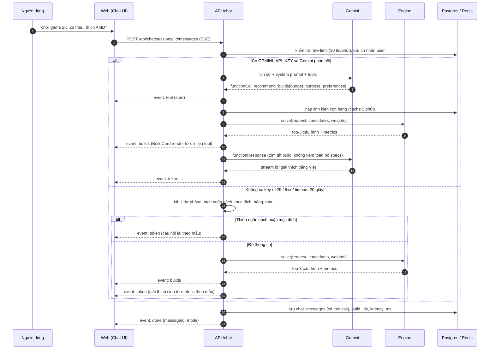
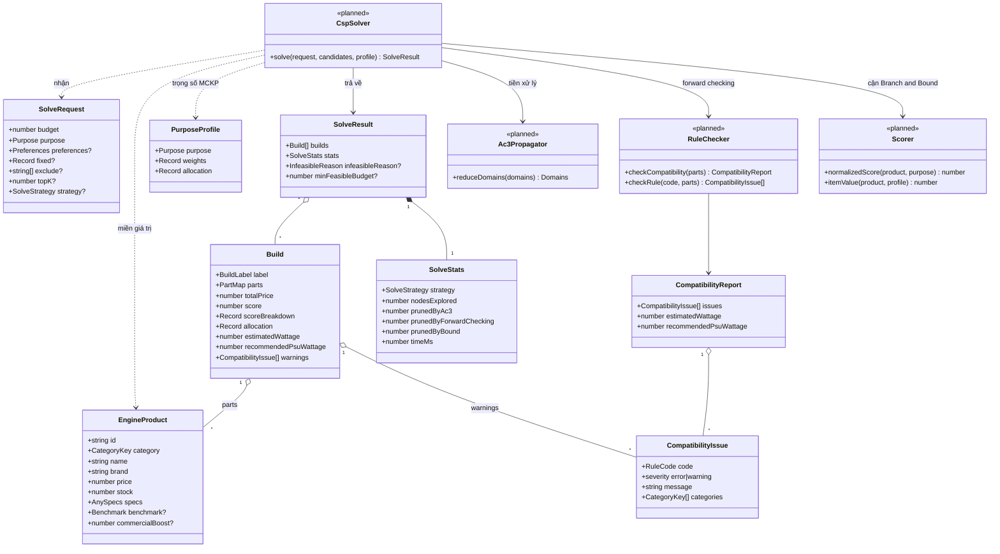
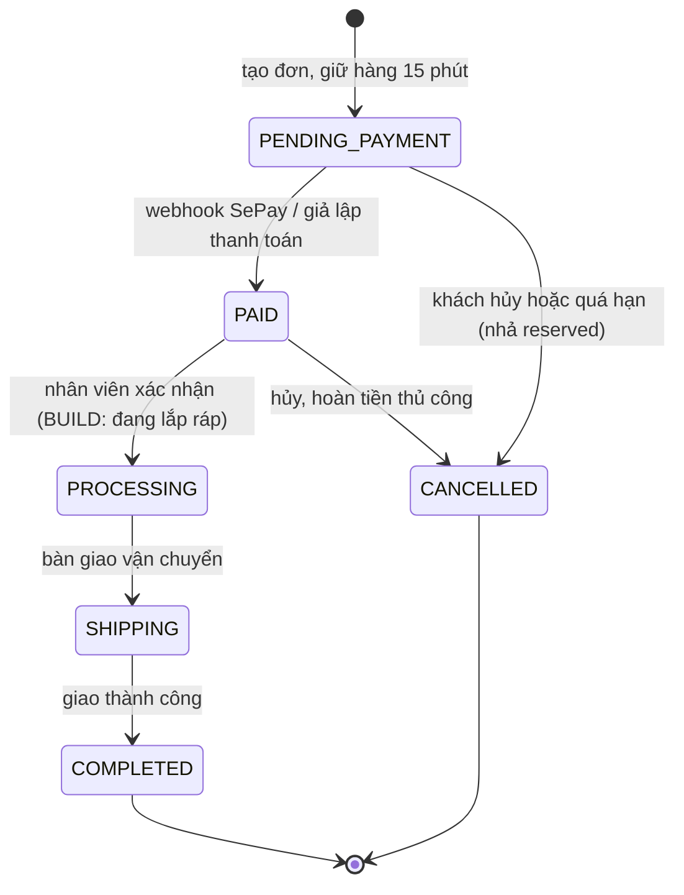
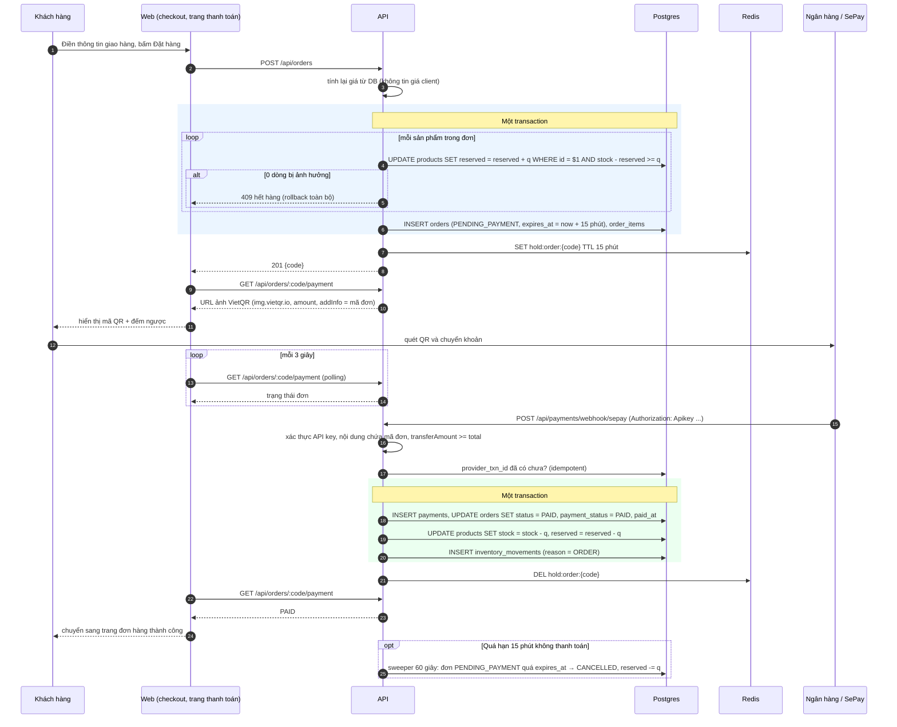

# CH5 — Chương 5 - Giải pháp và đóng góp nổi bật

Sinh tự động bởi `pnpm graph` — tư liệu thô để viết báo cáo, không sửa tay (sửa ở node tương ứng).

## Dàn ý chương

**Nội dung cần viết:** mỗi mục là một đóng góp, trình bày vấn đề → giải pháp → kết quả đo được.
1. **Optimization Engine: CSP + MCKP** - mô hình hóa, AC-3, Forward Checking, Branch and Bound, số liệu so sánh 4 biến thể (T-ENGINE-BENCH).
2. **AI PC Advisor** - kiến trúc chống ảo giác (LLM điều phối, Engine quyết định), guardrails, kết quả golden set.
3. **Chế độ dự phòng** - NLU tiếng Việt theo luật, không phụ thuộc quota.
4. **Chống bán vượt tồn kho** - UPDATE có điều kiện, giữ hàng 15 phút, thí nghiệm đặt hàng đồng thời.
5. **Thông số động với JSONB + GIN** - form schema động, truy vấn chứa, so sánh với/không chỉ mục.

**Nguồn trong graph:** các node gắn nhãn CH5 (tính năng, thuật toán, quyết định, test) bên dưới.

Tổng cộng **23** node thuộc chương này.

## Tính năng

### F-ADMIN-WEIGHTS — Quản trị ma trận trọng số và hệ số ưu tiên thương mại

Trạng thái: **planned**
Liên kết — realizes: FR-14, UC-14 · dependsOn: M-ADMIN, E-PURPOSE-WEIGHT, ALG-MCKP, ALG-SCORING, F-AUTH · shownIn: SCR-ADMIN-WEIGHTS

**Mục đích:** cho phép hiệu chỉnh hành vi thuật toán theo phản hồi thực tế (nội dung 6 của phiếu) mà không phải sửa code.

**Mô tả:** `WeightMatrixEditor` hiển thị ma trận 4 mục đích x 8 danh mục gồm trọng số `w` và khoảng phân bổ ngân sách (min-max %), lưu vào bảng `purpose_weights` (`updated_by` ghi người sửa). `commercialBoost` của sản phẩm cộng thêm vào giá trị MCKP để đẩy hàng tồn hoặc hàng khuyến mại. Lưu xong xóa cache gợi ý để lần sau dùng trọng số mới.

**Code:** `apps/api/src/modules/admin/weights/**`, `apps/web/src/features/admin/weights/**`

**Test:** `apps/api/src/modules/admin/**/*.int.test.ts`, `e2e/admin-weights.spec.ts`

### F-AI-ADVISOR — AI PC Advisor: chatbot Gemini điều phối Engine qua function calling

Trạng thái: **planned**
Liên kết — realizes: FR-07, UC-03, NFR-02, NFR-05 · dependsOn: M-CHAT, M-CHAT-LLM, F-ENGINE-CORE, F-FALLBACK-NLU, F-RECOMMEND, E-CHAT-SESSION, E-CHAT-MESSAGE · decidedBy: ADR-003, ADR-004, ADR-005 · shownIn: SCR-ADVISOR, SCR-HOME, SCR-ADMIN-CHATLOGS

**Mục đích:** tính năng nổi bật của hệ thống - người dùng nói nhu cầu bằng tiếng Việt, nhận cấu hình thật trong kho thay vì tự học thuật ngữ phần cứng.

**Mô tả:** API `POST /chat/sessions/:id/messages` trả luồng SSE. Orchestrator gửi lịch sử và system prompt kèm 5 tool cho Gemini (`recommend_builds`, `search_products`, `get_product_details`, `check_compatibility`, `modify_build`). Khi model gọi tool, API chạy Engine/DB thật và trả kết quả tóm tắt về cho model; thẻ cấu hình được gửi riêng tới web từ dữ liệu tool nên giá luôn đúng. Giới hạn 4 vòng tool mỗi lượt, timeout 20 giây, rate limit 10 tin/phút, cache kết quả tool theo băm tham số 10 phút. Toàn bộ hội thoại và tool call được lưu để xem lại và phân tích.

**Quyết định chính:** ADR-003 chọn Gemini free tier với function calling; ADR-004 LLM chỉ điều phối, Engine quyết định; ADR-005 chế độ dự phòng khi Gemini không dùng được.

**Điểm nhấn cho báo cáo (CH5):** kiến trúc chống ảo giác (guardrails), so sánh với chatbot thuần LLM, kết quả golden-set 30 kịch bản.

**Code:** `apps/api/src/modules/chat/**`, `apps/web/src/features/advisor/**`

**Test:** `apps/api/src/modules/chat/**/*.test.ts`, `apps/api/src/modules/chat/**/*.int.test.ts`

**Sơ đồ:** `docs/diagrams/seq-ai-advisor.mmd`

### F-CATALOG — Danh mục sản phẩm, lọc theo thông số JSONB và trang chi tiết

Trạng thái: **planned**
Liên kết — realizes: FR-01, FR-02, UC-01 · dependsOn: M-CATALOG, E-PRODUCT, E-CATEGORY, E-BENCHMARK · decidedBy: ADR-002 · shownIn: SCR-CATEGORY, SCR-PRODUCT

**Mục đích:** cho khách duyệt và lọc hàng trăm linh kiện có thuộc tính kỹ thuật khác nhau mà không cần một bảng cột riêng cho từng loại.

**Mô tả:** mỗi danh mục khai báo `specSchema` (danh sách trường: khóa, nhãn, kiểu, có lọc được hay không). Thông số của sản phẩm nằm trong cột JSONB `products.specs`. API trả facet (các giá trị và số lượng) sinh từ schema để web dựng bộ lọc động. Lọc theo thông số dùng phép chứa JSONB, ví dụ `specs @> '{"socket":"AM5","memoryType":["DDR5"]}'`, được tăng tốc bằng chỉ mục GIN `jsonb_path_ops`; lọc theo giá dùng chỉ mục `(category_id, price)`; tìm theo tên dùng GIN trên `to_tsvector`.

**Quyết định chính:** dùng JSONB + GIN thay vì mô hình EAV để truy vấn nhanh và thêm danh mục/thuộc tính mà không đổi schema; dữ liệu JSONB vẫn được kiểm tra bằng Zod theo schema từng danh mục. Trang chi tiết render SSR để tối ưu SEO.

**Điểm nhấn cho báo cáo (CH5):** truy vấn JSONB containment + GIN, so sánh có/không có chỉ mục (số liệu EXPLAIN ANALYZE).

**Code:** `apps/api/src/modules/catalog/**`, `apps/web/src/features/catalog/**`

**Test:** `apps/api/src/modules/catalog/**/*.int.test.ts`

### F-COMPAT-CHECK — Kiểm tra tương thích linh kiện theo bộ luật C01-C14

Trạng thái: **planned**
Liên kết — realizes: FR-09, UC-05 · dependsOn: M-COMPATIBILITY, M-ENGINE, ALG-CSP · decidedBy: ADR-001

**Mục đích:** trả lời "bộ linh kiện này có lắp được và chạy ổn không?" bằng danh sách lỗi (cứng) và cảnh báo (mềm).

**Mô tả:** mỗi luật là một hàm thuần có mã (C01-C14), mức độ (error/warning) và thông điệp tiếng Việt, ví dụ socket CPU không khớp mainboard, RAM sai chuẩn, GPU dài hơn case cho phép, nguồn thiếu công suất. Kết quả kèm công suất ước tính và công suất nguồn khuyến nghị. API `POST /compatibility/check` bọc cùng bộ luật cho client không có Engine.

**Quyết định chính:** luật là dữ liệu của miền (có mã) nên có thể xuất hiện trong thông báo và test; luật nhị phân được dùng lại làm ràng buộc cho CSP.

**Code:** `packages/engine/src/rules/**`, `apps/api/src/modules/compatibility/**`

**Test:** `packages/engine/src/rules/**/*.test.ts`, `apps/api/src/modules/compatibility/**/*.int.test.ts`

### F-CUSTOMIZER — Interactive PC Customizer: lắp ráp tự do với kiểm tra tương thích tức thì

Trạng thái: **planned**
Liên kết — realizes: FR-09, UC-05 · dependsOn: F-COMPAT-CHECK, M-WEB-STATE, M-ENGINE, F-CATALOG · decidedBy: ADR-001 · shownIn: SCR-BUILDER

**Mục đích:** cho người đã biết mình muốn gì tự lắp từng linh kiện nhưng vẫn được bảo vệ khỏi chọn sai.

**Mô tả:** trang `/builder` có 8 slot linh kiện; chọn linh kiện qua `PartPicker` (drawer có lọc). Mỗi lần đổi, `useBuilderStore` chạy bộ luật của `@pc/engine` ngay trên trình duyệt để cập nhật huy hiệu tương thích, tổng giá và công suất mà không gọi mạng. Khi lưu hoặc thêm vào giỏ, server kiểm tra lại bằng `POST /compatibility/check`. Có nút "Mở trong Customizer" nhận cấu hình từ chatbot hoặc form.

**Quyết định chính:** chạy cùng một bộ luật ở client và server (ADR-001) - phản hồi tức thì nhưng server vẫn là nguồn chân lý.

**Code:** `apps/web/src/features/builder/**`

**Test:** `apps/web/src/features/builder/**/*.test.ts`, `e2e/customizer.spec.ts`

**Sơ đồ:** `docs/diagrams/seq-customizer-check.mmd`

### F-ENGINE-CORE — Optimization Engine: bộ giải CSP + MCKP thuần TypeScript

Trạng thái: **planned**
Liên kết — realizes: FR-08, FR-09, NFR-01, NFR-08 · dependsOn: M-ENGINE, ALG-CSP, ALG-AC3, ALG-FC, ALG-BNB, ALG-MCKP, ALG-SCORING, ALG-TOPK, F-COMPAT-CHECK · decidedBy: ADR-001, ADR-004

**Mục đích:** là lõi học thuật của đề tài - biến bài toán "chọn linh kiện tương thích và tối ưu hiệu năng trong ngân sách" thành bài toán CSP kết hợp MCKP và giải bằng thuật toán tìm kiếm có cắt tỉa.

**Mô tả:** Engine là package thuần (không I/O) nhận danh sách ứng viên còn hàng + yêu cầu (ngân sách, mục đích, tùy chọn, linh kiện cố định) và trả về tối đa 3 cấu hình kèm điểm, phân bổ ngân sách, công suất ước tính, cảnh báo và số liệu thống kê (số nút duyệt, số nhánh bị cắt bởi AC-3/FC/bound, thời gian). Cùng bộ luật tương thích C01-C14 được dùng ở server (nguồn chân lý) và ở client (kiểm tra tức thì trong Customizer).

**Quyết định chính:** ADR-001 tách thành package riêng để test độc lập và dùng chung FE/BE; ADR-004 Engine là bên quyết định linh kiện, LLM chỉ điều phối.

**Đánh giá:** harness `bench` chạy 4 biến thể (brute force giới hạn, backtracking, +FC, +AC-3 và B&B) trên catalog 50/100/250/500 sản phẩm - bảng số liệu cho chương 4.

**Code:** `packages/engine/src/**`

**Test:** `packages/engine/src/**/*.test.ts`, `packages/engine/bench/**`

**Sơ đồ:** `docs/diagrams/class-engine.mmd`

### F-FALLBACK-NLU — Chế độ dự phòng: NLU tiếng Việt theo luật và giải thích theo mẫu

Trạng thái: **planned**
Liên kết — realizes: FR-17, NFR-04 · dependsOn: M-CHAT, ALG-NLU-FALLBACK, F-ENGINE-CORE · decidedBy: ADR-005

**Mục đích:** bảo đảm buổi demo và người dùng thật không bao giờ gặp "trang trắng" khi Gemini hết quota hoặc mất mạng.

**Mô tả:** khi không có `GEMINI_API_KEY`, Gemini trả 429/5xx hoặc quá thời gian chờ, orchestrator chuyển sang parser rule-based tách ngân sách (`25tr`, `25 triệu`, `25.000.000`, `25m`), mục đích (từ khóa game, valorant, đồ họa, premiere, AI, văn phòng...), độ phân giải, hãng, màu, Wi-Fi. Thiếu ngân sách hoặc mục đích thì hỏi lại theo mẫu. Sau đó gọi đúng Engine như chế độ AI và sinh lời giải thích từ số liệu (phân bổ %, bậc CPU/GPU, dư công suất nguồn). Giao diện hiển thị nhãn "Chế độ dự phòng".

**Code:** `apps/api/src/modules/chat/nlu/**`

**Test:** `apps/api/src/modules/chat/nlu/**/*.test.ts`

### F-INVENTORY-LOCK — Chống bán vượt: cập nhật có điều kiện trong transaction và giữ hàng 15 phút

Trạng thái: **planned**
Liên kết — realizes: FR-18, UC-09 · dependsOn: M-ORDERS, E-PRODUCT, E-INVENTORY-MOVEMENT · decidedBy: ADR-007

**Mục đích:** hai khách cùng đặt chiếc cuối cùng thì chỉ một người đặt được, không âm kho.

**Mô tả:** khi tạo đơn, trong một transaction chạy `UPDATE products SET reserved = reserved + q WHERE id = $1 AND stock - reserved >= q` cho từng dòng; nếu một dòng không cập nhật được dòng nào thì rollback toàn bộ và báo hết hàng. Sau khi thanh toán: `stock -= q, reserved -= q` và ghi `inventory_movements`. Hủy hoặc quá hạn: `reserved -= q`. Khóa Redis `hold:order:{code}` TTL 15 phút và sweeper 60 giây quét đơn PENDING_PAYMENT quá `expires_at`.

**Quyết định chính:** ADR-007 - điều kiện nằm trong câu UPDATE nên atomic ở tầng cơ sở dữ liệu, không cần khóa phân tán; Redis chỉ làm đồng hồ giữ hàng.

**Điểm nhấn cho báo cáo (CH5):** thí nghiệm đặt hàng đồng thời (N yêu cầu song song cho M sản phẩm trong kho) chứng minh không bán vượt.

**Code:** `apps/api/src/modules/orders/**`

**Test:** `apps/api/src/modules/orders/**/*.int.test.ts`

### F-ORDER — Đặt hàng lẻ / nguyên bộ và vòng đời đơn

Trạng thái: **planned**
Liên kết — realizes: FR-05, UC-09, UC-11 · dependsOn: M-ORDERS, E-ORDER, E-ORDER-ITEM, F-INVENTORY-LOCK, F-CART · shownIn: SCR-CHECKOUT, SCR-ACCOUNT

**Mục đích:** biến giỏ hàng thành đơn có thể thanh toán, theo dõi và xử lý.

**Mô tả:** `POST /orders` tính lại giá từ DB, tạo đơn RETAIL hoặc BUILD (cộng `ASSEMBLY_FEE` với đơn nguyên bộ), lưu ảnh chụp tên và giá từng dòng (`name_snapshot`, `price_snapshot`) để lịch sử không đổi khi giá đổi. Vòng đời được định nghĩa trong máy trạng thái `orders.state.ts` (xem sơ đồ): chỉ cho phép các chuyển trạng thái hợp lệ; hủy khi PAID cần hoàn tiền thủ công.

**Code:** `apps/api/src/modules/orders/**`, `apps/web/src/features/checkout/**`

**Test:** `apps/api/src/modules/orders/**/*.test.ts`, `apps/api/src/modules/orders/**/*.int.test.ts`

**Sơ đồ:** `docs/diagrams/state-order.mmd`

### F-PAYMENT-VIETQR — Thanh toán VietQR động, webhook SePay và giả lập

Trạng thái: **planned**
Liên kết — realizes: FR-06, UC-10 · dependsOn: M-PAYMENTS, E-PAYMENT, F-ORDER, F-INVENTORY-LOCK · decidedBy: ADR-008 · shownIn: SCR-PAY

**Mục đích:** nhận tiền chuyển khoản và tự chuyển đơn sang đã thanh toán mà không cần nhân viên đối soát tay.

**Mô tả:** URL ảnh QR dựng theo `https://img.vietqr.io/image/{BANK_BIN}-{ACCOUNT_NO}-compact2.png?amount={total}&addInfo={orderCode}`. Webhook `POST /payments/webhook/sepay` kiểm tra header `Authorization: Apikey ...`, nội dung chuyển khoản chứa mã đơn, số tiền `transferAmount >= total`, và idempotent theo `provider_txn_id` (cột unique) nên gửi lặp không cộng hai lần. Trang thanh toán poll mỗi 3 giây. `POST /payments/:orderCode/simulate` chỉ cho dev/admin để demo.

**Quyết định chính:** ADR-008 - dùng dịch vụ miễn phí và chuẩn webhook SePay để demo được mà không cần hợp đồng ngân hàng thật.

**Code:** `apps/api/src/modules/payments/**`, `apps/web/src/features/payment/**`

**Test:** `apps/api/src/modules/payments/**/*.test.ts`, `apps/api/src/modules/payments/**/*.int.test.ts`

**Sơ đồ:** `docs/diagrams/seq-checkout-vietqr.mmd`

### F-RECOMMEND — Gợi ý cấu hình theo form (ngân sách, mục đích, tùy chọn)

Trạng thái: **planned**
Liên kết — realizes: FR-08, UC-04, NFR-01 · dependsOn: M-RECOMMENDATION, F-ENGINE-CORE, E-PURPOSE-WEIGHT, E-BUILD · decidedBy: ADR-004 · shownIn: SCR-HOME, SCR-ADVISOR

**Mục đích:** cho người dùng không muốn chat vẫn nhận 2-3 cấu hình tối ưu chỉ với một form ngắn.

**Mô tả:** `POST /recommendations` nhận `{budget, purpose, preferences}`, nạp ứng viên còn hàng (cache Redis 5 phút theo danh mục), nạp ma trận trọng số từ bảng `purpose_weights`, gọi Engine và lưu các cấu hình thành `builds` (nguồn FORM). Kết quả cache theo băm của request trong 10 phút. Nếu không khả thi, trả lý do (ngân sách quá thấp, không có tổ hợp tương thích) kèm ngân sách tối thiểu khả thi.

**Code:** `apps/api/src/modules/recommendation/**`, `apps/web/src/features/recommend/**`

**Test:** `apps/api/src/modules/recommendation/**/*.int.test.ts`

## Thuật toán

### ALG-AC3 — Nhất quán cung AC-3 (tiền xử lý miền)

Trạng thái: **planned**
Liên kết — refines: F-ENGINE-CORE · dependsOn: ALG-CSP

**Mục đích:** loại sớm các giá trị của miền không thể nằm trong bất kỳ lời giải nào.

**Mô tả:** trên các ràng buộc nhị phân (C01-C07, C10-C12), AC-3 duyệt hàng đợi các cung (X, Y); với mỗi giá trị của X mà không có giá trị nào của Y hỗ trợ (thỏa ràng buộc) thì xóa khỏi miền X, và đưa lại các cung liên quan vào hàng đợi cho đến khi ổn định. Ví dụ: mọi mainboard socket AM4 bị loại nếu không còn CPU AM4 nào trong miền sau khi lọc hãng Intel.

**Độ phức tạp:** O(e·d³) với e ràng buộc, d kích thước miền lớn nhất. Số giá trị bị loại được ghi vào `stats.prunedByAc3` để báo cáo.

**Code:** `packages/engine/src/solver/**`

**Test:** `packages/engine/src/**/*.test.ts`

### ALG-BNB — Branch and Bound cho mục tiêu tối đa hóa điểm trong ngân sách

Trạng thái: **planned**
Liên kết — refines: F-ENGINE-CORE · dependsOn: ALG-CSP, ALG-MCKP, ALG-SCORING

**Mục đích:** không chỉ tìm cấu hình hợp lệ mà tìm cấu hình có điểm hiệu năng cao nhất trong ngân sách.

**Cận trên điểm:** điểm hiện tại + tổng điểm lớn nhất còn đạt được ở mỗi miền chưa gán; nếu không vượt điểm thấp nhất trong top-K hiện có thì cắt nhánh.
**Cận chi phí:** chi phí hiện tại + tổng giá nhỏ nhất của mỗi miền chưa gán; nếu vượt ngân sách thì cắt nhánh.

Số nhánh bị cắt ghi vào `stats.prunedByBound`. Cùng với AC-3 và FC, đây là biến thể "full" trong bộ benchmark 4 biến thể; mục tiêu thời gian giải dưới 300 ms p95 với khoảng 250 sản phẩm (NFR-01).

**Code:** `packages/engine/src/**`

**Test:** `packages/engine/src/**/*.test.ts`

### ALG-CSP — Mô hình CSP và Backtracking với thứ tự biến MRV

Trạng thái: **planned**
Liên kết — refines: F-ENGINE-CORE · dependsOn: ALG-AC3, ALG-FC, ALG-BNB · decidedBy: ADR-004

**Mô hình hóa (phiếu giao nhiệm vụ, nội dung 3):** bài toán chọn linh kiện được phát biểu là một CSP.
- **Biến:** CPU, MAINBOARD, RAM, GPU, STORAGE, PSU, CASE, COOLER (GPU tùy chọn nếu CPU có đồ họa tích hợp và mục đích là văn phòng).
- **Miền:** các sản phẩm còn hàng của danh mục, sau khi lọc theo tùy chọn người dùng và loại bỏ các giá trị bị trội (dominance pruning).
- **Ràng buộc:** các luật C01-C14 (xem các node R-C01..R-C14); ràng buộc nhị phân giữa hai biến dùng cho AC-3 và forward checking, ràng buộc toàn cục (tổng công suất, tổng giá) kiểm tra khi gán đủ biến hoặc dùng làm cận.

**Thuật toán:** backtracking gán lần lượt từng biến. Thứ tự biến theo heuristic MRV (miền nhỏ nhất trước), mặc định `CPU → MAINBOARD → RAM → COOLER → GPU → CASE → PSU → STORAGE`. Sau mỗi phép gán chạy Forward Checking (ALG-FC); miền rỗng thì quay lui. Tiền xử lý bằng AC-3 (ALG-AC3) và cắt nhánh bằng Branch and Bound (ALG-BNB).

**Vì sao cần:** không gian tìm kiếm tích các miền (hàng chục đến hàng trăm giá trị cho 8 biến) quá lớn để duyệt vét cạn; số liệu bench so sánh vét cạn giới hạn và các biến thể cắt tỉa được trình bày ở chương 4.

**Code:** `packages/engine/src/solver/**`

**Test:** `packages/engine/src/solver/**/*.test.ts`

### ALG-FC — Forward Checking trong lúc gán biến

Trạng thái: **planned**
Liên kết — refines: F-ENGINE-CORE · dependsOn: ALG-CSP

**Mục đích:** phát hiện sớm nhánh tìm kiếm chắc chắn thất bại.

**Mô tả:** sau khi gán biến X = v, với mỗi biến Y chưa gán có ràng buộc với X, loại khỏi miền Y mọi giá trị mâu thuẫn với v. Nếu miền của Y rỗng thì quay lui ngay mà không cần thử tiếp. Miền được khôi phục khi quay lui (lưu ảnh chụp thay đổi theo từng mức). Số giá trị bị loại ghi vào `stats.prunedByForwardChecking`.

**So với backtracking thuần:** backtracking chỉ phát hiện mâu thuẫn khi gán biến vi phạm; FC phát hiện sớm hơn nhiều tầng nên giảm mạnh số nút duyệt.

**Code:** `packages/engine/src/**`

**Test:** `packages/engine/src/**/*.test.ts`

### ALG-MCKP — Mô hình Bài toán cái túi đa lựa chọn (MCKP) để phân bổ ngân sách

Trạng thái: **planned**
Liên kết — refines: F-ENGINE-CORE · dependsOn: ALG-SCORING, ALG-BNB

**Mô hình hóa (phiếu giao nhiệm vụ, nội dung 3):** mỗi danh mục là một **lớp**, phải chọn đúng một sản phẩm từ mỗi lớp. Giá trị của sản phẩm `v = w_purpose[c] × normScore(item) + commercialBoost(item)`, trọng lượng là giá, sức chứa là ngân sách.

**Ma trận trọng số `w_purpose`** và khoảng phân bổ ngân sách gợi ý (min-max % cho từng danh mục) nằm trong bảng `purpose_weights` và admin chỉnh được (FR-14). Ví dụ: mục đích chơi game dồn trọng số vào GPU và CPU đơn nhân; AI dồn vào VRAM và RAM; văn phòng coi trọng giá.

**Quyết định:** khoảng phân bổ % được dùng để **sắp xếp miền và làm heuristic** (giá trị nằm trong khoảng được ưu tiên) chứ không phải ràng buộc cứng, để không làm mất lời giải tốt chỉ vì lệch tỷ lệ gợi ý. Việc giải chính xác kết hợp ràng buộc tương thích do backtracking + B&B đảm nhiệm vì MCKP thuần không biểu diễn được ràng buộc giữa các lớp.

**Code:** `packages/engine/src/**`

**Test:** `packages/engine/src/**/*.test.ts`

### ALG-NLU-FALLBACK — Bộ phân tích ngôn ngữ tiếng Việt theo luật cho chế độ dự phòng

Trạng thái: **planned**
Liên kết — refines: F-FALLBACK-NLU

**Mục đích:** hiểu tối thiểu "ngân sách, mục đích, tùy chọn" từ câu tiếng Việt khi không có Gemini.

**Mô tả:** chuẩn hóa văn bản (chữ thường, bỏ dấu để so khớp từ khóa nhưng vẫn giữ bản có dấu để hiển thị), rồi tách từng thực thể bằng biểu thức chính quy và từ điển từ khóa:
- **Ngân sách:** `25tr`, `25 triệu`, `25.000.000`, `25m`, `1 tỷ` (cắt về trần ngân sách).
- **Mục đích:** game/valorant/pubg/lol → gaming; đồ họa/premiere/blender/dựng phim → graphics; AI/deep learning/lập trình → ai; văn phòng/học tập → office.
- **Độ phân giải** 1080p/2K/4K, **hãng** AMD/Intel/NVIDIA/RTX/Radeon, **màu** trắng/đen, **Wi-Fi**.

Thiếu ngân sách hoặc mục đích thì sinh câu hỏi lại theo mẫu. Bộ kiểm thử gồm tối thiểu 40 câu tiếng Việt đa dạng cách viết.

**Code:** `apps/api/src/modules/chat/nlu/**`

**Test:** `apps/api/src/modules/chat/nlu/**/*.test.ts`

### ALG-SCORING — Chuẩn hóa điểm hiệu năng theo danh mục và mục đích

Trạng thái: **planned**
Liên kết — refines: F-ENGINE-CORE · dependsOn: E-BENCHMARK

**Mục đích:** đưa các đại lượng khác nhau (điểm benchmark CPU/GPU, dung lượng, tốc độ) về thang 0-100 để cộng được với nhau.

**Mô tả:** CPU dùng điểm đơn nhân/đa nhân, GPU dùng điểm raster, RAM dùng dung lượng × tốc độ, ổ cứng dùng dung lượng và tốc độ đọc; mỗi danh mục chuẩn hóa theo min-max trong tập ứng viên. Mục đích quyết định trọng số con: chơi game coi trọng đơn nhân + GPU; đồ họa coi trọng đa nhân + VRAM; AI coi trọng VRAM + RAM; văn phòng coi trọng giá. Điểm tổng của cấu hình là tổng có trọng số; `scoreBreakdown` ghi điểm từng danh mục. Hệ số `commercialBoost` được cộng với trọng số nhỏ.

**Code:** `packages/engine/src/scoring/**`

**Test:** `packages/engine/src/scoring/**/*.test.ts`

### ALG-TOPK — Chọn top-K cấu hình đa dạng và gắn nhãn

Trạng thái: **planned**
Liên kết — refines: F-ENGINE-CORE · dependsOn: ALG-BNB

**Mục đích:** trả cho người dùng 2-3 lựa chọn thật sự khác nhau thay vì ba biến thể gần giống.

**Mô tả:** giữ heap K = 3 theo nhãn: **Tối ưu hiệu năng** (điểm cao nhất), **Cân bằng** (điểm/giá cao nhất), **Tiết kiệm** (điểm đạt ít nhất 85% mức tốt nhất, giá thấp nhất). Các cấu hình phải khác nhau về CPU hoặc GPU. Cấu hình có tổng giá dưới 85% ngân sách bị cảnh báo là chưa tận dụng hết ngân sách (luật C14 mềm).

**Code:** `packages/engine/src/**`

**Test:** `packages/engine/src/**/*.test.ts`

## Quyết định thiết kế

### ADR-003 — Google Gemini qua @google/genai, model gemini-flash-latest cấu hình bằng biến môi trường

Trạng thái: **done**

**Quyết định:** dùng Gemini qua SDK `@google/genai` 2.x, model mặc định `gemini-flash-latest`, đổi được qua `GEMINI_MODEL`; timeout `GEMINI_TIMEOUT_MS`.

**Lý do:** có gói miễn phí (API key free tier) phù hợp đồ án, hỗ trợ function calling để điều phối Engine và streaming để hiển thị chữ chạy dần.

**Hệ quả:** quota miễn phí có giới hạn nên bắt buộc có chế độ dự phòng (ADR-005); truy cập qua giao diện `LlmClient` để test bằng LLM giả và đổi nhà cung cấp mà không đụng nghiệp vụ.

**Code:** `apps/api/src/modules/chat/llm/factory.ts`, `apps/api/src/config/env.ts`

### ADR-004 — LLM chỉ điều phối, Engine quyết định linh kiện

Trạng thái: **done**

**Bối cảnh:** mô hình ngôn ngữ có thể "bịa" linh kiện, giá hoặc đề xuất bộ không tương thích - các lỗi coi như làm hỏng sản phẩm dù hệ thống chạy được.

**Quyết định:** Gemini chỉ hiểu ý định và gọi tool; việc chọn linh kiện, kiểm tra tương thích và tính giá do Engine và cơ sở dữ liệu thực hiện. System prompt bắt buộc gọi tool trước khi nêu bất kỳ linh kiện/giá nào; thẻ cấu hình (BuildCard) được dựng từ dữ liệu tool, không từ văn bản LLM; hội thoại tóm tắt gửi lại cho model không chứa toàn bộ specs.

**Lý do:** chống ảo giác, đảm bảo tính đúng đắn (NFR-05) và tương thích 100% bằng thuật toán có thể chứng minh được.

**Hệ quả:** mọi khả năng mới của chatbot phải đi qua tool; chất lượng cấu hình độc lập với chất lượng LLM.

**Code:** `packages/engine/package.json`, `packages/shared/src/chat-events.ts`

### ADR-005 — Chế độ dự phòng rule-based khi không có khóa, lỗi 429 hoặc hết thời gian chờ

Trạng thái: **done**

**Quyết định:** nếu `GEMINI_API_KEY` trống, Gemini trả 429/5xx hoặc quá `GEMINI_TIMEOUT_MS`, orchestrator dùng parser NLU tiếng Việt theo luật và giải thích theo mẫu, vẫn gọi cùng Engine; giao diện hiện nhãn "Chế độ dự phòng". Trong `AppDeps`, `llm` là `undefined` nghĩa là dự phòng.

**Lý do:** demo bảo vệ không được phụ thuộc quota hay mạng (anti-goal của spec).

**Hệ quả:** phải duy trì hai đường xử lý và bộ test NLU; `GET /api/health` báo `ai: gemini | fallback` để biết đang ở chế độ nào.

**Code:** `apps/api/src/modules/chat/llm/factory.ts`, `apps/api/src/deps.ts`

### ADR-007 — Chống bán vượt bằng UPDATE có điều kiện trong transaction và giữ hàng Redis TTL 15 phút

Trạng thái: **done**

**Quyết định:** khi tạo đơn, mỗi dòng chạy `UPDATE products SET reserved = reserved + q WHERE id = $1 AND stock - reserved >= q` trong transaction; không dòng nào bị ảnh hưởng thì rollback và báo hết hàng. Thanh toán thành công: `stock -= q, reserved -= q`. Giữ hàng `ORDER_HOLD_MINUTES` (mặc định 15) bằng khóa Redis và sweeper.

**Lý do:** điều kiện nằm trong chính câu UPDATE nên atomic ở tầng cơ sở dữ liệu, an toàn khi đồng thời mà không cần khóa phân tán; tách `stock` và `reserved` để hàng chờ thanh toán không bị bán cho người khác nhưng cũng không bị trừ vĩnh viễn nếu khách bỏ ngang.

**Phương án đã cân nhắc:** khóa bi quan `SELECT ... FOR UPDATE` (giữ khóa lâu, giảm thông lượng); khóa Redis phân tán (thêm điểm lỗi, không cần thiết khi đã có transaction).

**Code:** `apps/api/src/db/schema.ts`, `apps/api/src/config/env.ts`
