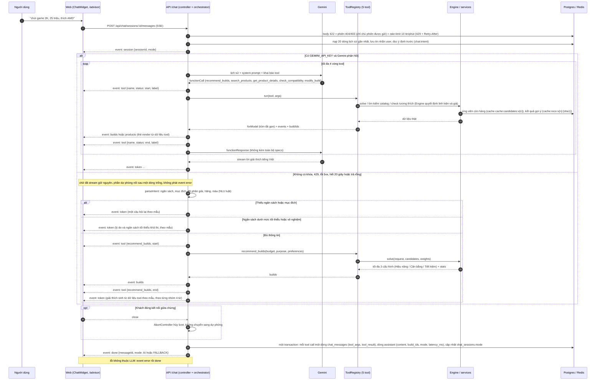
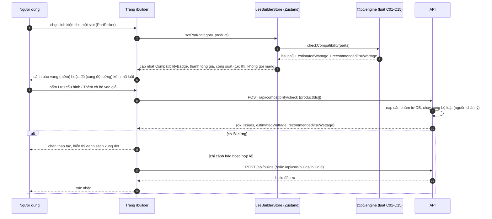
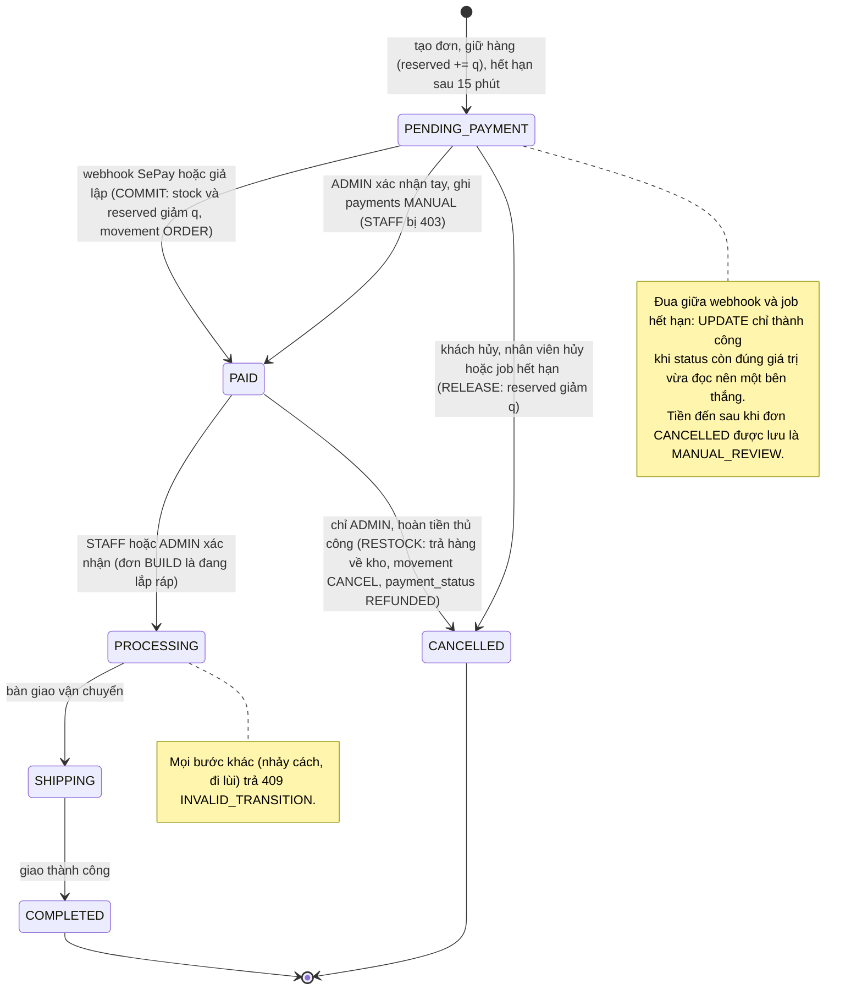
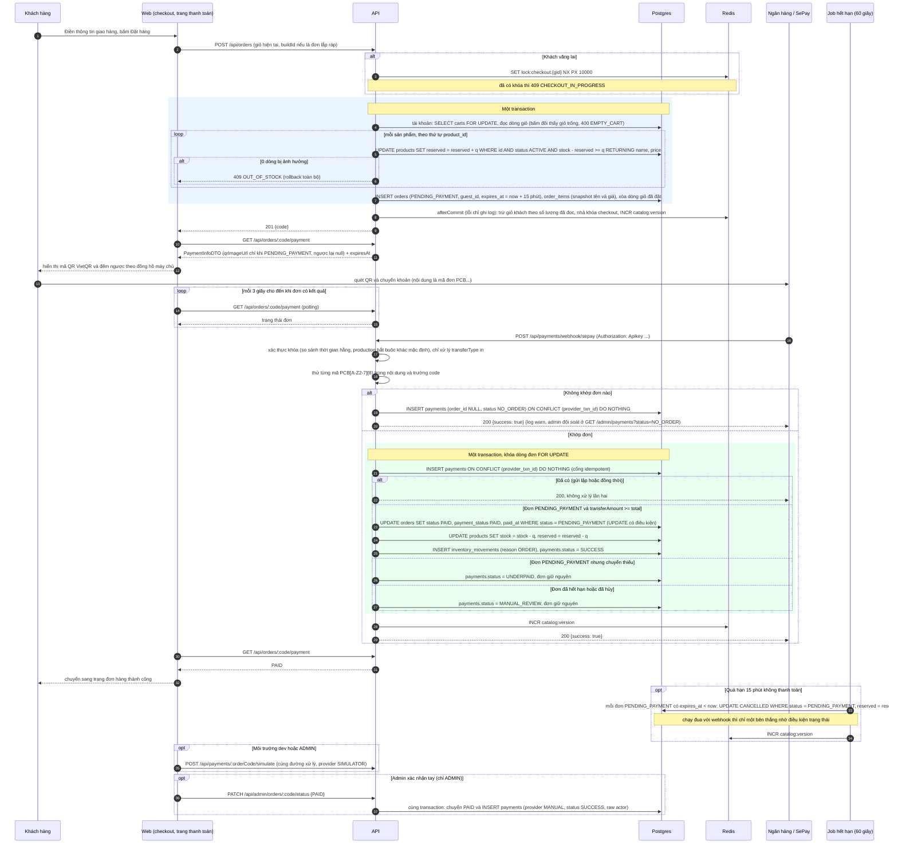

# CH5 — Chương 5 - Giải pháp và đóng góp nổi bật

Sinh tự động bởi `pnpm graph` — tư liệu thô để viết báo cáo, không sửa tay (sửa ở node tương ứng).

## Dàn ý chương

**Nội dung cần viết:** mỗi mục là một đóng góp, trình bày vấn đề → giải pháp → kết quả đo được.
1. **Optimization Engine: CSP + MCKP** - mô hình hóa, AC-3, Forward Checking, Branch and Bound, số liệu so sánh 4 biến thể (T-ENGINE-BENCH).
2. **AI PC Advisor** - kiến trúc chống ảo giác (LLM điều phối, Engine quyết định), guardrails, kết quả golden set.
3. **Chế độ dự phòng** - NLU tiếng Việt theo luật, không phụ thuộc quota.
4. **Chống bán vượt tồn kho** - UPDATE có điều kiện, giữ hàng 15 phút, thí nghiệm đặt hàng đồng thời.
5. **Thông số động với JSONB + GIN** - form schema động, truy vấn chứa, EXPLAIN chọn `products_specs_gin` (F-CATALOG).
6. **Các quyết định rút ra khi phát triển (ADR-012 đến ADR-021)** - chấm điểm theo mức đủ dùng, hệ số CUDA, luật mềm C15, khóa cache có phiên bản, JWT có `typ` và chính sách refresh-race, `orders.guest_id` cùng khóa checkout, phân tích ngân sách tiếng Việt, báo cáo điểm hai mức, hợp đồng nhãn top-K, lưu giao dịch không khớp đơn và xác nhận tay chỉ ADMIN. Mỗi mục: tình huống phát hiện (lỗi hoặc hành vi lạ khi chạy thử), quyết định, kết quả đo.

**Nguồn trong graph:** các node gắn nhãn CH5 (tính năng, thuật toán, quyết định, test) bên dưới.

Tổng cộng **38** node thuộc chương này.

## Tính năng

### F-ADMIN-WEIGHTS — Quản trị ma trận trọng số và hệ số ưu tiên thương mại

Trạng thái: **done**
Liên kết — realizes: FR-14, UC-14 · dependsOn: M-ADMIN, E-PURPOSE-WEIGHT, ALG-MCKP, ALG-SCORING, F-AUTH · shownIn: SCR-ADMIN-WEIGHTS

**Mục đích:** cho phép hiệu chỉnh hành vi thuật toán theo phản hồi thực tế (nội dung 6 của phiếu) mà không phải sửa code.

**Mô tả:** `WeightMatrixEditor` hiển thị ma trận 4 mục đích x 8 danh mục gồm trọng số `w` và khoảng phân bổ ngân sách (min-max %), lưu vào bảng `purpose_weights` (`updated_by` ghi người sửa). `GET /admin/weights` cho STAFF/ADMIN xem; `PUT /admin/weights/:purpose` chỉ ADMIN, kiểm tra đủ 8 danh mục, tổng trọng số bằng 1 (sai số ±0,001) và mỗi khoảng phân bổ có min ≤ max (lỗi trả 422 với đường dẫn `weights` hoặc `allocation.{danh mục}`). `commercialBoost` của sản phẩm (sửa qua API sản phẩm, trong khoảng ±0,5) cộng thêm vào giá trị MCKP để đẩy hàng tồn hoặc hàng khuyến mại. Lưu xong tăng `catalog:version` (khóa cache gợi ý chứa phiên bản nên tự hết hiệu lực) và xóa thêm các khóa `cache:reco:*` còn sót.

**Trạng thái:** API và trình sửa ma trận xong (SCR-ADMIN-WEIGHTS): tổng mỗi nhu cầu tính trực tiếp, nút Lưu khóa khi tổng khác 1,00 ± 0,001, khoảng phân bổ sửa trong dòng mở rộng, "Khôi phục mặc định" dùng `DEFAULT_PROFILES` của Engine, STAFF chỉ xem. E2E đổi trọng số rồi so sánh gợi ý (T-E2E-ADMIN-WEIGHTS) vẫn chờ nhóm kiểm thử.

**Code:** `apps/api/src/modules/admin/weights/**`, `apps/web/src/features/admin/weights/**`, `apps/web/src/features/admin/WeightMatrixEditor.tsx`

**Test:** `apps/api/src/modules/admin/**/*.int.test.ts`, `apps/web/src/features/admin/weights/**/*.test.ts`

### F-AI-ADVISOR — AI PC Advisor: chatbot Gemini điều phối Engine qua function calling

Trạng thái: **done**
Liên kết — realizes: FR-07, UC-03, NFR-02, NFR-05 · dependsOn: M-CHAT, M-CHAT-LLM, F-ENGINE-CORE, F-FALLBACK-NLU, F-RECOMMEND, E-CHAT-SESSION, E-CHAT-MESSAGE · decidedBy: ADR-003, ADR-004, ADR-005, ADR-018, ADR-019 · shownIn: SCR-ADVISOR, SCR-HOME, SCR-ADMIN-CHATLOGS

**Mục đích:** tính năng nổi bật của hệ thống - người dùng nói nhu cầu bằng tiếng Việt, nhận cấu hình thật trong kho thay vì tự học thuật ngữ phần cứng.

**Trạng thái:** đã xong cả API (module chat, 5 tool, luồng SSE, lưu hội thoại, đánh giá golden set) và giao diện web (`/advisor`, widget chat nổi; chi tiết ở SCR-ADVISOR). Đã chạy thử đầu-cuối ở chế độ dự phòng: "chơi game 25 triệu" → chip công cụ → 3 BuildCard → "Mở trong Customizer" nạp đủ 8 linh kiện không lỗi.

**Mô tả:** API `POST /chat/sessions/:id/messages` trả luồng SSE. Orchestrator gửi 20 dòng lịch sử gần nhất và system prompt kèm 5 tool cho Gemini (`recommend_builds`, `search_products`, `get_product_details`, `check_compatibility`, `modify_build`). Khi model gọi tool, API chạy Engine/DB thật và trả về cho model bản tóm tắt gọn (id, nhãn, tổng giá, tên và giá linh kiện, phân bổ, cảnh báo - không kèm toàn bộ thông số); thẻ cấu hình được gửi riêng tới web qua sự kiện `builds` từ dữ liệu tool nên giá luôn đúng. `modify_build` giữ nguyên mọi linh kiện trừ danh mục cần đổi, giải lại bằng Engine; nếu giữ nguyên làm bài toán vô nghiệm thì thử lại và cho đổi thêm các linh kiện phụ thuộc (ví dụ đổi card thì được đổi nguồn, vỏ case) rồi báo rõ cho khách. Giới hạn 4 vòng tool mỗi lượt, timeout 20 giây, rate limit 10 tin/phút, cache kết quả gợi ý theo băm tham số 10 phút. Toàn bộ hội thoại và tool call được lưu để xem lại và phân tích.

**Quyết định chính:** ADR-003 chọn Gemini free tier với function calling; ADR-004 LLM chỉ điều phối, Engine quyết định; ADR-005 chế độ dự phòng khi Gemini không dùng được. Khai báo tool chỉ dùng tập con JSON Schema mà Gemini chấp nhận (bộ lọc thông số của `search_products` là danh sách cặp `{key, value}` thay vì object tự do), có unit test kiểm tra.

**Kiểm tra giá phía server:** sau mỗi lượt ở chế độ AI, `price-check.ts` trích các số tiền VND trong câu trả lời và so với các số tool đã trả về; số không khớp được lưu vào `chat_messages.price_check` và log cảnh báo, văn bản giữ nguyên (giám sát, không chặn; xem NFR-05). Eval có thêm chỉ số "price-mention mismatch rate", chỉ có giá trị ở chế độ AI.

**Điểm nhấn cho báo cáo (CH5):** kiến trúc chống ảo giác (guardrails: giá trên thẻ cấu hình được bảo đảm từ DB/Engine, văn bản tự do được ràng buộc bằng prompt và giám sát bằng bộ kiểm tra giá), so sánh với chatbot thuần LLM, kết quả golden-set 30 kịch bản (`apps/api/eval/results.md`). Lần chạy ở chế độ dự phòng (2026-11-07), chấm **nghiêm ngặt** theo kỳ vọng của trợ lý AI: gọi đúng tool **26/30**, tham số đúng 23/25, sở thích 9/10, đạt mọi tiêu chí 26/30; 4 kịch bản trượt là 2 câu chỉnh cấu hình (luật dự phòng gọi lại `recommend_builds` thay vì `modify_build`) và 2 câu hỏi sản phẩm (dự phòng hỏi lại thay vì `search_products`). Nếu chấm theo khả năng thiết kế của chế độ luật (`fallbackExpect`) thì đạt 30/30. Ở cả hai cách chấm, 69/69 cấu hình trả về đều hợp lệ khi kiểm tra lại bằng bộ luật C01–C15 và ngân sách; độ trễ p50 10 ms / p95 22 ms.

**Sự kiện SSE và dự phòng:** luồng gồm `session` (id phiên), `token` (từng đoạn văn bản), `tool` (`start`/`end` kèm nhãn tiếng Việt, web hiện thành chip), `builds` và `products` (thẻ dữ liệu thật lấy từ kết quả tool, không từ lời model), `error` và `done` (kèm `messageId` và `mode`). Gemini hết quota (429), quá thời gian (20 giây), thiếu khóa hoặc trả rỗng thì orchestrator chuyển sang NLU luật (ADR-005, ADR-018) ngay trong cùng lượt: chữ đã phát vẫn giữ, phần dự phòng nối thêm sau một dòng trống, kết thúc `done{mode:'FALLBACK'}`; không phát `error`. Khách đóng kết nối thì hủy cả lượt (không chuyển dự phòng). Chỉ chủ phiên được gửi tin (STAFF/ADMIN chỉ đọc, nhật ký ở SCR-ADMIN-CHATLOGS); 10 tin/phút và 10 phiên mới/phút.

**Kiểm thử:** phía API có hơn 240 test cho module chat (đơn vị, tích hợp có DB và Redis thật), toàn bộ API 529 test và web 166 test (số liệu của Lead khi tích hợp, gồm cả store chat và trình đọc SSE). Cách chấm golden set và hai mức điểm nằm ở ADR-019.

**Hạn chế cần nêu trong báo cáo:** bộ golden set do chính người phát triển viết khi đã biết phạm vi của NLU dự phòng và không mang tính đối kháng, nên điểm chế độ dự phòng là cận trên chứ không phải độ chính xác trên câu hỏi thật; chỉ 30 kịch bản, một lần chạy, trên catalog dev. Hãy dẫn con số nghiêm ngặt (26/30). Kết quả chế độ Gemini thật cần khóa API: chạy `eval/smoke-gemini.ts` rồi `eval:ai`.

**Code:** `apps/api/src/modules/chat/**`, `apps/web/src/features/advisor/**`, `apps/web/src/stores/chat.ts`, `apps/web/src/components/ChatWidget.tsx`

**Test:** `apps/api/src/modules/chat/**/*.test.ts`, `apps/api/src/modules/chat/**/*.int.test.ts`, `apps/api/eval/**`, `apps/web/src/features/advisor/**/*.test.ts`, `apps/web/src/stores/chat.test.ts`

**Sơ đồ:** `docs/diagrams/seq-ai-advisor.mmd`

### F-CATALOG — Danh mục sản phẩm, lọc theo thông số JSONB và trang chi tiết

Trạng thái: **done**
Liên kết — realizes: FR-01, FR-02, UC-01 · dependsOn: M-CATALOG, E-PRODUCT, E-CATEGORY, E-BENCHMARK · decidedBy: ADR-002, ADR-015 · shownIn: SCR-CATEGORY, SCR-PRODUCT

**Mục đích:** cho khách duyệt và lọc hàng trăm linh kiện có thuộc tính kỹ thuật khác nhau mà không cần một bảng cột riêng cho từng loại.

**Mô tả:** mỗi danh mục khai báo `specSchema` (danh sách trường: khóa, nhãn, kiểu, có lọc được hay không). Thông số của sản phẩm nằm trong cột JSONB `products.specs`. API trả facet (các giá trị và số lượng sản phẩm ACTIVE) sinh từ schema để web dựng bộ lọc động. Lọc theo thông số dùng phép chứa JSONB, ví dụ `specs @> '{"socket":"AM5","memoryTypes":["DDR5"]}'`, giá trị được định kiểu theo schema (số, boolean, phần tử mảng), nhiều giá trị của một khóa được OR; khoảng số dùng `specsMin`/`specsMax`. Phép chứa được tăng tốc bằng chỉ mục GIN `jsonb_path_ops`; lọc giá dùng giá thực trả; tìm theo tên dùng ILIKE và GIN trên `to_tsvector`. Danh mục được đổi sang `category_id` trước khi truy vấn để planner thấy đúng phân bố dữ liệu và chọn GIN.

**Trạng thái:** API và giao diện đã xong: trang danh mục với bộ lọc sinh từ facet (SCR-CATEGORY), tìm kiếm, trang chi tiết có bảng thông số và benchmark (SCR-PRODUCT). Danh sách ứng viên của Engine được cache theo phiên bản catalog (`cache:candidates:v{version}`, TTL 300 giây, ADR-015).

**Quyết định chính:** dùng JSONB + GIN thay vì mô hình EAV để truy vấn nhanh và thêm danh mục/thuộc tính mà không đổi schema; dữ liệu JSONB vẫn được kiểm tra bằng Zod theo schema từng danh mục. Trang chi tiết render SSR để tối ưu SEO.

**Điểm nhấn cho báo cáo (CH5):** truy vấn JSONB containment + GIN. Integration test (`catalog.int.test.ts`) chèn 5.000 sản phẩm tổng hợp, chạy `ANALYZE`, rồi `EXPLAIN` đúng câu SQL mà API sinh ra (`category=cpu&specs[socket]=AM5`) với cấu hình planner mặc định và khẳng định kế hoạch dùng chỉ mục `products_specs_gin` (GIN `jsonb_path_ops` trên `specs`); nó chạy ổn định 3/3 lần liên tiếp. **Bằng chứng EXPLAIN đáng nêu:** lần đầu kế hoạch lại là `Bitmap Index Scan on products_category_price_idx`, vì bộ lọc danh mục đi qua phép nối `categories` nên planner ước lượng 655 dòng mỗi danh mục và bỏ qua GIN; sau khi API phân giải `category_id` trước và lọc `products.category_id = $1` (giống câu truy vấn mẫu của spec), kế hoạch chuyển sang `products_specs_gin`. Bài học: chỉ mục JSONB chỉ phát huy khi planner thấy đúng thống kê. Báo cáo chưa có thời gian EXPLAIN ANALYZE có và không có chỉ mục (test chỉ khẳng định dạng kế hoạch); nếu cần số đo thì chạy thêm trên catalog 5.000 dòng. Đo thêm: các biến thể phép chứa, khoảng số (`specsMin`/`specsMax`), phân trang và facet có test riêng (16 test tích hợp catalog).

**Code:** `apps/api/src/modules/catalog/**`, `apps/web/src/features/catalog/**`

**Test:** `apps/api/src/modules/catalog/**/*.test.ts`

### F-COMPAT-CHECK — Kiểm tra tương thích linh kiện theo bộ luật C01-C15

Trạng thái: **done**
Liên kết — realizes: FR-09, UC-05 · dependsOn: M-COMPATIBILITY, M-ENGINE, ALG-CSP · decidedBy: ADR-001, ADR-014

**Mục đích:** trả lời "bộ linh kiện này có lắp được và chạy ổn không?" bằng danh sách lỗi (cứng) và cảnh báo (mềm).

**Mô tả:** mỗi luật là một hàm thuần có mã (C01-C15), mức độ (error/warning) và thông điệp tiếng Việt, ví dụ socket CPU không khớp mainboard, RAM sai chuẩn, GPU dài hơn case cho phép, nguồn thiếu công suất. Kết quả kèm công suất ước tính và công suất nguồn khuyến nghị. API `POST /compatibility/check` bọc cùng bộ luật cho client không có Engine.

**Quyết định chính:** luật là dữ liệu của miền (có mã) nên có thể xuất hiện trong thông báo và test; luật nhị phân được dùng lại làm ràng buộc cho CSP.

**Code:** `packages/engine/src/rules.ts`, `packages/engine/src/compatibility.ts`, `apps/api/src/modules/compatibility/**`

**Test:** `packages/engine/src/rules.test.ts`, `apps/api/src/modules/compatibility/**/*.int.test.ts`

### F-CUSTOMIZER — Interactive PC Customizer: lắp ráp tự do với kiểm tra tương thích tức thì

Trạng thái: **done**
Liên kết — realizes: FR-09, UC-05 · dependsOn: F-COMPAT-CHECK, M-WEB-STATE, M-ENGINE, F-CATALOG · decidedBy: ADR-001 · shownIn: SCR-BUILDER

**Mục đích:** cho người đã biết mình muốn gì tự lắp từng linh kiện nhưng vẫn được bảo vệ khỏi chọn sai.

**Mô tả:** trang `/builder` có 8 slot linh kiện; chọn linh kiện qua `PartPicker` (drawer có lọc). Mỗi lần đổi, trang chạy bộ luật của `@pc/engine` (`checkCompatibility`) ngay trên trình duyệt để cập nhật huy hiệu tương thích, tổng giá và công suất mà không gọi mạng; ngay trong PartPicker, từng sản phẩm được xem trước tương thích và món xung đột bị làm mờ kèm mã luật. Khi lưu hoặc thêm vào giỏ, server kiểm tra lại trong `POST /builds` (lỗi cứng → 422 INCOMPATIBLE kèm danh sách luật). Luật cân bằng CPU–GPU (C13) cần toàn bộ danh mục để xếp bậc nên chỉ server tính. Nút "Mở trong Customizer" nhận cấu hình từ chatbot hoặc form qua `/builder?build=<id>`.

**Quyết định chính:** chạy cùng một bộ luật ở client và server (ADR-001) - phản hồi tức thì nhưng server vẫn là nguồn chân lý.

**Code:** `apps/web/src/features/builder/**`, `apps/web/src/stores/builder.ts`, `apps/web/src/app/*/builder/**`

**Test:** `apps/web/src/features/builder/**/*.test.ts`, `apps/web/src/stores/builder.test.ts`

**Sơ đồ:** `docs/diagrams/seq-customizer-check.mmd`

### F-ENGINE-CORE — Optimization Engine: bộ giải CSP + MCKP thuần TypeScript

Trạng thái: **done**
Liên kết — realizes: FR-08, FR-09, NFR-01, NFR-08 · dependsOn: M-ENGINE, ALG-CSP, ALG-AC3, ALG-FC, ALG-BNB, ALG-MCKP, ALG-SCORING, ALG-TOPK, F-COMPAT-CHECK · decidedBy: ADR-001, ADR-004, ADR-012, ADR-013, ADR-014, ADR-020

**Mục đích:** là lõi học thuật của đề tài: biến bài toán "chọn linh kiện tương thích và tối ưu hiệu năng trong ngân sách" thành bài toán CSP kết hợp MCKP và giải bằng tìm kiếm có cắt tỉa, kèm chứng minh thực nghiệm rằng kết quả là tối ưu.

**Mô tả:** Engine là package thuần (không I/O, không phụ thuộc DB) nhận danh sách ứng viên còn hàng và yêu cầu (ngân sách, mục đích, sở thích, linh kiện cố định, linh kiện loại trừ, `topK`, chiến lược) rồi trả về tối đa 3 cấu hình có nhãn Hiệu năng / Cân bằng / Tiết kiệm (ADR-020), kèm điểm theo danh mục, tỉ lệ phân bổ ngân sách, công suất ước tính, cảnh báo và thống kê (số nút duyệt, số giá trị bị loại bởi dominance, AC-3, forward checking, cận; cờ `capped`; thời gian). Khi vô nghiệm trả lý do (`BUDGET_TOO_LOW` kèm ngân sách tối thiểu, `FIXED_PART_CONFLICT`, `NO_COMPATIBLE_COMBINATION`, `SEARCH_LIMIT`). Cùng bộ luật C01-C15 chạy ở server (nguồn chân lý), trong Engine và ở client (Customizer).

**Cấu trúc (phẳng, một file mỗi mối quan tâm):** `rules.ts` (15 hàm luật thuần và hàm công suất), `compatibility.ts` (`checkCompatibility`), `scoring.ts` và `profiles.ts` (ALG-SCORING), `domains.ts` (mô hình bài toán, dominance), `ac3.ts`, `search.ts` (quay lui, forward checking, B&B), `topk.ts` (hợp đồng nhãn), `bruteforce.ts`, `solver.ts` (`solve`, `solveWithOptions` cho bench), `index.ts` (API công khai). Sơ đồ ở `class-engine.mmd`.

**Quyết định chính:** ADR-001 tách thành package riêng để test độc lập và dùng chung web/api; ADR-004 Engine quyết định linh kiện, LLM chỉ điều phối. Các quyết định rút ra trong quá trình phát triển: chấm theo mức đủ dùng (ADR-012), hệ số CUDA (ADR-013), luật mềm C15 (ADR-014), hợp đồng nhãn và thứ tự biến theo mục tiêu (ADR-020).

**Số liệu cho báo cáo (nguồn: báo cáo task 3 §3 và §5, `bench/results.md`; Apple M3, Node 22, hạt giống 7):**
- **175 test, phủ nhánh 98,85%** (691/699), phủ câu lệnh 99,51%, hàm 99,44%, dòng 99,63%. NFR-08 yêu cầu tối thiểu 90%.
- **Hiệu năng `full`:** p95 **11,5 ms** ở catalog 250 sản phẩm (221 còn hàng) và **40,3 ms** ở 500 sản phẩm (NFR-01: 300 ms). Mean nút duyệt 8.937 và 16.775.
- **So sánh 4 chiến lược** (kịch bản văn phòng 20 triệu, game 25 triệu, đồ họa 40 triệu, AI 60 triệu; 25 lần chạy cho `full`, 3 lần cho mỗi chiến lược vét cạn; trần 2.000.000 nút): ở 250 và 500 sản phẩm brute force, backtracking và forward checking đều chạm trần và không lần nào tìm được cấu hình có điểm bằng `full` (0/12). Cột "tối ưu" của bench lấy chính `full` làm mốc, nên dòng `full` không tự chứng minh được tính tối ưu; bằng chứng là phép kiểm tra tương đương bên dưới. Ở 50 sản phẩm cả bốn đều giải được (p95: brute force 57,1 ms, BT 5,9 ms, FC 9,9 ms, full 1,2 ms).
- **Kiểm tra tương đương (bằng chứng tối ưu):** `pnpm --filter @pc/engine bench:equivalence` so `full` với forward checking vét cạn (không giới hạn nút) trên catalog ngẫu nhiên đủ nhỏ để vét cạn chạy hết. Chạy lại ngày 2026-11-08: 1.080 ca (48 sản phẩm, 30 hạt giống) + 432 ca (72 sản phẩm, 12 hạt giống) = **1.512 ca, 0 sai khác**, 0 vi phạm hợp đồng nhãn (lần chạy ở task 3: 1.502 ca, 0 sai khác).
- **Seed thật** (240 sản phẩm, 213 còn hàng): mọi cấu hình đều tương thích, mỗi lần giải 2-14 ms.
- **Trung thực về AC-3:** AC-3 loại **gần như 0** giá trị trên dữ liệu tổng hợp (2 ở 50 sản phẩm, 0 ở 100 trở lên); mức tăng tốc đến từ cận LP của MCKP cùng thứ tự biến theo mục tiêu, không phải AC-3 (ADR-020). Ablation MRV: p95 1.896 ms so với 11,8 ms ở 250 sản phẩm.
- Không gian tìm kiếm của vét cạn: 1,69e8 (100 sản phẩm), 3,16e11 (250), 8,09e13 (500) tổ hợp.

**Hạn chế đã biết (cần nêu trong báo cáo):** dữ liệu benchmark và thông số của seed là giá trị tham chiếu gần đúng; `tdpW` của CPU là TDP cơ sở nên luật C08 cỡ nguồn theo công suất cơ sở + 30% dự phòng, hơi lạc quan với CPU có công suất đỉnh (PL2) cao như Intel thế hệ 12-14 (thêm trường công suất đỉnh là hướng phát triển, xem R-C08); `commercialBoost` nhân thay vì cộng như công thức spec; điểm văn phòng không nhạy giá; cache điểm theo định danh mảng catalog nên không được sửa catalog tại chỗ.

**Code:** `packages/engine/src/**`

**Test:** `packages/engine/src/**/*.test.ts`, `packages/engine/bench/**`

**Sơ đồ:** `docs/diagrams/class-engine.mmd`

```mermaid
%% Mirrors packages/engine/src (flat files). Data types come from types.ts; the module classes group the exported functions of each file.
classDiagram
  class EngineProduct {
    +string id
    +CategoryKey category
    +string name
    +string brand
    +number price
    +number stock
    +AnySpecs specs
    +Benchmark benchmark?
    +number commercialBoost?
  }
  class SolveRequest {
    +number budget
    +Purpose purpose
    +Preferences preferences?
    +Record fixed?
    +string[] exclude?
    +number topK?
    +SolveStrategy strategy?
    +number nodeLimit?
  }
  class Build {
    +BuildLabel label
    +PartMap parts
    +number totalPrice
    +number score
    +Record scoreBreakdown
    +Record allocation
    +number estimatedWattage
    +number recommendedPsuWattage
    +CompatibilityIssue[] warnings
  }
  class SolveResult {
    +Build[] builds
    +SolveStats stats
    +InfeasibleReason infeasibleReason?
    +number minFeasibleBudget?
  }
  class SolveStats {
    +SolveStrategy strategy
    +number nodesExplored
    +number prunedByDominance?
    +number prunedByAc3
    +number prunedByForwardChecking
    +number prunedByBound
    +boolean capped?
    +number timeMs
  }
  class PurposeProfile {
    +Purpose purpose
    +Record weights
    +Record allocation
  }
  class CompatibilityIssue {
    +RuleCode code
    +severity error or warning
    +string message
    +CategoryKey[] categories
  }
  class CompatibilityReport {
    +CompatibilityIssue[] issues
    +number estimatedWattage
    +number recommendedPsuWattage
  }
  class CompatibilityContext {
    +Purpose purpose?
    +number budget?
    +EngineProduct[] catalog?
  }
  class SolveStrategy {
    <<enumeration>>
    bruteforce
    backtracking
    forwardChecking
    full
  }
  class InfeasibleReason {
    <<enumeration>>
    BUDGET_TOO_LOW
    NO_COMPATIBLE_COMBINATION
    FIXED_PART_CONFLICT
    SEARCH_LIMIT
  }

  class rules_ts["rules.ts"] {
    <<module>>
    +RULES one pure function per rule C01 to C15
    +PAIR_RULES hard binary rules per category pair
    +pairCompatible(codes, parts) boolean
    +estimateWattage(tdp, tgp) number
    +minPsuWattage(estimated) number
    +recommendedPsuWattage(estimated) number
    +lacksPsuHeadroom(wattage, estimated) boolean
    +isEntryChipset(chipset) boolean
    +isHighClassCpu(cpu, catalog) boolean
  }
  class compatibility_ts["compatibility.ts"] {
    <<module>>
    +checkCompatibility(parts, ctx) CompatibilityReport
  }
  class scoring_ts["scoring.ts"] {
    <<module>>
    +scoreProduct(product, purpose, catalog) number
    +createScorer(catalog, purpose) Scorer
    +ecosystemFactor(product, purpose, prefs) number
    +cpuGpuTier(product, catalog) Tier
    +CUDA_ECOSYSTEM_FACTOR Record
  }
  class profiles_ts["profiles.ts"] {
    <<module>>
    +DEFAULT_PROFILES Record
    +profileForRequest(profile, prefs) PurposeProfile
  }
  class domains_ts["domains.ts"] {
    <<module>>
    +buildProblem(req, catalog, profile) Problem
    +initialDomains(problem) number[][]
    +compatible(problem, a, i, b, j) boolean
    +psuSufficient(problem, cpu, gpu, psu) boolean
    +softPenalty(problem, idx) number
    +exactScore(problem, idx) number
    +exactPrice(problem, idx) number
    +pruneDominated(problem, domains) number
  }
  class ac3_ts["ac3.ts"] {
    <<module>>
    +ac3(problem, domains) Ac3Result
  }
  class search_ts["search.ts"] {
    <<module>>
    +search(problem, initial, cfg) SearchResult
    +search uses forward checking and a MCKP LP bound
  }
  class bruteforce_ts["bruteforce.ts"] {
    <<module>>
    +bruteForce(problem, domains, onLeaf, nodeLimit) BruteForceResult
  }
  class topk_ts["topk.ts"] {
    <<module>>
    +labelRoles(candidates) LabelledCandidate[]
    +selectDiverse(candidates) LabelledCandidate[]
    +CandidatePool per cpu-gpu Pareto fronts
    +BUDGET_SCORE_RATIO 0.85
  }
  class solver_ts["solver.ts"] {
    <<module>>
    +solve(req, catalog, profile) SolveResult
    +solveWithOptions(req, catalog, profile, options) SolveResult
    +DEFAULT_NODE_LIMIT 2000000
  }

  solver_ts ..> SolveRequest : nhận
  solver_ts ..> EngineProduct : miền giá trị
  solver_ts ..> PurposeProfile : trọng số MCKP
  solver_ts --> SolveResult : trả về
  solver_ts --> domains_ts : dựng bài toán CSP, dominance
  solver_ts --> ac3_ts : tiền xử lý (full)
  solver_ts --> search_ts : quay lui, FC, B&B
  solver_ts --> bruteforce_ts : chiến lược vét cạn
  solver_ts --> topk_ts : gán nhãn top-3
  domains_ts --> rules_ts : ma trận tương thích từ hàm luật
  domains_ts --> scoring_ts : giá trị MCKP, hệ số CUDA
  domains_ts --> profiles_ts : trọng số theo mục đích
  ac3_ts --> domains_ts
  search_ts --> domains_ts
  compatibility_ts --> rules_ts : chạy C01..C15
  compatibility_ts --> CompatibilityReport
  rules_ts --> CompatibilityIssue
  CompatibilityReport "1" o-- "*" CompatibilityIssue
  CompatibilityContext ..> compatibility_ts : tùy chọn
  SolveResult "1" o-- "*" Build
  SolveResult "1" *-- "1" SolveStats
  SolveResult ..> InfeasibleReason
  SolveRequest ..> SolveStrategy
  Build "1" o-- "*" EngineProduct : parts
  Build "1" o-- "*" CompatibilityIssue : warnings
```

### F-FALLBACK-NLU — Chế độ dự phòng: NLU tiếng Việt theo luật và giải thích theo mẫu

Trạng thái: **done**
Liên kết — realizes: FR-17, NFR-04 · dependsOn: M-CHAT, ALG-NLU-FALLBACK, F-ENGINE-CORE · decidedBy: ADR-005, ADR-018

**Mục đích:** bảo đảm buổi demo và người dùng thật không bao giờ gặp "trang trắng" khi Gemini hết quota hoặc mất mạng.

**Mô tả:** khi không có `GEMINI_API_KEY`, Gemini trả 429/5xx hoặc quá thời gian chờ, orchestrator chuyển sang parser rule-based tách ngân sách (`25tr`, `25 triệu`, `25.000.000`, `25m`), mục đích (từ khóa game, valorant, đồ họa, premiere, AI, văn phòng...), độ phân giải, hãng, màu, Wi-Fi. Thiếu ngân sách hoặc mục đích thì hỏi lại theo mẫu. Sau đó gọi đúng Engine như chế độ AI và sinh lời giải thích từ số liệu (phân bổ %, bậc CPU/GPU, dư công suất nguồn). Giao diện hiển thị nhãn "Chế độ dự phòng" (phần web thuộc SCR-ADVISOR, đã làm: badge cạnh ô nhập). Code: `fallback/nlu.ts` (parser) và `fallback/responder.ts` (câu hỏi lại, gọi `recommend_builds`, giải thích theo mẫu); ý định của phiên được giữ giữa các lượt nên "rẻ hơn", "đổi card AMD" hiểu theo cấu hình trước.

**Code:** `apps/api/src/modules/chat/fallback/**`

**Test:** `apps/api/src/modules/chat/fallback/**/*.test.ts`

### F-INVENTORY-LOCK — Chống bán vượt: cập nhật có điều kiện trong transaction và giữ hàng 15 phút

Trạng thái: **done**
Liên kết — realizes: FR-18, UC-09 · dependsOn: M-ORDERS, E-PRODUCT, E-INVENTORY-MOVEMENT · decidedBy: ADR-007, ADR-017

**Mục đích:** hai khách cùng đặt chiếc cuối cùng thì chỉ một người đặt được, không âm kho.

**Mô tả:** khi tạo đơn, trong một transaction chạy `UPDATE products SET reserved = reserved + q WHERE id = $1 AND status = 'ACTIVE' AND stock - reserved >= q` cho từng sản phẩm; nếu một câu không cập nhật được dòng nào thì rollback toàn bộ và trả `409 OUT_OF_STOCK` kèm tên sản phẩm, số yêu cầu và số còn lại. Các dòng được khóa theo thứ tự `product_id` tăng dần (cả khi tạo đơn lẫn khi đổi trạng thái) nên hai đơn chứa cùng sản phẩm theo thứ tự khác nhau không gây deadlock. Sau khi thanh toán: `stock -= q, reserved -= q` và ghi `inventory_movements`. Hủy hoặc quá hạn: `reserved -= q`. Đồng hồ giữ hàng là cột `orders.expires_at` (= lúc tạo + `ORDER_HOLD_MINUTES`), không nhân bản sang Redis (bản cũ ghi khóa `hold:order:{code}` nhưng không nơi nào đọc nên đã bỏ); cột này được job `startOrderExpiryJob` quét mỗi 60 giây (`expirePendingOrders`), mỗi đơn hủy bằng một câu UPDATE có điều kiện trạng thái nên thanh toán đến cùng lúc vẫn thắng.

Bấm đặt hàng trùng của cùng một người mua được chặn riêng (khóa dòng `carts` với tài khoản, khóa Redis `lock:checkout:{gid}` với khách vãng lai), nên không có hai đơn cùng giữ hàng cho một giỏ.

Kết quả sau vòng rà soát (báo cáo task 6b, ADR-017): đặt hàng đôi của tài khoản trước khi sửa cho `[201, 201, 409]` tức hai đơn, sau khi sửa `[201, 400, 400]` và một đơn; khách vãng lai gửi 3 yêu cầu song song chỉ một 201 (còn lại `CHECKOUT_IN_PROGRESS` hoặc `EMPTY_CART`), `reserved = 2`. Job hết hạn chịu lỗi từng đơn (mỗi đơn một try/catch) và chạy đua với webhook thanh toán thì chỉ một bên thắng nhờ UPDATE có điều kiện trạng thái.

**Quyết định chính:** ADR-007 - điều kiện nằm trong câu UPDATE nên atomic ở tầng cơ sở dữ liệu (READ COMMITTED: giao dịch đến sau chờ khóa dòng rồi đánh giá lại điều kiện trên bản ghi mới), không cần khóa phân tán; Redis chỉ làm đồng hồ giữ hàng.

**Điểm nhấn cho báo cáo (CH5):** `orders.concurrency.int.test.ts` bắn song song thật (5 agent supertest, mỗi agent một giỏ khách riêng, `Promise.all`): sản phẩm tồn 1 → đúng 1 phản hồi 201 và 4 phản hồi `409 OUT_OF_STOCK`, `reserved = 1`; 8 yêu cầu cho 3 sản phẩm → đúng 3 đơn; 6 đơn khóa hai sản phẩm theo thứ tự ngược nhau → không deadlock, không bán vượt. Đối chứng: thay câu UPDATE có điều kiện bằng kiểu "đọc rồi ghi" (SELECT kiểm tra rồi UPDATE không điều kiện) thì cùng bài test cho 5/5 đơn thành công với tồn kho 1, tức bán vượt 4 chiếc.

**Code:** `apps/api/src/modules/orders/**`, `apps/api/src/jobs/**`

**Test:** `apps/api/src/modules/orders/**/*.int.test.ts`, `apps/api/src/jobs/**/*.int.test.ts`

### F-ORDER — Đặt hàng lẻ / nguyên bộ và vòng đời đơn

Trạng thái: **done**
Liên kết — realizes: FR-05, UC-09, UC-11 · dependsOn: M-ORDERS, E-ORDER, E-ORDER-ITEM, F-INVENTORY-LOCK, F-CART · decidedBy: ADR-017, ADR-021 · shownIn: SCR-CHECKOUT, SCR-ACCOUNT

**Mục đích:** biến giỏ hàng thành đơn có thể thanh toán, theo dõi và xử lý.

**Mô tả:** `POST /orders` nhận thông tin giao hàng (`checkoutSchema`) và dùng giỏ hiện tại của người gọi. Có `buildId` thì tạo đơn BUILD chỉ gồm các dòng của cấu hình đó và cộng `ASSEMBLY_FEE`; không có thì tạo đơn RETAIL từ toàn bộ giỏ; phí giao hàng 0. Giá được tính lại từ DB ngay trong câu UPDATE giữ hàng và lưu vào `name_snapshot`/`price_snapshot`, nên lịch sử đơn không đổi khi giá đổi. Mã đơn `PCB` + 8 ký tự base32 in hoa (an toàn khi ngân hàng bỏ chữ thường/dấu câu trong nội dung chuyển khoản). Bấm đặt hàng hai lần không tạo hai đơn: với tài khoản, transaction khóa dòng `carts` (`SELECT … FOR UPDATE`), đọc và xóa các dòng đã đặt ngay trong transaction nên lần bấm sau thấy giỏ trống; với khách vãng lai, khóa Redis `lock:checkout:{gid}` (`SET NX PX 10000`) trả `409 CHECKOUT_IN_PROGRESS` cho lần bấm trùng. Việc ghi Redis sau commit (khóa giữ hàng, trừ số lượng đã đặt khỏi giỏ khách bằng Lua `HINCRBY` âm, tăng `catalog:version`) lỗi thì chỉ ghi log, đơn đã tạo vẫn hợp lệ. Khách xem đơn qua `GET /orders/:code` (chủ đơn, đúng khách vãng lai đã đặt theo cột `orders.guest_id`, hoặc STAFF/ADMIN) và hủy qua `POST /orders/:code/cancel` khi còn chờ thanh toán; `GET /me/orders` liệt kê đơn của tài khoản.

**Máy trạng thái (`orders.state.ts`):** PENDING_PAYMENT → PAID | CANCELLED; PAID → PROCESSING | CANCELLED; PROCESSING → SHIPPING → COMPLETED; mọi bước khác trả `409 INVALID_TRANSITION`. Đây là đường duy nhất đổi trạng thái: câu UPDATE có điều kiện `status = trạng thái vừa đọc`, nên khi hai luồng tranh nhau (webhook thanh toán và sweeper hết hạn) chỉ một luồng thắng. Hiệu ứng kho đi kèm trong cùng transaction: hủy khi chờ thanh toán nhả `reserved`; thanh toán chuyển giữ hàng thành bán (`stock -= q, reserved -= q`, ghi movement ORDER); hủy đơn đã thanh toán (chỉ ADMIN) trả hàng về kho (movement CANCEL) và đánh dấu REFUNDED; xác nhận thanh toán thủ công PENDING_PAYMENT → PAID (chỉ ADMIN) ghi thêm một dòng `payments` với provider MANUAL và người xác nhận.

**Trạng thái:** API và giao diện web xong: trang checkout (SCR-CHECKOUT), trang thanh toán (SCR-PAY), danh sách và chi tiết đơn trong tài khoản với dòng thời gian trạng thái (SCR-ACCOUNT). Schema được củng cố bằng migration `0001_commerce_hardening` (ADR-017: `orders.guest_id`, `payments.order_id` cho phép rỗng, ràng buộc giỏ). Máy trạng thái có sơ đồ ở `state-order.mmd`.

**Code:** `apps/api/src/modules/orders/**`, `apps/web/src/features/checkout/**`

**Test:** `apps/api/src/modules/orders/**/*.test.ts`, `apps/api/src/modules/orders/**/*.int.test.ts`

**Sơ đồ:** `docs/diagrams/state-order.mmd`

### F-PAYMENT-VIETQR — Thanh toán VietQR động, webhook SePay và giả lập

Trạng thái: **done**
Liên kết — realizes: FR-06, UC-10 · dependsOn: M-PAYMENTS, E-PAYMENT, F-ORDER, F-INVENTORY-LOCK · decidedBy: ADR-008, ADR-021 · shownIn: SCR-PAY, SCR-ADMIN-PAYMENTS

**Mục đích:** nhận tiền chuyển khoản và tự chuyển đơn sang đã thanh toán mà không cần nhân viên đối soát tay.

**Mô tả:** `GET /orders/:code/payment` trả `PaymentInfoDTO`; chỉ khi đơn đang chờ thanh toán mới có URL ảnh QR (đã thanh toán/hủy/hết hạn thì `qrImageUrl = null` để không ai chuyển tiền nhầm), `https://img.vietqr.io/image/{BANK_BIN}-{ACCOUNT_NO}-compact2.png?amount={total}&addInfo={orderCode}&accountName={tên đã mã hóa URL}` (hàm thuần `buildVietQrUrl`). Webhook `POST /payments/webhook/sepay` kiểm tra header `Authorization: Apikey ...` (so sánh thời gian hằng), chỉ xử lý `transferType = 'in'`, thử lần lượt mọi mã khớp `/PCB[A-Z2-7]{8}/` trong `content` (khách có thể dán nhầm một mã trước), giao dịch không khớp đơn nào vẫn được lưu với `order_id` null, trạng thái NO_ORDER (ghi log mức warn, xem ở `GET /admin/payments?status=NO_ORDER`), và idempotent theo `provider_txn_id` (cột unique): bản ghi `payments` được chèn dưới khóa dòng của đơn với `ON CONFLICT DO NOTHING`, nên gửi lặp hay gửi đồng thời đều không xử lý hai lần. `transferAmount >= total` → đơn PAID qua máy trạng thái (trừ kho, ghi movement), payment SUCCESS; thiếu tiền → payment UNDERPAID, đơn giữ nguyên; tiền đến khi đơn đã hết hạn/hủy → payment MANUAL_REVIEW để xử lý tay. Mọi lời gọi đã xác thực đều nhận `200 {success:true}` (kể cả giao dịch bị bỏ qua hoặc body sai) để SePay không gửi lại; riêng lỗi hệ thống bất ngờ (ví dụ mất kết nối DB) trả 5xx để SePay gửi lại, điều này an toàn nhờ tính idempotent. `POST /payments/:orderCode/simulate` chạy đúng đường xử lý đó với giao dịch giả, chỉ cho phép ngoài production hoặc với ADMIN.

**Quyết định chính:** ADR-008 - dùng dịch vụ miễn phí và chuẩn webhook SePay để demo được mà không cần hợp đồng ngân hàng thật.

**Chuyển khoản không khớp và xác nhận tay (ADR-021):** tiền của giao dịch không tìm được đơn không biến mất mà nằm ở bảng `payments` với `order_id` rỗng (NO_ORDER) để admin đối soát; xác nhận thanh toán thủ công chỉ ADMIN và luôn sinh một dòng `payments` loại MANUAL cùng transaction. Khóa SePay bắt buộc khác mặc định ở production (fail closed). Mọi bước hậu kỳ Redis sau commit không làm hỏng giao dịch đã chốt.

**Kiểm thử đồng thời (báo cáo task 6b):** 5 webhook giống hệt gửi song song cho đúng một dòng `payments`, đơn PAID một lần, kho giảm một lần, một movement ORDER; webhook chạy đua với job hết hạn 6 vòng cho kết quả hoặc PAID (payment SUCCESS) hoặc CANCELLED (payment MANUAL_REVIEW), không bao giờ cả hai, cuối cùng `reserved = 0` và `stock = 50 − số đơn đã trả`.

**Trạng thái:** API và trang thanh toán web (`PaymentView`: mã QR, đồng hồ đếm ngược theo đồng hồ máy chủ, poll trạng thái 3 giây, nút giả lập ngoài production) đã xong (SCR-PAY).

**Code:** `apps/api/src/modules/payments/**`, `apps/web/src/features/checkout/PaymentView.tsx`, `apps/web/src/features/checkout/payment.ts`

**Test:** `apps/api/src/modules/payments/**/*.test.ts`, `apps/api/src/modules/payments/**/*.int.test.ts`

**Sơ đồ:** `docs/diagrams/seq-checkout-vietqr.mmd`

### F-RECOMMEND — Gợi ý cấu hình theo form (ngân sách, mục đích, tùy chọn)

Trạng thái: **done**
Liên kết — realizes: FR-08, UC-04, NFR-01 · dependsOn: M-RECOMMENDATION, F-ENGINE-CORE, E-PURPOSE-WEIGHT, E-BUILD · decidedBy: ADR-004, ADR-013, ADR-015, ADR-020 · shownIn: SCR-HOME, SCR-ADVISOR, SCR-ADVISOR-FORM

**Mục đích:** cho người dùng không muốn chat vẫn nhận 2-3 cấu hình tối ưu chỉ với một form ngắn.

**Mô tả:** `POST /recommendations` nhận `{budget, purpose, preferences}`, nạp ứng viên còn hàng (cache Redis 5 phút theo phiên bản catalog `cache:candidates:v{n}`), nạp ma trận trọng số từ bảng `purpose_weights` (thiếu thì dùng mặc định của Engine), gọi Engine và lưu các cấu hình thành `builds` (nguồn FORM; chatbot gọi cùng service với nguồn CHAT). Kết quả cache 10 phút theo băm của request đã chuẩn hóa tại `cache:reco:v{n}:{sha1}`, header `X-Cache` cho biết trúng hay trượt; lần gọi lặp lại trả đúng các build đã lưu. Khi admin đổi giá, tồn kho hay trọng số, phiên bản catalog tăng nên mọi cache cũ tự vô hiệu. Nếu không khả thi, trả HTTP 200 với lý do (ngân sách quá thấp, không có tổ hợp tương thích, linh kiện cố định xung đột) kèm ngân sách tối thiểu khả thi.

**Khóa cache và giới hạn tần suất:** khóa kết quả gồm yêu cầu đã chuẩn hóa, nguồn tạo build (FORM hoặc CHAT) và chủ sở hữu, để một lần trúng cache không đưa build của người này sang người khác (ADR-015). Kết quả `SEARCH_LIMIT` không được cache. Endpoint giới hạn 20 lần/phút theo người dùng, theo cookie khách hoặc theo IP (Redis `MULTI INCR/EXPIRE`, trả `429 RATE_LIMITED` kèm `Retry-After`).

**Điểm nhấn cho báo cáo:** các cấu hình trả về mang nhãn Hiệu năng / Cân bằng / Tiết kiệm theo hợp đồng nhãn của Engine (ADR-020); với mục đích AI hoặc đồ họa, GPU NVIDIA được ưu tiên bằng hệ số CUDA trừ khi người dùng chọn hãng khác (ADR-013).

**Trạng thái:** API xong và có test tích hợp. Giao diện: biểu mẫu gợi ý (ngân sách, mục đích, tùy chọn) trên trang `/advisor` (`apps/web/src/features/advisor`) gọi `POST /recommendations` và hiển thị 2-3 thẻ cấu hình, mở được trong Customizer. Biểu mẫu này được bổ sung ở đợt sửa cuối (2026-11-08); trước đó chatbot gọi cùng service qua tool `recommend_builds` nhưng chưa có giao diện nào gọi trực tiếp endpoint.

**Code:** `apps/api/src/modules/recommendation/**`, `apps/web/src/features/advisor/**`

**Test:** `apps/api/src/modules/recommendation/**/*.test.ts`

## Thuật toán

### ALG-AC3 — Nhất quán cung AC-3 (tiền xử lý miền)

Trạng thái: **done**
Liên kết — refines: F-ENGINE-CORE · dependsOn: ALG-CSP

**Mục đích:** loại sớm các giá trị của miền không thể nằm trong bất kỳ lời giải nào.

**Mô tả (theo `ac3.ts`):** AC-3 chạy trên các ràng buộc nhị phân cứng (C01-C07, C10-C12 và phần bộ nhớ của CPU trong C02). Với mỗi cung (X, Y), hàm `revise` loại khỏi miền X mọi giá trị không có giá trị nào của Y hỗ trợ (thỏa ràng buộc); khi miền X đổi thì các cung liên quan được đưa lại vào hàng đợi cho đến khi ổn định. Kết quả trả về `consistent` (có miền rỗng hay không) và `removed` (số giá trị đã loại, ghi vào `stats.prunedByAc3`). Ví dụ: nếu kho chỉ còn mainboard AM5 thì mọi CPU LGA1700 và AM4 bị loại và `removed` đúng bằng chênh lệch kích thước miền (kiểm tra trong `ac3.test.ts`).

**Ràng buộc ba ngôi C08** (nguồn ≥ ⌈(TDP + TGP + 75) × 1,3⌉) không đưa về nhị phân được. Engine dùng nhất quán cận (bounds consistency): vì yêu cầu công suất đơn điệu tăng theo TDP và TGP, một giá trị có hỗ trợ khi nó thỏa với cận thuận lợi nhất của hai miền còn lại.

**Độ phức tạp:** O(e·d³) với e ràng buộc và d là kích thước miền lớn nhất.

**Kết quả đo, nói thẳng (báo cáo task 3, `bench/results.md`):** AC-3 gần như **không loại được gì** trên các catalog tổng hợp dùng để benchmark: trung bình 2 giá trị ở catalog 50 sản phẩm và 0 ở 100, 250, 500 sản phẩm (so với dominance pruning loại 66 giá trị và forward checking loại 42.068 giá trị ở catalog 250). Lý do là catalog sinh ra có nhiều CPU và mainboard cho mỗi socket nên hầu như giá trị nào cũng có hỗ trợ. Vì vậy báo cáo **không ghi công tăng tốc cho AC-3**: mức tăng tốc đến từ cận LP của MCKP kết hợp thứ tự biến theo hàm mục tiêu (ADR-020), còn forward checking và dominance thu nhỏ miền ở mỗi nút. AC-3 vẫn được giữ vì đúng về lý thuyết, rẻ, và phát hiện ngay trường hợp vô nghiệm hiển nhiên (ví dụ kho chỉ còn một socket cho CPU nhưng không có mainboard tương ứng) trước khi tìm kiếm.

**Code:** `packages/engine/src/ac3.ts`

**Test:** `packages/engine/src/ac3.test.ts`

### ALG-BNB — Branch and Bound cho mục tiêu tối đa hóa điểm trong ngân sách

Trạng thái: **done**
Liên kết — refines: F-ENGINE-CORE · dependsOn: ALG-CSP, ALG-MCKP, ALG-SCORING

**Mục đích:** không chỉ tìm cấu hình hợp lệ mà tìm cấu hình có điểm cao nhất trong ngân sách, và chứng minh được nó là tối ưu.

**Cận trên (theo `search.ts`):** là nghiệm của **nới lỏng tuyến tính (LP relaxation) của MCKP** trên các danh mục chưa gán. Mỗi danh mục lấy bao lồi phía trên của các điểm (giá, giá trị); sau đó đi tham lam theo hiệu suất giảm dần trong phần ngân sách còn lại. Cận này chặt hơn nhiều so với "cộng điểm lớn nhất của từng miền", và là nguyên nhân chính của mức tăng tốc: tìm cấu hình tốt nhất ở catalog 250 sản phẩm giảm từ 380 nghìn xuống 1,4 nghìn nút khi thay cận cũ bằng cận LP.
- **Mục tiêu tuyến tính** `điểm − λ·giá` có sàn điểm: bước đi tham lam dừng khi hiệu suất rơi xuống λ, kẹp theo sàn và ngân sách. Vẫn là tối ưu LP chính xác vì mục tiêu lõm dọc đường đi tham lam.
- **Giá nhỏ nhất với điểm ≥ T:** cận dưới LP của phần giá cần thêm để đạt T.
- Mọi biến thể đều **trừ sẵn các phạt mềm đã chắc chắn** (C08 thiếu dư công suất, C09, C13, C15). Phạt chỉ trừ nên cận vẫn admissible (không bao giờ cắt nhầm nhánh chứa nghiệm tối ưu). Việc tính phạt mềm vào cận làm gaming 40 triệu giảm từ 187 nghìn xuống 8 nghìn nút.

**Cận chi phí:** giá hiện tại cộng giá nhỏ nhất của mỗi miền chưa gán; vượt ngân sách thì cắt. Số nhánh bị cắt ghi vào `stats.prunedByBound`.

**Dùng cho top-3 có nhãn:** `full` giải mỗi vai trò (Hiệu năng, Tiết kiệm, Cân bằng) bằng một lượt B&B có ràng buộc (ADR-020); tỉ số điểm/giá được giải bằng phương pháp Dinkelbach (tối đa hóa `điểm − λ·giá` rồi cập nhật λ, thường 2 vòng, vòng hai khởi đầu từ nghiệm đã có).

**Số liệu (báo cáo task 3, bench Apple M3, Node 22, hạt giống 7):** biến thể `full` p95 **11,5 ms** ở 250 sản phẩm và **40,3 ms** ở 500 sản phẩm (NFR-01: 300 ms), số nút trung bình 8.937 và 16.775. Tính tối ưu không lấy từ cột "tối ưu" của bench (cột đó dùng chính `full` làm mốc) mà từ kiểm tra tương đương ngẫu nhiên `pnpm --filter @pc/engine bench:equivalence`: `full` so với duyệt vét cạn có forward checking, chạy lại ngày 2026-11-08 trên 1.512 ca (1.080 ca catalog 48 sản phẩm + 432 ca catalog 72 sản phẩm), 0 sai khác, 0 vi phạm hợp đồng nhãn (lần chạy task 3: 1.502 ca, 0 sai khác).

**Code:** `packages/engine/src/search.ts`

**Test:** `packages/engine/src/strategies.test.ts`, `packages/engine/src/solve.test.ts`

### ALG-CSP — Mô hình CSP và tìm kiếm quay lui với thứ tự biến theo hàm mục tiêu

Trạng thái: **done**
Liên kết — refines: F-ENGINE-CORE · dependsOn: ALG-AC3, ALG-FC, ALG-BNB · decidedBy: ADR-004, ADR-014, ADR-020

**Mô hình hóa (phiếu giao nhiệm vụ, nội dung 3):** bài toán chọn linh kiện được phát biểu là một CSP.
- **Biến:** 8 biến, mỗi danh mục một biến (CPU, MAINBOARD, RAM, GPU, STORAGE, PSU, CASE, COOLER).
- **Miền:** các sản phẩm còn hàng sau khi lọc theo sở thích cứng và `exclude`, sắp theo id. Linh kiện cố định (`fixed`) ghi đè sở thích và `exclude` nhưng vẫn phải còn hàng. Miền GPU có thêm giá trị "không GPU" khi mục đích là văn phòng và người dùng không bắt buộc GPU rời (khi đó C10 trở thành ràng buộc nhị phân CPU-GPU).
- **Ràng buộc:** các luật cứng C01-C12 (ma trận tương thích từng cặp được tính sẵn từ chính các hàm luật nên bộ giải và Customizer dùng chung một nguồn sự thật; C08 là ba ngôi), luật toàn cục C14 (ngân sách), và bốn luật mềm C08-headroom, C09, C13, C15 tính vào hàm mục tiêu như phạt 2 điểm (CSP có trọng số). Ma trận mô tả đầy đủ ở các node R-C01..R-C15.
- **Mục tiêu:** tổng giá trị MCKP (xem ALG-MCKP) trừ phạt mềm.

**Thuật toán (`search.ts`):** một thủ tục tìm kiếm theo chiều sâu bao trùm cả bốn chiến lược: `bruteforce` (sinh và kiểm tra trên tích Descartes, có trần nút), `backtracking`, `forward-checking` (BT cộng ALG-FC) và `full`. `full` gồm: dominance pruning, AC-3 (ALG-AC3), forward checking (ALG-FC) và Branch and Bound với cận LP của MCKP (ALG-BNB). `solve()` chọn chiến lược, gán nhãn top-3 (ALG-TOPK), chẩn đoán vô nghiệm và dựng `Build`.

**Thứ tự biến (ADR-020).** Mặc định là **thứ tự theo hàm mục tiêu, miền đơn phần tử đi trước**: biến bị ép trước, rồi các danh mục theo trọng số mục đích giảm dần. **MRV (miền nhỏ nhất trước) chỉ giữ làm bản đối chứng.** MRV là heuristic tìm nghiệm khả thi nên rẽ nhánh sớm trên các miền nhỏ giá trị thấp (ổ cứng, nguồn), khiến cận LP siết chậm. Số liệu: ở 250 sản phẩm MRV có p95 1.896 ms (3/12 lần chạm trần nút), thứ tự theo mục tiêu 11,8 ms; ở 500 sản phẩm 2.447 ms so với 41,6 ms.

**Chẩn đoán vô nghiệm:** `BUDGET_TOO_LOW` (kèm `minFeasibleBudget` là tổng giá của cấu hình rẻ nhất tìm được khi bỏ ngân sách, ví dụ 12.820.000 ₫ trên fixture, đúng cả hai phía: có cấu hình ở đúng mức đó và không có ở thấp hơn 1 ₫), `FIXED_PART_CONFLICT` (bỏ linh kiện cố định thì giải được), `NO_COMPATIBLE_COMBINATION`, và `SEARCH_LIMIT` khi chạm trần nút (`nodeLimit`, mặc định 2.000.000, tính chung cả lần chẩn đoán; `stats.capped` báo cờ). Kết quả `SEARCH_LIMIT` không được cache (ADR-015).

**Vì sao cần:** tích các miền (hàng chục đến hàng trăm giá trị cho 8 biến) quá lớn để duyệt vét cạn: 1,69e8 tổ hợp ở catalog 100 sản phẩm, 3,16e11 ở 250 (ước tính 2,1 giờ theo tốc độ đo), 8,09e13 ở 500 (khoảng 25 ngày).

**Số liệu chính (báo cáo task 3 §3, §5; Apple M3, Node 22):**
- 175 test, độ phủ nhánh 98,85% (691/699), phủ câu lệnh 99,51%;
- `full` p95 **11,5 ms** (250 sản phẩm) và **40,3 ms** (500 sản phẩm) so với yêu cầu 300 ms (NFR-01); ba chiến lược còn lại chạm trần 2.000.000 nút ở 250 và 500 sản phẩm;
- kiểm tra tương đương ngẫu nhiên `full` so với forward checking vét cạn: 1.502 ca (1.080 ca catalog 48 sản phẩm + 422 ca catalog 80 sản phẩm), **0 sai khác**, 0 vi phạm hợp đồng nhãn;
- trên seed thật (240 sản phẩm, 213 còn hàng) mỗi lần giải 2-14 ms và mọi cấu hình trả về đều tương thích.

**Code:** `packages/engine/src/domains.ts`, `packages/engine/src/search.ts`, `packages/engine/src/solver.ts`, `packages/engine/src/bruteforce.ts`

**Test:** `packages/engine/src/solve.test.ts`, `packages/engine/src/solve.infeasible.test.ts`, `packages/engine/src/strategies.test.ts`, `packages/engine/src/domains.test.ts`

### ALG-FC — Forward Checking trong lúc gán biến

Trạng thái: **done**
Liên kết — refines: F-ENGINE-CORE · dependsOn: ALG-CSP

**Mục đích:** phát hiện sớm nhánh tìm kiếm chắc chắn thất bại.

**Mô tả (theo `search.ts`):** sau khi gán biến X = v, với mỗi biến Y chưa gán có ràng buộc với X, loại khỏi miền Y mọi giá trị mâu thuẫn với v; miền rỗng thì quay lui ngay. Forward checking của Engine kiểm tra bốn thứ: tính tương thích từng cặp (ma trận tính sẵn từ chính các hàm luật), ngân sách còn lại, ràng buộc ba ngôi C08 ngay khi đã gán 2 trong 3 biến (CPU, GPU, PSU), và các cặp (CPU, GPU) bị cấm. Miền được khôi phục khi quay lui. Số giá trị bị loại ghi vào `stats.prunedByForwardChecking`.

**So với backtracking thuần:** backtracking chỉ phát hiện mâu thuẫn khi gán biến vi phạm; FC phát hiện sớm nhiều tầng. Số liệu bench (nút trung bình trên bộ 4 kịch bản văn phòng 20 triệu, game 25 triệu, đồ họa 40 triệu, AI 60 triệu; báo cáo task 3): ở catalog 50 sản phẩm backtracking duyệt 35.315 nút còn FC 29.034 nút; FC là chiến lược thứ ba trong bảng so sánh bốn biến thể (brute force, backtracking, FC, full) và là chuẩn tham chiếu cho kiểm tra tương đương (`bench:equivalence`, xem ALG-CSP).

**Vai trò trong `full`:** FC đóng góp nhiều lượt loại nhất trong biến thể đầy đủ (trung bình 42.068 giá trị mỗi lần giải ở catalog 250 sản phẩm, 124.110 ở 500 sản phẩm), nhưng không một mình quyết định tốc độ: chạy FC mà không có cận LP vẫn chạm trần 2.000.000 nút ở 250 và 500 sản phẩm (0/12 lần tìm được tối ưu).

**Code:** `packages/engine/src/search.ts`

**Test:** `packages/engine/src/strategies.test.ts`, `packages/engine/src/solve.test.ts`

### ALG-MCKP — Mô hình Bài toán cái túi đa lựa chọn (MCKP) để phân bổ ngân sách

Trạng thái: **done**
Liên kết — refines: F-ENGINE-CORE · dependsOn: ALG-SCORING, ALG-BNB

**Mô hình hóa (phiếu giao nhiệm vụ, nội dung 3):** mỗi danh mục là một **lớp**, phải chọn đúng một sản phẩm từ mỗi lớp. Trọng lượng là giá, sức chứa là ngân sách. Trong `domains.ts`, giá trị của một sản phẩm là `w_purpose[c] × (điểm × hệ số CUDA + 5 × commercialBoost)` cộng thưởng màu (case 3 điểm, tản nhiệt/RAM/mainboard 1,5 điểm). Với văn phòng, miền GPU có thêm giá trị "không GPU" để cấu hình dùng đồ họa tích hợp. Hàm mục tiêu của một cấu hình hoàn chỉnh là tổng giá trị trừ các phạt mềm (mỗi cảnh báo C08, C09, C13, C15 trừ 2 điểm): đây là bài toán CSP có trọng số.

**Ma trận trọng số `w_purpose`** và khoảng phân bổ ngân sách gợi ý (trọng số ± 0,08, kẹp trong [0, 1]; GPU văn phòng cố định {0, 0}) nằm trong bảng `purpose_weights`, admin chỉnh được (FR-14). Với chơi game độ phân giải 1440p chuyển 0,04 trọng số từ CPU sang GPU, 4K chuyển 0,08.

**Vai trò của MCKP trong lời giải chính xác:** MCKP thuần không biểu diễn được ràng buộc giữa các lớp (socket, kích thước), nên việc giải chính xác do tìm kiếm có quay lui + forward checking đảm nhiệm. MCKP cung cấp **cận trên**: nới lỏng tuyến tính của MCKP trên các lớp còn lại, bằng đường bao lồi giá-giá trị và bước đi tham lam theo hiệu suất (xem ALG-BNB). Khoảng phân bổ % chỉ dùng để sắp xếp thứ tự giá trị thử (giá trị nằm trong khoảng được thử trước), không phải ràng buộc cứng, để không bỏ mất lời giải tốt chỉ vì lệch tỷ lệ gợi ý.

**Tiền xử lý dominance:** trong mainboard, RAM, ổ cứng, nguồn, case và tản nhiệt, loại sản phẩm B nếu có sản phẩm A giá trị ≥, giá ≤ và không kém linh hoạt hơn B dưới mọi luật cứng và phạt mềm liên quan. Trung bình loại 66 giá trị ở catalog 250 sản phẩm và 156 ở catalog 500. CPU và GPU không bao giờ bị loại vì chúng tạo ra sự đa dạng giữa các cấu hình.

**Ghi chú cho báo cáo:** hệ số thương mại nhân vào (điểm + 5 × boost) chứ không cộng như công thức spec, và điểm văn phòng không nhạy giá: hai khác biệt đã biết so với mô hình trong spec (báo cáo task 3).

**Code:** `packages/engine/src/search.ts`, `packages/engine/src/domains.ts`

**Test:** `packages/engine/src/strategies.test.ts`, `packages/engine/src/domains.test.ts`, `packages/engine/bench/equivalence.ts`

### ALG-NLU-FALLBACK — Bộ phân tích ngôn ngữ tiếng Việt theo luật cho chế độ dự phòng

Trạng thái: **done**
Liên kết — refines: F-FALLBACK-NLU · decidedBy: ADR-018, ADR-019

**Mục đích:** hiểu tối thiểu "ngân sách, mục đích, tùy chọn" từ câu tiếng Việt khi không có Gemini (không khóa API, hết quota, quá thời gian chờ).

**Mô tả (`nlu.ts`, `parseIntent(text, previous?)`):** văn bản được bỏ dấu để so khớp từ khóa, nhưng giữ dấu ở những chỗ bỏ dấu gây trùng ("đen" với "đến", "tỷ" với "Ti"). Mỗi thực thể được tách bằng biểu thức chính quy và từ điển từ khóa:
- **Ngân sách:** `25tr`, `25tr5`, `25 triệu rưỡi`, `25,5 triệu`, `25.000.000đ`, `25m`, `30 củ`, `1 tỷ` (cắt về trần 200 triệu); số viết bằng chữ ("hai mươi lăm", "hai lăm", "mười lăm"); khoảng ("20-25 triệu", "từ 18 đến 22 triệu", cận trên làm ngân sách). Phần đọc tiền có nhiều bẫy (số hiệu sản phẩm, "cũ" với "củ", so sánh hơn) và được xử lý bằng bộ luật ở ADR-018.
- **Mục đích:** đếm từ khóa của từng mục đích, đồng điểm thì từ khóa xuất hiện sớm nhất thắng (game, valorant → gaming; premiere, blender → graphics; "AI" viết hoa, deep learning → ai, trừ khi người dùng đang gọi bot như "AI ơi"; văn phòng, học tập → office).
- **Độ phân giải** 1080p/FHD, 2K/QHD/1440p, 4K ("GTX 1080" không bị đọc là độ phân giải); **hãng CPU/GPU** theo họ sản phẩm (ryzen, i5, rtx, rx 7800, arc) hoặc từ ngữ cảnh xung quanh, phủ định đảo hãng; **màu** (có phủ định), **Wi-Fi**, RAM, ổ cứng (1 TB = 1.000 GB), kích cỡ máy, GPU rời.
- **`wantsChange`:** rẻ hơn, mạnh hơn, đổi hãng GPU hoặc CPU. Được gộp lên ý định của lượt trước.

**Phản hồi (`responder.ts`):** thiếu ngân sách hoặc mục đích thì hỏi đúng một câu ngắn; ngân sách dưới mức tối thiểu thì giải thích mức tối thiểu; còn lại chạy `recommend_builds` qua cùng registry với đường AI và viết lời giải thích theo mẫu chỉ từ dữ liệu tool (nhãn và tổng giá, hai phần chia ngân sách lớn nhất, tên CPU và GPU, cảnh báo; nếu vô nghiệm thì nêu lý do và `minFeasibleBudget`). Không bịa linh kiện hoặc giá vì mọi số liệu đến từ Engine.

**Kiểm thử:** `nlu.test.ts` có hơn 50 test (gồm bảng các câu thăm dò hồi quy), cộng test của orchestrator và int test chat. Golden set 30 prompt (`apps/api/eval`) chấm ở chế độ này cho **26/30 theo chuẩn nghiêm ngặt** và 30/30 theo kỳ vọng riêng của chế độ luật (`fallbackExpect`); con số dẫn trong báo cáo là 26/30 vì bộ test do chính người phát triển viết khi đã biết phạm vi NLU (ADR-019). Độ trễ phân tích và giải p50 10 ms, p95 22 ms.

**Hạn chế:** đây là heuristic, câu phát biểu lạ có thể đọc sai và người dùng chỉ cần nói lại; không hiểu ngữ cảnh dài, nên các ca hỏi sản phẩm cụ thể (`search_products`) hoặc chỉnh một linh kiện (`modify_build`) mà chế độ luật không xử lý đúng được trình bày ở F-AI-ADVISOR.

**Code:** `apps/api/src/modules/chat/fallback/**`

**Test:** `apps/api/src/modules/chat/fallback/**/*.test.ts`

### ALG-SCORING — Chuẩn hóa điểm hiệu năng theo danh mục và mục đích

Trạng thái: **done**
Liên kết — refines: F-ENGINE-CORE · dependsOn: E-BENCHMARK · decidedBy: ADR-012, ADR-013

**Mục đích:** đưa các đại lượng khác nhau (điểm benchmark CPU/GPU, dung lượng, tốc độ) về thang 0-100 trong từng danh mục để cộng được với nhau, đồng thời không thưởng cho phần "thừa" ở các linh kiện chỉ cần đủ dùng.

**Mô tả (theo `scoring.ts`, `profiles.ts`):** `scoreProduct(p, purpose, catalog)` cho điểm 0-100 trong danh mục.
- **Linh kiện hiệu năng (CPU, GPU):** tổ hợp có trọng số các điểm benchmark theo mục đích: chơi game coi trọng đơn nhân + GPU; đồ họa coi trọng đa nhân + VRAM; AI coi trọng VRAM (card 16 GB xếp trên card nhanh hơn nhưng 8 GB). Khi sản phẩm thiếu benchmark dùng ước lượng từ thông số.
- **Linh kiện chấm theo mức đủ dùng (ADR-012):** nguồn = 0,85 + 0,12 × bậc hiệu suất + 0,03 modular, công suất không cho điểm ngoài C08; mainboard = 0,7 + 0,1 cho mỗi tiêu chí khe M.2, khe RAM, RAM tối đa đạt ngưỡng, bỏ qua chipset (lệch phân khúc xử lý ở C15); tản nhiệt = 0,92 + 0,08 × độ dư định mức; case phẳng; tốc độ RAM bão hòa ở DDR5-6000; tốc độ đọc ổ cứng bão hòa ở 5.000 MB/s (game), 3.500 (văn phòng), 7.500 (đồ họa, AI).
- **Hệ số CUDA (ADR-013):** `ecosystemFactor` nhân điểm GPU không phải NVIDIA với 0,55 (AI) hoặc 0,8 (đồ họa), tắt khi người dùng nêu hãng GPU.
- `cpuGpuTier` cho cấp 1-5 theo ngũ phân vị hạng trung bình trong danh mục của catalog tham chiếu (3 nếu không có tham chiếu); dùng cho luật C13 và C15.
- Kết quả được ghi nhớ theo mảng catalog (WeakMap), vì vậy không được sửa catalog tại chỗ.

**Hồ sơ mục đích (`DEFAULT_PROFILES`):** bốn mục đích với ma trận trọng số lấy đúng từ kế hoạch, khoảng phân bổ = trọng số ± 0,08 kẹp trong [0, 1]; `profileForRequest` dịch trọng số theo độ phân giải. Điểm tổng của cấu hình là tổng có trọng số; `scoreBreakdown` ghi điểm từng danh mục (sau hệ số CUDA nên có thể khác `scoreProduct` thuần), `allocation` là tỉ lệ phần trăm giá (0..1).

**Ghi chú cho báo cáo:** điểm văn phòng không nhạy giá (chỉ nhãn ngân sách có tác dụng); hệ số 0,55/0,8 là hệ số kinh nghiệm đo trên seed. Bộ test `scoring.test.ts` kiểm tra thứ hạng, bão hòa, hệ số CUDA, cấp CPU/GPU và hồ sơ.

**Code:** `packages/engine/src/scoring.ts`, `packages/engine/src/profiles.ts`

**Test:** `packages/engine/src/scoring.test.ts`

### ALG-TOPK — Chọn top-K cấu hình đa dạng và gắn nhãn

Trạng thái: **done**
Liên kết — refines: F-ENGINE-CORE · dependsOn: ALG-BNB · decidedBy: ADR-020

**Mục đích:** trả cho người dùng 2-3 lựa chọn thật sự khác nhau, mỗi lựa chọn có một vai trò rõ ràng, thay vì ba biến thể gần giống.

**Hợp đồng nhãn (`topk.ts`, ADR-020).** Gọi P là cấu hình điểm cao nhất, T = 0,85 × P.điểm. Mọi cấu hình còn lại có giá ≤ P.giá và dùng cặp (CPU, GPU) chưa cấu hình nào khác dùng.
- **performance** (Hiệu năng) = P; hòa thì giá thấp hơn, rồi theo id sản phẩm.
- **budget** (Tiết kiệm) = cấu hình rẻ nhất có điểm ≥ T. Không có thì bỏ vai trò này.
- **balanced** (Cân bằng) = điểm/giá lớn nhất trong số cấu hình có điểm ≥ (P.điểm + budget.điểm)/2. Không có thì: nếu có budget lấy điểm cao nhất ≥ T với giá ≤ P.giá; nếu không có budget lấy điểm cao nhất với giá ≤ P.giá.
- Vai trò được giữ như đã chọn, không suy lại từ việc sắp theo điểm; thiếu vai trò thì bỏ, nên kết quả có thể có 2 cấu hình.
- Bất biến được test: budget.giá ≤ balanced.giá ≤ performance.giá; budget.điểm ≥ 0,85 × performance.điểm; performance.điểm ≥ mọi điểm khác.
- Cảnh báo C14 "dùng chưa hết ngân sách" chỉ gắn vào `performance`.

**Vì sao không đơn giản là sắp theo điểm:** bản đầu sắp xếp rồi gán nhãn theo thứ hạng nên đổi vai trò: cấu hình "Tiết kiệm" đắt hơn "Cân bằng" ở 6/302 ca thường và 44/1.200 ca có sở thích. Định nghĩa "cân bằng = điểm/giá lớn nhất" cũng suy biến về chính cấu hình rẻ nhất (18,61 triệu so với 18,57 triệu ở cùng điểm); sàn trung điểm và trần giá khắc phục điều đó. Ví dụ bench 250 sản phẩm, gaming 25 triệu: Hiệu năng 24,67 triệu (68,05 điểm), Cân bằng 19,67 triệu (63,15), Tiết kiệm 17,56 triệu (58,05).

**Hai cách chọn.** `full` chạy một lượt B&B có ràng buộc cho mỗi vai trò (tỉ số điểm/giá bằng Dinkelbach). Các chiến lược vét cạn (brute force, BT, FC) đưa mọi cấu hình khả thi vào mặt Pareto theo từng cặp (CPU, GPU) trên (điểm tăng, giá giảm) rồi dùng `selectDiverse` với cùng hợp đồng; mỗi vai trò đều Pareto-tối ưu trong cặp của nó dưới trần giá nên phép chọn là chính xác. Mọi hòa nhau được phá theo thứ tự chuẩn (điểm, giá, id) và điểm lá được cộng theo thứ tự chuẩn nên các chiến lược cho kết quả trùng từng bit; `bench:equivalence` xác nhận trên 1.502 ca, 0 sai khác.

**Code:** `packages/engine/src/topk.ts`

**Test:** `packages/engine/src/topk.test.ts`, `packages/engine/src/labels.test.ts`

## Luật ràng buộc

### R-C15 — C15: CPU phân khúc cao trên mainboard chipset phổ thông (cảnh báo mềm)

Trạng thái: **done**
Liên kết — refines: F-COMPAT-CHECK · dependsOn: ALG-CSP · decidedBy: ADR-014

**Mã luật:** `C15` (giá trị của `RuleCode`, thêm sau 14 luật đầu của phiếu giao nhiệm vụ)
**Loại:** mềm (cảnh báo, mức `warning`) - ràng buộc nhị phân giữa CPU và mainboard
**Danh mục liên quan:** mainboard, cpu

**Điều kiện:** chipset thuộc nhóm phổ thông (A520, A620, H610, H810) **và** CPU thuộc phân khúc cao (TDP > 105 W, hoặc cấp hiệu năng ≥ 4 khi có catalog tham chiếu).

**Thông điệp (nguyên văn trong `rules.ts`):** `Mainboard {chipset} phân khúc phổ thông, không tối ưu cho CPU {tên CPU} (VRM/tính năng hạn chế)`.

**Giải thích:** về mặt vật lý hai linh kiện vẫn lắp được (C01 đạt), nhưng mainboard phổ thông có VRM yếu và ít tính năng nên không phát huy CPU cao cấp. Luật này sinh ra vì kiểm tra seed catalog cho thấy khi mainboard chỉ được chấm theo "đủ dùng" (ADR-012) thì bộ giải ghép Ryzen 9 9900X với A620M. Phạt mềm 2 điểm trong hàm mục tiêu, chỉ trừ điểm nên cận B&B vẫn chấp nhận được (admissible); dominance pruning không bao giờ thay một mainboard bằng bản chipset phổ thông. Seed hiện tại: bản gaming 40 triệu ghép i7-14700K với MSI PRO B660M và không bản nào kích hoạt C15.

Nguồn: báo cáo task 3 (fix round 2), commit `f70745e`. Test: 125 W trên H610 có đúng thông điệp; 105 W đạt, 106 W cảnh báo; nhánh tier ≥ 4 có và không có catalog; chipset trung/cao đạt; trong `solve.test.ts` bản 30 triệu chuyển sang B760M, bản 25 triệu giữ H610M kèm cảnh báo vì B760M buộc hạ GPU một bậc.

**Code:** `packages/engine/src/rules.ts`

**Test:** `packages/engine/src/rules.test.ts`, `packages/engine/src/solve.test.ts`

## Màn hình

### SCR-ADMIN-CHATLOGS — Admin: nhật ký chat

Trạng thái: **done**

**Route:** `/admin/chats`, `/admin/chats/[id]` (CSR)

Danh sách phiên lọc theo chế độ (AI Gemini / Dự phòng), có tiêu đề, người dùng, số tin nhắn, thời điểm bắt đầu và tin cuối. Trang chi tiết dựng lại hội thoại: tin của khách, câu trả lời của trợ lý (markdown, độ trễ, nhãn Dự phòng) và từng lần gọi công cụ dưới dạng thẻ thu gọn (tên công cụ, tóm tắt kết quả như "3 cấu hình", tham số một dòng; mở ra xem JSON đầy đủ của tham số và kết quả trả cho mô hình). Mã cấu hình được gợi ý là liên kết tới `/builds/[id]`. Cột "Chuỗi lập luận" liệt kê thứ tự các công cụ đã gọi để hội đồng thấy chatbot suy luận thế nào.

Ảnh: `chats-1440.png`, `chat-detail-1440.png`.

**Code:** `apps/web/src/app/admin/chats/**`, `apps/web/src/features/admin/chats/**`

**Test:** `apps/web/src/features/admin/chats/**/*.test.ts`

### SCR-ADMIN-WEIGHTS — Admin: ma trận trọng số

Trạng thái: **done**

**Route:** `/admin/weights` (CSR)

`WeightMatrixEditor`: lưới 8 danh mục x 4 nhu cầu, mỗi ô là trọng số hai chữ số thập phân kèm thanh màu danh mục. Dòng tổng cuối mỗi cột tính trực tiếp và phải bằng 1,00 ± 0,001; nếu lệch, nút Lưu của cột bị khóa và có gợi ý "Thêm/Bớt …". Mở một dòng để sửa khoảng phân bổ ngân sách tối thiểu – tối đa của danh mục cho từng nhu cầu (báo lỗi khi min > max, có thanh biểu diễn khoảng). Mỗi nhu cầu lưu riêng; "Khôi phục mặc định" nạp `DEFAULT_PROFILES` của `@pc/engine`, "Hoàn tác" quay về bản đang lưu. Lời giải thích trên trang nói rõ trọng số là `w` trong giá trị MCKP, khoảng phân bổ là heuristic của bộ giải CSP và lưu sẽ xóa cache gợi ý. STAFF xem chỉ đọc.

Ảnh: `weights-sum-check-1440.png`, `weights-saved-1440.png`, `weights-staff-readonly-1440.png`.

**Code:** `apps/web/src/app/admin/weights/**`, `apps/web/src/features/admin/weights/**`, `apps/web/src/features/admin/WeightMatrixEditor.tsx`

**Test:** `apps/web/src/features/admin/weights/**/*.test.ts`

## Kiểm thử

### T-AI-GOLDEN — Đánh giá chất lượng AI bằng bộ 30 kịch bản (golden set)

Trạng thái: **done**
Liên kết — verifies: NFR-02, NFR-05, FR-07, F-AI-ADVISOR

**Lệnh:** `pnpm --filter @pc/api eval:ai` (thêm `--fallback` để ép chế độ dự phòng, `--only=G01,F02` để chạy một phần). Chạy từng kịch bản trong `eval/golden-set.json` qua `runTurn` với tool và Engine thật trên CSDL dev, dùng Gemini thật khi có `GEMINI_API_KEY`, không thì chế độ dự phòng; ghi `eval/results.md`.

**Bộ kịch bản (30):** gaming 8, đồ họa 5, AI/lập trình 5, văn phòng 4, thiếu thông tin 3 (phải hỏi lại), hội thoại nhiều lượt 3 (rẻ hơn, đổi hãng card, bổ sung ngân sách), hỏi sản phẩm 2. Có khoảng ngân sách, ngân sách viết bằng chữ, tiếng lóng "củ", "2K" là độ phân giải, sở thích hãng/màu/Wi-Fi/kích thước và một ngân sách không khả thi (8 triệu chơi game).

**Chỉ số:** tỷ lệ gọi đúng tool, tham số đúng (mục đích khớp, ngân sách lệch ≤ 5%), sở thích đúng, hiện build đúng lúc, tỷ lệ cấu hình hợp lệ khi kiểm tra lại từng build bằng bộ luật C01–C15 và ngân sách (phải 100%), hỏi lại khi thiếu thông tin, giải thích ngân sách tối thiểu khi vô nghiệm, độ trễ p50/p95 một lượt.

**Kết quả chế độ dự phòng (2026-11-07):** báo cáo hai cột. Nghiêm ngặt (theo kỳ vọng của trợ lý AI): gọi đúng tool 26/30, tham số 23/25, sở thích 9/10, đạt mọi tiêu chí 26/30. Theo `fallbackExpect` (các dòng đánh dấu † trong `results.md`): 30/30. Cấu hình hợp lệ 69/69, p50 10 ms / p95 22 ms. `results.md` có mục "Hạn chế / Limitations": bộ kịch bản được viết khi đã biết phạm vi NLU và không đối kháng, nên điểm dự phòng là cận trên. Kết quả chế độ Gemini sẽ bổ sung khi có khóa API (kiểm tra trước bằng `eval/smoke-gemini.ts`). **Đưa vào chương 4 và 5.**

**Test:** `apps/api/eval/**`

### T-INT-OVERSELL — Integration test chống bán vượt (đặt hàng đồng thời)

Trạng thái: **done**
Liên kết — verifies: FR-18, F-INVENTORY-LOCK

Chạy trên Postgres và Redis thật; mỗi người mua là một agent supertest có cookie `gid` và giỏ khách riêng, các `POST /api/orders` được bắn song song bằng `Promise.all`.

- Tồn kho 1, 5 đơn song song → đúng một `201`, bốn `409 OUT_OF_STOCK` (kèm tên sản phẩm), cuối cùng `reserved = 1`, `stock = 1`.
- N = 8 yêu cầu cho M = 3 sản phẩm → đúng 3 đơn thành công, `stock - reserved = 0`.
- 6 đơn khóa hai sản phẩm theo thứ tự ngược nhau → chỉ có 201/409, không deadlock, mỗi sản phẩm `reserved = 2`.
- Hết hạn giữ hàng: `expirePendingOrders` hủy đơn quá `expires_at`, nhả `reserved`, chạy lại không nhả hai lần; đơn đã thanh toán không bị hủy; một đơn lỗi không chặn các đơn khác; job định kỳ chạy theo chu kỳ và dừng được.
- Bấm đặt hàng trùng song song (khách vãng lai và tài khoản) → đúng một đơn, `reserved` chỉ tăng một lần.
- Webhook trùng gửi song song → một lần PAID, một dòng `payments`; sweeper hết hạn chạy đua với webhook (lặp nhiều vòng) → mỗi đơn hoặc PAID đúng một lần hoặc được nhả đúng một lần, `reserved` cuối cùng bằng 0.
- Thêm vào giỏ song song → không mất số lượng, không vượt tồn khả dụng (Redis và DB).

**Đối chứng (đưa vào chương 5):** khi tạm thay câu UPDATE có điều kiện bằng kiểu "SELECT kiểm tra rồi UPDATE", bài test đầu cho kết quả `[201, 201, 201, 201, 201]` (bán vượt 4 chiếc) và bài N/M cho 8/8 đơn thành công, chứng tỏ bài test phát hiện được race condition và lời giải UPDATE có điều kiện là cần thiết.

**Test:** `apps/api/src/modules/orders/orders.concurrency.int.test.ts`, `apps/api/src/modules/orders/orders.int.test.ts`, `apps/api/src/jobs/order-expiry.int.test.ts`, `apps/api/src/modules/payments/payments.webhook.int.test.ts`, `apps/api/src/modules/cart/cart.int.test.ts`

## Quyết định thiết kế

### ADR-003 — Google Gemini qua @google/genai, model gemini-flash-latest cấu hình bằng biến môi trường

Trạng thái: **done**

**Quyết định:** dùng Gemini qua SDK `@google/genai` 2.x, model mặc định `gemini-flash-latest`, đổi được qua `GEMINI_MODEL`; timeout `GEMINI_TIMEOUT_MS`.

**Lý do:** có gói miễn phí (API key free tier) phù hợp đồ án, hỗ trợ function calling để điều phối Engine và streaming để hiển thị chữ chạy dần.

**Hệ quả:** quota miễn phí có giới hạn nên bắt buộc có chế độ dự phòng (ADR-005); truy cập qua giao diện `LlmClient` để test bằng LLM giả và đổi nhà cung cấp mà không đụng nghiệp vụ.

**Code:** `apps/api/src/modules/chat/llm/factory.ts`, `apps/api/src/config/env.ts`

### ADR-004 — LLM chỉ điều phối, Engine quyết định linh kiện

Trạng thái: **done**

**Bối cảnh:** mô hình ngôn ngữ có thể "bịa" linh kiện, giá hoặc đề xuất bộ không tương thích - các lỗi coi như làm hỏng sản phẩm dù hệ thống chạy được.

**Quyết định:** Gemini chỉ hiểu ý định và gọi tool; việc chọn linh kiện, kiểm tra tương thích và tính giá do Engine và cơ sở dữ liệu thực hiện. Thẻ cấu hình (BuildCard) được dựng từ dữ liệu tool, không từ văn bản LLM; hội thoại tóm tắt gửi lại cho model không chứa toàn bộ specs. System prompt bắt buộc gọi tool trước khi nêu bất kỳ linh kiện/giá nào. Văn bản tự do của model được giám sát bằng bộ kiểm tra giá phía server: số tiền VND trong câu trả lời không khớp số nào do tool trả về (±1% hoặc làm tròn tới triệu) được ghi vào `chat_messages.price_check` và log cảnh báo, không sửa văn bản.

**Lý do:** chống ảo giác, đảm bảo tính đúng đắn (NFR-05) và tương thích 100% bằng thuật toán có thể chứng minh được.

**Hệ quả:**
- Thẻ cấu hình và giá trên thẻ được **bảo đảm** đúng với DB/Engine; mọi khả năng mới của chatbot phải đi qua tool; chất lượng cấu hình độc lập với chất lượng LLM.
- Văn bản tự do chỉ được **ràng buộc** bằng prompt và **giám sát** bằng bộ kiểm tra giá (không chặn), nên câu chữ sai vẫn có thể đến tay khách; tỷ lệ này được đo bằng chỉ số "price-mention mismatch rate" của eval.
- Chế độ AI chưa được đánh giá trực tiếp (chưa có khóa Gemini); số liệu hiện có đều ở chế độ dự phòng.

**Code:** `packages/engine/package.json`, `packages/shared/src/chat-events.ts`, `apps/api/src/modules/chat/price-check.ts`

**Test:** `apps/api/src/modules/chat/price-check.test.ts`

### ADR-005 — Chế độ dự phòng rule-based khi không có khóa, lỗi 429 hoặc hết thời gian chờ

Trạng thái: **done**

**Quyết định:** nếu `GEMINI_API_KEY` trống, Gemini trả 429/5xx hoặc quá `GEMINI_TIMEOUT_MS`, orchestrator dùng parser NLU tiếng Việt theo luật và giải thích theo mẫu, vẫn gọi cùng Engine; giao diện hiện nhãn "Chế độ dự phòng". Trong `AppDeps`, `llm` là `undefined` nghĩa là dự phòng.

**Lý do:** demo bảo vệ không được phụ thuộc quota hay mạng (anti-goal của spec).

**Hệ quả:** phải duy trì hai đường xử lý và bộ test NLU; `GET /api/health` báo `ai: gemini | fallback` để biết đang ở chế độ nào.

**Code:** `apps/api/src/modules/chat/llm/factory.ts`, `apps/api/src/deps.ts`

### ADR-007 — Chống bán vượt bằng UPDATE có điều kiện trong transaction và giữ hàng Redis TTL 15 phút

Trạng thái: **done**

**Quyết định:** khi tạo đơn, mỗi dòng chạy `UPDATE products SET reserved = reserved + q WHERE id = $1 AND stock - reserved >= q` trong transaction; không dòng nào bị ảnh hưởng thì rollback và báo hết hàng. Thanh toán thành công: `stock -= q, reserved -= q`. Giữ hàng `ORDER_HOLD_MINUTES` (mặc định 15) bằng khóa Redis và sweeper.

**Lý do:** điều kiện nằm trong chính câu UPDATE nên atomic ở tầng cơ sở dữ liệu, an toàn khi đồng thời mà không cần khóa phân tán; tách `stock` và `reserved` để hàng chờ thanh toán không bị bán cho người khác nhưng cũng không bị trừ vĩnh viễn nếu khách bỏ ngang.

**Phương án đã cân nhắc:** khóa bi quan `SELECT ... FOR UPDATE` (giữ khóa lâu, giảm thông lượng); khóa Redis phân tán (thêm điểm lỗi, không cần thiết khi đã có transaction).

**Code:** `apps/api/src/db/schema.ts`, `apps/api/src/config/env.ts`

### ADR-012 — Chấm điểm theo mức đủ dùng (sufficiency) cho nguồn, mainboard, case, tản nhiệt

Trạng thái: **done**

**Bối cảnh:** bản đầu của hàm chấm điểm thưởng công suất nguồn và "độ xịn" mainboard theo giá trị tuyệt đối. Khi chạy thử trên seed catalog (kiểm tra của Lead sau task 3), bộ giải chọn nguồn 750-1200 W cho cấu hình chỉ cần 330-500 W, và mainboard Z890 cho CPU tầm trung, vì mỗi đồng bỏ vào các linh kiện này đều "mua" thêm điểm. Kết quả là tiền bị rút khỏi CPU/GPU, trái với tiêu chí "hiệu năng trên từng đồng" của spec §3.2.

**Quyết định:** các linh kiện mà mức phù hợp đã được ràng buộc cứng bởi luật (C01-C12) chỉ được chấm theo mức đủ dùng, phần vượt không được thưởng:
- nguồn: 0,85 + 0,12 × bậc hiệu suất + 0,03 nếu modular; công suất không cho điểm ngoài ràng buộc C08;
- mainboard: 0,7 + 0,1 cho mỗi tiêu chí đạt ngưỡng (khe M.2 ≥ 2, khe RAM ≥ 4, RAM tối đa ≥ 64 GB, hoặc 128 GB cho AI/đồ họa); chipset không tính vào điểm;
- tản nhiệt: 0,92 + 0,08 × độ dư định mức; case: điểm phẳng; RAM bão hòa ở DDR5-6000; ổ cứng bão hòa theo tốc độ đọc và dung lượng tham chiếu của từng mục đích.

**Hệ quả:** tiền dồn vào CPU/GPU như kỳ vọng (gaming 25 triệu chọn RX 9060 XT + nguồn 450 W; gaming 60 triệu chọn RTX 5080 + nguồn 850 W). Đổi lại điểm không còn là mô hình tổng trọng số tuyến tính thuần của spec, nên báo cáo phải nêu rõ sai khác này. Việc mainboard không còn được thưởng theo chipset dẫn tới ADR-014 (luật C15). Các hạn chế đã biết (báo cáo task 3): điểm văn phòng không nhạy giá; `commercialBoost` được nhân chứ không cộng như spec.

**Code:** `packages/engine/src/scoring.ts`, `packages/engine/src/domains.ts`

**Test:** `packages/engine/src/scoring.test.ts`, `packages/engine/src/solve.test.ts`

### ADR-013 — Hệ số hệ sinh thái CUDA cho GPU khi mục đích AI hoặc đồ họa

Trạng thái: **done**

**Bối cảnh:** điểm benchmark thô của GPU không phản ánh việc các framework AI (PyTorch, TensorFlow) và nhiều engine render đồ họa chạy tốt nhất, đôi khi chỉ chạy được, trên CUDA của NVIDIA. Kiểm tra seed cho thấy cấu hình AI và đồ họa chọn card AMD hoặc Intel vì chúng rẻ hơn trên điểm thô, điều người dùng thật sẽ không mong muốn.

**Quyết định:** khi gợi ý, điểm GPU không phải NVIDIA bị nhân hệ số `CUDA_ECOSYSTEM_FACTOR`: AI × 0,55, đồ họa × 0,8, chơi game và văn phòng × 1. Hệ số 0,8 cho đồ họa được chọn bằng đo trên seed (ở 0,85 cấu hình đồ họa 40 triệu vẫn rơi vào Arc B580). Nếu người dùng nêu rõ hãng GPU (`gpuBrand`), hệ số tắt vì ý người dùng đi trước.

**Hệ quả:** cấu hình AI 60 triệu của seed chọn RTX 5070 Ti; người dùng vẫn có thể ép AMD bằng `gpuBrand`. `scoreBreakdown` của Build hiển thị điểm đã nhân hệ số nên không khớp `scoreProduct` thuần. Đây là hệ số kinh nghiệm chứ không phải số đo, cần nêu như hạn chế trong báo cáo.

**Code:** `packages/engine/src/scoring.ts`, `packages/engine/src/domains.ts`

**Test:** `packages/engine/src/scoring.test.ts`, `packages/engine/src/solve.test.ts`

### ADR-014 — Thêm luật mềm C15: CPU phân khúc cao trên mainboard chipset phổ thông

Trạng thái: **done**

**Bối cảnh:** sau ADR-012 mainboard chỉ được chấm theo mức đủ dùng nên bộ giải chọn mainboard rẻ nhất lắp được, kể cả ghép Ryzen 9 9900X với A620M. Cặp này hợp lệ về vật lý (C01 đạt) nhưng VRM yếu, người mua thật sẽ thấy vô lý. C09 (tản nhiệt) không đúng ngữ nghĩa nên không tái sử dụng được.

**Quyết định:** thêm mã luật `C15` (cảnh báo mềm, xem R-C15): chipset A520/A620/H610/H810 với CPU có TDP > 105 W hoặc cấp ≥ 4. Trong bộ giải, đây là phạt mềm 2 điểm như C08/C09/C13 (bài toán CSP có trọng số). Phạt chỉ trừ điểm nên cận B&B vẫn admissible; dominance pruning không bao giờ thay mainboard bằng bản chipset phổ thông.

**Hệ quả:** seed gaming 40 triệu giờ ghép i7-14700K với MSI PRO B660M và không bản nào mang cảnh báo C15; khi ngân sách chật (25 triệu) bộ giải vẫn được giữ H610M kèm cảnh báo nếu nâng mainboard buộc hạ GPU một bậc. `RuleCode` tăng lên 15 giá trị. Kiểm chứng: 175 test, 1.502 ca ngẫu nhiên `full` so với duyệt vét cạn có forward checking, 0 sai khác (báo cáo task 3, fix round 2).

**Code:** `packages/engine/src/rules.ts`, `packages/engine/src/domains.ts`

**Test:** `packages/engine/src/rules.test.ts`, `packages/engine/src/solve.test.ts`

### ADR-015 — Khóa cache có phiên bản catalog (catalog:version) thay vì xóa khóa

Trạng thái: **done**

**Bối cảnh:** Engine cần danh sách sản phẩm còn hàng (đọc DB mỗi lần sẽ chậm) và kết quả gợi ý được cache để câu hỏi lặp lại trả ngay. Nhưng giá, tồn kho, thông số, trọng số đổi liên tục (đặt hàng, thanh toán, admin), cache cũ sẽ gợi ý linh kiện đã hết hàng. Quét và xóa khóa theo mẫu trong Redis vừa chậm vừa dễ sót.

**Quyết định:** mọi khóa cache dẫn xuất từ catalog đều chứa số phiên bản: `cache:candidates:v{version}` (TTL 300 giây) và `cache:reco:v{version}:{sha1}` (TTL 600 giây). Bộ đếm `catalog:version` tăng bằng `INCR` mỗi khi giá, tồn kho, giữ hàng, thông số hoặc trọng số thay đổi (đơn hàng, thanh toán, hết hạn, admin). Khóa cũ chỉ ngừng được đọc và tự hết hạn theo TTL. Phần băm của khóa gợi ý gồm yêu cầu đã chuẩn hóa, nguồn tạo build và chủ sở hữu (userId hoặc null): một lần trúng cache trả về id build đã lưu, nên thiếu hai thành phần sau thì build của người dùng A có thể lọt sang B hoặc sang chatbot. Kết quả `SEARCH_LIMIT` (chạy chạm trần nút) không được cache.

**Hệ quả:** vô hiệu hóa là một lệnh `INCR` O(1), không cần quét khóa; trả giá bằng một lần đọc Redis thêm cho mỗi truy vấn và một ít khóa mồ côi chờ TTL. Header `X-Cache: HIT|MISS` (đã mở trong CORS) cho phép kiểm chứng. Mọi mô-đun ghi vào tồn kho bắt buộc gọi `bumpCatalogVersion`; các bước Redis sau commit chạy qua `afterCommit` (bắt và ghi log lỗi) để Redis hỏng không làm hỏng giao dịch đã chốt.

**Code:** `apps/api/src/lib/catalog-version.ts`, `apps/api/src/modules/catalog/catalog.service.ts`, `apps/api/src/modules/recommendation/recommendation.cache.ts`

**Test:** `apps/api/src/modules/recommendation/recommendation.cache.test.ts`, `apps/api/src/modules/recommendation/recommendation.int.test.ts`, `apps/api/src/modules/catalog/catalog.int.test.ts`

### ADR-016 — JWT có trường typ (access/refresh) và chính sách refresh-race không xóa cookie

Trạng thái: **done**

**Bối cảnh:** (1) Refresh token và access token cùng ký bằng một khóa nên một refresh token bị lộ có thể bị dùng như access token (và ngược lại). (2) Refresh token xoay vòng một lần dùng (jti trong Redis, ADR-006). Khi người dùng mở hai tab, cả hai cùng gọi refresh: tab thắng nhận token mới, tab thua bị 401 vì jti đã bị tiêu thụ. Nếu server xóa cookie khi gặp 401 này thì phiên vừa được tab thắng làm mới bị hủy và người dùng bị đăng xuất oan.

**Quyết định:** access token mang `typ: 'access'`, refresh token mang `typ: 'refresh'`; `optionalAuth` chỉ chấp nhận `typ === 'access'`, `verifyRefreshToken` bắt buộc `typ === 'refresh'` và kiểm tra trước khi tiêu thụ jti (token sai loại không làm mất jti thật). Về refresh-race: token thật nhưng jti đã bị tiêu thụ trả 401 `INVALID_REFRESH_TOKEN` và **giữ nguyên cookie**; chỉ khi token thiếu, giả, hết hạn, sai `typ` hoặc người dùng đã bị xóa mới xóa cả hai cookie. Phía web dùng refresh single-flight (một yêu cầu refresh chung cho mọi lời gọi đồng thời).

**Hệ quả:** token cũ không có `typ` bị từ chối, nên phiên đang chạy phải đăng nhập lại một lần. Tab thua cuộc lấy lại phiên từ cookie của tab thắng ở lần thử sau. Đổi lại cần test cho cả bốn nhánh xóa cookie (`auth.int.test.ts`), và cần `exposedHeaders` CORS khi web gọi chéo nguồn.

**Code:** `apps/api/src/modules/auth/auth.tokens.ts`, `apps/api/src/modules/auth/auth.service.ts`, `apps/api/src/middleware/auth.ts`, `apps/web/src/stores/auth.ts`

**Test:** `apps/api/src/modules/auth/auth.int.test.ts`

### ADR-017 — orders.guest_id, khóa checkout và cart_items UNIQUE NULLS NOT DISTINCT (migration 0001)

Trạng thái: **done**

**Bối cảnh:** vòng rà soát sau task 6b tái hiện được lỗi thật: 5 lần thêm giỏ song song làm giỏ tài khoản trả `[500, 500, 500, 500, 201]` (chỉ mục unique không coi `build_id NULL` là trùng nên cho chèn dòng lặp); bấm đặt hàng hai lần cho ra hai đơn (`[201, 201, 409]`); quyền xem đơn của khách vãng lai phụ thuộc khóa Redis nên Redis mất là khách mất đơn.

**Quyết định (migration `0001_commerce_hardening`):**
- `orders.guest_id text` lưu chủ sở hữu của đơn khách vãng lai ngay trong DB; quyền đọc đơn kiểm tra bằng cột này;
- `cart_items` đổi chỉ mục thành ràng buộc `UNIQUE NULLS NOT DISTINCT (cart_id, product_id, build_id)` (Postgres 16), dọn trước các dòng trùng, dùng làm đích `ON CONFLICT ... DO UPDATE SET qty = LEAST(qty + excluded.qty, 20)`;
- `payments.order_id` cho phép NULL (chuyển khoản không khớp đơn, xem ADR-021) và thêm chỉ mục `payments_status_created_idx (status, created_at)` cho bộ lọc `?status=` của admin;
- chống đặt hàng đôi: tài khoản khóa dòng `carts` bằng `SELECT ... FOR UPDATE` và xóa dòng đã đặt trong cùng transaction; khách vãng lai khóa `SET lock:checkout:{gid} NX PX 10000`, nhả khóa bằng Lua so sánh-rồi-xóa;
- giỏ khách trong Redis ghi bằng script Lua nguyên tử (kiểm tra trần 20 và tồn kho rồi `HINCRBY`); dọn giỏ theo đúng số lượng đã đọc, gộp giỏ có khóa `FOR UPDATE` cùng thứ tự khóa với checkout để tránh deadlock.

**Hệ quả:** sau sửa, 5 lần thêm giỏ song song cho một dòng qty 5; đặt hàng đôi cho `[201, 400, 400]` và một đơn duy nhất. Đơn tạo trước migration có `guest_id = NULL` nên khách không mở lại được bằng cookie (chỉ ảnh hưởng dữ liệu dev). Drizzle chưa hỗ trợ `nullsNotDistinct` trên `uniqueIndex` nên schema dùng `unique().nullsNotDistinct()` (ràng buộc thay vì chỉ mục) và câu lệnh dọn trùng được viết tay trong migration.

**Code:** `apps/api/drizzle/0001_commerce_hardening.sql`, `apps/api/src/db/schema.ts`, `apps/api/src/modules/orders/orders.service.ts`, `apps/api/src/modules/cart/cart.store.ts`, `apps/api/src/modules/cart/redis-lock.ts`

**Test:** `apps/api/src/modules/cart/cart.int.test.ts`, `apps/api/src/modules/orders/orders.concurrency.int.test.ts`, `apps/api/src/modules/orders/orders.int.test.ts`

**Sơ đồ:** `docs/diagrams/erd.mmd`

```mermaid
%% Mirrors apps/api/src/db/schema.ts (migrations 0000_init, 0001_commerce_hardening, 0002_chat_price_check); update this diagram whenever the schema changes
%% INDEXES below is not a table: it is the index note block, so the indexes also show up in the rendered diagram
%% Indexes: products_specs_gin = GIN(specs jsonb_path_ops); products_category_price_idx(category_id, price); products_name_search_idx = GIN(to_tsvector(simple, name))
%% Indexes: inventory_movements_product_idx(product_id, created_at); builds_user_idx(user_id); orders_user_idx(user_id, created_at); orders_status_expires_idx(status, expires_at)
%% Indexes: payments_status_created_idx(status, created_at); chat_messages_session_idx(session_id, created_at)
%% Constraint: cart_items_cart_product_build_uq = UNIQUE NULLS NOT DISTINCT (cart_id, product_id, build_id)
erDiagram
  users {
    uuid id PK "default random"
    text email UK
    text password_hash
    text full_name
    text phone "nullable"
    role role "CUSTOMER|STAFF|ADMIN; default CUSTOMER"
    timestamptz created_at "default now"
  }
  categories {
    uuid id PK "default random"
    text key UK
    text slug UK
    text name
    int sort_order "default 0"
    jsonb spec_schema "default []"
  }
  brands {
    uuid id PK "default random"
    text name UK
  }
  products {
    uuid id PK "default random"
    uuid category_id FK
    uuid brand_id FK
    text sku UK
    text slug UK
    text name
    bigint price
    bigint sale_price "nullable"
    int stock "default 0"
    int reserved "default 0"
    jsonb images "default []"
    jsonb specs
    text description "nullable"
    product_status status "ACTIVE|HIDDEN; default ACTIVE"
    real commercial_boost "default 0"
    timestamptz created_at "default now"
    timestamptz updated_at "default now"
  }
  benchmarks {
    uuid product_id PK,FK
    int cpu_single "nullable"
    int cpu_multi "nullable"
    int gpu_score "nullable"
    text source "nullable"
    timestamptz updated_at "default now"
  }
  inventory_movements {
    uuid id PK "default random"
    uuid product_id FK
    int delta
    movement_reason reason "IMPORT|ORDER|CANCEL|ADJUST"
    text ref "nullable"
    uuid actor_id FK "nullable"
    timestamptz created_at "default now"
  }
  purpose_weights {
    text purpose PK
    jsonb weights
    jsonb allocation
    uuid updated_by FK "nullable"
    timestamptz updated_at "default now"
  }
  builds {
    uuid id PK "default random"
    uuid user_id FK "nullable"
    text name
    text label "nullable"
    text purpose
    bigint budget
    jsonb items
    bigint total_price
    real score "default 0"
    jsonb score_breakdown "default {}"
    jsonb allocation "default {}"
    int estimated_wattage "default 0"
    int recommended_psu_wattage "default 0"
    jsonb warnings "default []"
    build_source source "CHAT|FORM|CUSTOM"
    timestamptz created_at "default now"
  }
  carts {
    uuid id PK "default random"
    uuid user_id FK,UK
    timestamptz updated_at "default now"
  }
  cart_items {
    uuid id PK "default random"
    uuid cart_id FK
    uuid product_id FK
    int qty "capped at 20 per line"
    uuid build_id FK "nullable; in UNIQUE NULLS NOT DISTINCT (cart_id, product_id, build_id)"
  }
  orders {
    uuid id PK "default random"
    text code UK
    uuid user_id FK "nullable"
    text guest_id "nullable; gid cookie of a guest checkout (0001)"
    order_type type "RETAIL|BUILD"
    order_status status "PENDING_PAYMENT|PAID|PROCESSING|SHIPPING|COMPLETED|CANCELLED; default PENDING_PAYMENT"
    payment_status payment_status "UNPAID|PAID|REFUNDED; default UNPAID"
    uuid build_id FK "nullable"
    bigint subtotal
    bigint assembly_fee "default 0"
    bigint shipping_fee "default 0"
    bigint total
    text shipping_name
    text phone
    text address
    text note "nullable"
    timestamptz paid_at "nullable"
    timestamptz expires_at "nullable"
    timestamptz created_at "default now"
    timestamptz updated_at "default now"
  }
  order_items {
    uuid id PK "default random"
    uuid order_id FK
    uuid product_id FK
    text name_snapshot
    bigint price_snapshot
    int qty
    uuid build_id FK "nullable"
  }
  payments {
    uuid id PK "default random"
    uuid order_id FK "nullable: NO_ORDER transfers (0001)"
    text provider "SEPAY|SIMULATOR|MANUAL"
    bigint amount
    text transfer_content "nullable"
    text provider_txn_id UK "nullable"
    jsonb raw "nullable"
    text status "SUCCESS|UNDERPAID|MANUAL_REVIEW|NO_ORDER; index (status, created_at)"
    timestamptz created_at "default now"
  }
  chat_sessions {
    uuid id PK "default random"
    uuid user_id FK "nullable"
    text guest_id "nullable"
    text title "nullable"
    chat_mode mode "AI|FALLBACK; default AI"
    timestamptz created_at "default now"
  }
  chat_messages {
    uuid id PK "default random"
    uuid session_id FK
    chat_role role "user|assistant|tool"
    text content "default "
    text tool_name "nullable"
    jsonb tool_args "nullable"
    jsonb tool_result "nullable"
    jsonb build_ids "default []"
    chat_mode mode "AI|FALLBACK; nullable"
    int latency_ms "nullable"
    jsonb price_check "nullable; AI replies: mentions + unmatched amounts from the server price check"
    timestamptz created_at "default now"
  }
  INDEXES {
    gin products_specs_gin "products(specs jsonb_path_ops): JSONB containment filters on specs"
    gin products_name_search_idx "products(to_tsvector simple, name): name full-text search"
    btree products_category_price_idx "products(category_id, price): category listing by price"
    unique cart_items_cart_product_build_uq "cart_items(cart_id, product_id, build_id) UNIQUE NULLS NOT DISTINCT"
    btree payments_status_created_idx "payments(status, created_at): admin payment list by status"
    btree orders_status_expires_idx "orders(status, expires_at): expiry job scan"
    btree orders_user_idx "orders(user_id, created_at): order history"
    btree inventory_movements_product_idx "inventory_movements(product_id, created_at): stock audit"
    btree builds_user_idx "builds(user_id)"
    btree chat_messages_session_idx "chat_messages(session_id, created_at): conversation replay"
  }
  categories ||--o{ products : "category_id"
  brands ||--o{ products : "brand_id"
  products ||--o| benchmarks : "product_id (PK)"
  products ||--o{ inventory_movements : "product_id"
  users ||--o{ inventory_movements : "actor_id"
  users ||--o{ purpose_weights : "updated_by"
  users ||--o{ builds : "user_id"
  users ||--o| carts : "user_id (unique)"
  carts ||--o{ cart_items : "cart_id"
  products ||--o{ cart_items : "product_id"
  builds ||--o{ cart_items : "build_id"
  users ||--o{ orders : "user_id"
  builds ||--o{ orders : "build_id"
  orders ||--o{ order_items : "order_id"
  products ||--o{ order_items : "product_id"
  builds ||--o{ order_items : "build_id"
  orders |o--o{ payments : "order_id (nullable)"
  users ||--o{ chat_sessions : "user_id"
  chat_sessions ||--o{ chat_messages : "session_id"
```

### ADR-018 — Phân tích ngân sách tiếng Việt bằng luật: số hiệu sản phẩm, cũ/củ, so sánh

Trạng thái: **done**

**Bối cảnh:** chế độ dự phòng (ADR-005) phải tự đọc ngân sách từ câu tiếng Việt mà không có LLM. Ngôn ngữ tự nhiên có nhiều bẫy: "i5 13600K" hay "B650M" và "card 3060" chứa số trông như tiền; "củ" (triệu) và "cũ" (đã qua sử dụng) khác nhau chỉ ở dấu, mà người gõ hay bỏ dấu ("cu"); "mạnh hơn 30 triệu" là mục tiêu tuyệt đối nhưng "mạnh hơn bản trước 5 triệu" là mức tăng thêm. Hai vòng rà soát task 7a tìm ra các lỗi này (K-series bị đọc thành 25 tỷ, "cũ" ra ngân sách tối đa, so sánh luôn bị đọc thành delta).

**Quyết định:** NLU theo luật có thứ tự ưu tiên rõ ràng, không dùng mô hình học máy:
- bỏ hẳn mẫu tiền `NNNNk`; số dính liền chữ cái đứng trước (`B650M`, `rtx4060`) không bắt đầu một khoản tiền; số nguyên ≥ 4 chữ số hoặc số đứng ngay sau từ chỉ linh kiện (card, vga, ram, cpu, i5, ryzen...) bị loại, không bị cắt trần;
- `disambiguateCu()`: "củ" là đơn vị tiền; "cu" không dấu chỉ là tiền khi cuối mệnh đề, hoặc đi ngay sau số ngắn (≤ 200) không đứng sau từ chỉ linh kiện, hoặc sau số viết bằng chữ; mọi dạng khác ("cũ", "cụ"...) bị vô hiệu;
- mỗi khoản tiền mang `cue` (động từ thêm/bớt, so sánh, neo lên/xuống/còn): khi chưa có ngân sách trước thì mọi số là tuyệt đối; động từ rõ ràng luôn là delta; so sánh chỉ là delta khi số nhỏ hơn một nửa ngân sách trước; "ngân sách N", "tầm N", "khoảng N" thay ngân sách cũ, còn số trần trụi chỉ điền vào chỗ trống.

**Hệ quả:** hành vi khớp cách đọc tự nhiên của tiếng Việt trong các ca đã thử (ví dụ "card 3060 cũ, chơi game 20 triệu" cho 20 triệu; "mạnh hơn bản trước 5 triệu" từ 25 triệu cho 30 triệu), nhưng đây là heuristic: câu phát biểu lạ có thể đọc sai và người dùng chỉ cần nói lại. Số ca kiểm thử lớn (bộ test NLU, 30 prompt golden set) nhưng không thể bao phủ hết tiếng Việt; đây là lý do kết quả golden set ở chế độ dự phòng chỉ là cận trên (ADR-019).

**Code:** `apps/api/src/modules/chat/fallback/nlu.ts`, `apps/api/src/modules/chat/fallback/responder.ts`

**Test:** `apps/api/src/modules/chat/fallback/nlu.test.ts`

### ADR-019 — Báo cáo kết quả đánh giá AI hai mức: nghiêm ngặt 26/30 và điều chỉnh theo dự phòng 30/30

Trạng thái: **done**

**Bối cảnh:** golden set 30 câu tiếng Việt được viết khi đã biết phạm vi của NLU dự phòng, và có 4 ca (F01, F02, P01, P02) mà chế độ luật chủ ý xử lý khác trợ lý AI (gọi lại `recommend_builds` thay vì `modify_build`; hỏi lại thay vì `search_products`). Lần đầu kết quả được ghi là 30/30, vòng rà soát task 7b chỉ ra rằng như vậy che giấu sự thiên lệch của bộ test.

**Quyết định:** harness chấm mỗi ca hai lần: **nghiêm ngặt** theo `expect` (kỳ vọng với trợ lý AI) và **điều chỉnh theo dự phòng** theo `fallbackExpect` (chỉ ở chế độ dự phòng). Con số dẫn trong báo cáo là con số nghiêm ngặt; số điều chỉnh luôn đi kèm ký hiệu và giải thích. `results.md` có mục "Hạn chế / Limitations" nêu: điểm dự phòng là cận trên vì bộ test không đối kháng, chỉ 30 ca, chạy một lần, trên catalog dev, độ trễ chỉ đo phần xử lý cục bộ, kết quả Gemini thật sẽ dao động giữa các lần chạy.

**Kết quả (dự phòng, 2026-11-07):**

| Chỉ số | Nghiêm ngặt | Điều chỉnh theo dự phòng |
| --- | --- | --- |
| Gọi đúng tool | 26/30 | 30/30 |
| Tham số | 23/25 | 25/25 |
| Sở thích | 9/10 | 10/10 |
| Đạt mọi tiêu chí | 26/30 | 30/30 |
| Cấu hình hợp lệ khi kiểm tra lại (C01-C15 và ngân sách) | 69/69 | 69/69 |
| Độ trễ p50 / p95 | 10 / 22 ms | 10 / 22 ms |

**Hệ quả:** con số trung thực nhưng thấp hơn; bù lại có thể bảo vệ trước hội đồng. Điểm số chế độ Gemini thật chưa có vì thiếu khóa API: chạy `eval/smoke-gemini.ts` rồi `pnpm --filter @pc/api eval:ai` để có số liệu AI-mode và ghi vào báo cáo.

**Code:** `apps/api/eval/run-eval.ts`, `apps/api/eval/golden-set.json`, `apps/api/eval/results.md`, `apps/api/eval/smoke-gemini.ts`

### ADR-020 — Hợp đồng nhãn top-K (Hiệu năng/Cân bằng/Tiết kiệm) và thứ tự biến theo hàm mục tiêu thay cho MRV thuần

Trạng thái: **done**

**Bối cảnh (a, nhãn):** spec yêu cầu ba cấu hình nhãn Hiệu năng / Cân bằng / Tiết kiệm. Bản đầu gán nhãn bằng cách sắp xếp theo điểm, nên vai trò bị mất: cấu hình "Tiết kiệm" đắt hơn "Cân bằng" ở 6/302 ca thường và 44/1.200 ca có sở thích. Định nghĩa "cân bằng = điểm/giá lớn nhất" thì suy biến về chính cấu hình rẻ nhất.

**Quyết định (a):** hợp đồng nhãn trong `topk.ts`. Gọi P là cấu hình điểm cao nhất, T = 0,85 × P.điểm. Mọi cấu hình còn lại có giá ≤ P.giá và dùng cặp (CPU, GPU) khác nhau. `performance` = P; `budget` = rẻ nhất có điểm ≥ T; `balanced` = điểm/giá lớn nhất trong số điểm ≥ trung điểm của P và budget. Vai trò giữ nguyên như đã chọn, thiếu vai trò thì bỏ ("trả những gì có"), nên kết quả có thể chỉ có 2 cấu hình. Bất biến: budget.giá ≤ balanced.giá ≤ performance.giá; budget.điểm ≥ 0,85 × performance.điểm. `full` giải mỗi vai trò bằng một lượt B&B có ràng buộc, riêng tỉ số điểm/giá giải bằng phương pháp Dinkelbach.

**Bối cảnh (b, thứ tự biến):** spec chọn MRV (miền nhỏ nhất trước). Đo thực tế: MRV là heuristic để tìm lời giải khả thi, nó rẽ nhánh sớm trên các miền nhỏ giá trị thấp (ổ cứng, nguồn) nên cận LP siết chậm.

**Quyết định (b):** mặc định dùng **thứ tự theo hàm mục tiêu với miền đơn phần tử đi trước** (biến bị ép, rồi các danh mục theo trọng số mục đích giảm dần); MRV giữ lại làm **phiên bản đối chứng (ablation)**, có test chứng minh trả cùng kết quả. Số liệu (báo cáo task 3): trên 250 sản phẩm MRV có p95 1.896 ms (3/12 lần chạm trần nút) so với 11,8 ms, nút trung bình 729 nghìn giảm còn 8,9 nghìn; trên 500 sản phẩm p95 2.447 ms so với 41,6 ms.

**Hệ quả:** báo cáo nêu thẳng rằng chọn khác spec là có chủ đích và có đo. Tăng tốc đến từ cận LP của MCKP cùng thứ tự theo mục tiêu; AC-3 không được ghi công (loại gần như 0 giá trị trên dữ liệu thử). Cảnh báo "dùng thiếu ngân sách" C14 chỉ gắn vào cấu hình `performance` vì hai cấu hình rẻ hơn tiêu ít hơn là có chủ đích.

**Code:** `packages/engine/src/topk.ts`, `packages/engine/src/search.ts`, `packages/engine/src/solver.ts`

**Test:** `packages/engine/src/labels.test.ts`, `packages/engine/src/topk.test.ts`, `packages/engine/src/strategies.test.ts`

### ADR-021 — Webhook lưu cả chuyển khoản không khớp đơn (NO_ORDER); xác nhận thanh toán thủ công chỉ ADMIN

Trạng thái: **done**

**Bối cảnh:** (1) Bản đầu của webhook SePay bỏ qua mọi giao dịch không tìm thấy mã đơn `PCB…`, nên tiền khách chuyển sai nội dung biến mất khỏi hệ thống, không đối soát được. (2) Nút "xác nhận đã thanh toán" thủ công cho phép STAFF đưa đơn sang PAID mà không để lại dấu vết giao dịch; rà soát giao diện cũng phát hiện nút hiện với STAFF dù server trả 403.

**Quyết định:** mọi giao dịch tiền vào hợp lệ được ghi vào `payments`; giao dịch không khớp đơn hoặc không có mã được lưu với `order_id NULL` và trạng thái `NO_ORDER`, idempotent theo `provider_txn_id`, ghi log mức warn, và admin xem được bằng `GET /admin/payments?status=NO_ORDER` (STAFF và ADMIN). Webhook thử lần lượt mọi mã `PCB[A-Z2-7]{8}` trong nội dung chuyển khoản. Tiền đến sau khi đơn hết hạn hoặc đã hủy được ghi `MANUAL_REVIEW`; chuyển thiếu ghi `UNDERPAID` và đơn không đổi. Mã QR chỉ trả về khi đơn đang `PENDING_PAYMENT`. Chuyển PENDING_PAYMENT sang PAID thủ công **chỉ ADMIN** và luôn ghi một dòng `payments` `{provider: 'MANUAL', status: 'SUCCESS', raw: {actorId, actorEmail, confirmedAt}}` trong cùng transaction với việc chuyển trạng thái; giao diện ẩn nút này với STAFF. Hủy đơn đã thanh toán (PAID sang CANCELLED, hoàn kho RESTOCK và `paymentStatus REFUNDED`) cũng chỉ ADMIN được làm, vì cần hoàn tiền thủ công. Khóa SePay `SEPAY_API_KEY` bắt buộc khác mặc định khi `NODE_ENV=production` (fail closed).

**Hệ quả:** có dấu vết kiểm toán cho mọi dòng tiền, kể cả tiền "lạc"; quyền xác nhận thủ công tập trung ở ADMIN. Đổi lại màn hình admin cần thêm tab đối soát và test song song (5 webhook trùng cho đúng một dòng payment và một lần trừ kho; webhook chạy đua với job hết hạn cho kết quả hoặc PAID hoặc CANCELLED kèm MANUAL_REVIEW, không bao giờ cả hai).

**Code:** `apps/api/src/modules/payments/payments.service.ts`, `apps/api/src/modules/payments/payments.routes.ts`, `apps/api/src/modules/admin/orders/admin-orders.routes.ts`, `apps/api/src/modules/orders/orders.state.ts`, `apps/web/src/features/admin/orders/order-state.ts`

**Test:** `apps/api/src/modules/payments/payments.webhook.int.test.ts`, `apps/api/src/modules/admin/orders/admin-orders.int.test.ts`, `apps/web/src/features/admin/orders/order-state.test.ts`

**Sơ đồ:** `docs/diagrams/seq-checkout-vietqr.mmd` (đã nêu ở trên trong chương này)

**Sơ đồ:** `docs/diagrams/state-order.mmd` (đã nêu ở trên trong chương này)
