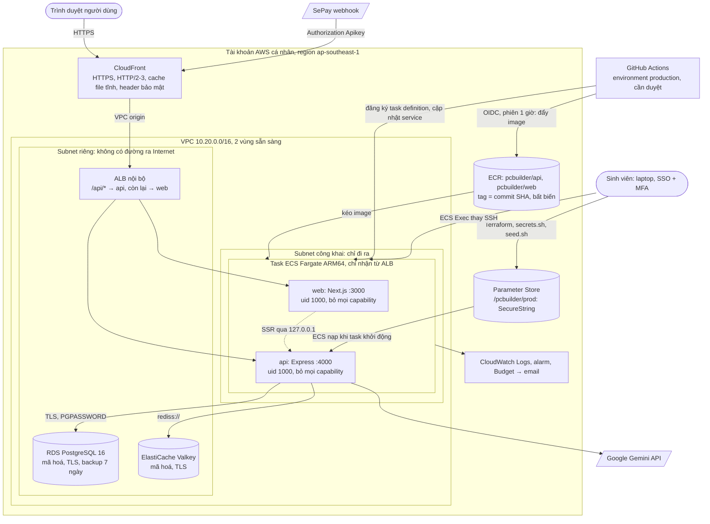

# CH6 — Chương 6 - Kết luận

Sinh tự động bởi `pnpm graph` — tư liệu thô để viết báo cáo, không sửa tay (sửa ở node tương ứng).

## Dàn ý chương

**Nội dung cần viết:**
1. **Kết quả đạt được** - đối chiếu từng mục tiêu của phiếu giao nhiệm vụ với `docs/graph/out/coverage.md` và `traceability.md` (yêu cầu nào đã có code và test).
2. **Triển khai thực tế và phản hồi người dùng** - kết quả UAT (điểm SUS), hiệu chỉnh trọng số theo phản hồi (Nội dung 6).
3. **Hạn chế** - catalog khoảng 250 sản phẩm, không vận chuyển thật, thanh toán dùng webhook chuẩn SePay/giả lập, phụ thuộc quota Gemini (đã có dự phòng).
4. **Hướng phát triển.**

**Liên hệ phiếu giao nhiệm vụ:** Nội dung 6 (tuần 16-17): triển khai, phản hồi người dùng, hiệu chỉnh trọng số, hoàn thiện báo cáo.

Tổng cộng **6** node thuộc chương này.

## Yêu cầu

### NFR-11 — Khả năng sử dụng: đánh giá bằng khảo sát người dùng thật (UAT, điểm SUS)

Trạng thái: **planned**

**Nguồn:** phiếu giao nhiệm vụ nội dung 6 (cung cấp công cụ cho người dùng và kỹ thuật viên lắp ráp thử nghiệm; thu thập phản hồi qua biểu mẫu khảo sát).

Thu thập phản hồi của người dùng và kỹ thuật viên lắp ráp bằng biểu mẫu khảo sát (thang SUS và mức hài lòng); dùng phản hồi để hiệu chỉnh trọng số thuật toán trước khi hoàn thiện báo cáo.

## Tính năng

### F-DEPLOY — Đóng gói Docker và triển khai lên VPS / AWS ECS

Trạng thái: **done**
Liên kết — realizes: NFR-07 · dependsOn: M-INFRA · decidedBy: ADR-023

**Mục đích:** đưa hệ thống lên máy chủ thật để người dùng và kỹ thuật viên dùng thử (nội dung 6 của phiếu), bằng một lệnh và không cần cài Node hay Postgres trên máy chủ.

**Mô tả (theo `infra/docker-compose.prod.yml`, dự án `pcbuilder-prod`):** năm dịch vụ trên một mạng nội bộ `internal`.
- **caddy** (`caddy:2-alpine`) là dịch vụ duy nhất mở cổng 80 và 443; tự xin và gia hạn chứng chỉ HTTPS Let's Encrypt cho `DOMAIN`. `Caddyfile` chuyển `/api/*` tới `api:4000` với `flush_interval -1` (để luồng SSE của chatbot không bị đệm) và mọi đường dẫn khác tới `web:3000`. Nén `zstd/gzip` chỉ áp cho JSON ở nhánh `/api/*` (nén `text/event-stream` khiến bộ nén đệm luồng SSE) và cho toàn bộ nhánh web. Web và API dùng chung một tên miền nên cookie `Secure; SameSite=Lax` hoạt động như cùng một site.
- **api** (Node 22 alpine, build nhiều giai đoạn bằng `pnpm deploy --prod`, 257 MB) chạy bằng người dùng `node`, có HEALTHCHECK `/api/health`, tự chạy migration (`src/db/migrate.ts`) rồi mới mở server. Migrator không có advisory lock nên chỉ chạy đúng 1 replica.
- **web** (Next.js `standalone`, 223 MB, người dùng không phải root) với `NEXT_PUBLIC_API_URL` được nhúng lúc build từ `DOMAIN`, nên đổi tên miền phải build lại web. Khi render phía server, web gọi API qua mạng nội bộ (`API_INTERNAL_URL=http://api:4000/api`) vì từ trong container không với tới URL công khai.
- **postgres:16** và **redis:7** (bật AOF) chỉ nằm trong mạng nội bộ, không mở cổng ra ngoài; dữ liệu ở volume `pgdata`, `redisdata`.
- Cấu hình qua `infra/.env.prod` (mẫu `.env.prod.example`, bị gitignore). API production từ chối khởi động (fail-closed) nếu `JWT_ACCESS_SECRET`, `JWT_REFRESH_SECRET` hoặc `SEPAY_API_KEY` ngắn hơn 32 ký tự hoặc bắt đầu bằng `dev-`/`change-me`, hoặc `VIETQR_ACCOUNT_NO` còn là `0000000000`. Seed ở production bắt buộc `SEED_ADMIN_PASSWORD` (≥ 12 ký tự) cho `admin@pcbuilder.vn` và chỉ tạo tài khoản demo nhân viên/khách khi `SEED_DEMO_USERS=1`; đổi mật khẩu qua trang Tài khoản (`POST /api/auth/password`). Bản dev chỉ chạy postgres và redis bằng `infra/docker-compose.yml`.
- `docs/deploy.md` (tiếng Việt) hướng dẫn trên Ubuntu 22.04/24.04: yêu cầu VPS, secret, khởi chạy, nạp seed thủ công một lần (seed xóa dữ liệu cũ), xin khóa Gemini, cấu hình webhook SePay `https://<DOMAIN>/api/payments/webhook/sepay` với `Authorization: Apikey <khóa>`, sao lưu `pg_dump` bằng cron.

**Bản AWS (ADR-023):** web và API là hai container trong một task ECS Fargate ARM64, nằm sau một ALB nội bộ. Đường vào duy nhất là CloudFront qua VPC origin, nên web và API dùng chung một tên miền và cookie giữ nguyên. Dữ liệu ở RDS PostgreSQL 16 và ElastiCache Valkey (subnet riêng, mã hoá, TLS). Hạ tầng dựng bằng Terraform (`infra/aws/terraform`). Image build arm64 trên GitHub Actions, đẩy vào ECR (tag là commit SHA), deploy bằng `scripts/ecs-deploy.sh` (rolling, có circuit breaker). Không có khoá AWS dài hạn: CI dùng OIDC, người vận hành dùng SSO có MFA. Khoá ứng dụng nằm trong Parameter Store và được ECS nạp vào lúc task khởi động. API đọc `TRUST_PROXY_HOPS=2` để giới hạn tần suất theo IP thật của khách. Kế hoạch setup, cách thêm tài khoản AWS cá nhân bên cạnh tài khoản công ty, và bảng rủi ro khoá ở `docs/deploy-aws.md`.

**Kiểm chứng đã làm (báo cáo task 12):** chạy toàn bộ stack production trên máy dev ở cổng 8081/8443: cả năm dịch vụ khỏe, `GET /api/health` qua Caddy trả `{"status":"ok","db":"up","redis":"up","ai":"fallback"}`, cookie đặt `Secure; SameSite=Lax`, trang chủ trả 200, đăng nhập tài khoản mẫu qua Caddy 200, các container chạy uid 1000.

**Chưa kiểm chứng (nêu trong báo cáo):** cấp chứng chỉ Let's Encrypt thật (cần tên miền công khai), luồng SSE đi xuyên Caddy đầu-cuối, và webhook SePay thật; ba mục này thuộc phần kiểm thử QA và triển khai trên VPS.

**Code:** `infra/docker-compose.prod.yml`, `infra/Caddyfile`, `infra/.env.prod.example`, `apps/api/Dockerfile`, `apps/web/Dockerfile`, `docs/deploy.md`, `infra/aws/**`, `.github/workflows/deploy-aws.yml`, `docs/deploy-aws.md`

**Test:** `e2e/smoke.spec.ts`

**Sơ đồ:** `docs/diagrams/deployment.mmd`

**Sơ đồ:** `docs/diagrams/deployment-aws.mmd`

### F-UAT-SURVEY — Khảo sát người dùng (UAT) và hiệu chỉnh trọng số theo phản hồi

Trạng thái: **planned**
Liên kết — realizes: NFR-11 · dependsOn: F-DEPLOY, F-ADMIN-WEIGHTS

**Mục đích:** thu thập bằng chứng về mức độ dùng được và hài lòng từ người dùng thật (nội dung 6 của phiếu).

**Mô tả:** mời người dùng phổ thông và kỹ thuật viên lắp ráp thử hệ thống đã triển khai, điền biểu mẫu Google Form (thang SUS và mức hài lòng, câu hỏi mở về độ hợp lý của cấu hình gợi ý). Phản hồi được dùng để chỉnh ma trận trọng số (F-ADMIN-WEIGHTS) rồi đo lại. Kết quả đưa vào chương 4 (đánh giá) và chương 6 (kết luận).

## Kiểm thử

### T-UAT-SUS — Khảo sát UAT: điểm SUS và mức hài lòng

Trạng thái: **planned**
Liên kết — verifies: NFR-11, F-UAT-SURVEY

Kết quả biểu mẫu Google Form từ người dùng phổ thông và kỹ thuật viên lắp ráp (nội dung 6 của phiếu). Chưa có file kiểm thử tự động - dữ liệu khảo sát được tổng hợp thủ công vào chương 4 và 6.

## Quyết định thiết kế

### ADR-019 — Báo cáo kết quả đánh giá AI hai mức: nghiêm ngặt 26/30 và điều chỉnh theo dự phòng 30/30

Trạng thái: **done**

**Bối cảnh:** golden set 30 câu tiếng Việt được viết khi đã biết phạm vi của NLU dự phòng, và có 4 ca (F01, F02, P01, P02) mà chế độ luật chủ ý xử lý khác trợ lý AI (gọi lại `recommend_builds` thay vì `modify_build`; hỏi lại thay vì `search_products`). Lần đầu kết quả được ghi là 30/30, vòng rà soát task 7b chỉ ra rằng như vậy che giấu sự thiên lệch của bộ test.

**Quyết định:** harness chấm mỗi ca hai lần: **nghiêm ngặt** theo `expect` (kỳ vọng với trợ lý AI) và **điều chỉnh theo dự phòng** theo `fallbackExpect` (chỉ ở chế độ dự phòng). Con số dẫn trong báo cáo là con số nghiêm ngặt; số điều chỉnh luôn đi kèm ký hiệu và giải thích. `results.md` có mục "Hạn chế / Limitations" nêu: điểm dự phòng là cận trên vì bộ test không đối kháng, chỉ 30 ca, chạy một lần, trên catalog dev, độ trễ chỉ đo phần xử lý cục bộ, kết quả Gemini thật sẽ dao động giữa các lần chạy.

**Kết quả (dự phòng, 2026-11-07):**

| Chỉ số | Nghiêm ngặt | Điều chỉnh theo dự phòng |
| --- | --- | --- |
| Gọi đúng tool | 26/30 | 30/30 |
| Tham số | 23/25 | 25/25 |
| Sở thích | 9/10 | 10/10 |
| Đạt mọi tiêu chí | 26/30 | 30/30 |
| Cấu hình hợp lệ khi kiểm tra lại (C01-C15 và ngân sách) | 69/69 | 69/69 |
| Độ trễ p50 / p95 | 10 / 22 ms | 10 / 22 ms |

**Hệ quả:** con số trung thực nhưng thấp hơn; bù lại có thể bảo vệ trước hội đồng. Điểm số chế độ Gemini thật chưa có vì thiếu khóa API: chạy `eval/smoke-gemini.ts` rồi `pnpm --filter @pc/api eval:ai` để có số liệu AI-mode và ghi vào báo cáo.

**Code:** `apps/api/eval/run-eval.ts`, `apps/api/eval/golden-set.json`, `apps/api/eval/results.md`, `apps/api/eval/smoke-gemini.ts`

### ADR-023 — Triển khai trên AWS bằng ECS Fargate (web + API), RDS, ElastiCache sau CloudFront; khoá ở Parameter Store, CI dùng OIDC

Trạng thái: **in-progress**

**Bối cảnh:** phiếu giao nhiệm vụ yêu cầu triển khai trên máy chủ đám mây (NFR-07). Tài khoản AWS sẵn có trên máy phát triển là của công ty (profile `aircloset`, shell đặt sẵn `AWS_PROFILE=aircloset`) nên không được dùng; cần một tài khoản cá nhân riêng. Sinh viên muốn cả frontend và backend nằm trên AWS, chạy bằng ECS để đỡ phải tự vận hành máy chủ. Các khoá phải an toàn: lộ khoá JWT cho phép giả token admin, lộ khoá SePay cho phép đánh dấu đơn đã thanh toán, lộ quyền AWS cho phép người khác tạo tài nguyên tính tiền.

Đã cân nhắc hai phương án:
- **Một EC2 chạy Docker Compose** (commit `18795c2`, khoảng 22 USD/tháng): rẻ, nhưng phải tự vá hệ điều hành và tự lo backup.
- **Frontend trên Vercel, backend trên ECS:** web và API khác tên miền, nên cookie `SameSite=Lax` không còn được gửi kèm; muốn dùng thì phải sửa cơ chế đăng nhập.

**Quyết định:**

- **Một tên miền, một điểm vào:** CloudFront chuyển request tới một ALB **nội bộ** qua VPC origin. ALB chia `/api/*` cho container api, phần còn lại cho container web. Web và API vẫn cùng tên miền nên cookie hoạt động như cũ. Không có load balancer hay máy chủ nào có IP công khai nhận request.
- **Ứng dụng:** web và api là hai container trong **một task Fargate ARM64**. Server-side rendering gọi API qua `127.0.0.1`, đỡ thêm một IP công khai.
  - Task nằm ở subnet công khai chỉ để đi ra (ECR, Gemini). Nhờ vậy không cần NAT gateway, vốn khoảng 45 USD/tháng.
  - Security group của task chỉ nhận kết nối từ ALB.
- **Dữ liệu:** RDS PostgreSQL 16 (`db.t4g.micro`) và ElastiCache Valkey (`cache.t4g.micro`), cả hai ở subnet không có đường ra, mã hoá khi lưu và khi truyền.
  - Ứng dụng kết nối bằng `sslmode=require` và `rediss://`.
  - Mật khẩu DB nạp vào biến `PGPASSWORD` (postgres.js tự đọc), nên `DATABASE_URL` không chứa bí mật.
- **Không có khoá dài hạn:**
  - người vận hành dùng SSO có MFA;
  - GitHub dùng OIDC, chỉ job trong environment `production` của đúng repo mới được;
  - role CI chỉ đẩy được image vào 2 repo ECR, cập nhật đúng một service, và chỉ chuyển được 2 role của task.
- **Khoá ứng dụng:** nằm ở Parameter Store (SecureString), ECS nạp vào lúc task khởi động. Task definition chỉ chứa ARN của tham số.
  - `scripts/secrets.sh` sinh khoá tại chỗ hoặc nhận nhập ẩn, gửi qua tệp tạm.
  - Riêng mật khẩu DB, script đổi trên RDS trước rồi mới ghi vào Parameter Store. Mật khẩu khởi tạo trong `terraform.tfstate` vì thế không còn dùng được.
  - Mật khẩu admin dùng cho seed chỉ tồn tại trong Parameter Store đúng lúc task seed chạy.
- **Hàng rào chống nhầm tài khoản:** Terraform khai báo `allowed_account_ids`; script bỏ qua `AWS_PROFILE` của shell và kiểm tra số tài khoản; direnv tự đổi profile theo thư mục.
- **Thay đổi trong ứng dụng:**
  - `TRUST_PROXY_HOPS`: phía sau CloudFront và ALB có 2 proxy, để giới hạn tần suất tính theo IP thật của khách.
  - `GEMINI_API_KEY=disabled` được hiểu là không có khoá, vì SecureString không được rỗng.
- **Vận hành:**
  - deploy theo kiểu rolling, có circuit breaker tự quay về bản trước;
  - rollback bằng một lệnh, dùng commit SHA;
  - ECS Exec thay cho SSH;
  - RDS sao lưu 7 ngày, khôi phục được về thời điểm bất kỳ;
  - cảnh báo khi không còn container khoẻ, khi DB sắp đầy, và khi vượt ngân sách.

**Hệ quả:**

- Chi phí khoảng 77–82 USD/tháng, gồm Fargate 18, ALB khoảng 20, RDS 21, Valkey 14, IPv4 3,7 (giá Singapore ngày 20/11/2026). Gấp khoảng 3,5 lần phương án EC2, nhưng không phải tự vận hành máy chủ.
- Credit 200 USD của tài khoản mới đủ dùng tới buổi bảo vệ.
- Một task nên khi deploy có hai task chạy song song trong thời gian ngắn. Migration vẫn chỉ do task mới chạy.

**Đã kiểm chứng trên máy phát triển (20/11/2026):**

- `terraform validate` đạt; trivy không còn cảnh báo, các điểm chấp nhận có chủ ý được ghi lý do trong code; shellcheck và actionlint sạch; 584/584 test API đạt.
- Mô phỏng task bằng Docker:
  - api và web dùng chung mạng như một task Fargate, cả hai uid 1000 và không có capability;
  - API kết nối PostgreSQL chỉ nhận SSL qua TLS 1.3 bằng `PGPASSWORD`;
  - `GEMINI_API_KEY=disabled` cho chế độ fallback;
  - seed bằng container chạy một lần thì admin đăng nhập được;
  - web render phía server gọi API qua `127.0.0.1`;
  - chat SSE kết thúc bằng `done`;
  - với 2 proxy, giới hạn đăng nhập chặn đúng một khách sau 5 lần, và giả mạo phần đầu `X-Forwarded-For` không có tác dụng.
- Script thử với một lệnh `aws` giả:
  - từ chối khi sai tài khoản, bỏ qua `AWS_PROFILE=aircloset`;
  - đổi mật khẩu RDS trước rồi mới ghi Parameter Store, hai giá trị khớp nhau;
  - không giá trị khoá nào lọt vào tham số dòng lệnh;
  - `ecs-deploy.sh` thay đúng tag image của cả hai container.

**Chưa kiểm chứng:** `terraform apply` trên tài khoản AWS thật, CloudFront VPC origin, TLS của ElastiCache với ioredis, và workflow GitHub chạy thật. Kế hoạch ở `docs/deploy-aws.md`.

**Code:** `infra/aws/**`, `.github/workflows/deploy-aws.yml`, `docs/deploy-aws.md`, `apps/api/src/config/env.ts`, `apps/api/src/app.ts`

**Test:** `apps/api/src/config/env.test.ts`, `apps/api/src/app.test.ts`

**Sơ đồ:** `docs/diagrams/deployment-aws.mmd` (đã nêu ở trên trong chương này)
