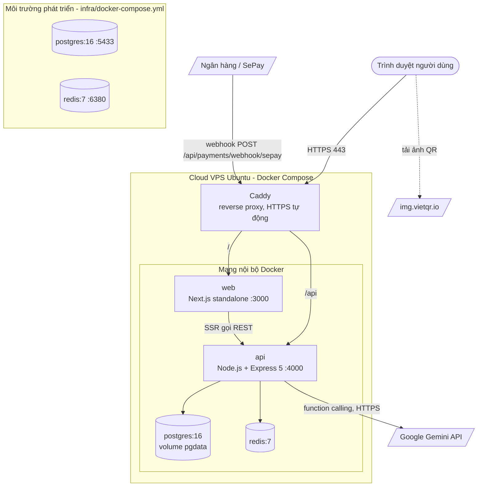

# CH6 — Chương 6 - Kết luận

Sinh tự động bởi `pnpm graph` — tư liệu thô để viết báo cáo, không sửa tay (sửa ở node tương ứng).

## Dàn ý chương

**Nội dung cần viết:**
1. **Kết quả đạt được** - đối chiếu từng mục tiêu của phiếu giao nhiệm vụ với `docs/graph/out/coverage.md` và `traceability.md` (yêu cầu nào đã có code và test).
2. **Triển khai thực tế và phản hồi người dùng** - kết quả UAT (điểm SUS), hiệu chỉnh trọng số theo phản hồi (Nội dung 6).
3. **Hạn chế** - catalog khoảng 250 sản phẩm, không vận chuyển thật, thanh toán dùng webhook chuẩn SePay/giả lập, phụ thuộc quota Gemini (đã có dự phòng).
4. **Hướng phát triển.**

**Liên hệ phiếu giao nhiệm vụ:** Nội dung 6 (tuần 16-17): triển khai, phản hồi người dùng, hiệu chỉnh trọng số, hoàn thiện báo cáo.

Tổng cộng **4** node thuộc chương này.

## Yêu cầu

### NFR-11 — Khả năng sử dụng: đánh giá bằng khảo sát người dùng thật (UAT, điểm SUS)

Trạng thái: **planned**

**Nguồn:** phiếu giao nhiệm vụ nội dung 6 (cung cấp công cụ cho người dùng và kỹ thuật viên lắp ráp thử nghiệm; thu thập phản hồi qua biểu mẫu khảo sát).

Thu thập phản hồi của người dùng và kỹ thuật viên lắp ráp bằng biểu mẫu khảo sát (thang SUS và mức hài lòng); dùng phản hồi để hiệu chỉnh trọng số thuật toán trước khi hoàn thiện báo cáo.

## Tính năng

### F-DEPLOY — Đóng gói Docker và triển khai lên VPS

Trạng thái: **planned**
Liên kết — realizes: NFR-07 · dependsOn: M-INFRA

**Mục đích:** đưa hệ thống lên máy chủ thật để người dùng và kỹ thuật viên dùng thử (nội dung 6 của phiếu).

**Mô tả:** Dockerfile nhiều giai đoạn cho api và web (Next.js standalone); `docker-compose.prod.yml` chạy web, api, postgres, redis và Caddy với HTTPS tự động; hướng dẫn triển khai trên Ubuntu VPS trong `docs/deploy.md`. Bản dev chỉ chạy postgres và redis bằng `infra/docker-compose.yml`.

**Code:** `infra/docker-compose.prod.yml`, `apps/api/Dockerfile`, `apps/web/Dockerfile`, `docs/deploy.md`

**Sơ đồ:** `docs/diagrams/deployment.mmd`

### F-UAT-SURVEY — Khảo sát người dùng (UAT) và hiệu chỉnh trọng số theo phản hồi

Trạng thái: **planned**
Liên kết — realizes: NFR-11 · dependsOn: F-DEPLOY, F-ADMIN-WEIGHTS

**Mục đích:** thu thập bằng chứng về mức độ dùng được và hài lòng từ người dùng thật (nội dung 6 của phiếu).

**Mô tả:** mời người dùng phổ thông và kỹ thuật viên lắp ráp thử hệ thống đã triển khai, điền biểu mẫu Google Form (thang SUS và mức hài lòng, câu hỏi mở về độ hợp lý của cấu hình gợi ý). Phản hồi được dùng để chỉnh ma trận trọng số (F-ADMIN-WEIGHTS) rồi đo lại. Kết quả đưa vào chương 4 (đánh giá) và chương 6 (kết luận).

## Kiểm thử

### T-UAT-SUS — Khảo sát UAT: điểm SUS và mức hài lòng

Trạng thái: **planned**
Liên kết — verifies: NFR-11, F-UAT-SURVEY

Kết quả biểu mẫu Google Form từ người dùng phổ thông và kỹ thuật viên lắp ráp (nội dung 6 của phiếu). Chưa có file kiểm thử tự động - dữ liệu khảo sát được tổng hợp thủ công vào chương 4 và 6.
