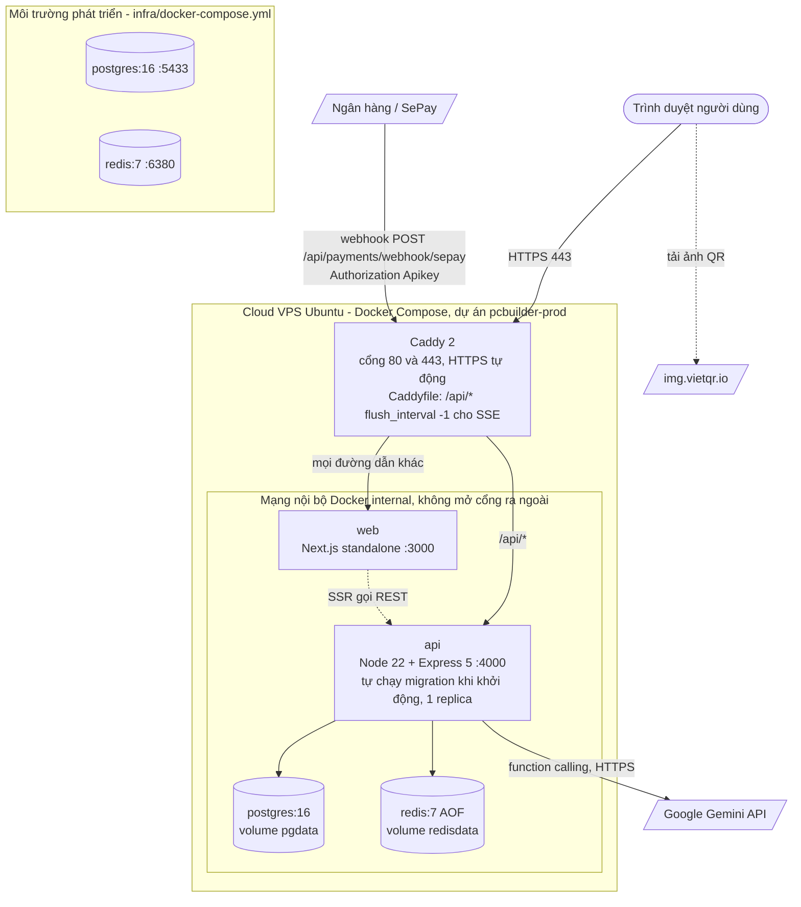
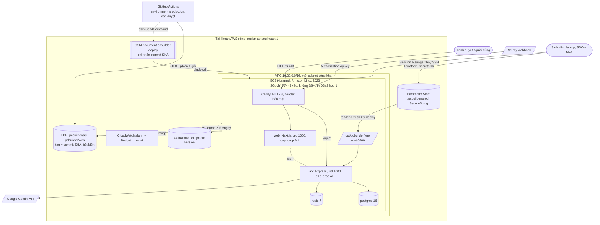

# CH6 — Chương 6 - Kết luận

Sinh tự động bởi `pnpm graph` — tư liệu thô để viết báo cáo, không sửa tay (sửa ở node tương ứng).

## Dàn ý chương

**Nội dung cần viết:**
1. **Kết quả đạt được** - đối chiếu từng mục tiêu của phiếu giao nhiệm vụ với `docs/graph/out/coverage.md` và `traceability.md` (yêu cầu nào đã có code và test).
2. **Triển khai thực tế và phản hồi người dùng** - kết quả UAT (điểm SUS), hiệu chỉnh trọng số theo phản hồi (Nội dung 6).
3. **Hạn chế** - catalog khoảng 250 sản phẩm, không vận chuyển thật, thanh toán dùng webhook chuẩn SePay/giả lập, phụ thuộc quota Gemini (đã có dự phòng).
4. **Hướng phát triển.**

**Liên hệ phiếu giao nhiệm vụ:** Nội dung 6 (tuần 16-17): triển khai, phản hồi người dùng, hiệu chỉnh trọng số, hoàn thiện báo cáo.

Tổng cộng **6** node thuộc chương này.

## Yêu cầu

### NFR-11 — Khả năng sử dụng: đánh giá bằng khảo sát người dùng thật (UAT, điểm SUS)

Trạng thái: **planned**

**Nguồn:** phiếu giao nhiệm vụ nội dung 6 (cung cấp công cụ cho người dùng và kỹ thuật viên lắp ráp thử nghiệm; thu thập phản hồi qua biểu mẫu khảo sát).

Thu thập phản hồi của người dùng và kỹ thuật viên lắp ráp bằng biểu mẫu khảo sát (thang SUS và mức hài lòng); dùng phản hồi để hiệu chỉnh trọng số thuật toán trước khi hoàn thiện báo cáo.

## Tính năng

### F-DEPLOY — Đóng gói Docker và triển khai lên VPS / AWS EC2

Trạng thái: **done**
Liên kết — realizes: NFR-07 · dependsOn: M-INFRA · decidedBy: ADR-023

**Mục đích:** đưa hệ thống lên máy chủ thật để người dùng và kỹ thuật viên dùng thử (nội dung 6 của phiếu), bằng một lệnh và không cần cài Node hay Postgres trên máy chủ.

**Mô tả (theo `infra/docker-compose.prod.yml`, dự án `pcbuilder-prod`):** năm dịch vụ trên một mạng nội bộ `internal`.
- **caddy** (`caddy:2-alpine`) là dịch vụ duy nhất mở cổng 80 và 443; tự xin và gia hạn chứng chỉ HTTPS Let's Encrypt cho `DOMAIN`. `Caddyfile` chuyển `/api/*` tới `api:4000` với `flush_interval -1` (để luồng SSE của chatbot không bị đệm) và mọi đường dẫn khác tới `web:3000`. Nén `zstd/gzip` chỉ áp cho JSON ở nhánh `/api/*` (nén `text/event-stream` khiến bộ nén đệm luồng SSE) và cho toàn bộ nhánh web. Web và API dùng chung một tên miền nên cookie `Secure; SameSite=Lax` hoạt động như cùng một site.
- **api** (Node 22 alpine, build nhiều giai đoạn bằng `pnpm deploy --prod`, 257 MB) chạy bằng người dùng `node`, có HEALTHCHECK `/api/health`, tự chạy migration (`src/db/migrate.ts`) rồi mới mở server. Migrator không có advisory lock nên chỉ chạy đúng 1 replica.
- **web** (Next.js `standalone`, 223 MB, người dùng không phải root) với `NEXT_PUBLIC_API_URL` được nhúng lúc build từ `DOMAIN`, nên đổi tên miền phải build lại web. Khi render phía server, web gọi API qua mạng nội bộ (`API_INTERNAL_URL=http://api:4000/api`) vì từ trong container không với tới URL công khai.
- **postgres:16** và **redis:7** (bật AOF) chỉ nằm trong mạng nội bộ, không mở cổng ra ngoài; dữ liệu ở volume `pgdata`, `redisdata`.
- Cấu hình qua `infra/.env.prod` (mẫu `.env.prod.example`, bị gitignore). API production từ chối khởi động (fail-closed) nếu `JWT_ACCESS_SECRET`, `JWT_REFRESH_SECRET` hoặc `SEPAY_API_KEY` ngắn hơn 32 ký tự hoặc bắt đầu bằng `dev-`/`change-me`, hoặc `VIETQR_ACCOUNT_NO` còn là `0000000000`. Seed ở production bắt buộc `SEED_ADMIN_PASSWORD` (≥ 12 ký tự) cho `admin@pcbuilder.vn` và chỉ tạo tài khoản demo nhân viên/khách khi `SEED_DEMO_USERS=1`; đổi mật khẩu qua trang Tài khoản (`POST /api/auth/password`). Bản dev chỉ chạy postgres và redis bằng `infra/docker-compose.yml`.
- `docs/deploy.md` (tiếng Việt) hướng dẫn trên Ubuntu 22.04/24.04: yêu cầu VPS, secret, khởi chạy, nạp seed thủ công một lần (seed xóa dữ liệu cũ), xin khóa Gemini, cấu hình webhook SePay `https://<DOMAIN>/api/payments/webhook/sepay` với `Authorization: Apikey <khóa>`, sao lưu `pg_dump` bằng cron.

**Bản AWS (ADR-023):** cùng stack chạy trên một EC2 Graviton `t4g.small` dựng bằng Terraform (`infra/aws/terraform`); image build arm64 trên GitHub Actions, đẩy vào ECR (tag là commit SHA), deploy qua tài liệu SSM chỉ nhận commit SHA. Không có khoá AWS dài hạn: CI dùng OIDC, người vận hành dùng SSO có MFA, máy chủ dùng instance role. Khoá ứng dụng nằm trong Parameter Store (SecureString) và được ghi thành `.env` 0600 lúc deploy. Không SSH (Session Manager), IMDSv2 hop 1, container `cap_drop: ALL`, backup S3 hai lần mỗi ngày có cảnh báo khi thiếu. Kế hoạch setup và bảng rủi ro khoá ở `docs/deploy-aws.md`.

**Kiểm chứng đã làm (báo cáo task 12):** chạy toàn bộ stack production trên máy dev ở cổng 8081/8443: cả năm dịch vụ khỏe, `GET /api/health` qua Caddy trả `{"status":"ok","db":"up","redis":"up","ai":"fallback"}`, cookie đặt `Secure; SameSite=Lax`, trang chủ trả 200, đăng nhập tài khoản mẫu qua Caddy 200, các container chạy uid 1000.

**Chưa kiểm chứng (nêu trong báo cáo):** cấp chứng chỉ Let's Encrypt thật (cần tên miền công khai), luồng SSE đi xuyên Caddy đầu-cuối, và webhook SePay thật; ba mục này thuộc phần kiểm thử QA và triển khai trên VPS.

**Code:** `infra/docker-compose.prod.yml`, `infra/Caddyfile`, `infra/.env.prod.example`, `apps/api/Dockerfile`, `apps/web/Dockerfile`, `docs/deploy.md`, `infra/aws/**`, `.github/workflows/deploy-aws.yml`, `docs/deploy-aws.md`

**Test:** `e2e/smoke.spec.ts`

**Sơ đồ:** `docs/diagrams/deployment.mmd`

**Sơ đồ:** `docs/diagrams/deployment-aws.mmd`

### F-UAT-SURVEY — Khảo sát người dùng (UAT) và hiệu chỉnh trọng số theo phản hồi

Trạng thái: **planned**
Liên kết — realizes: NFR-11 · dependsOn: F-DEPLOY, F-ADMIN-WEIGHTS

**Mục đích:** thu thập bằng chứng về mức độ dùng được và hài lòng từ người dùng thật (nội dung 6 của phiếu).

**Mô tả:** mời người dùng phổ thông và kỹ thuật viên lắp ráp thử hệ thống đã triển khai, điền biểu mẫu Google Form (thang SUS và mức hài lòng, câu hỏi mở về độ hợp lý của cấu hình gợi ý). Phản hồi được dùng để chỉnh ma trận trọng số (F-ADMIN-WEIGHTS) rồi đo lại. Kết quả đưa vào chương 4 (đánh giá) và chương 6 (kết luận).

## Kiểm thử

### T-UAT-SUS — Khảo sát UAT: điểm SUS và mức hài lòng

Trạng thái: **planned**
Liên kết — verifies: NFR-11, F-UAT-SURVEY

Kết quả biểu mẫu Google Form từ người dùng phổ thông và kỹ thuật viên lắp ráp (nội dung 6 của phiếu). Chưa có file kiểm thử tự động - dữ liệu khảo sát được tổng hợp thủ công vào chương 4 và 6.

## Quyết định thiết kế

### ADR-019 — Báo cáo kết quả đánh giá AI hai mức: nghiêm ngặt 26/30 và điều chỉnh theo dự phòng 30/30

Trạng thái: **done**

**Bối cảnh:** golden set 30 câu tiếng Việt được viết khi đã biết phạm vi của NLU dự phòng, và có 4 ca (F01, F02, P01, P02) mà chế độ luật chủ ý xử lý khác trợ lý AI (gọi lại `recommend_builds` thay vì `modify_build`; hỏi lại thay vì `search_products`). Lần đầu kết quả được ghi là 30/30, vòng rà soát task 7b chỉ ra rằng như vậy che giấu sự thiên lệch của bộ test.

**Quyết định:** harness chấm mỗi ca hai lần: **nghiêm ngặt** theo `expect` (kỳ vọng với trợ lý AI) và **điều chỉnh theo dự phòng** theo `fallbackExpect` (chỉ ở chế độ dự phòng). Con số dẫn trong báo cáo là con số nghiêm ngặt; số điều chỉnh luôn đi kèm ký hiệu và giải thích. `results.md` có mục "Hạn chế / Limitations" nêu: điểm dự phòng là cận trên vì bộ test không đối kháng, chỉ 30 ca, chạy một lần, trên catalog dev, độ trễ chỉ đo phần xử lý cục bộ, kết quả Gemini thật sẽ dao động giữa các lần chạy.

**Kết quả (dự phòng, 2026-11-07):**

| Chỉ số | Nghiêm ngặt | Điều chỉnh theo dự phòng |
| --- | --- | --- |
| Gọi đúng tool | 26/30 | 30/30 |
| Tham số | 23/25 | 25/25 |
| Sở thích | 9/10 | 10/10 |
| Đạt mọi tiêu chí | 26/30 | 30/30 |
| Cấu hình hợp lệ khi kiểm tra lại (C01-C15 và ngân sách) | 69/69 | 69/69 |
| Độ trễ p50 / p95 | 10 / 22 ms | 10 / 22 ms |

**Hệ quả:** con số trung thực nhưng thấp hơn; bù lại có thể bảo vệ trước hội đồng. Điểm số chế độ Gemini thật chưa có vì thiếu khóa API: chạy `eval/smoke-gemini.ts` rồi `pnpm --filter @pc/api eval:ai` để có số liệu AI-mode và ghi vào báo cáo.

**Code:** `apps/api/eval/run-eval.ts`, `apps/api/eval/golden-set.json`, `apps/api/eval/results.md`, `apps/api/eval/smoke-gemini.ts`

### ADR-023 — Triển khai trên AWS bằng một EC2 Graviton và Docker Compose; khoá nằm ở Parameter Store, CI dùng OIDC, không có khoá dài hạn

Trạng thái: **in-progress**

**Bối cảnh:** phiếu giao nhiệm vụ yêu cầu đóng gói Docker và triển khai trên máy chủ đám mây (NFR-07). Stack Docker Compose của `docs/deploy.md` đã chạy được trên một VPS bất kỳ. Cần chọn nơi chạy thật với chi phí thấp nhất cho một đồ án, nhưng không đánh đổi an toàn của các khoá. Lộ khoá JWT cho phép giả token admin, lộ khoá SePay cho phép đánh dấu đơn đã thanh toán, lộ quyền AWS cho phép người khác tạo máy trên tài khoản của sinh viên. Máy phát triển còn có sẵn profile AWS của công ty (shell đặt `AWS_PROFILE=aircloset`), nên có nguy cơ thật là chạy nhầm vào tài khoản đó.

**Quyết định:**

- **Hạ tầng** (`infra/aws/terraform`): một máy EC2 `t4g.small` (2 vCPU ARM, 2 GiB, khoảng 15,5 USD/tháng ở Singapore) chạy nguyên stack Compose, trong một VPC một subnet công khai. Không dùng NAT, load balancer hay RDS vì mỗi thứ tốn hơn chính máy chủ.
- **Đường deploy:** image api và web build arm64 trên GitHub Actions, đẩy vào ECR với tag là commit SHA, không ghi đè được. Máy chủ nhận lệnh deploy qua tài liệu SSM `pcbuilder-deploy`. Tài liệu này chỉ nhận một commit SHA; nó ghi lại các tệp stack rồi gọi `deploy.sh`.
- **Không có khoá dài hạn ở đâu cả:**
  - người vận hành đăng nhập bằng IAM Identity Center có MFA;
  - GitHub đổi token OIDC lấy phiên 1 giờ, và chỉ job trong environment `production` của đúng repo mới được;
  - máy chủ dùng instance role.
- **Khoá ứng dụng:** nằm ở Parameter Store dạng SecureString. `scripts/secrets.sh` sinh khoá tại chỗ hoặc nhận nhập ẩn rồi gửi thẳng lên AWS, nên khoá không đi qua Terraform state, git, CI, user data hay tham số lệnh. Mỗi lần deploy, máy chủ dựng lại `.env` (root, 0600).
- **Quyền tối thiểu:**
  - role CI chỉ được đẩy image và chạy đúng tài liệu deploy trên đúng máy, không được `AWS-RunShellScript`;
  - role máy chủ bị chặn đọc tham số ngoài `/pcbuilder/prod`, và chỉ được ghi backup, không đọc hay xoá được.
- **Hàng rào chống nhầm tài khoản:** provider khai báo `allowed_account_ids`; script trên laptop bỏ qua `AWS_PROFILE` của shell và kiểm tra số tài khoản trước khi chạy.
- **Cứng hoá máy chủ:**
  - không SSH, chỉ Session Manager;
  - chỉ mở 80/443;
  - IMDSv2 với hop limit 1, để container không lấy được credential của máy;
  - container chạy không phải root, `cap_drop: ALL`, `no-new-privileges`;
  - CPU credit `standard`, để máy bị chiếm cũng không đẩy được hoá đơn lên.
- **Dữ liệu và giám sát:**
  - backup `pg_dump` lên S3 có version hai lần mỗi ngày, cảnh báo khi quá 24 giờ không có bản mới;
  - snapshot ổ đĩa hằng ngày;
  - tự phục hồi khi máy hỏng;
  - budget gửi email.

**Hệ quả:**

- Chi phí khoảng 22–23 USD/tháng.
- Một máy nên vẫn có thời gian chết khi khởi động lại; chấp nhận được với đồ án.
- Đổi khoá chỉ cần hai lệnh (`secrets.sh rotate`, `ssm-deploy.sh current`). Riêng mật khẩu Postgres, `deploy.sh` tự đặt lại cho role qua stdin trước khi API khởi động.

**Đã kiểm chứng trên máy phát triển (20/11/2026):**

- `terraform validate` đạt; trivy không còn cảnh báo, 4 điểm chấp nhận có chủ ý được ghi lý do trong code; shellcheck và actionlint sạch.
- Chạy `infra/aws/compose.yml` với image arm64 build tại chỗ:
  - cả 5 service khoẻ;
  - api và web chạy uid 1000, không có capability; Caddy chỉ giữ `NET_BIND_SERVICE`;
  - header bảo mật có đủ, `Server` bị ẩn;
  - seed nhận mật khẩu qua `-e NAME` và admin đăng nhập được;
  - chat SSE qua Caddy trả `text/event-stream` không nén;
  - đổi mật khẩu Postgres theo cách của `deploy.sh` vẫn giữ nguyên 240 sản phẩm.
- `secrets.sh` thử với một lệnh `aws` giả: từ chối khi sai số tài khoản, bỏ qua `AWS_PROFILE=aircloset`, và không giá trị khoá nào xuất hiện trong tham số dòng lệnh.

**Chưa kiểm chứng:** chạy `terraform apply` trên tài khoản AWS thật, chứng chỉ Let's Encrypt thật, và workflow GitHub chạy thật. Các bước này cần tài khoản AWS riêng của sinh viên; kế hoạch ở `docs/deploy-aws.md` mục 3.

**Code:** `infra/aws/**`, `.github/workflows/deploy-aws.yml`, `docs/deploy-aws.md`

**Sơ đồ:** `docs/diagrams/deployment-aws.mmd` (đã nêu ở trên trong chương này)
