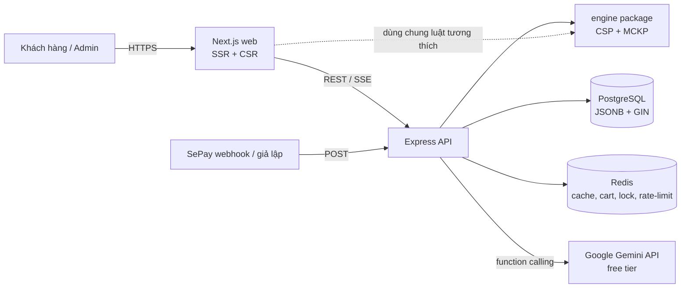
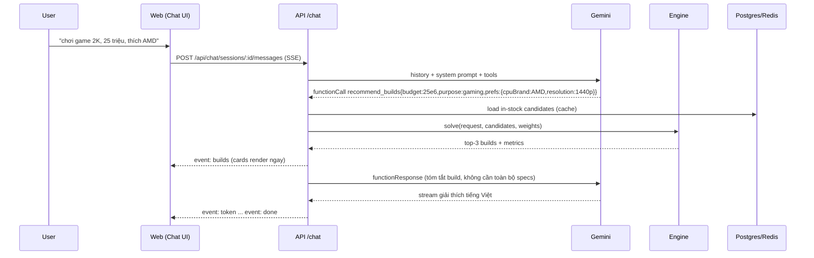

# PC Builder — Thiết kế hệ thống (Design Spec)

> ĐATN Kỹ sư 2026.1 — Phan Hải Dương (20194533) — GVHD: Trần Nhật Hóa
> Đề tài: _Xây dựng Hệ thống TMĐT Linh kiện Máy tính tích hợp công cụ gợi ý xây dựng cấu hình PC phù hợp nhu cầu người dùng_
> Ngày: 2026-11-07 · Trạng thái: **Approved (autonomous mode — sinh viên ủy quyền tự quyết)**

---

## 1. Mục tiêu & lý do

Người dùng phổ thông muốn mua PC nhưng không đủ kiến thức về socket, chuẩn RAM, công suất nguồn, nghẽn cổ chai CPU/GPU. Web TMĐT truyền thống chỉ bán lẻ từng linh kiện. Hệ thống này:

1. **AI PC Advisor (tính năng nổi bật)** — chatbot tiếng Việt dùng **Google Gemini (API key free tier)**. Người dùng chat tự nhiên ("chơi Valorant + edit video nhẹ, tầm 25 triệu, thích màu trắng") → AI hiểu nhu cầu, hỏi lại khi thiếu thông tin, gọi **Optimization Engine** để chọn linh kiện **thật trong kho**, trả về 2–3 cấu hình kèm giải thích, cho phép sửa tiếp bằng hội thoại ("đổi sang card AMD", "bớt 3 triệu"), rồi thêm cả bộ vào giỏ / xuất PDF báo giá.
2. **Optimization Engine** — CSP (Backtracking + Forward Checking + AC-3) đảm bảo tương thích phần cứng; MCKP (phân bổ ngân sách theo ma trận trọng số + Branch & Bound) tối đa hiệu năng theo mục đích. _LLM không bao giờ tự bịa linh kiện/giá_ — mọi linh kiện đến từ Engine/DB.
3. **Interactive PC Customizer** — tự chọn từng linh kiện, kiểm tra tương thích realtime (chạy cùng bộ luật trên client để phản hồi tức thì, server là nguồn chân lý).
4. **TMĐT D2C hoàn chỉnh** — danh mục, lọc theo thông số động (JSONB + GIN), giỏ hàng, đặt hàng lẻ/nguyên bộ, thanh toán VietQR động tự xác nhận, xuất báo giá PDF.
5. **Admin Portal** — sản phẩm với form schema động, tồn kho, benchmark, ma trận trọng số thuật toán, hệ số ưu tiên thương mại, đơn hàng, thống kê.

### Thành công nghĩa là

- Demo bảo vệ: chat 1 câu → ≤ 8s có 3 cấu hình tương thích 100%, trong ngân sách, giải thích được.
- Engine trả kết quả < 300 ms (p95) trên catalog ~250 sản phẩm; có số liệu so sánh brute-force vs Backtracking vs +FC vs +AC-3+B&B cho báo cáo.
- Hết quota Gemini / mất mạng → chatbot vẫn chạy ở **chế độ dự phòng** (rule-based NLU + template), không lỗi trắng.
- Mọi yêu cầu → use case → module → code → test truy vết được qua **Spec-Code Graph** để viết báo cáo.

### Non-goals

- Không làm marketplace nhiều người bán, không vận chuyển thật (chỉ trạng thái), không app mobile native.
- Không fine-tune model; không vector DB/RAG phức tạp (catalog nhỏ → tool calling đủ).
- Không tích hợp ngân hàng thật bắt buộc: webhook theo chuẩn SePay + nút giả lập thanh toán cho demo.

### Anti-goals (làm thì coi như hỏng dù chạy được)

- AI gợi ý linh kiện **không có trong kho** hoặc **không tương thích**.
- AI nói giá khác giá trong DB.
- Demo phụ thuộc hoàn toàn vào Gemini (quota hết là chết).
- Code không khớp spec/báo cáo (giảng viên hỏi "chỗ này code ở đâu" không trả lời được).

---

## 2. Kiến trúc tổng thể

```
pc-builder/ (pnpm monorepo)
├─ apps/
│  ├─ web/        Next.js 16 (App Router, TS, Tailwind v4, Zustand, TanStack Query)
│  └─ api/        Node.js + Express 5 (TS), REST + SSE, Drizzle ORM
├─ packages/
│  ├─ shared/     Kiểu dữ liệu, Zod schema, hằng số (category, purpose, order status)
│  └─ engine/     Optimization Engine thuần TS (không I/O): luật tương thích, CSP, MCKP, scoring
├─ docs/
│  ├─ superpowers/specs|plans/   Spec & kế hoạch
│  ├─ graph/nodes/**             Spec-Code Graph (Markdown + frontmatter)
│  ├─ graph/out/**               Sinh tự động: graph.json, traceability.md, chapters/*.md, index.html
│  └─ diagrams/*.mmd             Mermaid: use case, class, ERD, sequence, deployment
├─ tools/graph/   CLI build/validate graph
└─ infra/         docker-compose (dev/prod), Dockerfile, Caddy
```



**Quyết định chính (ADR — chi tiết trong `docs/graph/nodes/decisions/`):**

| #       | Quyết định                                                                                                    | Lý do                                                                            |
| ------- | ------------------------------------------------------------------------------------------------------------- | -------------------------------------------------------------------------------- |
| ADR-001 | Monorepo pnpm, `packages/engine` thuần TS                                                                     | Engine test độc lập, dùng chung FE (check realtime) & BE (nguồn chân lý)         |
| ADR-002 | Express 5 + Zod + Drizzle                                                                                     | Nhẹ, cấu trúc module rõ; Drizzle viết SQL JSONB/GIN tường minh (phục vụ báo cáo) |
| ADR-003 | Gemini qua `@google/genai` 2.x, model `gemini-flash-latest` (cấu hình qua env)                                | Free tier, function calling, streaming                                           |
| ADR-004 | LLM chỉ điều phối, Engine quyết định linh kiện                                                                | Chống hallucination, đảm bảo tương thích                                         |
| ADR-005 | Chế độ dự phòng rule-based khi không có key / 429 / timeout                                                   | Demo không phụ thuộc quota                                                       |
| ADR-006 | JWT access (15') + refresh (7d, httpOnly cookie, lưu Redis để thu hồi)                                        | RBAC, logout thật                                                                |
| ADR-007 | Chống bán vượt: `UPDATE ... WHERE stock >= qty` trong transaction + giữ hàng Redis TTL 15' khi chờ thanh toán | Đồng thời an toàn                                                                |
| ADR-008 | VietQR động qua img.vietqr.io + webhook chuẩn SePay + giả lập                                                 | Miễn phí, demo được                                                              |
| ADR-009 | PDF báo giá server-side bằng pdfkit + font DejaVu (hỗ trợ tiếng Việt)                                         | Ổn định, không cần headless browser                                              |
| ADR-010 | Spec-Code Graph bằng Markdown frontmatter + CLI sinh JSON/traceability/chapters                               | Diff được, review được, sinh tư liệu báo cáo                                     |
| ADR-011 | Không đặt mã spec trong comment code; mapping nằm ở node graph (`code:`/`tests:`), CLI kiểm tra path tồn tại  | Code sạch, mapping vẫn được kiểm tra tự động                                     |

---

## 3. Tính năng trọng tâm: AI PC Advisor + Optimization Engine

### 3.1 Luồng hội thoại



**Tools khai báo cho Gemini** (JSON Schema, `parametersJsonSchema`):

| Tool                  | Mục đích                                                                                                                                                                        | Trả về cho model                                                                                                                     |
| --------------------- | ------------------------------------------------------------------------------------------------------------------------------------------------------------------------------- | ------------------------------------------------------------------------------------------------------------------------------------ |
| `recommend_builds`    | `{budget, purpose, resolution?, preferences{cpuBrand?, gpuBrand?, color?, formFactor?, minRamGB?, minStorageGB?, needWifi?, rgb?}, excludeProductIds?, mustIncludeProductIds?}` | 1–3 build tóm tắt: id, nhãn (Hiệu năng/Cân bằng/Tiết kiệm), tổng giá, danh sách linh kiện (tên, giá), điểm hiệu năng, cảnh báo nghẽn |
| `search_products`     | `{category, keyword?, maxPrice?, minPrice?, filters?}`                                                                                                                          | ≤ 8 sản phẩm còn hàng                                                                                                                |
| `get_product_details` | `{productId}`                                                                                                                                                                   | specs chính + benchmark                                                                                                              |
| `check_compatibility` | `{productIds[]}`                                                                                                                                                                | danh sách lỗi/cảnh báo, tổng công suất ước tính                                                                                      |
| `modify_build`        | `{buildId, replaceCategory?, newProductId?, budgetDelta?, preferenceChanges?}`                                                                                                  | build mới (Engine giải lại với ràng buộc cố định phần còn lại)                                                                       |

**System prompt (tóm tắt):** vai trò chuyên viên tư vấn PC của cửa hàng; trả lời tiếng Việt, ngắn gọn; _bắt buộc_ gọi tool trước khi nêu bất kỳ linh kiện/giá nào; nếu thiếu ngân sách hoặc mục đích → hỏi lại 1 câu; không bàn chủ đề ngoài PC; tiền định dạng `25.000.000₫`.

**Guardrails:**

- Build card được render từ dữ liệu tool (không từ text LLM) → giá luôn đúng.
- Giới hạn 4 vòng tool-call / lượt; timeout Gemini 20s → fallback.
- Rate-limit chat: 10 tin/phút/người (Redis); cache phản hồi tool theo hash tham số (TTL 10').
- Lưu `chat_sessions`, `chat_messages` (cả tool call) để xem lại & phân tích báo cáo.

**Chế độ dự phòng (fallback NLU):** khi `GEMINI_API_KEY` trống, lỗi 429/5xx, timeout:

- Parser tiếng Việt: ngân sách (`25tr`, `25 triệu`, `25.000.000`, `25m`, `1 tỷ`→cap), mục đích (từ khóa game/valorant/pubg/đồ họa/premiere/blender/AI/deep learning/văn phòng/học tập…), độ phân giải (1080p/2K/4K), hãng (AMD/Intel/NVIDIA/RTX/Radeon), màu (trắng/đen), Wi-Fi.
- Thiếu ngân sách/mục đích → hỏi lại theo template.
- Gọi cùng Engine → giải thích bằng template sinh từ metrics (phân bổ %, tier CPU/GPU, headroom PSU).
- UI hiện badge "Chế độ dự phòng".

### 3.2 Optimization Engine (`packages/engine`)

**Mô hình CSP:**

- Biến: `CPU, MAINBOARD, RAM, GPU, STORAGE, PSU, CASE, COOLER` (GPU tùy chọn nếu CPU có iGPU và purpose=office).
- Miền: sản phẩm còn hàng của category, sau khi lọc preference & cắt miền (dominance pruning).
- Ràng buộc (mỗi luật là 1 hàm thuần, có mã lỗi & thông điệp tiếng Việt, dùng chung cho Customizer):

| Mã  | Ràng buộc                                                                                     | Loại                  |
| --- | --------------------------------------------------------------------------------------------- | --------------------- |
| C01 | `cpu.socket == mainboard.socket`                                                              | cứng                  |
| C02 | `ram.type ∈ mainboard.memoryType` (DDR4/DDR5)                                                 | cứng                  |
| C03 | `ram.modules ≤ mainboard.memorySlots`, `ram.capacity ≤ mainboard.maxMemoryGB`                 | cứng                  |
| C04 | `mainboard.formFactor ∈ case.supportedFormFactors`                                            | cứng                  |
| C05 | `gpu.lengthMm ≤ case.maxGpuLengthMm`                                                          | cứng                  |
| C06 | `cooler.heightMm ≤ case.maxCoolerHeightMm` (air) / radiator size ∈ case.radiatorSupport (AIO) | cứng                  |
| C07 | `cpu.socket ∈ cooler.sockets`                                                                 | cứng                  |
| C08 | `psu.wattage ≥ ceil((cpu.tdp + gpu.tgp + 75) × 1.3)` ; khuyến nghị ≥ ×1.5                     | cứng + mềm            |
| C09 | `cooler.tdpRating ≥ cpu.tdp`                                                                  | mềm (cảnh báo)        |
| C10 | Không GPU rời ⇒ `cpu.integratedGraphics == true`                                              | cứng                  |
| C11 | `storage.interface == NVMe` ⇒ `mainboard.m2Slots ≥ 1`                                         | cứng                  |
| C12 | `psu.formFactor` vừa case (ATX/SFX)                                                           | cứng                  |
| C13 | Cân bằng CPU–GPU: `                                                                           | tier(cpu) − tier(gpu) | ≤ 2` cho gaming | mềm (cảnh báo nghẽn cổ chai) |
| C14 | `Σ price ≤ budget` (và ≥ 85% budget để không quá lãng phí ngân sách)                          | cứng / mềm            |

- Thuật toán:
  1. **Tiền xử lý AC-3** trên các ràng buộc nhị phân (C01–C07, C10–C12) → loại giá trị không có hỗ trợ.
  2. **Thứ tự biến MRV** (miền nhỏ nhất trước), mặc định `CPU → MAINBOARD → RAM → COOLER → GPU → CASE → PSU → STORAGE`.
  3. **Backtracking + Forward Checking**: gán biến → lọc miền các biến chưa gán theo ràng buộc liên quan; miền rỗng → quay lui.
  4. **Branch & Bound** cho mục tiêu: cận trên = điểm hiện tại + Σ max điểm miền còn lại; cận chi phí = chi phí hiện tại + Σ min giá miền còn lại > budget → cắt.
  5. **Top-K đa dạng**: giữ heap K=3 theo nhãn: _Hiệu năng_ (max score), _Cân bằng_ (max score/price), _Tiết kiệm_ (score ≥ 85% best, giá thấp nhất); khác CPU hoặc GPU.
- **Mô hình MCKP:** mỗi category = 1 lớp, chọn đúng 1 item; giá trị `v = w_purpose[c] × normScore(item) + commercialBoost(item)`; trọng lượng = giá; capacity = budget. Ma trận `w_purpose` & tỷ lệ phân bổ gợi ý (min–max %) lưu DB, admin chỉnh được. Phân bổ % dùng để sắp miền & làm heuristic (giá trị trong khoảng phân bổ được ưu tiên), không phải ràng buộc cứng.
- **Chuẩn hóa điểm:** benchmark CPU (single/multi), GPU (raster score), RAM (capacity × speed), storage (capacity, read speed) → điểm 0–100 theo category; purpose quyết định trọng số con (gaming coi trọng single-core + GPU; đồ họa coi trọng multi-core + VRAM; AI coi trọng VRAM + RAM; văn phòng coi trọng giá).
- **Đầu ra:** `Build { items, totalPrice, score, scoreBreakdown, allocation%, estimatedWattage, warnings[], label }` + `stats { nodesExplored, prunedByFC, prunedByBound, timeMs }` (phục vụ đánh giá trong báo cáo).
- **Benchmark harness:** `pnpm --filter engine bench` chạy 4 biến thể (brute force giới hạn, BT, BT+FC, BT+FC+AC3+B&B) trên catalog 50/100/250/500 sp → bảng CSV/Markdown cho chương 4.

---

## 4. Thiết kế Backend (`apps/api`)

**Cấu trúc module** (mỗi module: `*.routes.ts` → `*.controller.ts` → `*.service.ts` → `*.repository.ts`, Zod validate tại route):

| Module           | Chức năng                                                                                                                                     |
| ---------------- | --------------------------------------------------------------------------------------------------------------------------------------------- |
| `auth`           | đăng ký, đăng nhập, refresh, logout, `me`; bcrypt; JWT; middleware `requireAuth`, `requireRole('ADMIN'                                        | 'STAFF')` |
| `catalog`        | categories (kèm `specSchema` JSONB), products (list/filter/sort/paginate, detail), facets lọc động                                            |
| `recommendation` | `POST /recommendations` (form), cache Redis theo hash request                                                                                 |
| `compatibility`  | `POST /compatibility/check`                                                                                                                   |
| `builds`         | lưu cấu hình (user/guest share link), lấy, nhân bản                                                                                           |
| `chat`           | sessions, messages (SSE), Gemini orchestrator, fallback NLU                                                                                   |
| `cart`           | giỏ (Redis cho guest, DB cho user, merge khi login), thêm cả build                                                                            |
| `orders`         | tạo đơn (lẻ / nguyên bộ + phí lắp ráp), vòng đời, hủy, giữ hàng                                                                               |
| `payments`       | tạo VietQR, webhook SePay (xác thực API key), polling trạng thái, giả lập (dev/admin)                                                         |
| `quotes`         | PDF báo giá cho build/giỏ                                                                                                                     |
| `admin`          | CRUD sản phẩm (validate specs theo `specSchema`), tồn kho + lịch sử, benchmark, weight matrix, commercial boost, đơn hàng, thống kê doanh thu |

**API chính** (prefix `/api`, JSON, lỗi chuẩn `{error:{code,message,details}}`):

```
POST   /auth/register | /auth/login | /auth/refresh | /auth/logout     GET /auth/me
GET    /categories                    GET /categories/:slug/facets
GET    /products?category=&q=&minPrice=&maxPrice=&specs[socket]=AM5&sort=&page=
GET    /products/:slug
POST   /compatibility/check           { productIds[] }
POST   /recommendations               { budget, purpose, preferences }
POST   /builds  GET /builds/:id  GET /me/builds
POST   /chat/sessions                 GET /chat/sessions/:id
POST   /chat/sessions/:id/messages    (text/event-stream: token | builds | tool | error | done)
GET    /cart  POST /cart/items  PATCH /cart/items/:id  DELETE /cart/items/:id  POST /cart/builds/:buildId
POST   /orders  GET /me/orders  GET /orders/:code  POST /orders/:code/cancel
GET    /orders/:code/payment          (VietQR URL + trạng thái)
POST   /payments/webhook/sepay        POST /payments/:orderCode/simulate (dev/admin)
GET    /quotes/builds/:id.pdf  GET /quotes/cart.pdf
ADMIN  /admin/products (CRUD) /admin/categories/:id/schema /admin/inventory/:productId/adjust
       /admin/benchmarks /admin/weights /admin/orders (+status) /admin/stats/revenue?from&to&groupBy
```

**CSDL (PostgreSQL, Drizzle):**

```
users(id, email uq, password_hash, full_name, phone, role[CUSTOMER|STAFF|ADMIN], created_at)
categories(id, slug uq, name, sort_order, spec_schema jsonb)          -- form schema động
brands(id, name uq)
products(id, category_id fk, brand_id fk, sku uq, slug uq, name, price bigint, sale_price bigint?,
         stock int, reserved int default 0, images jsonb, specs jsonb, description, status, commercial_boost real,
         created_at, updated_at)
   INDEX GIN (specs jsonb_path_ops), INDEX (category_id, price), INDEX trigram/tsvector(name)
benchmarks(product_id pk fk, cpu_single, cpu_multi, gpu_score, source, updated_at)
inventory_movements(id, product_id, delta, reason[IMPORT|ORDER|CANCEL|ADJUST], ref, actor_id, created_at)
purpose_weights(purpose pk, weights jsonb, allocation jsonb, updated_by, updated_at)
builds(id uuid, user_id?, name, purpose, budget, items jsonb, total_price, score, source[CHAT|FORM|CUSTOM], created_at)
carts(id, user_id uq) / cart_items(id, cart_id, product_id, qty, build_id?)
orders(id, code uq, user_id?, type[RETAIL|BUILD], status, subtotal, assembly_fee, shipping_fee, total,
       shipping_name, phone, address, note, payment_status, paid_at, expires_at, created_at)
order_items(id, order_id, product_id, name_snapshot, price_snapshot, qty, build_id?)
payments(id, order_id, provider, amount, transfer_content, provider_txn_id uq, raw jsonb, status, created_at)
chat_sessions(id uuid, user_id?, guest_id?, title, mode[AI|FALLBACK], created_at)
chat_messages(id, session_id, role[user|assistant|tool], content, tool_name, tool_args jsonb, tool_result jsonb,
              build_ids jsonb, latency_ms, created_at)
refresh tokens: Redis `rt:{userId}:{jti}` TTL 7d
```

Truy vấn JSONB mẫu: `WHERE category_id=$1 AND specs @> '{"socket":"AM5","memoryType":["DDR5"]}'` (dùng GIN `jsonb_path_ops`).

**Redis keys:** `cache:reco:{hash}` (10'), `cache:candidates:{category}` (5', xóa khi admin sửa sp), `cart:guest:{guestId}` (7d), ~~`hold:order:{code}`~~ (bản cài đặt dùng cột `orders.expires_at` làm đồng hồ giữ hàng, job quét cột này để nhả `reserved`; không có khóa Redis), `rl:chat:{who}` (rate limit), `rt:*`.

**Đơn hàng & tồn kho:** tạo đơn trong transaction: `UPDATE products SET reserved = reserved + q WHERE id=$1 AND stock - reserved >= q` cho từng item (fail → rollback "hết hàng"); thanh toán thành công → `stock -= q, reserved -= q`, ghi `inventory_movements`; hết hạn/hủy → `reserved -= q`. Sweeper chạy mỗi 60s quét đơn `PENDING_PAYMENT` quá `expires_at`.

**Vòng đời đơn:** `PENDING_PAYMENT → PAID → PROCESSING (BUILD: ASSEMBLING) → SHIPPING → COMPLETED`; `PENDING_PAYMENT|PAID → CANCELLED` (PAID cần hoàn tiền thủ công). Máy trạng thái đặt trong `orders.state.ts`.

**VietQR:** URL `https://img.vietqr.io/image/{BANK_BIN}-{ACCOUNT_NO}-compact2.png?amount={total}&addInfo={orderCode}&accountName=...`. Webhook SePay: header `Authorization: Apikey {SEPAY_API_KEY}`, đối chiếu `content` chứa `orderCode` & `transferAmount ≥ total`, idempotent theo `provider_txn_id`. Trang thanh toán poll `GET /orders/:code/payment` mỗi 3s.

**Bảo mật:** helmet, CORS whitelist, rate-limit login (5/phút/IP), Zod mọi input, query tham số hóa, cookie `httpOnly; SameSite=Lax; Secure (prod)`, không log key/password, giá luôn tính lại ở server.

**Cấu hình (`.env`):** `DATABASE_URL, REDIS_URL, JWT_ACCESS_SECRET, JWT_REFRESH_SECRET, GEMINI_API_KEY, GEMINI_MODEL=gemini-flash-latest, VIETQR_BANK_BIN, VIETQR_ACCOUNT_NO, VIETQR_ACCOUNT_NAME, SEPAY_API_KEY, WEB_ORIGIN, ASSEMBLY_FEE=200000`.

---

## 5. Thiết kế Frontend (`apps/web`)

**Routes (App Router):**

| Route                                             | Màn hình                                                                                            | Render           |
| ------------------------------------------------- | --------------------------------------------------------------------------------------------------- | ---------------- |
| `/`                                               | Trang chủ: hero AI Advisor (ô chat lớn), danh mục, build mẫu theo mục đích, sp nổi bật              | SSR              |
| `/advisor`                                        | **AI PC Advisor** toàn màn hình: chat trái, panel build phải (so sánh 3 cấu hình)                   | CSR              |
| `/builder`                                        | **PC Customizer**: 8 slot linh kiện, picker có lọc, thanh tương thích realtime, tổng giá, công suất | CSR              |
| `/c/[category]`                                   | Danh sách sp: bộ lọc động sinh từ `specSchema`/facets, sort, phân trang                             | SSR + CSR filter |
| `/p/[slug]`                                       | Chi tiết sp: ảnh, giá, bảng thông số, benchmark, "thêm vào cấu hình"                                | SSR (SEO)        |
| `/builds/[id]`                                    | Cấu hình chia sẻ được, xuất PDF, mua cả bộ                                                          | SSR              |
| `/cart` `/checkout` `/orders/[code]/pay`          | Giỏ, thông tin giao hàng, trang VietQR + đếm ngược + tự cập nhật                                    | CSR              |
| `/login` `/register` `/account` `/account/orders` | Tài khoản                                                                                           | CSR              |
| `/admin/*`                                        | dashboard, products (form động), inventory, benchmarks, weights (ma trận), orders, chat logs        | CSR, guard role  |

**State:** Zustand stores — `useBuilderStore` (slots, check realtime bằng `@pc/engine` rules), `useCartStore` (đồng bộ server), `useChatStore` (messages, streaming, builds hiện tại), `useAuthStore`. TanStack Query cho dữ liệu server. API client typed dùng schema từ `@pc/shared`. SSE đọc bằng `fetch` + `ReadableStream`.

**Widget chat nổi** ở mọi trang (góc phải dưới) → mở `/advisor` khi cần toàn màn hình.

---

## 6. Thiết kế UI/UX

- **Ngôn ngữ thiết kế:** "Tech Workshop" — nền tối than chì cho khu Advisor/Builder (cảm giác phần cứng, RGB nhẹ), nền sáng cho storefront để đọc thông số; accent **Electric Cyan `#22D3EE`** + **Signal Lime `#A3E635`** (tương thích OK), **Amber `#F59E0B`** (cảnh báo), **Red `#EF4444`** (xung đột).
- **Typography:** `Be Vietnam Pro` (UI, hỗ trợ dấu tiếng Việt), `JetBrains Mono` (thông số kỹ thuật, giá). Thang 12/14/16/20/24/32/48.
- **Tokens** (Tailwind v4 `@theme`): màu ngữ nghĩa `--color-bg, --color-surface, --color-fg, --color-muted, --color-accent, --color-ok, --color-warn, --color-danger`, radius 8/12/16, spacing 4-pt, shadow 2 cấp, light/dark.
- **Component chính:** `ProductCard`, `SpecTable`, `PriceTag`, `CompatibilityBadge` (OK/Cảnh báo/Xung đột kèm tooltip mã luật), `BuildSlot`, `PartPicker` (drawer + filter), `BuildSummaryBar` (sticky: tổng giá, công suất, trạng thái), `BuildCard` (trong chat: nhãn, 8 dòng linh kiện, điểm, nút hành động), `ChatMessage` (markdown, streaming caret, tool-status chip "Đang tìm linh kiện…"), `AllocationBar` (thanh % ngân sách theo category), `PerfMeter` (FPS tier/score), `VietQRPanel`, `OrderTimeline`, `DynamicSpecForm` (admin), `WeightMatrixEditor` (admin).
- **Khoảnh khắc "wow" (demo):** gõ câu → chip trạng thái tool hiện theo thời gian thực → 3 BuildCard trượt vào với AllocationBar động → text giải thích stream bên dưới → "Mở trong Customizer" chuyển nguyên cấu hình sang `/builder`.
- **Chuẩn chất lượng:** responsive 360px → 1440px, WCAG AA contrast, focus ring rõ, `prefers-reduced-motion`, skeleton loading, empty/error states có hướng dẫn, số tiền định dạng `vi-VN`.

---

## 7. Thiết kế kiểm thử (Tester)

| Tầng              | Công cụ                                                        | Phạm vi                                                                                                                                                        | Mục tiêu                                |
| ----------------- | -------------------------------------------------------------- | -------------------------------------------------------------------------------------------------------------------------------------------------------------- | --------------------------------------- |
| Unit — Engine     | Vitest                                                         | từng luật C01–C14 (đúng/sai/biên), AC-3, FC, B&B, top-K, ngân sách, fallback khi miền rỗng                                                                     | ≥ 90% branch coverage `packages/engine` |
| Unit — API        | Vitest                                                         | NLU fallback parser (≥ 40 câu tiếng Việt), state machine đơn, VietQR builder, specSchema validator, price calc                                                 | các service thuần                       |
| Integration — API | Vitest + Supertest + Postgres/Redis thật (docker compose test) | auth/RBAC, lọc JSONB, recommendation, chat (Gemini mock qua interface `LlmClient`), cart→order→webhook→PAID, chống bán vượt (đặt đồng thời), hết hạn giữ hàng  | mọi endpoint chính                      |
| E2E               | Playwright                                                     | (1) chat → build → thêm giỏ → checkout → giả lập thanh toán → PAID; (2) customizer chọn linh kiện xung đột → cảnh báo; (3) admin sửa trọng số → gợi ý thay đổi | 3 luồng cốt lõi                         |
| Hiệu năng         | engine bench + autocannon `/recommendations`                   | thời gian giải theo kích thước catalog, so sánh 4 biến thể                                                                                                     | bảng số liệu báo cáo                    |
| Chất lượng AI     | script đánh giá 30 kịch bản chat (golden set)                  | tỷ lệ gọi đúng tool, tham số đúng, build hợp lệ 100%, độ trễ                                                                                                   | bảng số liệu báo cáo                    |
| UAT               | Google Form khảo sát người dùng & kỹ thuật viên                | SUS score, mức hài lòng                                                                                                                                        | nội dung 6 của phiếu                    |

Ma trận test case chi tiết nằm trong graph (`docs/graph/nodes/tests/`), mỗi node test trỏ về requirement nó kiểm chứng.

---

## 8. Spec-Code Graph (phục vụ viết báo cáo)

**Mục đích:** một nguồn truy vết duy nhất: _Yêu cầu → Use case → Tính năng → Module/API/Entity/Thuật toán → File code → Test → Chương báo cáo_. Khi viết báo cáo: chạy `pnpm graph` → có ngay bảng truy vết, tư liệu từng chương, sơ đồ.

**Node** = 1 file Markdown trong `docs/graph/nodes/<type>/<ID>.md`:

```markdown
---

id: F-AI-ADVISOR
type: feature # requirement|usecase|feature|module|api|entity|algorithm|rule|screen|test|decision|chapter
title: Chatbot AI tư vấn cấu hình PC
status: done # planned|in-progress|done
chapters: [CH4, CH5]
links:
realizes: [FR-07, UC-06]
dependsOn: [M-CHAT, ALG-CSP, ALG-MCKP]
decidedBy: [ADR-003, ADR-004, ADR-005]
code: [apps/api/src/modules/chat/**, apps/web/src/features/advisor/**]
tests: [apps/api/src/modules/chat/**/*.test.ts]
diagrams: [docs/diagrams/seq-ai-advisor.mmd]
---

Mô tả, quyết định, ghi chú cho báo cáo...
```

**Loại cạnh:** `realizes`, `refines`, `dependsOn`, `decidedBy`, `verifies` (test→req), `shownIn` (screen) + cạnh ngầm `implementedBy` (từ `code:`), `verifiedBy` (từ `tests:`), `documentedIn` (từ `chapters:`).

**CLI `tools/graph`** (`pnpm graph`, `pnpm graph:check`):

- Validate: id duy nhất, link trỏ tới node tồn tại, glob `code:`/`tests:` khớp ≥ 1 file, mọi requirement có ≥ 1 feature và ≥ 1 test (cảnh báo nếu thiếu).
- Sinh `docs/graph/out/`: `graph.json`, `graph.mmd`, `traceability.md` (bảng FR→UC→Feature→Code→Test), `coverage.md` (requirement chưa có code/test), `chapters/CH1..CH6.md` (gom node theo chương, kèm mô tả + sơ đồ liên quan), `index.html` (viewer tương tác Cytoscape, lọc theo type/chapter).

**Chương báo cáo (mẫu SoICT):** CH1 Giới thiệu · CH2 Khảo sát & phân tích yêu cầu · CH3 Công nghệ sử dụng · CH4 Thiết kế, triển khai & đánh giá · CH5 Giải pháp & đóng góp nổi bật (Engine CSP/MCKP, AI Advisor + fallback, chống bán vượt, JSONB động) · CH6 Kết luận.

**Quy tắc:** mỗi task code xong phải cập nhật node liên quan (`status`, `code`, `tests`); `graph:check` chạy trong `pnpm verify`.

---

## 9. Chia agent & giai đoạn

| Agent                          | Vai trò                                                   | Sở hữu thư mục                                               |
| ------------------------------ | --------------------------------------------------------- | ------------------------------------------------------------ |
| Lead/Architect (session chính) | spec, plan, scaffold, tích hợp, review, merge             | root, `infra/`, `docs/superpowers`                           |
| Engine Agent                   | CSP/MCKP, luật tương thích, bench                         | `packages/engine`                                            |
| Data Agent                     | seed catalog ~250 sp thật, benchmark, specSchema          | `apps/api/src/db/seed/**`                                    |
| Backend Agent                  | API modules, DB, Redis, payments, PDF                     | `apps/api`                                                   |
| AI Agent                       | Gemini orchestrator, tools, fallback NLU, golden-set eval | `apps/api/src/modules/chat`                                  |
| UI/UX Designer Agent           | design system, tokens, component primitives, layouts      | `apps/web/src/components/ui`, `apps/web/src/app/globals.css` |
| Frontend Agent                 | pages, stores, API client, advisor/builder/admin          | `apps/web`                                                   |
| QA Agent                       | integration, E2E, perf, AI eval, test report              | `**/*.test.ts`, `e2e/`                                       |
| Docs/Graph Agent               | graph CLI, node seed, diagrams                            | `tools/graph`, `docs/graph`, `docs/diagrams`                 |

**Giai đoạn:**

- **P0 Foundation** (Lead): monorepo, deps, docker-compose, shared types, DB schema skeleton.
- **P1 song song:** Engine · Data seed · Graph CLI + nodes · Design system.
- **P2 song song:** Backend core (auth, catalog, cart, orders, payments, quotes, admin) · AI Advisor module.
- **P3:** Frontend (storefront, advisor, builder, checkout, admin).
- **P4:** QA (integration/E2E/perf/AI eval) · Deploy (Dockerfile, compose prod, Caddy) · Graph completion.

Ánh xạ sang lịch phiếu giao nhiệm vụ: còn ~10 tuần (07/11/2026 → 14/01/2027): tuần 1–2 P0–P2, tuần 3–4 P3, tuần 5 P4, tuần 6 deploy + UAT (Nội dung 6), tuần 7–10 viết báo cáo từ graph + hiệu chỉnh trọng số theo phản hồi.

---

## 10. Triển khai

- `infra/docker-compose.yml` (dev: postgres:16, redis:7), `infra/docker-compose.prod.yml` (web, api, postgres, redis, caddy auto-HTTPS).
- Dockerfile multi-stage cho `api` và `web` (Next standalone output).
- Hướng dẫn deploy VPS (Ubuntu) trong `docs/deploy.md`.

## 11. Phần để builder tự quyết

- Cách chia nhỏ component/hook nội bộ, tên file chi tiết trong module.
- Bộ dữ liệu seed cụ thể (tên/giá tham khảo thị trường VN 2026, đánh dấu "giá tham khảo").
- Thư viện chart admin (mặc định recharts), icon (lucide-react).
